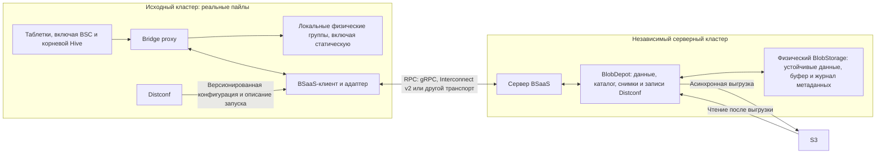

# RFC 195: резервное копирование кластера через виртуальный пайл bridge

| Поле | Значение |
| --- | --- |
| Статус | На обсуждении |
| Дата | 2026-11-13 |
| Область | BSaaS, bridge, внешнее резервное хранилище, восстановление кластера |
| Проверенная ревизия | `0db329fec7d8b2329ae34f33df8dc495e07893fa` |

## 1. Суть предложения

Штатный режим bridge реплицирует данные между пайлами одного кластера YDB. Каждый такой
пайл имеет собственные узлы, диски и системные службы и может стать основным при
переключении. Это полезно для отказоустойчивости, но не заменяет независимую резервную
копию: ресурсы хранения остаются частью того же кластера, а восстановление после потери
всех рабочих пайлов требует отдельного протокола.

Предлагаются два связанных, но разных механизма:

1. **BSaaS (BlobStorage as a Service)** — общая возможность обслуживать группу
   BlobStorage через RPC в другом кластере. Одни логические группы исходного кластера
   могут быть локальными, другие — удалёнными. BSaaS должен работать и для целой обычной
   группы вне bridge; резервное копирование — лишь одно из его применений.
2. **Виртуальный резервный пайл** — применение BSaaS к bridge. У защищаемой bridge-группы
   появляется часть в таком пайле, но запросы к ней обслуживает не локальный VDisk,
   а внешний сервис. В исходном кластере у виртуального пайла нет узлов, дисков,
   StateStorage, Board и SchemeBoard. Он не может стать `PRIMARY` или `PROMOTED` и поэтому
   не обеспечивает обычный failover.

Внешний сервис работает в **независимом серверном кластере** со своими ресурсами и службами
управления. Для реализации сервера резервирования в этом RFC выбирается BlobDepot:
предлагается расширить его приёмом данных и записей Distconf, каталогом копий,
согласованными снимками и удержанием версий. Реплицируемые физические группы серверного
кластера должны обеспечивать устойчивое подтверждение данных и метаданных; основной объём
данных может затем асинхронно выгружаться в S3. Это требования к предлагаемой реализации,
а не описание уже готовой функциональности BlobDepot. Общий протокол BSaaS не обязан
использовать BlobDepot в других сценариях.

Для виртуального пайла предусматриваются:

- синхронный режим, использующий состояние `SYNCHRONIZED`: защищаемая запись подтверждается
  только после устойчивого подтверждения внешним сервисом;
- асинхронный режим, аналогичный предлагаемому `HOT_STANDBY`: записи доставляются фоном,
  поэтому гарантированной точкой восстановления является опубликованный согласованный
  снимок, а не произвольное текущее содержимое копии.

После аварии выбранная копия переносится на новые реальные ресурсы с простоем. Согласованные
снимки позволяют выбрать точку восстановления, но не восстановление на произвольный момент
времени. Запуск баз до полного переноса данных относится к более позднему этапу.

**Статус текста.** Это проект, а не описание существующего API. Слово **должен** обозначает
требование к предлагаемой реализации. Раздел 4 отдельно описывает то, что уже есть в
проверенной ревизии. Имена `backup-only`, этапов и полей манифеста обозначают контракт RFC;
их окончательное представление в конфигурации и protobuf ещё предстоит определить.

## 2. Понятия, необходимые для чтения RFC

### 2.1. Данные и метаданные YDB

Подробные определения находятся в [глоссарии](ydb/docs/ru/core/concepts/glossary.md).
Здесь важны следующие различия:

- **Таблетка** — компонент YDB с персистентным состоянием. Пользовательские данные и
  метаданные системных компонентов хранятся таблетками в виде блобов и журналов изменений.
- **Блоб** — неизменяемая двоичная запись с идентификатором LogoBlobID. Запись журнала
  таблетки может ссылаться на блобы: при восстановлении нужны и запись, и все её подтверждённые
  зависимости.
- **Блокировки поколений** отсекают прежних владельцев таблетки. **GC (garbage collection)**
  удаляет ненужные блобы по барьерам и флагам `KEEP`/`DO_NOT_KEEP`. Блокировки, барьеры и флаги —
  часть состояния группы, без которой нельзя корректно скопировать только сами байты блобов.
- **Группа BlobStorage** — независимый репозиторий блобов. Обычная физическая группа состоит
  из нескольких **VDisk** — компонентов, хранящих её данные на выделенных дисках. Динамическими
  группами управляет **BSC (BS Controller)**. Пул хранения описывает ресурсы, из которых
  выделяются группы; пул и пайл — не одно и то же.
- **Статическая группа** создаётся при начальном развёртывании и хранит состояние системных
  таблеток, включая BSC и корневой Hive. Её конфигурацией управляет Distconf, а не BSC.
- **Hive** запускает и размещает таблетки. Корневой Hive управляет системными таблетками.
- **Distconf** распространяет и сохраняет конфигурацию, необходимую для запуска статических
  узлов, статических групп и StateStorage. Он стартует до BSC и других системных таблеток.
- **StateStorage, Board и SchemeBoard** распространяют служебные метаданные и участвуют в
  выборах лидеров и обнаружении сервисов. Их конфигурацию нужно сохранить, но временные
  регистрации и прежние лидеры не являются содержимым физического бэкапа: при восстановлении
  эти сервисы создаются заново на реальных узлах.

Поэтому копии только пользовательских динамических групп недостаточно. Для самостоятельного
запуска нужны статическая группа, конфигурация Distconf и минимальные сведения о том,
как найти внешнюю копию до запуска BSC.

### 2.2. Bridge

[Bridge](ydb/docs/ru/core/concepts/bridge.md) делит узлы одного кластера на **пайлы (piles)**.
Пайлы — не независимые кластеры: у них общие логические базы и таблетки.

Логическая **bridge-группа** объединяет части одной группы в разных пайлах. У каждой части
свой физический group ID и поколение. **Bridge proxy** предоставляет таблетке единый интерфейс
и направляет операции в нужные части; **синхронизатор** переносит недостающие блобы, блокировки,
барьеры и флаги между частями.

- `PRIMARY` — пайл, в котором запускаются таблетки. В проверенной модели он должен быть
  `SYNCHRONIZED`.
- `PROMOTED` — синхронизированный пайл, выбранный для плановой смены `PRIMARY`.
- `SYNCHRONIZED` — полностью синхронизированный пайл, участвующий в требуемых кворумах данных
  и конфигурации. В обычном bridge защищаемая запись выполняется синхронно в такие части.
- `NOT_SYNCHRONIZED` и связанные внутренние стадии описывают возврат и синхронизацию части.
  Пока процесс не завершён, такая копия не считается полной.

Обычный `rejoin` возвращает пайл в кластер, у которого уже есть работающий `PRIMARY`.
Это ограничение станет важным при восстановлении после потери всех реальных пайлов (раздел 9).

### 2.3. Новые сущности

- **BSaaS** — удалённое выполнение операций группы BlobStorage. RPC (remote procedure call)
  здесь означает только способ вызова операций в другом кластере; сам транспорт не создаёт
  гарантий сохранности или согласованности. Сетевой адрес сервиса называется **endpoint**.
- **Виртуальный резервный пайл** — новая сущность конфигурации bridge, представляющая внешние
  части защищаемых групп. Слово «виртуальный» означает отсутствие локальных узлов и VDisk
  у частей этого пайла.
- **Серверный кластер** — независимый кластер, который реализует BSaaS и владеет физическими
  ресурсами резервного хранилища. Он не становится ещё одним пайлом исходного кластера.
- **Восстанавливаемый кластер** — новые реальные ресурсы, на которых после аварии поднимается
  защищённое состояние. Это не произвольный действующий кластер, в который импортируется база.
- **Снимок** — неизменяемая согласованная копия защищаемого набора. **Манифест** — устойчиво
  сохранённое описание снимка: его состав, граница, версии и зависимости.

Не следует смешивать виртуальный **пайл** с уже существующей виртуальной **группой**
BlobDepot. Первая сущность относится к топологии bridge; вторая предоставляет интерфейс
группы и может хранить её данные в других группах или S3. RFC использует вторую как один из
строительных блоков сервера, но вводит первую отдельно.

## 3. Цели и границы

### 3.1. Цели

- Позволить отдельным группам работать через BSaaS, включая смешанное использование локальных
  и удалённых групп; применить эту возможность к резервным частям bridge-групп.
- Восстанавливать выбранные базы и необходимые системные данные после потери рабочих пайлов,
  включая потерю всех узлов исходного кластера.
- Не выделять для резервного пайла узлы, диски или StateStorage в исходном кластере.
- Отделить ресурсы и эксплуатацию резервного хранилища от исходного кластера.
- Явно определить гарантии синхронного и асинхронного режимов, согласованные точки
  восстановления, срок хранения и поведение при отказах.
- Предусмотреть выборочное восстановление баз и последующее ускорение их запуска.

### 3.2. Не входит в первую версию

- Автоматический failover на резервный пайл: он не имеет вычислительных ресурсов и не может
  стать `PRIMARY`.
- Переносимость физического бэкапа между произвольными версиями YDB.
- Импорт отдельной базы в произвольный работающий кластер.
- Восстановление на любой момент времени между опубликованными снимками. Для него потребуются
  отдельный журнал изменений и протокол его воспроизведения.
- Запуск базы до переноса необходимых ей данных. Ленивое чтение рассматривается отдельно
  в разделе 9.3.
- Возможность читать копию напрямую из S3 без сервиса только потому, что данные выгружены
  в бакет. Для этого нужен отдельный документированный формат экспорта (раздел 8.3).

### 3.3. Что означает «бэкап кластера»

Этот термин обозначает восстановление общего системного состояния вместе с явно выбранным
набором баз. Если защищена только часть баз, охват должен быть виден в статусе и манифесте:
такая копия не содержит всех пользовательских данных кластера. Общие системные метаданные
могут также содержать сведения о невыбранных базах; это не означает, что их данные защищены
или что их разрешено запускать после восстановления.

## 4. Что уже существует и какие расширения нужны

### 4.1. Bridge

В проверенной ревизии [модель bridge](ydb/core/protos/bridge.proto) различает состояния
пайлов, поколения конфигурации и стадии синхронизации частей групп. `PRIMARY` и `PROMOTED`
должны указывать на пайл в состоянии `SYNCHRONIZED`. Состояние относится к пайлу, а не к базе:
его переключение влияет на все группы, имеющие часть в этом пайле.

[Контракты состояний](ydb/core/base/bridge.h) связывают участие в кворумах данных и
конфигурации: например, `SYNCHRONIZED` требует обоих. Для виртуального пайла это нельзя
использовать без изменений. Требование внешнего подтверждения данных необходимо отделить
от кворума узлов, распространения конфигурации, StateStorage и Board реальных пайлов.

В обычном bridge чтения могут отправляться в обе синхронизированные части, а конфигурация
и запуск таблеток связаны с физическими пайлами. Новая роль должна учитываться в Distconf,
BSC, маршрутизации proxy, размещении синхронизаторов и определении доступных узлов. Hive и
обнаружение клиентских endpoint не должны ожидать вычислительных узлов резервного пайла.
См. [описание реализации bridge](ydb/docs/ru/core/contributor/bridge.md) и
[bridge proxy](ydb/core/blobstorage/bridge/proxy/bridge_proxy.cpp).

Проверенная ревизия уже поддерживает смешанные обычные и bridge-пулы при включённом
`NonUniformStorageEnabled`. Это помогает ограничить защиту выбранными пулами, но не реализует
удалённые группы или виртуальный пайл: каждая существующая часть bridge-группы по-прежнему
связана с реальными ресурсами пайла.

Включение виртуального пайла требует проверки совместимости узлов с новой конфигурацией и
интерфейсом сервиса. Узел, который не поддерживает эту роль, не должен обслуживать защищаемые
группы, ошибочно считая их обычными bridge-группами. Существующий механизм уровня возможностей
(feature level) в реестре пайлов является основой для такой проверки.

### 4.2. `HOT_STANDBY`

`HOT_STANDBY` предлагается в [draft PR #57906](https://github.com/ydb-platform/ydb/pull/57906),
который на 2026-11-13 открыт и не входит в проверенную ревизию. По описанию PR, такой пайл
получает фоновые записи, не обслуживает чтения и таблетки и периодически сверяется с
синхронизированными частями. При превышении лимита незавершённых фоновых записей они могут
отбрасываться; пропуски учитываются и требуют сверки перед быстрым возвратом в
синхронизированное состояние.

Для внешнего сервиса полезна именно эта семантика фоновой доставки и сверки. Сам PR не
реализует ни виртуальный пайл без узлов, ни внешнее долговременное хранилище, ни согласованные
снимки всего защищаемого набора.

### 4.3. BlobDepot и S3

BlobDepot — выбранная основа сервера резервирования, а не готовый сервер BSaaS. Существующий
[агент виртуальной группы](ydb/core/blob_depot/agent/query.cpp) принимает операции BlobStorage,
включая записи, чтения, блокировки, GC и проверку целостности. Однако внешнее назначение частей
групп, изоляция пространств, каталог копий и устойчивые записи Distconf требуют нового протокола
и адаптера. Если за виртуальной группой нет физической группы, текущий обработчик `Assimilate`
возвращает ошибку; для синхронизации и восстановления внешней копии нужен отдельный эквивалент
перечисления состояния.

[Конфигурация BlobDepot](ydb/core/protos/blob_depot_config.proto) уже предусматривает
синхронный и асинхронный режимы S3. В асинхронном режиме данные сначала записываются в обычный
канал, а затем должны выгружаться в S3. При этом в проверенной ревизии
[асинхронный uploader](ydb/core/blob_depot/s3_upload.cpp) содержит незавершённые обработчики
ошибок чтения и ответа S3, включая пустой обработчик успешной загрузки. Поэтому нельзя считать
выгрузку, смену расположения и последующее освобождение локальной копии готовым механизмом
с требуемыми гарантиями. Все они относятся к предлагаемой реализации.

## 5. Архитектура

### 5.1. Компоненты и путь запроса

Рабочие таблетки обращаются к bridge proxy. Proxy направляет запросы в локальные части и через
BSaaS-клиент — во внешнюю часть. Адаптер и синхронизаторы работают на реальных узлах исходного
кластера. Distconf дополнительно сохраняет версии конфигурации и загрузочного описания через
тот же логический интерфейс BSaaS, но внешний сервис не входит в конфигурационный кворум.

Метаданные BSC и корневого Hive попадают во внешнюю копию обычными записями их таблеток в
статическую группу. Отдельный логический экспорт их таблиц не требуется. Напротив, Distconf
запускается до этих таблеток и должен сохраняться отдельной версионированной записью.

Сервер BSaaS направляет данные и записи Distconf в BlobDepot. Для изменяемого каталога, версий
конфигурации, снимков и управления их временем жизни нужен устойчивый слой состояния; один
интерфейс записи блобов в физические группы этот протокол не реализует. В данном RFC таким
слоем служит BlobDepot с предлагаемыми расширениями.

### 5.2. Границы кластеров и адресация

Архитектура разделяет четыре уровня:

| Уровень | Ответственность |
| --- | --- |
| Адресация и адаптер в исходном кластере | Выбрать обычный или BSaaS-маршрут; для bridge направить запрос во внешнюю часть группы. |
| RPC и транспорт | Передать операции и результаты с сохранением их семантики. gRPC, Interconnect v2 или другой транспорт выбирается отдельно. |
| Независимый серверный кластер | Проверить сервис, пространство и владельца; направить данные и записи Distconf в BlobDepot; использовать собственные службы управления. |
| Хранилище сервера | Хранить данные, каталог и версии; обеспечить устойчивые подтверждения и при настроенной политике асинхронно выгружать данные в S3. |

Соответствие «логический group ID исходного кластера → сервис → пространство → серверная
группа» хранится явно. Локальные группы сохраняют обычный маршрут. Идентификаторы и поколения
групп двух кластеров не обязаны совпадать: адаптер и сервер согласуют отображение и версию
назначения отдельно от внутренних поколений серверного BSC.

Пространство исходного кластера изолирует блобы, блокировки таблеток и GC: совпадающие tablet ID
в разных кластерах не должны влиять друг на друга. Endpoint — лишь сетевой адрес сервиса, а не
идентичность данных. Смена транспорта или endpoint не должна менять идентичность пространства.
При недоступности сервера нельзя незаметно перенаправить новые записи обычной удалённой группы
в локальное хранилище.

Серверный кластер имеет собственные BSC, Hive, StateStorage и Board. Их запуск и доступность
не зависят от исходного кластера; узлы сервера не включаются в его топологию и кворумы. Выбор
Interconnect v2 как транспорта не объединяет кластеры.

### 5.3. Виртуальная роль `backup-only`

В конфигурации с включённым резервированием есть один или несколько реальных рабочих пайлов
и виртуальный резервный пайл. Для последнего вводится роль `backup-only`, отдельная от состояния
синхронизации. Назначение роли, участие в синхронном подтверждении и внутренняя политика
хранения внешнего сервиса — три независимых понятия.

Для `backup-only` обязательны правила:

- Запрещены назначение `PRIMARY`/`PROMOTED`, запуск таблеток и наличие узлов исходного кластера
  в виртуальном пайле. Это не ограничивает устройство серверного кластера.
- Для него не создаются StateStorage, Board, SchemeBoard и кворумы узлов исходного кластера.
- Конфигурацию кластера сохраняют и согласуют реальные пайлы; внешний сервис не становится
  участником этого кворума даже в `SYNCHRONIZED`.
- В `SYNCHRONIZED` успешная защищаемая запись требует устойчивого подтверждения сервиса.
- В `HOT_STANDBY` доставка выполняется фоном; сбои и пропуски должны учитываться и устраняться
  сверкой до выдачи сильной гарантии.
- В `SYNCHRONIZED` полная внешняя копия может участвовать в доверенных чтениях через адаптер.
  Политика может предпочитать реальные пайлы по задержке и стоимости.
- В `HOT_STANDBY` обычные чтения текущего состояния запрещены. Чтения для сверки и чтения
  неизменяемого снимка выполняются в отдельном явно заданном контексте.

Внешний сервис получает конфигурацию своего пространства данных и её поколение через BSaaS.
Доступность сервиса определяется запросами к его endpoint и состоянием операций, а не наличием
узлов виртуального пайла в исходном кластере.

Один реальный пайл с виртуальной копией получает защиту данных, но не резервные вычислительные
ресурсы и независимые службы управления самого исходного кластера. После потери реального пайла
требуется восстановление, а не переключение на виртуальный.

### 5.4. Организация хранения на сервере

Для каждой защищаемой группы определяется отдельное логическое пространство во внешнем сервисе.
Это не требует отдельной таблетки, процесса или физических ресурсов на группу. BSC и Distconf
должны уметь описывать внешнюю часть группы без VDisk и списка узлов; для статических групп
нужен такой же способ конфигурации.

Сервер BSaaS может направлять запросы в одну или несколько таблеток BlobDepot. Одна таблетка
на группу не предписывается. Однако при нескольких таблетках снимок всё равно требует общей
границы согласованности (раздел 8): единая точка приёма RPC сама по себе не обеспечивает
атомарный снимок.

В предлагаемой конфигурации BlobDepot быстрое локальное подтверждение означает устойчивое
сохранение данных и метаданных в реплицируемом BlobStorage серверного кластера. Оно не означает,
что копия уже находится в S3. Последующая агрегация и выгрузка скрыты за BSaaS, но не могут
ослабить выданное подтверждение: пока новое расположение и связанные метаданные не зафиксированы
устойчиво, единственная предыдущая копия не освобождается.

### 5.5. Базовый протокол BSaaS и расширения для резервирования

Базовый BSaaS предоставляет операции группы BlobStorage. Для резервного копирования поверх него
нужны снимки, каталог, удержание и согласованное сохранение внешнего описания запуска. Сам по
себе удалённый доступ к группе ещё не является системой резервного копирования.

Следует определить версионируемый интерфейс с такими возможностями:

| Область | Требование |
| --- | --- |
| Адресация | Идентификаторы сервиса, исходного кластера, группы, снимка и эпохи восстановления; изоляция пространств. Endpoint задаёт адрес, но не идентичность данных. |
| Совместимость и доступ | Согласование возможностей и форматов; аутентификация и авторизация чтения, записи, создания и удаления снимков. |
| `Put`, `Patch` | Запись данных и необходимых метаданных с явной границей устойчивого подтверждения. Для `Patch` допустимо эквивалентное преобразование адаптером при согласовании возможностей. |
| Поколения | Проверка поколений конфигурации и владельца, отклонение устаревших запросов; эквивалент защиты `ForceGroupGeneration`, которая позволяет получателю отклонять запросы с неправильным поколением части. |
| Повторы | Идемпотентная обработка повторов после тайм-аута: неизвестный клиенту результат не означает, что операция не выполнена. |
| `Get`, `Range`, `Discover` | Чтение блобов и поиск в явно заданном контексте текущей полной копии либо снимка; сохранение семантики результатов BlobStorage. |
| `Status`, `CheckIntegrity` | Получение состояния группы и проверка целостности внешней копии, включая данные после перемещения в S3. |
| `Block`, `GetBlock`, GC | Устойчивые блокировки поколений, GC-барьеры и флаги `KEEP`/`DO_NOT_KEEP`. Блокировки отсекают прежних владельцев таблетки; барьеры и флаги определяют, какие блобы нужно сохранить или можно удалить. |
| Эквивалент `Assimilate` | Согласованное постраничное перечисление блокировок, барьеров, блобов и флагов для первоначальной синхронизации, сверки и восстановления. |
| Состояние BSaaS | Создание пространств, согласование совместимости, подтверждённый прогресс и состояние обслуживания групп. |
| Расширение для резервирования | Каталог и фиксация снимков, сохранение Distconf и описания запуска, удержание данных и безопасное удаление с учётом активных восстановлений. |
| Нагрузка и ошибки | Ограничение потока, явные статусы перегрузки, недоступности и несовместимой конфигурации; различие отсутствующего блоба и ошибки чтения. |

Контракт должен покрывать все операции защищаемых групп, а не только передачу байтов. Конкретные
RPC, идентификаторы операций и форматы сообщений определяются отдельной спецификацией.

### 5.6. Выбор баз и замкнутый набор восстановления

Пользователь выбирает базы, но физическая репликация работает с группами. При включении защиты
система должна вычислить **замкнутый набор восстановления** — группы и системные зависимости,
без которых выбранные базы не запускаются:

- статическую группу с состоянием BSC, корневого Hive и других размещённых в ней системных
  таблеток;
- остальные группы выбранных баз и необходимых системных таблеток, включая группы системных
  таблеток, размещённых вне статической группы;
- данные, журналы, блокировки поколений, GC-барьеры и флаги сохранения всех этих групп;
- историю назначения каналов таблеток группам, чтобы при чтении старых блобов использовалась
  правильная группа.

Отдельно сохраняется только состояние исходного кластера вне защищаемого BlobStorage:
конфигурация Distconf и минимальное описание запуска — идентичность сервиса и пространства,
маршрут статической группы, ссылки на форматы и необходимые ключи. Устойчивый каталог самого
BSaaS — обязанность сервера, а не дополнительный экспорт метаданных Hive или BSC.

Distconf и описание запуска предлагается хранить версионированной служебной записью в том же
логическом потоке BSaaS. Начальный указатель на неё должен быть доступен без BSC исходного
кластера. Манифест и каталог содержат ссылки на ключи и правила доступа к ним, но не должны
незащищённо копировать секретные значения.

Для нулевой потери подтверждённых изменений необходимая версия Distconf и описания запуска
должна быть устойчиво доступна внешне до подтверждения зависящих от неё записей и согласована
с общей границей снимка. Независимый периодический экспорт этого не обеспечивает. Порядок
фиксации и активации версий требует протокола; сервер при этом не включается в конфигурационный
кворум Distconf.

Если группа общая для нескольких баз, её физическая копия содержит данные всех этих баз. Для
первой версии предпочтительны выделенные пулы защищаемых баз; иначе интерфейс должен явно
показывать фактический охват. Общие системные метаданные также могут содержать сведения о
других базах.

Создание групп, перенос каналов, включение и отключение защиты должны согласованно изменять
этот набор. Старые группы и история каналов сохраняются, пока они нужны снимкам. До завершения
начальной синхронизации и проверки зависимостей статус защиты — «подготавливается», а не
«активна».

## 6. Жизненный цикл защиты

### 6.1. Включение

1. Проверить версии узлов и сервиса, возможности протокола, аутентификацию и права. Зафиксировать
   устойчивые идентичности сервиса и пространств, отдельно от их сетевых адресов.
2. Вычислить замкнутый набор выбранных баз, включая статическую группу и историю каналов.
3. Описать в Distconf и BSC виртуальные части групп и отображение на серверные пространства.
   Не выделять для них узлы или VDisk исходного кластера.
4. Выполнить начальную синхронизацию: перечислить блокировки, барьеры, блобы и флаги, скопировать
   недостающее и проверить полноту внешнего описания Distconf и запуска.
5. Только после завершения и проверки считать внешнюю часть полной. До этого статус должен
   показывать подготовку и невозможность гарантированного восстановления текущего состояния.
6. Включить выбранный режим доставки. Возраст последнего опубликованного снимка и фактический
   охват защиты остаются отдельными показателями: полная текущая реплика ещё не означает наличие
   исторического снимка.

### 6.2. Обычная запись и чтение

В `SYNCHRONIZED` bridge proxy отправляет требуемые операции в локальные части и через адаптер
во внешнюю часть. Отправка может быть параллельной. Успех защищаемой записи возвращается только
после всех необходимых подтверждений, включая устойчивое подтверждение сервиса. Для изменения
конфигурации дополнительно действует порядок фиксации Distconf из раздела 5.6.

В `HOT_STANDBY` подтверждение клиенту определяется реальными пайлами, а копия во внешний сервис
отправляется фоном. Если в кластере есть другие реальные синхронизированные пайлы, их обычные
кворумы сохраняются. Переполнение очереди, тайм-аут или потерянный ответ не должны исчезать:
сервис и прокси учитывают возможные пропуски до сверки.

Обычное чтение текущего состояния может использовать внешнюю часть только в `SYNCHRONIZED`,
когда она признана полной. В `HOT_STANDBY` она не участвует в таких чтениях, поскольку может
не содержать свежих данных или содержать неполный набор зависимостей.

### 6.3. Изменение и отключение

Переход между режимами и отключение защиты выполняются только явной политикой. Статус должен
показывать момент прекращения синхронной защиты, необходимость сверки и последнюю сохранённую
точку. Недоступность сервиса не должна автоматически превращать синхронный режим в асинхронный.

Изменение политики применяется через конфигурационный кворум реальных пайлов и не ждёт
несуществующих узлов виртуального пайла. При смене идентичности сервиса или пространства,
а не только endpoint, прежний статус полной копии аннулируется до проверки и повторной
синхронизации.

## 7. Гарантии сохранности и влияние на нагрузку

### 7.1. RPO, RTO и модель отказов

**RPO (Recovery Point Objective)** — целевой максимальный объём потери последних изменений,
обычно выражаемый временным интервалом. **RPO = 0** означает, что в заявленной модели отказов
не теряются изменения, успешно подтверждённые защищаемой записью. **RTO (Recovery Time
Objective)** — целевое время восстановления работоспособности.

Гарантия всегда относится к конкретной модели отказов. В этом RFC основной отказ — потеря
рабочих пайлов исходного кластера при сохранении внешнего сервиса, его подтверждённых данных,
каталога и необходимых ключей. Катастрофа самого серверного кластера требует отдельной модели
и, возможно, дополнительной репликации.

`SYNCHRONIZED` описывает участие внешнего сервиса в подтверждении данных. Он не предписывает
его внутреннее устройство и не означает обязательную запись именно в S3.

| Доступное состояние после отказа | Гарантия |
| --- | --- |
| Полная текущая копия `SYNCHRONIZED`; защита была непрерывно включена; сервис сохранил все подтверждённые данные и согласованные с ними версии Distconf | В заявленной модели отказов RPO = 0 для защищаемого набора: все подтверждённые изменения доступны для восстановления. Перед восстановлением текущего состояния фиксируется его устойчивая граница. |
| Опубликованный согласованный снимок | Гарантируется восстановление на границу снимка `N`. Возможная потеря определяется возрастом этой границы на момент отказа, включая интервал между снимками и время их публикации. |
| Только текущее содержимое `HOT_STANDBY`, без опубликованного снимка | Согласованное восстановление не гарантируется: пропуски данных и служебных записей могут быть произвольными. Нельзя обещать даже просто «более старую» целостную базу. |
| `HOT_STANDBY` и опубликованный снимок | Гарантируется восстановление снимка. Более свежие фоновые записи не входят в гарантию без отдельного протокола. |

Если сервис подтверждает запись во внутреннем устойчивом буфере, но заявленная модель отказов
допускает одновременную потерю этого буфера до выгрузки, такой контракт не даёт RPO = 0 для
данного отказа. Нужно либо усилить подтверждение, либо явно сузить гарантию.

### 7.2. Задержка, доступность и ресурсы

В `SYNCHRONIZED` запись ждёт сеть и устойчивое сохранение сервисом. Его недоступность,
перегрузка или исчерпание ресурсов ограничивает защищаемую запись. Внутренний буфер может
сократить задержку, но не устраняет сетевое ожидание и не заменяет гарантию сохранности.

Поэтому временный переход в `SYNCHRONIZED` ради снимка также влияет на рабочую нагрузку:
добавляются внешние подтверждения и сверка накопленных пропусков. Автоматически ослаблять
гарантию при деградации нельзя; допустим только явный переход с видимым статусом.

`HOT_STANDBY` уменьшает зависимость клиентского пути от сервиса, но требует ограничивать фоновые
ресурсы и измерять пропуски, отставание и стоимость сверки. Независимое переключение одной базы
между режимами потребовало бы нового механизма: исходная модель bridge задаёт состояние всего
пайла.

Наконец, сохранность копии не означает маленький RTO. В первой версии после потери реальных
пайлов нужно выделить ресурсы, запустить системные службы и перенести данные, поэтому
восстановление происходит с простоем.

## 8. Согласованные снимки

### 8.1. Что делает снимок согласованным

Снимок — неизменяемый набор данных и метаданных, достаточный для восстановления заявленных баз
и общего системного контекста. В установившемся `SYNCHRONIZED` его можно инициировать в любой
момент без общей остановки транзакций, если сервис обеспечивает следующие условия:

- Один **логически упорядоченный поток изменений** охватывает все защищаемые группы, включая
  статическую: данные, журналы, блокировки и GC. С ним согласуются версии Distconf и описания
  запуска, находящиеся вне BlobStorage. Отдельные снимки логических таблиц Hive, BSC или других
  таблеток не требуются.
- Порядок потока сохраняет зависимости, требуемые протоколом хранения. Подтверждение операции
  означает её устойчивую фиксацию, а не только приём запроса.
- Снимок фиксирует единый полностью применённый непрерывный префикс `1..N` этого потока для всех
  участников. Операции до `N` либо полностью представлены со всеми зависимостями, либо снимок не
  публикуется; эффекты операций после `N` в него не попадают.
- Состояние префикса устойчиво закреплено и неизменяемо. Последующие записи и GC используют
  другие версии или корни; копирование при записи, многоверсионность либо эквивалентный механизм
  сохраняет выбранный срез.

Одна физическая связь или gRPC channel этих условий не обеспечивают. gRPC гарантирует порядок
сообщений внутри отдельного потокового RPC, но сам по себе не упорядочивает разные RPC и
завершение их параллельной обработки. См. [основные понятия gRPC](https://grpc.io/docs/what-is-grpc/core-concepts/).

Рассмотрим пример без общей границы. Пусть `Gdata` хранит блобы данных, а `Glog` — записи
журнала, которые на них ссылаются:

1. Сервис скопировал текущее состояние `Gdata`.
2. Записал и подтвердил новый блоб `D` в `Gdata`.
3. Записал и подтвердил в `Glog` запись `L`, которая требует `D` при восстановлении.
4. Скопировал состояние `Glog`.

В объединённой копии есть `L`, но нет `D`, хотя записи выполнялись в указанном порядке и пайл
оставался `SYNCHRONIZED`. Общий префикс `1..N` не разрешает включить `L`, исключив более раннее
`D`.

При выполнении условий снимок пригоден для штатного восстановления после аварии
(**crash-consistent**): незавершённые транзакции допустимы и разрешаются восстановлением. Это не
транзакционный снимок приложения на выбранную метку времени YDB. Гарантия также требует
замкнутого набора зависимостей и корректного протокола восстановления: единый поток не исправляет
пропущенные метаданные или данные вне набора. Единый поток — достаточная модель, но допустим и
эквивалентный распределённый атомарный снимок.

Это согласуется с существующим [протоколом записи журнала](ydb/core/tablet/tablet_req_writelog.cpp):
блобы, на которые ссылается запись, и сама запись отправляются без ожидания каждого предыдущего
ответа, но успех возвращается после всех записей.
[Восстановление истории](ydb/core/tablet/tablet_req_rebuildhistory.cpp) проверяет ссылки и
зависимости и может отбросить неполный неподтверждённый хвост. Оно не разрешает терять данные
подтверждённой истории и не заменяет проверку согласованности всего набора групп.

### 8.2. Протокол создания и публикации

1. Зафиксировать операцию снимка и версию защищаемого набора, включая статическую группу и
   согласованное описание Distconf.
2. При `HOT_STANDBY` включить синхронную доставку предусмотренным протоколом и дождаться полной
   сверки групп, отсечения устаревших писателей и подтверждения отсутствия пропусков на общей
   границе. Простой смены значения состояния недостаточно.
3. Поместить маркер снимка в общий поток; маркер выбирает границу `N`. Дождаться завершения всех
   операций до неё и устойчиво закрепить версии групп и внешнего описания запуска. Более поздние
   операции могут исполняться параллельно, только если их эффекты отделены от снимка. Для
   отделения версий допустима краткая остановка применения операций сервисом, но не общее
   завершение всех транзакций YDB.
4. Проверить полноту зависимостей и требования сохранности снимка. Внутренний перенос в S3, если
   он необходим, не требует остановки новых записей. Возврат в `HOT_STANDBY` допустим после
   устойчивого закрепления снимка, которое будет учитываться последующим GC.
5. На последнем шаге атомарно опубликовать неизменяемый манифест со статусом `COMMITTED`.
   Только такая точка считается завершённым снимком с заявленной моделью сохранности.

До последнего шага предыдущий опубликованный снимок остаётся последней гарантированной точкой
данного класса. Сбой новой операции не заменяет и не повреждает его. Возможность инициировать
снимок в любой момент не означает мгновенное завершение: маркер ждёт предыдущие операции,
закрепление версий и требуемую устойчивость.

### 8.3. Манифест, хранение и удаление

Манифест содержит:

- идентификаторы исходного кластера и снимка;
- требования к версии YDB, форматам и возможностям сервиса;
- выбранные базы и полный набор зависимостей, групп и истории каналов;
- границу `N`, эпоху потока, конфигурации и поколения;
- ссылку на неизменяемое представление данных;
- контрольные суммы или эквивалентные средства проверки;
- ссылки на ключи и сведения для первоначального запуска;
- для инкрементального снимка — явные зависимости от базовых снимков.

Внешнее представление данных может быть непрозрачным идентификатором снимка сервиса. Если
заявляется восстановление напрямую из S3 без сервиса, дополнительно необходимы документированный
формат экспорта, каталог и совместимый инструмент чтения. Наличие объектов в бакете само по себе
этой возможности не создаёт.

GC живой реплики не должен удалять данные сохранённых снимков. Сервис удерживает данные и
соответствующие версии блокировок, барьеров и флагов, пока существуют ссылки от живого состояния,
снимков или активных восстановлений. Новые `DO_NOT_KEEP` и барьеры не применяются к историческому
снимку так, как они применяются к текущей реплике.

Удаление снимка должно быть возобновляемым: сначала снимок исключается из доступных точек, затем
освобождаются ссылки и только после этого физически удаляются данные. Активное восстановление
удерживает нужные ссылки. Для защиты от ошибочного удаления полезны отдельные права и
поддерживаемая сервисом политика неизменяемости с согласованным сроком хранения.

## 9. Восстановление

### 9.1. Почему нужен специальный первоначальный запуск

После потери всех реальных пайлов у исходного кластера нет работающего `PRIMARY`, Distconf,
StateStorage, Hive и BSC. Виртуальный пайл не может заменить их: у него нет вычислительных узлов,
и ему запрещено становиться `PRIMARY`. Обычный `rejoin` неприменим, потому что он синхронизирует
пайл с уже существующим полным `PRIMARY`.

Нужен независимый **загрузочный комплект**, доступный без исходного кластера:

- выбранный манифест либо описание закреплённого текущего состояния;
- идентичность сервиса BSaaS и пространства, endpoint и необходимые учётные данные или ссылки
  на них;
- маршрут к внешней статической группе;
- согласованная версия Distconf;
- ссылки на форматы и ключи, необходимые для чтения копии.

Состояние BSC и корневого Hive уже содержится в сохранённой статической группе; их логические
таблицы отдельно не выгружаются. StateStorage, Board и SchemeBoard создаются на новых реальных
узлах по сохранённой конфигурации. Временные регистрации, прежние лидеры и их полномочия не
переносятся как действующее состояние.

### 9.2. Последовательность восстановления

1. **Изолировать восстановление.** Новые ресурсы не должны принимать записи прежних узлов и
   клиентов. Операция получает отдельную идентичность и эпоху; прежний владелец не должен писать
   в новый экземпляр.
2. **Выбрать и закрепить источник.** Это опубликованный снимок либо полное текущее состояние
   сервиса. Для текущего состояния сначала фиксируется устойчивая граница. Нельзя смешивать свежие
   метаданные текущего состояния со старым снимком без доказанной совместимости. Источник
   удерживается от удаления на всю операцию.
3. **Проверить исходные данные и подготовить ресурсы.** Проверяются сервис, ключи, версии,
   целостность и замкнутость зависимостей. Загрузочный комплект должен быть получен без исходного
   кластера. Выделяются новые узлы, диски и реальные пайлы.
4. **Подготовить пустую управляющую инфраструктуру.** На новых узлах запускается Distconf из
   загрузочного комплекта; по сохранённой конфигурации создаются реальные пайлы, StateStorage,
   Board и SchemeBoard, а также согласованная карта старых и новых идентификаторов. Новые диски
   и узлы допустимы, но несвязанный логический кластер сам не обнаружит прежние tablet ID,
   group ID и историю каналов: их нужно сохранить или согласованно преобразовать.
5. **Восстановить статическую группу.** Специальный режим назначает выбранную внешнюю копию
   источником восстановления, не делая виртуальный пайл `PRIMARY` и не объявляя пустой рабочий
   пайл полной копией. Доступ к внешней статической группе работает по загрузочному описанию до
   запуска BSC. Данные переносятся в новую реальную статическую группу.
6. **Запустить системные таблетки и восстановить остальные группы.** Из статической группы штатно
   поднимаются BSC, корневой Hive и другие размещённые там таблетки. Затем по карте идентификаторов
   восстанавливаются остальные группы выбранных баз и необходимых системных таблеток.
7. **Проверить и открыть кластер.** После проверки целостности и завершения перехода рабочих групп
   в обслуживающее состояние готовый реальный пайл назначается `PRIMARY`. Разрешаются выбранные
   базы и подключение клиентов; политика резервирования включается заново для новой конфигурации.

Право менять конфигурацию на новых реальных узлах должно быть определено явно, без назначения
внешнего сервиса `PRIMARY`. При откате на снимок поколения и эпоха восстановления должны отсекать
старые узлы и писателей. Прерванная операция возобновляется или безопасно отменяется, не оставляя
частично восстановленную базу доступной как успешно восстановленную.

### 9.3. Выборочное и ленивое восстановление

Общие системные зависимости восстанавливаются раньше баз. Невыбранные и незащищённые базы
получают административный статус, запрещающий запуск их таблеток; циклические попытки старта не
являются приемлемым результатом. Общие группы ограничивают независимость физического переноса и
должны учитываться в плане.

В первой версии база запускается после переноса всего необходимого ей набора данных на рабочие
ресурсы. Перенос остальных баз может продолжаться, если общие службы допускают такое разделение.
Импорт одной базы в другой действующий кластер — отдельная задача.

Ленивое восстановление относится к следующему этапу. В нём локальное состояние содержит новые
записи, а недостающие старые блобы читаются из закреплённого неизменяемого источника. Объединённое
представление должно корректно поддерживать `Get`, `Range`, `Discover`, блокировки и GC. Источник
удерживается до проверенного окончания фонового переноса; ошибка сервиса не превращается в ответ
об отсутствии блоба.

«Доступно до полной загрузки» означает отдельный момент готовности после восстановления системных
служб и метаданных. Нужно измерять как RTO, так и задержку холодных чтений; мгновенная доступность
не следует из одного наличия внешней копии.

## 10. Эксплуатация и отказы

| Ситуация | Требуемое поведение |
| --- | --- |
| Внешний сервис недоступен в `SYNCHRONIZED` | Не подтверждать записи без требуемой копии. Изменение политики возможно через конфигурацию реальных пайлов с явным изменением гарантии. |
| Внешний сервис недоступен или перегружен в `HOT_STANDBY` | Ограничивать фоновые ресурсы, учитывать пропуски и требуемую сверку; сохранять опубликованные снимки. |
| Ответ сервиса потерян после записи | Безопасно повторить запрос с сохранением идентичности операции; не считать тайм-аут доказательством отсутствия записи. |
| По прежнему endpoint доступен сервис с пустым или другим пространством | Обнаружить смену идентичности или потерю полноты; не сохранять статус `SYNCHRONIZED` без проверки и повторной синхронизации. |
| Сервис переносит данные между внутренними уровнями | Сохранять силу выданных подтверждений; не требовать от YDB управления его буфером или дисками. |
| Потерян координатор снимка | Возобновить или отменить операцию; неполную точку не публиковать, предыдущую сохранить. |
| Потеряны все рабочие узлы | Восстановить реальную инфраструктуру из внешнего загрузочного комплекта и выбранной копии. |
| Повреждены данные или недоступен ключ | Сообщить конкретную невосстановимую зависимость; не объявлять базу успешно восстановленной. |
| Снимок удаляется во время восстановления | Сохранять данные до освобождения ссылок активной операции. |

Мониторинг должен показывать:

- фактический охват защиты и состояние начальной синхронизации;
- доступность и идентичность сервиса;
- задержку устойчивых подтверждений;
- отставание и пропуски фоновой доставки, потребность в сверке;
- последнюю согласованную точку и её возраст;
- ошибки целостности и доступности ключей;
- прогресс и результат восстановления.

Внутренние ёмкость и очереди сервиса могут быть дополнительными метриками. Его публичный контракт
обязан сообщать перегрузку и актуальную гарантию независимо от реализации.

Нужны периодические пробные восстановления в изолированный кластер. Проверка наличия объектов
полезна, но не заменяет запуск системных служб и выбранных баз, проверку данных и доступа к ключам.

## 11. План реализации и критерии приёмки

### 11.1. Этапы

1. **Общий BSaaS.** Определить базовый протокол и отображение групп, выбрать транспорт, реализовать
   адаптер и сервер с маршрутизацией в BlobDepot. Проверить смешанные локальные и удалённые группы
   вне bridge, независимость кластеров и устойчивые подтверждения.
2. **Минимальный синхронный резервный пайл.** Отделить подтверждения данных от кворумов реальных
   узлов, расширить BlobDepot устойчивыми записями Distconf и описания запуска, включить статическую
   группу. Реализовать внешние части групп, начальную синхронизацию, выгрузку в S3 и восстановление
   текущего состояния после потери всех рабочих пайлов. `HOT_STANDBY` на этом этапе необязателен.
3. **Исторические снимки.** Реализовать маркер общего префикса, устойчивое закрепление версий и
   каталог снимков в BlobDepot, атомарную публикацию манифеста, проверку целостности и восстановление
   выбранной точки.
4. **Асинхронный режим и выбор баз.** Реализовать фоновые записи, сверку, переход к согласованному
   снимку, изменение состава защиты и выборочный запуск баз.
5. **Ускорение восстановления.** Добавить ленивое чтение и фоновый перенос; оценить независимые
   политики по базам и инкрементальные снимки.

### 11.2. Приёмка BSaaS и хранилища

Проверяются:

- одинаковая семантика локального и удалённого маршрутов и их совместная работа;
- независимые идентификаторы и поколения кластеров;
- идемпотентный повтор после потери ответа;
- запуск серверного кластера без клиента;
- чтение и восстановление из BlobDepot до и после выгрузки в S3;
- сбой в момент смены расположения без потери единственной подтверждённой копии;
- перезапуск таблетки с сохранением каталога, версий Distconf и уже подтверждённых данных;
- корректное различие отсутствующих данных, ошибки чтения и недоступности сервиса.

### 11.3. Приёмка резервирования и восстановления

Сценарии проверяют:

- отсутствие узлов, дисков и собственных кворумов резервного пайла;
- потерю рабочих пайлов сразу после подтверждения записи и потерю всех узлов исходного кластера;
- отсечение устаревших поколений и прежних владельцев;
- повторы после потери ответа;
- подмену пространства данных за тем же endpoint;
- несовместимую версию узла;
- недоступность сервиса и изменение политики через реальные пайлы;
- транзакции, изменения схемы и перенос каналов во время снимка;
- сбой до и после публикации манифеста;
- GC при удерживаемом снимке и попытку удаления снимка во время восстановления;
- повторный запуск прерванного восстановления;
- запрет назначения виртуального пайла `PRIMARY` и запрет запуска невыбранных баз.

Результат проверяется на уровне баз и служебного состояния, а не только по числу переданных блобов.

Для снимков дополнительно проверяются зависимость «данные — ссылающаяся запись журнала» в разных
группах по обе стороны маркера, задержанная операция до маркера при быстром выполнении последующей,
GC во время закрепления версий и перезапуск до публикации `COMMITTED`. Снимок не должен содержать
смесь разных префиксов или терять закреплённые данные.

## 12. Альтернативы и открытые вопросы

### 12.1. Альтернативы

- **Логический экспорт** проще отделить от исходной топологии и удобнее для переноса отдельных баз,
  но он не восстанавливает физическое системное состояние кластера.
- **Полноценный рабочий bridge-пайл** даёт более быстрое переключение и резервные вычислительные
  ресурсы, но требует полноценной инфраструктуры YDB и остаётся частью того же кластера.
- **Виртуальный пайл** позволяет независимо реализовать хранилище и разделить эксплуатацию, но не
  устраняет необходимость строгого контракта подтверждения, согласованных метаданных и специального
  восстановления.

### 12.2. Открытые вопросы

До реализации необходимо решить:

1. Как представлены виртуальная часть группы и её состояние в BSC, Distconf и proxy, чтобы
   существующие проверки не ожидали узлы и кворумы резервного пайла?
2. Каковы точная модель отказов сервиса, граница устойчивого подтверждения, версия протокола,
   защита поколениями и семантика повторов?
3. Как согласуются версии Distconf и минимального описания запуска с подтверждениями данных и
   границей снимка? Как открыть сохранённую статическую группу до запуска BSC?
4. Как распределяются пространства по таблеткам BlobDepot и как обеспечить для них общий префикс
   и сохранение зависимостей: единым порядком изменений или распределённым атомарным снимком?
   Где возникает ограничение производительности упорядочивания, как отделяются версии и
   восстанавливается незавершённый маркер? Используется ли существующий синхронизатор с адаптером
   или отдельный импортёр?
5. Какие физические пулы и наборы баз поддерживает первая версия? Как изолируются невыбранные базы
   и как интерфейс показывает случайно захваченные общими группами данные?
6. Какие версии и форматы совместимы, каковы сроки хранения снимков и ключей, целевые RPO и RTO?
   Требуется ли автономный экспорт для чтения без исходного сервиса?
7. Какой транспорт BSaaS выбрать: gRPC, Interconnect v2 или другой? Выбор требует проверки семантики,
   совместимости и измерений; преимущества по задержке или пропускной способности заранее не
   предполагаются. Как отображаются клиентские группы и поколения на серверные?
