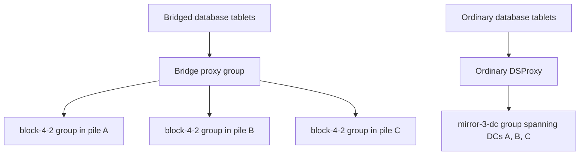

# Non-uniform bridge clusters in YDB

Design exploration based on source inspection of checkout `c946cc018e2`, followed by the selected scope and implementation checklist. Implementation at `87fd43406da` on `bridge/non-uniform-cluster` passed 18 selected C++ checks on remote `qa4`; the database functional test passed on an unchanged retry after a bootstrap timeout.

## Implementation status

The current source changes implement the pool-level interface and allocation path:

- `TDefineStoragePool.BridgeMode` is optional. BSC resolves it from the request or cluster default when creating a pool and persists only the existing resolved `BridgeMode` boolean. Updates that omit the field preserve the stored mode, conflicting values are rejected, and reads return the resolved mode. Ordinary pools may use any supported erasure, subject to normal geometry and eligible-disk constraints.
- `bridge_config.enable_non_uniform_storage: true` enables the feature. Activation is durable and irreversible: later configuration replacements must retain the flag. For an existing cluster, BSC bridge conversion must already be complete; native bridged bootstrap can enable it from the start.
- Activation raises the required bridge feature level to 3. Configuration replacement uses the existing connected-node capability check before raising that requirement. The persisted requirement also fences incompatible nodes on reconnect.
- After non-uniform storage activation, ordinary pools use explicit cross-pile placement for allocation, reassignment, repair, and allocation reserve checks. Physical geometry follows the pool's resolved mode: ordinary pools ignore the logical `BridgePileName` prefix during allocation, layout checking, and self-heal; actual `DataCenter`/rack levels and the nodes' pile labels remain intact. The cross-pile scope remains feature-gated to preserve legacy conversion behavior. Disconnected, inactive, and suspended piles are not new-placement targets.
- Group moves between different effective modes are rejected. Existing ordinary DSProxy/quorum behavior and the guard against removing a pile that still hosts ordinary VDisks remain in place. Health formatting avoids attributing ordinary-group issues to an empty pile name.
- BSC [LoadFinished](ydb/core/mind/bscontroller/impl.h#L2474) rechecks unsynchronized piles when bridge configuration is present. This resumes recovery when the controller starts with an already unsynchronized cluster state, including after physically stopped piles rejoin.

The root remains bridged, and existing storage-kind templates carry the override through database creation; no database-mode API is added. Build and test execution is restricted to remote `qa4`.

### Validation status

Validation of the current simplification—removing `BridgeModeOverride`, returning the resolved mode, and allowing ordinary erasures beyond `mirror-3-dc`—is pending on `qa4`. The results below describe the earlier implementation and do not establish those changes.

All **18 selected C++ checks passed on `qa4` at `87fd43406da`**:

- Health: ordinary-group attribution without a pile label.
- NodeWarden: activation validation and `OlderDynamicNode` variants for feature levels 2 and 3.
- Static placement: `UsesValidExplicitTarget`.
- Mapper: `AcrossPilesPreservesDatacenterGeometry`, `SimplestMirror3dc`, and `SanitizeGroupTest3dc`.
- Legacy conversion: `ConvertDynamicGroups` and `PoolErasureOfConvertedGroups`.
- Failover: `BridgeFailover::TwoFailedPilesPrimaryLost` and `BridgeFailover::TwoFailedPilesPrimarySurvives`.
- All four `BridgeMixedStorage` tests: policy/data persistence through restart and disk reassignment, activation/validation, shared disconnection with ordinary quorum and rejoin, and rejection with only two datacenters.
- Recovery/order regressions: `BridgeRejoin::TwoDisconnectedPilesRecoverData` and `BridgeRestart::RegistrationSnapshotPrecedesDiskUpdates`.

The functional `test_mixed_storage.py::TestMixedStorageDatabases::test_create_grow_and_promote` passed on `qa4` at `87fd43406da` in 125.4 seconds on an unchanged retry. The preceding combined run passed all 18 C++ checks but failed functional setup: PDisk metadata writes were still pending when the harness's 30-second cluster-bootstrap deadline expired. The retry completed with exit code 0. The functional test exercises new databases using the two configured storage kinds, table writes and reads before and after primary promotion, pool growth, and physical group counts/geometry. Together, these results establish the covered pool-level and database contracts, including the destructive pile-removal guard, rather than the entire acceptance inventory below.

Remaining acceptance includes explicit GC/block fencing scenarios, Console restart and serverless coverage, custom/table-family/topic and private-Hive channel bindings, pile addition with mixed pools, out-of-space isolation, and workload space measurements. These are not established by the currently added tests. Existing available-group forecasts in [storage_stats_calculator.cpp](ydb/core/mind/bscontroller/storage_stats_calculator.cpp) still use default geometry and erasure/filter aggregation rather than per-pool bridge policy; mode-aware capacity forecasting is not implemented or validated. Actual pool/group counts and physical group geometry are separate assertions in the added tests.

## Prior assessment

This assessment originally explored a database-level switch and an ordinary-root option. The selected design below supersedes those proposals: new databases choose existing storage-pool kinds, whose templates carry a pool-level bridge override, and the root always remains bridged. Existing-database migration is outside this design.

The proposed configuration is feasible in principle. The storage data path already has much of the necessary separation. The larger work is separating **storage replication policy** from the **cluster-wide bridge rules for tablet placement, state storage, connectivity, and configuration quorum**.

The assessment is:

- Mixed bridged and ordinary storage is a realistic extension.
- Databases using ordinary storage while following shared bridge management would be the smallest useful version.
- Databases with fully independent, ordinary failover behavior would require substantially more work.
- A bridged root preserves the management foundation for recovery from one surviving pile.

The practical example has three datacenters and three bridge piles. Bridged databases use a block-4-2 group in each pile. Ordinary databases use mirror-3-dc groups spanning the three datacenters. New databases select the appropriate storage-pool kind; the root domain and static system storage remain bridged.



Both paths could use the same storage infrastructure. The mirror-3-dc group belongs to **no individual bridge pile**, although its VDisks run on nodes that do.

**What already supports this, and what currently prevents it**

1. **Proxy selection is already per group.**

   NodeWarden examines group metadata and creates either a bridge proxy or an ordinary DSProxy. It does not universally put every group behind a bridge proxy merely because the node runs in bridge mode. This is the strongest reason to consider the proposal practical. See [node_warden_proxy.cpp](ydb/core/blobstorage/nodewarden/node_warden_proxy.cpp#L66).

   BSC group allocation also already branches on a persisted pool-level `BridgeMode`: it creates either a logical bridge group with physical groups in the piles, or one ordinary group. See [config_fit_groups.cpp](ydb/core/mind/bscontroller/config_fit_groups.cpp#L109).

2. **The pool policy is currently chosen for the whole cluster.**

   For a new pool, BSC automatically sets `BridgeMode` from the cluster's bridge state. `TDefineStoragePool` does not expose that choice. Existing pool definitions retain their stored mode. See [cmds_storage_pool.cpp](ydb/core/mind/bscontroller/cmds_storage_pool.cpp#L179).

   Consequently, defining a pool with `mirror-3-dc` erasure in a bridged cluster would request bridged groups whose *per-pile* erasure is mirror-3-dc. It would not mean one ordinary mirror-3-dc group spanning the three piles.

   Conversion also assumes a uniform destination: it enables bridging for all ordinary blob-storage pools and converts eligible physical groups. See [bridge.cpp](ydb/core/mind/bscontroller/bridge.cpp#L265). The selected scope avoids combining that conversion with the new feature: mixed pool creation begins only in an already bridged cluster after any legacy conversion has completed.

3. **Physical placement currently requires one pile.**

   The mapper rejects a PDisk when its pile differs from the requested group pile. An absent group pile is resolved through the implicit-pile mechanism; it does not mean "allocate across all piles." See [group_mapper.cpp](ydb/core/mind/bscontroller/group_mapper.cpp#L243) and [bridge.h](ydb/core/base/bridge.h#L230).

   An explicit placement scope is needed for ordinary groups spanning piles, preserving normal DC/rack geometry. That scope must apply to allocation, replacement, balancing, and reserve calculations.

   Simply redefining an absent `BridgePileId` as a wildcard would be problematic: it already has meaning in cluster conversion.

4. **Database creation has a useful existing propagation path.**

   Console creates pools from storage-kind templates and passes pool names/kinds into the subdomain. SchemeShard uses the subdomain pools to construct tablet channel bindings, including a dedicated tenant Hive's channels. See [console_tenants_manager.cpp](ydb/core/cms/console/console_tenants_manager.cpp#L2283) and [schemeshard__operation_alter_extsubdomain.cpp](ydb/core/tx/schemeshard/schemeshard__operation_alter_extsubdomain.cpp#L685).

   A database creation switch therefore has a natural implementation route. It must cover the database's log channels and supporting tablets—SchemeShard, coordinators, mediators, and private Hive where applicable—as well as table data.

   Serverless databases need a defined inheritance rule because they currently receive their shared database's storage pools.

The more difficult constraints appear above storage.

**Tablet placement and state storage currently follow the cluster's bridge policy.**

Hive's node filter defaults to requiring the primary pile; during promotion, its primary-pile check targets the promoted pile. Promotion also initiates a pile drain. Neither decision currently consults a database replication mode. See [hive.cpp](ydb/core/mind/hive/hive.cpp#L122) and [tx__update_pile.cpp](ydb/core/mind/hive/tx__update_pile.cpp#L74).

After implementing mixed storage alone, ordinary database leaders would still follow bridge promotions. That can be an acceptable initial contract, but it needs to be explicit.

State storage is a deeper dependency:

- Distconf requires every ring group in a bridged configuration to have a `BridgePileId`.
- It derives their states from the cluster's pile states.
- State-storage requests use that configuration and fan out to participating ring groups; they do not select a policy using the database's storage mode.

See [distconf_bridge.cpp](ydb/core/blobstorage/nodewarden/distconf_bridge.cpp#L314) and [statestorage_proxy.cpp](ydb/core/base/statestorage_proxy.cpp#L793).

An ordinary database can therefore have enough mirror-3-dc storage available while tablet startup or leader discovery still depends on completing a bridge state transition. Ordinary automatic failover semantics would require separate state-storage policies and a reliable way to select one for every tablet. Adding another ring group to the current shared configuration would not provide that separation.

**Pile disconnection remains a shared failure event.**

The current implementation explicitly disconnects interconnect sessions between nodes based on pile state, including connections involving dynamic nodes. This operates at node level, without knowing which database or storage group needs the connection. See [distconf_connectivity.cpp](ydb/core/blobstorage/nodewarden/distconf_connectivity.cpp#L100).

For mixed storage, the resulting storage behavior would be approximately:

| Situation | Bridged block-4-2 storage | Ordinary mirror-3-dc storage |
|---|---|---|
| All three DCs healthy | Uses all participating piles | Uses ordinary mirror-3-dc quorum |
| One pile disconnected | Uses the remaining participating piles | Can tolerate the lost DC, subject to remaining failures |
| Only one pile remains, after a valid bridge transition | Can operate from that pile | Cannot satisfy normal write quorum |
| Bridge primary promoted | Uses updated bridge routing | Storage quorum rules stay unchanged |

These are **storage-level properties**, not whole-database availability guarantees. They assume sufficient healthy disks within the surviving datacenters. The mirror quorum distinction follows directly from [the mirror-3-dc quorum checker](ydb/core/blobstorage/groupinfo/blobstorage_groupinfo.cpp#L255).

A particularly revealing scenario is a **1+2 partition**: bridge operation is recovered on the single-DC side, while mirror-3-dc has its usable quorum on the two-DC side. Supporting both sides simultaneously would require independent control and connectivity arrangements. Per-database pool selection cannot accomplish that with the current global pile isolation rules.

**The root domain remains bridged.**

Today, bridge configuration drives static-group generation, and system-tablet bootstrappers restrict startup to the primary pile. See [distconf_generate.cpp](ydb/core/blobstorage/nodewarden/distconf_generate.cpp#L57) and [bootstrapper.cpp](ydb/core/tablet/bootstrapper.cpp#L198).

There is also a less obvious dependency: **ordinary static groups participate in Distconf's configuration quorum checks**. A static group without quorum is only exempted when it is a bridge component excluded by the applicable pile policy. See [distconf_quorum.cpp](ydb/core/blobstorage/nodewarden/distconf_quorum.cpp#L280).

Keeping the root bridged preserves the foundation for management and recovery from one surviving pile. An ordinary root would introduce a separate quorum dependency even when a bridged tenant retained a complete copy in that pile. The root is therefore always bridged in this design; changing root/static-group policy is excluded from the plan.

**There are three sensible implementation scopes.**

| Scope | What it delivers | Main work |
|---|---|---|
| Mixed storage, shared bridge management | The two storage layouts coexist; both database types follow global bridge lifecycle | Pool/API policy, placement scope, pile lifecycle, validation |
| Separate database placement and state storage | Ordinary databases gain more conventional placement and recovery within the connected cluster | Durable database/tablet policy, Hive filtering and drains, state-storage selection, discovery/boards audit |
| Independent operation across bridge partitions | Ordinary databases can keep operating on a side excluded from bridge operation | Separate connectivity and control domains; separate clusters are also an architectural option |

The original assessment proposed an explicit, initially immutable creation-time policy. The selected plan implements that choice at pool level through existing storage kinds. Its relevant invariants are:

- Verify which selected pools serve data, logs, and supporting tablets; the database-level consequences depend on those actual bindings.
- Ordinary groups retain ordinary quorum and recovery rules through bridge transitions.
- Pile operations preserve explicitly ordinary pools; mixed pool creation requires legacy cluster conversion to have completed.
- Removing a pile/DC accounts for ordinary groups whose VDisks still reside there.
- Bridge synchronization status is distinguished from ordinary mirror recovery status.

The decisive prototype would create both database types, restart everything, then exercise promotion, one-pile loss, recovery to one surviving pile, and rejoining stale nodes. That would test the boundaries that source inspection alone cannot establish.

The recommended starting point is **mixed storage with a bridged root and explicitly shared bridge management**. It delivers the different storage schemes without requiring immediate redesign of state storage and interconnect isolation.

## Selected scope

The accepted first step is **mixed storage, shared bridge management**. The primary motivation is reducing physical storage consumption. Ordinary databases following bridge promotions, placement, and disconnections is acceptable for this step; separate availability and failover behavior is not its objective.

The selected interface is an **optional `BridgeMode` boolean in `TDefineStoragePool`**. Existing storage-pool kinds in `config.yaml` carry bridged or ordinary templates, and database creation chooses the desired kind through its existing `unit_kind` selection. There is no new database-mode field, public CMS creation option, or mode-specific template schema.

The accepted boundaries are:

- Keep the root domain and static root system storage always bridged. This design contains no ordinary-root option or changes to root quorum policy.
- Keep shared Hive placement and promotion, state storage, and interconnect isolation. A storage policy does not create an independent control domain.
- Select the mode only for new databases and new storage pools, with pool mode immutable. No existing-database, existing-pool, or data migration is included, and no cross-mode channel rebinding or automatic reclamation of existing storage is provided.
- Support growth, restart, repair, and reassignment within the selected policy for those new databases. Activate the feature in an already bridged cluster after legacy conversion completes, or during native bridged bootstrap.
- Allow ordinary pools to use any supported erasure, subject to its normal geometry and eligible-disk constraints. `mirror-3-dc` requires three distinct datacenters because of its own failure model; that requirement does not apply to all ordinary pools. Keep the existing mixed `mirror-3-dc`/bridged `block-4-2` coverage and add ordinary `block-4-2` and `none` cases.
- Database-specific placement, state-storage, and connectivity policies are outside this scope.

For a new pool, absent `BridgeMode` selects the cluster default, `true` requests bridged storage, and `false` requests ordinary storage. Resolve this choice once at creation and persist only the existing `BridgeMode` boolean. For an existing pool, an omitted update preserves its stored mode and a different supplied mode is rejected. Reads return the resolved value; unchanged read/redefine operations must remain valid without non-uniform storage activation. Creating an ordinary pool in a bridged cluster requires the feature to be enabled and legacy conversion to have completed.

### Deferred follow-up: location filters

After completing the current work, extend the required properties of `TPDiskFilter` with `Location(TNodeLocation)`. Match all supplied location fields by exact equality in conjunction; unspecified fields impose no constraint. A filter supplying only `DataCenter` therefore selects all PDisks in that datacenter, subject to the other PDisk filter properties.

The motivating example has two datacenters with capacity for 100 and 50 physical groups: use 50 bridged groups, each with one component in each datacenter, and 50 additional single-datacenter groups in the larger datacenter. The location filter is a separate follow-up, not part of this branch. Ordinary erasure selection is unrestricted by bridge policy; a location filter supplies the additional constraint needed to keep those groups in the intended datacenter.

## Implementation and validation checklist

The first deliverable is **BSC-managed bridged and ordinary groups coexisting correctly**, exercised through the storage configuration API. Then verify existing tenant provisioning with the configured pool kinds. The status above distinguishes source changes and test results from remaining work; the checks below are the acceptance inventory, not a claim that all have passed.

### 1. Resolve and persist storage-pool policy

The source now adds `optional bool BridgeMode` to `TDefineStoragePool` in [blobstorage_config.proto](ydb/core/protos/blobstorage_config.proto), with persistence and response serialization in [scheme.h](ydb/core/mind/bscontroller/scheme.h), [impl.h](ydb/core/mind/bscontroller/impl.h), [cmds_storage_pool.cpp](ydb/core/mind/bscontroller/cmds_storage_pool.cpp), and [config.cpp](ydb/core/mind/bscontroller/config.cpp). Verify the following contracts:

- Resolve the optional request field at pool creation and persist only the existing `BridgeMode` boolean. Preserve legacy/default behavior without adding a migration workflow or separate override-presence state.
- Preserve the stored policy when an update omits the new field. Distinguish omitted update fields from an explicit policy value, and reject attempts to change an existing pool's mode.
- Define validation for cluster capabilities, completed bridge conversion, erasure, placement geometry, and unsupported combinations. Reject conflicting mixed-pool creation while legacy conversion is pending. Creating an ordinary pool in a bridged cluster requires non-uniform storage activation; normal erasure and geometry validation decides whether its groups can be allocated.
- Retain the existing rejection of `ExistingGroups` imports. Verify the new `TMoveGroups` check rejecting different effective bridge modes.
- Return the stored, resolved mode when reading pool configuration. Accept an unchanged mode on redefine without requiring non-uniform storage activation. Gate creation of ordinary pools in a bridged cluster and cross-pile allocation, while keeping legacy conversion placement intact.

Acceptance: omitted, explicit `true`, and explicit `false` creation requests resolve correctly; the resolved mode survives read/redefine and BSC restart; legacy definitions remain valid; omitted updates preserve the stored mode; conflicting mode changes and incompatible moves fail before mutation. Cover these cases in [bscontroller/ut](ydb/core/mind/bscontroller/ut) and [ut_bscontroller](ydb/core/mind/bscontroller/ut_bscontroller).

### 2. Allocate ordinary groups across piles

The source now carries an explicit `TGroupMapper::TPileScope`, including `AcrossPiles()`, through [group_mapper.h](ydb/core/mind/bscontroller/group_mapper.h), [group_mapper.cpp](ydb/core/mind/bscontroller/group_mapper.cpp), [group_geometry_info.h](ydb/core/mind/bscontroller/group_geometry_info.h), and [config_fit_groups.cpp](ydb/core/mind/bscontroller/config_fit_groups.cpp). Validate its use across the following paths:

- Preserve legacy implicit-pile semantics. Do not reinterpret a missing `BridgePileId` as a wildcard, and do not clear the node's pile labels to obtain cross-pile placement.
- Select cross-pile placement for ordinary pools only after non-uniform storage activation. Derive physical geometry from the resolved pool mode, ignoring the logical `BridgePileName` location prefix for ordinary pools while preserving physical DC/rack failure domains and existing eligible-node restrictions, including pile-state restrictions where applicable.
- Carry the scope through initial allocation, reassignment, layout repair, balancing, and reserve calculations. Keep bridged physical groups and inline groups confined to their intended pile.
- Ordinary physical groups must carry no bridge-group metadata. Verify that the existing NodeWarden dispatch creates ordinary DSProxy actors for them.
- Add mapper and storage integration tests immediately, before enabling mixed pool kinds for database provisioning. Use three distinct `DataCenter` values with matching pile assignments, enough racks for the geometry, and spare nodes for replacement tests.

The existing [bridge_common.h](ydb/core/blobstorage/ut_blobstorage/bridge_common.h) helper assigns all nodes to `my_dc`, so its layout cannot prove `mirror-3-dc` placement. The added [bridge_mixed_storage.cpp](ydb/core/blobstorage/ut_blobstorage/bridge_mixed_storage.cpp) fixture instead uses 27 nodes across three distinct datacenters and piles, with distinct racks and spare placement capacity. Its two-datacenter variant checks `mirror-3-dc` allocation rejection; this is an erasure-specific requirement.

Acceptance: one test environment allocates both modes; ordinary `mirror-3-dc` groups span three DCs, other ordinary erasures satisfy their own geometry, and every bridged component stays in its pile. Allocation, replacement, repair, and reserve checks all honor the same scope. Insufficient eligible DCs or racks for the selected erasure produces a clear allocation error.

### 3. Preserve policy through bridge lifecycle operations

Audit and update pile-operation logic in [bridge.cpp](ydb/core/mind/bscontroller/bridge.cpp), keeping mode fixed for each newly created pool.

- Keep ordinary groups out of bridge synchronization and bridge pile expansion. Their recovery continues through ordinary group quorum and VDisk mechanisms.
- Verify promotion, pile addition, disconnection, and rejoin with both pool types present. Pile addition must not create bridge components for ordinary pools or alter their erasure scheme.
- Preserve the existing `RemoveBridgePileGroups` guard that rejects removal when ordinary VDisks still reside in that pile. Temporary disconnection and destructive pile removal have different requirements; a disconnect must not imply data evacuation.
- Verify reassignment, generation changes, block/GC fencing, delayed messages, and stale-node rejoin for ordinary groups while the shared bridge lifecycle progresses.
- Verify policy persistence and recovery across BSC, NodeWarden, and whole-cluster restarts.

Acceptance: promotion and temporary disconnection preserve ordinary group identity and acknowledged data. Rejoin and same-mode disk replacement recover correctly; pile addition does not bridge ordinary groups. Destructive removal remains blocked until ordinary groups no longer depend on the removed pile. Extend [ut_bridge](ydb/core/blobstorage/ut_blobstorage/ut_bridge) and BSC integration coverage. A legacy cluster-conversion regression protects existing unrelated behavior; it is not a supported migration workflow for this feature.

### 4. Provision databases using matching pool templates

Use existing `TDomainsConfig::TStoragePoolType` entries from [config.proto](ydb/core/protos/config.proto) and the existing database storage-unit kind selection in [ydb_cms.proto](ydb/public/api/protos/ydb_cms.proto). Each template already contains a complete `TDefineStoragePool`; no new Console tenant-mode schema or SDK/CLI mode flag is needed.

Illustrative fragments inside the existing domain's `storage_pool_types` list are below. They use the newly added field and require non-uniform storage activation. These are not complete templates: retain `box_id`, `vdisk_kind`, PDisk filters, and any required geometry from the complete configuration:

```yaml
storage_pool_types:
  - kind: ssd-bridged
    pool_config:
      kind: ssd-bridged
      erasure_species: block-4-2
      bridge_mode: true
  - kind: ssd-ordinary
    pool_config:
      kind: ssd-ordinary
      erasure_species: mirror-3-dc
      bridge_mode: false
```

- Confirm full-template propagation through [run.cpp](ydb/core/driver_lib/run/run.cpp), [console__create_tenant.cpp](ydb/core/cms/console/console__create_tenant.cpp), and the later `MakeStoragePool` / [console__alter_tenant.cpp](ydb/core/cms/console/console__alter_tenant.cpp) paths. [TStoragePool](ydb/core/cms/console/console_tenants_manager.h#L289) already copies the complete definition; allocation copies it again and Console persists the full protobuf. Add regression coverage for optional field presence through load, retries, and pool redefinition.
- Confirm that growing a pool created for a new database preserves its resolved mode. A later template edit must not silently change that pool's mode. Additional capacity within the selected policy uses the configured kind and normal compatibility checks.
- Verify channel-profile and default-family resolution for the chosen kind names. [ResolveSubdomainsChannels](ydb/core/tx/schemeshard/schemeshard_impl.cpp#L1506) uses profile 0, and [TabletResolveChannelsDetails](ydb/core/tx/schemeshard/schemeshard_impl.cpp#L1562) falls back to the first pool for missing kinds only for that default profile. With one selected pool, this supports default tablet bindings without a new policy layer.
- Cover explicit profiles and exact-kind paths separately: [ResolveChannelsDetailsAsIs](ydb/core/tx/schemeshard/schemeshard_impl.cpp#L1546) and [ResolvePoolNames](ydb/core/tx/schemeshard/schemeshard_impl.cpp#L63), including topic paths, require matching kinds. [ApplyStorageConfig](ydb/core/tx/schemeshard/schemeshard_impl.cpp#L946) uses `PreferredPoolKind` and `AllowOtherKinds`. Document the required profiles for the chosen kinds, and test table/family/topic selection as applicable; do not generalize the default-profile fallback to all APIs.
- For the first end-to-end scenario, verify that all intended data and log channels plus SchemeShard, coordinators, mediators, and private Hive where present use the selected pools. Cover creation/default bindings, restart, and same-mode maintenance; cross-mode channel rebinding is excluded. Establish this with dedicated external subdomains, and describe shared/legacy tablet dependencies accurately.
- Keep policy at pool level. Do not add a blanket database-wide uniform-mode restriction: a database may reference several pools, and its resulting storage behavior follows the actual channel bindings. Validate borrowed/custom pools using the existing rules and any concrete compatibility requirements discovered by the audit.
- Verify that new serverless databases use their shared resource database's pools. Use actual BSC pool state for effective-mode reporting rather than re-resolving current template defaults.

Acceptance: create new databases with the existing `unit_kind` selection for each configured kind, grow storage within that policy, restart Console and tenant tablets, and inspect actual pool/channel bindings. Test missing or unresolved kinds and profiles using existing validation paths. Cover Console propagation in [ut_console](ydb/core/cms/console/ut_console), with focused SchemeShard tests for creation and supporting-tablet bindings.

### 5. Make health and capacity reporting reflect both layouts

Report effective mode per pool/group. The change to [health_check.cpp](ydb/core/health_check/health_check.cpp#L3132) adds pile labels only when the underlying issue names a pile; the main group checker already distinguishes groups using their metadata. Validate that ordinary quorum failures remain visible and correctly attributed.

- Verify physical group counts, usable logical capacity, reservations, storage quotas, and out-of-space attribution for each policy.
- Treat aggregate available-group forecasts separately: [storage_stats_calculator.cpp](ydb/core/mind/bscontroller/storage_stats_calculator.cpp) remains unchanged and does not distinguish pool bridge policy in its erasure/filter grouping. The implemented placement and allocation reserve checks do not make these forecasts mode-aware.
- Check that an ordinary pool becoming full does not block an unrelated bridged database when their remaining physical resources suffice. Shared physical exhaustion remains a shared constraint.
- Measure physical usage for representative blob sizes and a table workload after compaction and cleanup settle, including the fixed cost of the shared bridged root.

For the example, ideal payload overhead is `3 * (6 / 4) = 4.5` raw bytes per byte for three bridged `block-4-2` copies, versus `3` for ordinary `mirror-3-dc`. That suggests about **33% less raw payload storage**, or **50% more payload per fixed raw capacity**. Actual savings depend on metadata, padding, compaction, handoffs, free-space reserves, and workload; the acceptance measurement must report those limits.

Acceptance: health output identifies an ordinary group's failed quorum without treating it as a bridge synchronization problem. Capacity accounting matches allocated physical groups, and measured payload savings are explained against the theoretical comparison.

### 6. Gate rollout and validate the shared-management contract

The feature is off by default. For an existing bridged cluster, complete legacy BSC conversion and upgrade the relevant control and storage nodes before activation. Set the following field in the existing `bridge_config`, retaining its pile list:

```yaml
bridge_config:
  enable_non_uniform_storage: true
```

This fragment also applies at native bridged bootstrap. Activation persists in `TClusterStateDetails.NonUniformStorageEnabled`, raises the required bridge feature level to 3, and cannot be reversed. Later configuration replacements must retain `enable_non_uniform_storage: true`. Configuration replacement checks connected-node capabilities before increasing the requirement; incompatible nodes are fenced on reconnect. Validate both activation paths, rejection during conversion, and rejection of attempts to disable an activated feature.

The acceptance matrix is:

| Scenario | Required result |
|---|---|
| Existing configuration and default database creation | Current behavior remains unchanged; legacy conversion is covered only as a compatibility regression |
| Attempt mixed-pool creation before bridge conversion completes | Reject the request before creating incompatible state |
| Activate through configuration replacement or native bridged bootstrap | Persist activation and bridge feature level 3; later attempts to disable it fail |
| Create, grow, inspect, and restart new databases of both types | Policies and bindings persist; both layouts store and retrieve data without mode changes |
| Promote the primary pile | Both database types follow shared placement and management |
| Disconnect one pile | Each pool follows its selected erasure's quorum and failure model after shared management settles; ordinary storage is not guaranteed to survive the loss |
| Isolate two piles, leaving one connected pile after a valid bridge transition | Bridged storage continues; ordinary writes require their selected erasure's normal quorum and reachable VDisks |
| Rejoin stale nodes and complete recovery | Acknowledged data remains intact; generation, block, and GC fencing hold |
| Attempt destructive removal of a pile hosting ordinary VDisks | The existing removal guard rejects the operation |
| Exhaust ordinary storage | Unrelated bridged databases continue unless shared physical resources are also exhausted |
| Restart or introduce incompatible old control code after activation | Compatibility protection prevents unsafe operation |

The quorum-loss and rejoin tests stop or isolate nodes and later restore their disks, then verify all acknowledged writes. They do not assert mirror-3-dc durability after permanent destruction beyond its normal failure model.

Use BSC tests, [ut_bridge](ydb/core/blobstorage/ut_blobstorage/ut_bridge), Console tests, focused health/SchemeShard tests, and [functional/bridge](ydb/tests/functional/bridge) for end-to-end coverage. The added [test_mixed_storage.py](ydb/tests/functional/bridge/test_mixed_storage.py) fixture uses 24 nodes across three distinct datacenters and piles, extending the existing two-pile default. Its current test covers database/table creation, reads and writes, promotion, and pool growth; it does not cover the entire matrix.

Finish with an operator-facing description of provisioning templates, expected space savings for newly stored data, shared bridge dependencies, and removal restrictions. State explicitly that the root always remains bridged and that existing databases, pools, and data are not migrated by this feature.

The selected C++ validation and the functional retry passed at `87fd43406da`. The status above records the covered scenarios, the initial bootstrap failure, and remaining work. Workload/capacity benchmarks have not been run. Build and test execution and result collection use remote `qa4`.
