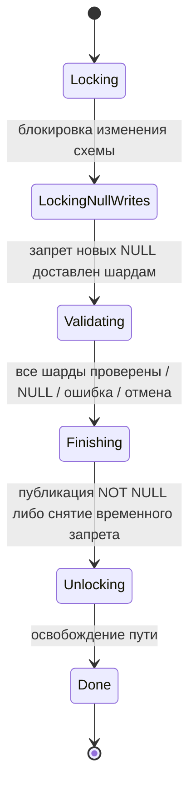

# RFC: SET NOT NULL для существующих колонок Column Tables

Статус: проект.

## Краткое описание

Добавить `ALTER TABLE ... ALTER COLUMN ... SET NOT NULL` для существующих
колонок самостоятельных колоночных таблиц. Операция проверяет уже записанные
данные, допускает конкурентные записи с заполненной колонкой и не требует
перезаписи всей таблицы. Новое ограничение становится видимым читателям только
после успешной проверки всех шардов.

На время проверки блокируются конкурирующие изменения схемы. INSERT, REPLACE
и UPSERT с явно заданными значениями без NULL в проверяемых колонках продолжаются.

## Мотивация

При развитии схемы приложения nullable-колонка часто становится обязательной:
новый код уже заполняет её, старые значения исправлены, и требуется закрепить
инвариант на стороне базы. Наличие `NOT NULL` при создании колонки и возможности
`DROP NOT NULL` не решает задачу изменения уже существующей таблицы.

Для таблицы размером в терабайты нельзя удерживать общий запрет записи на всё
время проверки или собирать данные в памяти SchemeShard. Нельзя также просто
проверить текущий снимок и поменять флаг: между этими действиями другая
транзакция может закоммитить NULL.

## Другие системы

### PostgreSQL 18

PostgreSQL разделяет применение ограничения к новым изменениям и проверку
исторических строк. `ADD CONSTRAINT ... NOT VALID` пропускает первоначальный
scan, но уже проверяет новые INSERT/UPDATE. В версии 18 этот механизм применим
также к not-null constraints. `VALIDATE CONSTRAINT` проверяет существующие строки
с блокировкой `SHARE UPDATE EXCLUSIVE`, совместимой с обычными изменениями данных.
Начальное изменение метаданных всё ещё требует более сильной блокировки.
Обычный `SET NOT NULL` сканирует таблицу, если корректность не доказана имеющимся
валидным CHECK. Двухэтапный вариант требует отдельных команд добавления
непроверенного ограничения и его валидации.
[Документация PostgreSQL 18](https://www.postgresql.org/docs/18/sql-altertable.html).

В предлагаемом протоколе YDB также разделяются состояния «проверяется при
записи» и «доказано для чтения». Дополнительно учитываются кэши схем и записи,
уже принятые другими акторами.

### CockroachDB

Online schema changes выполняются фоновыми jobs и последовательно проводят
схему через промежуточные версии, пока кластер обслуживает чтения и записи.
Документация отдельно предупреждает о потреблении ресурсов и росте задержек
при высокой нагрузке.
[Документация CockroachDB](https://docs.cockroachlabs.com/docs/stable/online-schema-changes).

### ClickHouse

`MODIFY COLUMN` для MergeTree позволяет менять схему без длительной блокировки
таблицы, однако многие преобразования типов требуют mutation существующих
частей. Документация прямо предупреждает: перевод Nullable в Non-Nullable при
наличии NULL может вызвать проблемы чтения; восстановление требует отмены
mutation и возврата Nullable.
[Документация ClickHouse](https://clickhouse.com/docs/reference/statements/alter/column).

В предлагаемом протоколе YDB обнаружение NULL завершает операцию ошибкой
с сохранением исходного публичного типа. Перепись физических частей таблицы
для изменения ограничения не требуется.

### Google Cloud Spanner

Добавление NOT NULL в Spanner проверяет старые данные фоновой долгой операцией,
блокирует конфликтующие DDL и заранее начинает отклонять новые записи NULL.
Если проверка исторических данных заканчивается
ошибкой, некоторое время записи NULL всё равно были запрещены. Длительность
проверки зависит от объёма данных, вычислительной мощности и текущей нагрузки;
операцию можно отменить.
[Документация Spanner](https://docs.cloud.google.com/spanner/docs/schema-updates).

### MySQL 8.4 / InnoDB

MySQL поддерживает перевод колонки в NOT NULL через `MODIFY COLUMN` с
`ALGORITHM=INPLACE, LOCK=NONE`: конкурентный DML разрешён, но таблица перестраивается.
Требуется strict SQL mode; при существующих NULL операция завершается ошибкой.
Для Column Tables YDB предлагается проверка без перестройки таблицы:
существующий формат portions позволяет сохранить данные.
[Документация MySQL 8.4](https://dev.mysql.com/doc/refman/8.4/en/innodb-online-ddl-operations.html).

### Сравнение публичного синтаксиса

| Система | Пример установки ограничения |
| --- | --- |
| YQL / Column Tables | `ALTER TABLE t ALTER COLUMN c SET NOT NULL` |
| PostgreSQL | `ALTER TABLE t ALTER COLUMN c SET NOT NULL` |
| [CockroachDB](https://www.cockroachlabs.com/blog/sql-add-column-drop-column/) | `ALTER TABLE t ALTER COLUMN c SET NOT NULL` |
| ClickHouse | `ALTER TABLE t MODIFY COLUMN c String` вместо прежнего `Nullable(String)` |
| Spanner / GoogleSQL | `ALTER TABLE t ALTER COLUMN c STRING(MAX) NOT NULL` |
| MySQL / InnoDB | `ALTER TABLE t MODIFY COLUMN c VARCHAR(255) NOT NULL, ALGORITHM=INPLACE, LOCK=NONE` |

Для YQL не требуется новая конструкция грамматики: используется существующий
SET NOT NULL, ранее недоступный для этой разновидности таблиц. Установка
временного запрета, проверка данных и публикация ограничения составляют одну
операцию; отдельные команды `NOT VALID` и `VALIDATE` не вводятся.

## Предлагаемый синтаксис и поведение

```sql
ALTER TABLE events ALTER COLUMN source SET NOT NULL;

ALTER TABLE events
    ALTER COLUMN source SET NOT NULL,
    ALTER COLUMN tenant SET NOT NULL;

ALTER TABLE events ALTER COLUMN source DROP NOT NULL;
```

Используются существующий SQL-синтаксис, операция SchemeShard
`SetColumnConstraint` и её механизмы статуса, отмены и восстановления.
Несколько колонок одного SET NOT NULL проверяются совместно и публикуются одним
изменением схемы. Повторное применение уже существующего ограничения допустимо.

Если в проверяемом снимке есть NULL, операция возвращает
`PRECONDITION_FAILED`. Временный запрет и блокировка DDL снимаются; таблица
остаётся доступной с исходной схемой. Конкурентное исправление строки
после выбранного снимка не обязывает текущую проверку завершиться успешно:
после исправления можно повторить ALTER.

Область первой реализации — самостоятельные Column Tables. Изменение отдельных
таблиц внутри Column Store с общей схемой отклоняется: для него нужен отдельный
протокол проверки всех таблиц, использующих preset. Совмещение SET NOT NULL
с изменением других свойств колонки не входит в область RFC.

Отмена использует существующий API `SetColumnConstraint`. Запрос принимается
в состояниях `Locking`, `LockingNullWrites` и `Validating`; начиная с `Finishing`
он отклоняется с `PRECONDITION_FAILED`. Принятие отмены не означает немедленного
снятия запрета NULL: операция должна выполнить завершающее изменение схемы
и освободить блокировку DDL. Уже существовавшие ограничения сохраняются.

### Контракт конкурентных запросов

За основу взят существующий контракт DataShard. Общая операция SchemeShard
устанавливает `SetNotNullInProgress`, проверяет данные и затем либо публикует
ограничение, либо снимает временный запрет. В DataShard
[`datashard_write_operation.cpp`](ydb/core/tx/datashard/datashard_write_operation.cpp)
проверяет временный флаг вместе с `NotNull` и отклоняет запросы с устаревшей
версией схемы. В
[`validate_row_condition.cpp`](ydb/core/tx/datashard/validate_row_condition.cpp)
проверка выбирает MVCC-снимок, ждёт volatile-транзакции на этом снимке и сканирует
только нужные колонки до первого NULL. Для ColumnShard сохраняются эти гарантии;
ожидание реализовано через его собственный менеджер операций записи.

ColumnShard сливает версии строк при чтении и compaction, поэтому проверка
входных данных требует дополнительных ограничений на частичные записи.
Статус, отмена, восстановление операции и публикация non-nullable типа
используют общий код SchemeShard.

| Запрос во время проверки | Поведение |
| --- | --- |
| SELECT | Продолжается с исходным типом колонки |
| INSERT/REPLACE/UPSERT с явно заданными значениями без NULL в проверяемых колонках | Продолжается |
| Запись NULL в проверяемую колонку | Отклоняется |
| Частичный UPSERT без проверяемой колонки | Отклоняется, даже для уже существующего ключа |
| DELETE | Допускается; старый запрос может получить ошибку смены схемы |
| UPDATE проверяемой колонки | Отклоняется при проверке запроса в KQP |
| UPDATE остальных колонок | Запись без значений проверяемых колонок отклоняется в ColumnShard |
| Изменение/удаление таблицы | Отклоняется из-за блокировки изменения схемы |
| Запись, подготовленная по старой nullable-схеме | Отклоняется в ColumnShard с `STATUS_SCHEME_CHANGED`; требуется обновить схему |

ColumnShard требует явного значения каждой проверяемой колонки и отклоняет
значения с признаком отсутствия `$$EXISTS=false`: такие записи могут сохранять
старый NULL. Поддержка произвольных частичных обновлений потребует проверки
итоговой строки после слияния версий.

## Техническое устройство

### Состояния схемы

Переходы для изначально nullable-колонки:

| Состояние | `NotNull` | `SetNotNullInProgress` | Чтение | Новая запись |
| --- | --- | --- | --- | --- |
| Исходное | false | отсутствует/false | nullable | NULL допустим |
| Проверка | false | true | nullable | Проверяемая колонка обязательна, NULL запрещён |
| Успех | true | отсутствует/false | non-nullable | Обычное NOT NULL |
| Ошибка/отмена | исходное значение | отсутствует/false | исходный тип | Исходные правила |

При повторном SET NOT NULL уже обязательная колонка сохраняет `NotNull=true`
и во время проверки, и при отмене.

В `TOlapColumnDescription` добавляется внутреннее optional-поле
`SetNotNullInProgress`, в `TOlapColumnDiff` — его изменение. Оно сохраняется
в SchemeShard, полных схемах и schema diff ColumnShard, передаётся через
SchemeBoard в KQP. В финальном состоянии поле очищается.

Если конфигурация допускает nullable-первичный ключ, SET NOT NULL применим и к
нему. Ужесточение nullability не меняет порядок сравнения ключа. Полная схема
и schema diff должны одинаково обновлять Arrow-схему ключа; обратное ослабление
ключа по-прежнему не допускается.

Внутреннее поле нельзя устанавливать обычным пользовательским ALTER или CREATE.
`TOlapColumnDescription` используется и для хранения схемы, и в запросах CREATE,
поэтому разбор пользовательского запроса явно отклоняет это поле: иначе клиент
мог бы включить промежуточное состояние в обход операции проверки.
Переходы ограничения проходят только через служебные подоперации
SetColumnConstraint с блокировкой пути. Прямой запрос `NotNull=true` через
обычный `AlterColumnTable` не должен обходить валидацию.

### Протокол SchemeShard



1. Проверить feature flag, тип таблицы, список колонок и доступность операции.
2. Заблокировать конкурирующие DDL через существующий lock пути. Такая блокировка
   сама по себе не блокирует DML.
3. Служебным ALTER установить `SetNotNullInProgress=true`. Дождаться завершения
   schema transaction на всех ColumnShard.
4. Отправить каждому шарду запрос проверки. Использовать существующую очередь
   SetColumnConstraint: одновременно не более десяти шардов одной операции.
5. Сохранять результат каждого шарда в SchemeShard. После рестарта или разрыва
   соединения повторять запрос незавершённым шардам. Ошибка сканирования,
   возвращённая валидатором, завершает проверку отказом.
6. После успеха всех шардов одним ALTER выставить `NotNull=true` и убрать
   промежуточный флаг. При ошибке/отмене только убрать промежуточный флаг.
7. Освободить DDL-lock и завершить долгую операцию.

### Защита от старой схемы и принятых записей

Проверки только в KQP недостаточно: запрос мог быть скомпилирован до ALTER,
а запись могла уже попасть в очередь ColumnShard.

ColumnShard сравнивает ограничения актуальной схемы со схемой запроса дважды:
при приёме и непосредственно перед запуском записи из очереди. Если актуальная
схема требует колонку, а старая схема ещё допускает NULL, возвращается
`STATUS_SCHEME_CHANGED`. Это сравнение действует также после завершения ALTER
и не зависит от текущего значения feature flag.

Во время валидации схема запроса должна также содержать временный флаг, чтобы
выполнялись более строгие проверки частичной записи. Это закрывает старые
запросы со схемой NOT NULL, скомпилированные до цикла DROP NOT NULL / SET NOT NULL.

Записи, уже запущенные до установки запрета, нельзя потерять или молча считать
проверенными. В операции записи сохраняется версия схемы. Перед выбором снимка
валидатор ждёт исчезновения активных операций этой таблицы со схемой старше
установленного запрета. Commit/abort завершает ожидание; новые корректные записи
не мешают проверке. Для операций, восстановленных из старого формата без версии,
значение 0 означает необходимость консервативно дождаться их завершения.

Запросы в очереди, ещё не ставшие операциями записи, закрыты повторной проверкой
при извлечении из очереди. Версия записывается до запуска асинхронной обработки,
проверка схемы и регистрация активной операции выполняются в одном обработчике
события tablet.

Долгая незавершённая транзакция может задержать ALTER, но не должна останавливать
новые корректные записи. Автоматически откатывать пользовательские транзакции
ради DDL не предлагается. В первой реализации ожидание проверяется таймером
с интервалом 100 мс.

### Почему гонка с записью закрыта

Для каждого шарда выбирается снимок S после завершения ранее принятых записей.
Любая запись, способная добавить NULL, относится к одному из случаев:

1. Принята до запрета: валидатор дожидается commit/abort и проверяет её результат
   в S, если запись сохранилась.
2. Пришла во время проверки, но использует схему без временного ограничения:
   отклоняется при приёме или извлечении из очереди.
3. Использует промежуточную либо финальную схему: проверяется при записи и не
   может добавить NULL.

После успешного scan инвариант сохраняется до публикации финальной схемы,
поскольку временное ограничение продолжает действовать. Общий снимок всех
шардов не нужен: проверяемое свойство локально для строки, а изменения после
каждого локального снимка сохраняют это свойство.

### Проверка в ColumnShard

Используется обычный MVCC scan через `TEvKqpScan`. В результат выводятся только
проверяемые колонки; ключ и служебные колонки движок читает по необходимости.
Отдельный актор принимает Arrow batches и проверяет наличие NULL. Первый NULL
достаточен для отрицательного результата; полный проход заканчивается успехом.

Считать только `null_count` физических portions некорректно: там могут
оставаться перезаписанные или удалённые версии. Обратная проблема — новая
колонка может отсутствовать в старой portion и логически иметь NULL. Поэтому
проверяется результат чтения с обычными правилами MVCC, дедупликации, удаления
и восстановления отсутствующих колонок. Compaction не является условием
успеха ALTER.

ColumnShard проверяет владельца, tablet ID, путь и наличие временного ограничения.
Повторный запрос заменяет предыдущий валидатор той же операции. При следующем
ALTER или остановке tablet валидатор завершается; scanner и его снимок должны
быть освобождены даже при отмене на границе запуска scan.

## Большие таблицы и стоимость

Размер таблицы имеет как минимум две независимые координаты: N строк и C колонок.
Обозначим K число колонок одного SET NOT NULL.

| Форма таблицы | Основная стоимость | Требование к реализации |
| --- | --- | --- |
| Узкая, очень много строк | Чтение и обработка N строк, длительный снимок | Потоковый scan, ранний отказ при NULL, без накопления результатов |
| Широкая, проверяется мало колонок | Риск чтения всех C колонок и роста метаданных | Проекция только K колонок плюс необходимые ключ/служебные поля |
| Широкая, проверяются многие колонки | Суммарная ширина K колонок и декодирование batch | Один общий проход и byte-based backpressure вместо отдельного scan на каждую колонку |
| Широкая и длинная | Все перечисленные затраты | Квоты scan, ограничение параллелизма, измерение I/O и памяти |

При создании версии схемы заранее рассчитывается список проверяемых колонок.
Проверка входных batches обходит этот список, а не все C колонок. Совпадение
объекта актуальной схемы и схемы записи даёт быстрый путь проверки совместимости;
старые схемы сравниваются по колонкам с ограничениями. Поэтому добавление фичи
не должно вносить полный дополнительный обход широкой схемы для каждой записи
по актуальной версии. Сами метаданные схемы по-прежнему имеют размер O(C).

Проверка выполняет один логический проход по требуемым колонкам каждого шарда.
Не требуется выгружать таблицу в SchemeShard, переписывать её или хранить список
строк. Объём чтения зависит от проверяемых колонок, ключа и количества версий,
а не только от числа актуальных строк. Время проверки зависит от объёма чтения,
стоимости декодирования и слияния версий, а также конкуренции за CPU и I/O.

Актор проверки выдаёт ACK с бюджетом 1 MiB и одним batch. Это ограничение
передачи результатов. Общий расход памяти также включает декодирование
portion, отдельные большие значения и слияние версий в сканирующем движке.
Они подчиняются обычным ограничениям scan и его механизмам backpressure.

SchemeShard сохраняет O(числа шардов) результатов. После перезапуска завершённые
шарды повторно читать не нужно. Незавершённый шард в первой версии сканируется
сначала на новом снимке под тем же запретом новых NULL. Это безопасно, но дорого
для одного очень большого шарда при частых перезапусках.

Дальнейшее улучшение — сохраняемый курсор проверки диапазонов ключа. Его нельзя
добавить как «номер физической portion»: compaction меняет portions. Потребуется
зафиксировать семантику диапазона, снимка и допустимых конкурентных UPDATE,
а также протестировать продолжение после resharding. До такого расширения
размер отдельного шарда и частота рестартов ограничивают достижимое время ALTER.

Ограничение десяти сканов относится к одной операции. Это не глобальная квота
на все одновременные ALTER. Перед включением по умолчанию нужны нагрузочные
измерения совместно с пользовательскими запросами и решение о квоте фоновых
scan на database/node. Долгое удержание MVCC-снимка также может увеличить
потребление хранилища из-за отсрочки очистки старых версий.

## Совместимость и rollout

Добавляется `EnableColumnTableSetNotNull=false`. Он проверяется при входе
SQL и при создании операции в SchemeShard. Существующий общий
`EnableSetColumnConstraint` продолжает действовать.

Флаг управляет только допуском новых операций. Его выключение не отменяет уже
запущенные операции, не отключает проверку входных данных и не мешает
восстановлению после рестарта. Иначе динамическое выключение флага создало бы
дыру в ограничении.

Новые поля protobuf optional; отсутствие означает прежнее поведение.
Финальная схема использует уже существующий `NotNull`. Данные сохраняют свои
исторические версии схем и не мигрируют автоматически в новый формат.

Старый ColumnShard не применяет промежуточный запрет, а старый SchemeShard
рассчитывает, что SetColumnConstraint относится к строковой таблице.
Поэтому включение разрешено только после обновления всех узлов,
способных исполнять KQP, SchemeShard и ColumnShard.

Порядок включения:

1. Обновить весь кластер с флагом false.
2. Проверить отсутствие старых узлов и возможность восстановления tablet только
   на новой версии.
3. Включить флаг на ограниченном наборе баз и проверить задержки/ошибки.
4. Расширить включение после успешных функциональных и compatibility-тестов.

Порядок downgrade: выключить допуск новых SET NOT NULL, дождаться завершения
или отменить все незавершённые операции и дождаться снятия временных состояний,
затем откатывать узлы. Удаление нового флага из конфигурации нужно для бинарников,
которые не знают его имя. Downgrade посередине валидации первой версией не
поддерживается.

Для завершённой операции требуется проверить чтение старых portions, корректные
новые записи и отклонение NULL на старом бинарнике. Если конкретная поддерживаемая
версия не проходит эту проверку, downgrade с завершённым ограничением также
нельзя разрешать без дополнительной миграции/исправления.

Отдельное ограничение касается nullable-первичного ключа, разрешённого специальной
конфигурацией ColumnShard. Старый код проверяет полное равенство Arrow-схем ключа
и может отвергнуть историю перехода nullable → NOT NULL при загрузке tablet.
Downgrade после такого перехода на бинарник без исправленной проверки
совместимости ключа не поддерживается. Тесты downgrade проверяют ограничения
на обычных колонках при изначально non-nullable ключе.

## План тестирования

| Уровень | Проверяемый контракт |
| --- | --- |
| Schema unit tests | Полная схема и diff сохраняют промежуточный флаг; чтение nullable; старые схемы и цикл DROP/SET; rollback; ужесточение nullability ключа |
| SchemeShard | Прямой API: флаг false/true; нельзя обойти проверку обычным ALTER |
| KQP + ColumnShard | Пустая и заполненная таблица, повторный SET, DROP NOT NULL, несколько колонок |
| История данных | NULL после DELETE/overwrite не мешает; колонка, отсутствующая в старых portions, проверяется как логическая |
| Конкуренция | Корректный UPSERT проходит во время scan, NULL и частичный UPSERT отклоняются, DDL заблокирован |
| Гонки записи | Запрос со старой схемой задержан до финализации; ранее принятая запись с NULL задержана до начала валидации |
| Форма таблицы | 100 000 строк; 200 колонок с проверкой проекции одного столбца и NULL в остальных |
| Отмена | Ранняя отмена завершается снятием временного запрета и DDL-lock; отмена начиная с Finishing отклоняется |
| Восстановление | Перезапуски SchemeShard/ColumnShard во время проверки; флаг выключен после запуска |
| Restart compatibility | Таблица создана старой версией, ограничение добавлено новой; завершённый успех и завершённый отказ переживают смену версии |
| Rolling compatibility | После финализации ограничения чтения и записи проверяются на каждом шаге downgrade/upgrade |

Проверки со сбоями должны включать очередь записи при перегрузке, перезапуск
с незавершённой транзакцией с NULL, отмену до ScanInit, повторную доставку ответа
и ошибки хранения.
Нагрузочная проверка должна включать многошардовую таблицу, большую отдельную
portion, широкий тип значений, compaction и конкурентную загрузку. Проверять
надо расход памяти, задержки конкурентных запросов и время завершения ALTER.
При росте числа строк буфер результатов валидатора не должен расти вместе
с таблицей; при росте числа колонок проекция должна оставаться ограниченной
проверяемыми колонками, ключом и служебными полями движка.

Тесты совместимости должны выполняться на каждой поддерживаемой паре версий
и проверять чтение старых данных, корректные новые записи и запрет NULL
после завершения ограничения. Незавершённая операция допускает перезапуск
только на версии, поддерживающей временный запрет.

## Рассмотренные альтернативы

| Альтернатива | Причина отказа |
| --- | --- |
| Запретить всю запись на время scan | Длительная недоступность DML на больших таблицах |
| Проверить снимок, затем включить NOT NULL | Гонка с записью NULL между scan и публикацией |
| Сразу выставить публичный NotNull | Читатели могут получить старый NULL в объявленном non-nullable типе |
| Переписать все portions | Высокая стоимость I/O и места без необходимости менять значения |
| Проверить только физические null-count статистики | Удалённые/перезаписанные строки и отсутствующие колонки требуют логической интерпретации |
| Поддержать произвольные частичные UPDATE сразу | Требует проверки итоговой строки и отдельного доказательства корректности merge |

## Открытые вопросы перед включением по умолчанию

1. Нужны ли отдельная фоновая resource pool и глобальная квота параллельных
   проверок, либо достаточно существующих лимитов scan?
2. Достаточно ли восстановления на уровне шарда для целевых размеров или
   сохраняемый курсор диапазонов обязателен уже в первом релизе?
3. Когда расширять контракт UPDATE и частичных UPSERT с проверкой итоговой строки?
4. Каким автоматическим механизмом rollout запрещать старые узлы и downgrade
   при незавершённой операции? Один feature flag не проверяет версии кластера.
5. Какие счётчики прогресса (байты/строки, ожидание старых транзакций, скорость,
   повторные сканы) добавить в публичную диагностику долгой операции?
