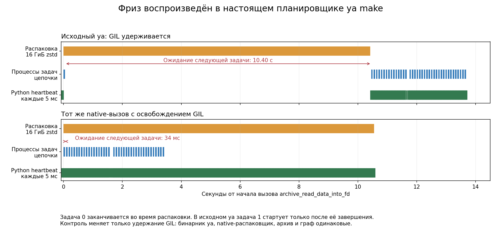

# Reproduce ya make's GIL stall during archive extraction

`ResultNodeTask` extracts archive entries through a SWIG wrapper that keeps the
GIL. A large entry prevents other Python threads in the runner from progressing,
including scheduling work after a child process has finished.

This example runs **real `ya make`** with a small graph supplied through
`--build-custom-json`: one archive target and a chain of 40 short Python tasks.
Task 0 waits for extraction to start, sleeps for 50 ms, then records its completion
from its own process. Task 1 is ready but cannot start until extraction finishes.
The chain uses CPU slots, so this delay is not caused by the shared linker I/O pool.

The control bypasses only the SWIG wrapper: `ctypes.CFUNCTYPE` calls the **same
native `archive_read_data_into_fd` function in the same ya binary**, releasing the
GIL for the call. Its address is resolved with `nm`, not hardcoded. This adapter
is for diagnosis, not a production fix.

## Observed result

One run per variant, a zstd archive containing one **16 GiB** regular file of
repeated log messages. No artificial delay is added to extraction.
Measured with ya commit `f927ec85865ba920d5b988cf748a077694d7ce6f`, revision
`21488830`, also used in [CI run 40563570626](https://github.com/ydb-platform/ydb/actions/runs/40563570626).

| Metric | Original wrapper | GIL released |
|---|---:|---:|
| Extraction | 10.423 s | 10.552 s |
| Longest Python heartbeat pause during extraction | **10.423 s** | **12 ms** |
| Task 0 completion to task 1 start | **10.404 s** | **34 ms** |
| Subsequent tasks started during extraction | 0 | 39 |
| Graph execution | 13.720 s | 10.587 s |

Both extracted files match the expected SHA-256. These timings describe this
synthetic graph; they do not predict the improvement of a full CI run.



[Measurements](results/summary.json) and
[stacks captured during the stall](results/original-stacks.txt).
The extraction worker is in `ResultNodeTask → extract_tar → archive_read_data_into_fd`.
An external process requests targeted `faulthandler` dumps via SIGUSR2 without
needing the runner's GIL. Local source paths in the saved stacks are shortened.

## Run

From the repository root. Requires Linux x86_64, an unstripped non-PIE `ya-bin`,
`nm`, `/usr/bin/python3`, and about 32 GiB of scratch space for the two outputs.
The initial ya/tool download may need network access.

```bash
probe_root=$(mktemp -d /tmp/ya-gil-repro.XXXXXX)
probe_bin=$(Y_PYTHON_ENTRY_POINT=:main ./ya -c 'import sys; print(sys.executable)')
probe_source="$PWD/tools/ya_archive_gil_repro"
export YA_CACHE_DIR="$probe_root/cache"

Y_PYTHON_ENTRY_POINT=:main "$probe_bin" "$probe_source/make_archive.py" \
  "$probe_root/payload.tar.zstd" --mib 16384
bash "$probe_source/run_case.sh" "$probe_bin" "$probe_root/original" \
  "$probe_root/payload.tar.zstd" original
bash "$probe_source/run_case.sh" "$probe_bin" "$probe_root/release" \
  "$probe_root/payload.tar.zstd" release
python3 "$probe_source/summarize.py" --root "$probe_root" \
  --output "$probe_root/report" --mib 16384 original release
```

For a smaller run, use `--mib 1024` for both archive generation and summarization.
Use a fresh case directory each time. Graph nodes have `cache=false`; remote cache
is disabled. `--no-src-links` leaves just one extraction into `--output`.
The example is manual and is not registered in the repository build/test graph.
