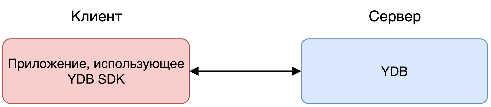
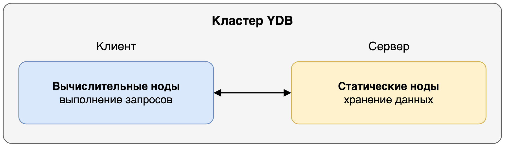
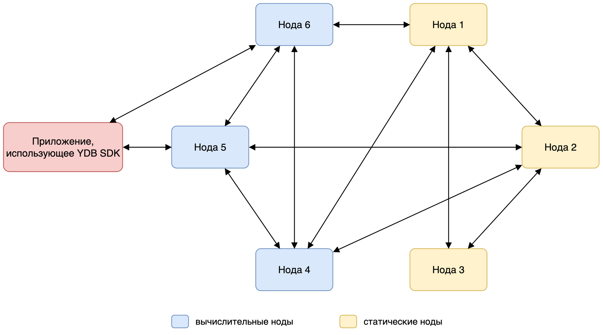
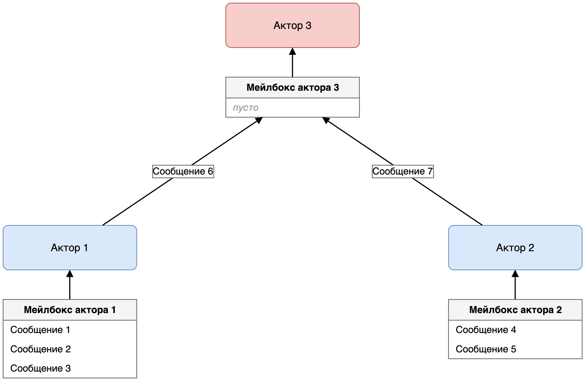
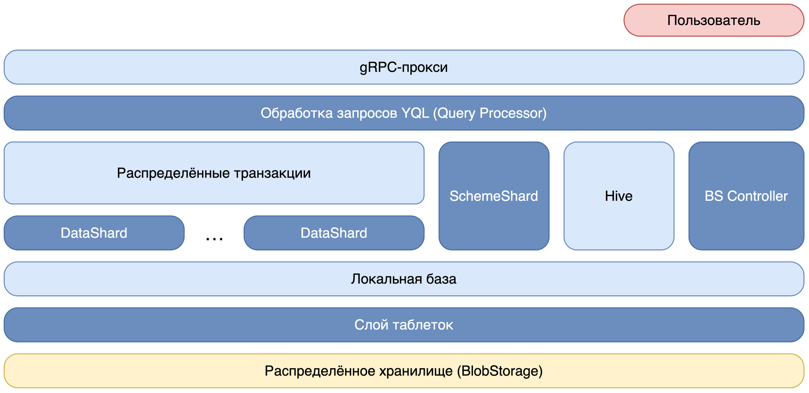

## 1.3 Архитектура YDB

Рассмотрим архитектуру YDB. На верхнем уровне YDB является
клиент-серверной системой, где клиентские приложения взаимодействуют по
сети с серверами СУБД, отправляя запросы и получая результаты их
выполнения. Многие приложения разрабатываются при помощи YDB SDK.

Сама YDB может быть представлена как клиент-серверная система, состоящая
из нод, отвечающих за хранение данных, и нод, занимающихся выполнением
запросов. На самом деле это не обязательно целые машины, а, например,
просто процессы, и на одной и той же машине могут быть запущены и
процессы-ноды, занимающиеся хранением данных (статические ноды), и
процессы-ноды, выполняющие запросы (вычислительные ноды).

С другой стороны, YDB является peer-to-peer системой. В процессе
выполнения запросов вычислительные ноды взаимодействуют между собой
peer-to-peer. В процессе записи и восстановления избыточности записанных
ранее данных статические ноды также взаимодействуют peer-to-peer.

YDB построена с применением акторной модели параллельных вычислений, где
система состоит из акторов, обменивающихся сообщениями с другими
акторами.

С актором связана очередь сообщений. Актор получает из очереди сообщение
и может выполнять в рамках его обработки сколько угодно раз следующие
действия:

-   создать ещё одного актора;

-   послать сообщение какому-либо актору;

-   изменить своё внутреннее состояние;

-   взаимодействовать с внешними сущностями, не относящимися к акторной
    системе, --- например делать syscall;

-   перестать существовать.

Внутри каждого из процессов YDB работает акторная система и постоянно
порождаются, уничтожаются и обмениваются сообщениями сотни тысяч
акторов. По сути, акторы являются C++-объектами, использующими интерфейс
акторной системы для обмена C++-объектами-сообщениями как в пределах
одной ноды, так и между нодами по сети. Построение системы из большого
количества акторов, обменивающихся сообщениями, позволяет масштабировать
систему путем добавления дополнительных нод и распределения акторов по
ним, а также переживать отказы, перемещая акторы с отказавших нод на
работоспособные.

Можно рассматривать YDB как систему, разделённую на несколько слоев,
каждый из которых использует нижележащие слои и предоставляет более
высокоуровневые абстракции для последующих слоев.

Рассмотрим эти слои снизу вверх.

На самом нижнем уровне располагается слой распределённого хранилища,
distributed blobstorage. Этот слой скрывает множество ненадёжных дисков,
которые подключены к разным статическим нодам, и предоставляет интерфейс
надёжного распределённого отказоустойчивого хранилища данных. Данные
хранятся в виде блобов: иммутабельных фрагментов двоичных данных
ограниченного размера (от 1 байта до 10 мегабайт), для адресации блобов
применяются специального вида двоичные ключи фиксированной длины.

Поверх распределённого хранилища реализован слой таблеток (от
английского tablet --- фрагмент большой таблицы). Этот слой позволяет
специальным акторам (мы называем их таблетками) иметь и изменять
состояние, надёжно сохраненное в распределённом хранилище таким образом,
что при отказе в произвольный момент времени ноды, на которой работал
экземпляр таблетки, новый экземпляр этой таблетки может быть запущен на
любой другой ноде и он продолжит работу с того места, на котором
остановился предыдущий экземпляр. По сути, это Replicated State Machine
over Shared Log. Соответственно, когда таблетка выполняет операции, она
фиксирует в логе, хранящемся в распределённом хранилище, блобы, которые
описывают эти операции, и дожидается подтверждения записи, прежде чем
подтверждать выполнение операции.

Следующий слой --- локальная база. Она предоставляет программисту на C++
удобный интерфейс для работы с состоянием таблетки как с небольшой базой
данных, включающей в себя несколько таблиц. Каждая таблица может
содержать набор строк и колонок различных типов. Над данными могут
выполняться транзакции, код которых пишут на C++. База локальна в том
смысле, что управляется непосредственно этой таблеткой.

Поверх локальной базы написан ряд специальных таблеток --- системных и
прикладных.

- Системные таблетки необходимы для обеспечения работоспособности YDB
и её подсистем.

- Прикладные --- реализуют собственно логику работы YDB как прикладной
системы.

Особое место занимают таблетки Data Shard, предназначенные для хранения
небольших частей огромных таблиц.

Слой распределённых транзакций служит для выполнения транзакций над
данными в различных Data Shard (дата-шардах). Этот слой содержит набор
специальных таблеток, координирующих выполнение транзакций.

Поверх слоя распределённых транзакций лежит слой обработки запросов на
языке YQL --- диалекте SQL, который позволяет более эффективно
использовать возможности YDB. Поступающие запросы компилируются,
кэшируются, оптимизируются и выполняются. Из таких запросов формируются
YQL-транзакции.

Наконец, верхний слой --- gRPC-прокси, позволяющий взаимодействовать с
системой по протоколу gRPC, передавая запросы и получая ответы.

Каждый слой состоит из множества компонент, которые далее рассмотрим
более детально.

