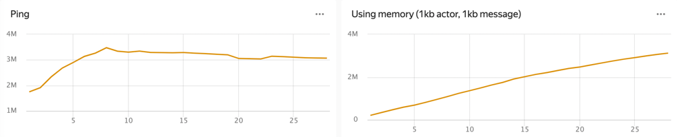
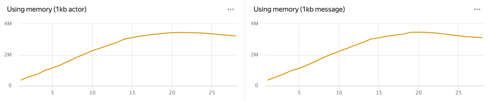

## 2.1 Обзор акторной системы

В этом разделе рассматриваются акторная система, её преимущества и
недостатки.

При создании YDB была выбрана модель явной передачи сообщений с
использованием акторов и отдельных мейлбоксов.

Актор представляет собой объект C++, реализующий специальный интерфейс.
Актор способен отправлять сообщения другим акторам, принимать их и
создавать новых акторов. Сообщения также являются объектами C++.
Передачу сообщений и запуск обработки этих сообщений выполняет акторная
система.

Акторная система распространяется на весь кластер, позволяя акторам
обмениваться сообщениями не только на одной машине, но и между разными
машинами. При этом сообщения, передаваемые по сети, автоматически
сериализуются и десериализуются. Для обмена сообщениями между акторами,
работающими на разных нодах (разных процессах YDB, в основном запущенных
на разных машинах кластера), используется подсистема интерконнект.
Интересной особенностью архитектуры является то, что сам интерконнект построен на основе акторов.

Ниже приведён код простейшего актора TMyActor, умеющего обрабатывать
только сообщение TEvPoison, получив которое он завершает работу. Для
завершения работы актора в базовом типе определена функция PassAway().
Для показанного актора она выполняет дерегистрацию, а память освобождается
после возврата из обработчика события. После вызова PassAway() следует
завершить обработчик: актор уже заканчивает свой жизненный цикл. Сообщение
TEvPoison предопределено и используется в акторной системе для того,
чтобы попросить актор самоуничтожиться. Уничтожить актор снаружи нельзя,
это может сделать только сам актор вызовом PassAway(). Каждый автор актора
должен сам позаботиться о том, чтобы его актор корректно обрабатывал
TEvPoison.

```cpp
class TMyActor: public TActor<TMyActor> {
public:
    TMyActor() : TActor{&TThis::Main} {
    }

    void Main(TAutoPtr<::NActors::IEventHandle>& ev) {
        switch (ev->GetTypeRewrite()) {
        case TEvents::TEvPoison::EventType:
            PassAway();
            break;
        }
    }
};
```

Ниже приведён код, определяющий номер нового типа пользовательского
сообщения EvHello и сам тип локального сообщения TEvHello, которое
содержит единственное поле данных Text. Локальные сообщения не имеют
сериализаторов/десериализаторов и из-за этого могут быть переданы только
между акторами в пределах одной ноды.

```cpp
enum {
    EvHello = EventSpaceBegin(TEvents::ES_PRIVATE)
};

struct TEvHello : public TEventLocal<TEvHello, EvHello> {
    std::string Text;
};
```

В акторной системе есть несколько пулов потоков, которые выполняют код
акторов. Акторная система на машине содержит планировщик, работающий в
user-space. Важно писать код акторов так, чтобы обработка одного
сообщения не занимала много времени, и невытесняющая многозадачность в
user space работала хорошо. Потоки разных пулов используются для
выполнения разных классов задач, поэтому для различных пулов характерны
разные времена обработки сообщений акторами.

Ниже приведён фрагмент кода, создающий новый актор типа TMyActor и
регистрирующий его в акторной системе, чтобы этот актор мог получать
сообщения от других акторов. Переменная poolId используется для указания
индекса пула потоков, в котором будет выполняться этот актор. При
регистрации актору присваивается уникальный в пределах кластера
идентификатор, который заносится в переменную myActorId. Далее он может
быть использован для отправки сообщений этому актору. При создании
актора указывается тип мейлбокса (FIFO-очереди сообщений), к которому
будет прикреплен актор. Разные типы мейлбоксов отличаются
производительностью при наличии/отсутствии контеншен.

```cpp
ui32 poolId = 0;
NActors::TActorId myActorId;
myActorId = TActivationContext::ActorSystem()->Register(
    new TMyActor, TMailboxType::ReadAsFilled, poolId);
```

Ниже приведён фрагмент кода актора, выполняющий отправку сообщения
TEvHello актору с идентификатором myActorId.

```cpp  
Send (myActorId, new TEvHello);
```

Отправленное сообщение попадёт в мейлбокс, к которому был прикреплен
актор при регистрации. Чтобы акторная система начала обрабатывать
сообщения в мейлбоксе, запись о необходимости активации этого мейлбокса
помещается в очередь активации, которая уже вовсе не FIFO.

Каждый поток в пулах акторной системы занимается выполнением акторных
обработчиков сообщений. Для этого поток берёт из очереди активации
запись и активирует мейлбокс, то есть обрабатывает сообщения из
мейлбокса, вызывая для них обработчики акторов, прикрепленных к
мейлбоксу.

Алгоритм работы потока примерно следующий: поток берёт из очереди
активаций активацию мейлбокса. Затем из очереди сообщений в этом
мейлбоксе берёт сообщение и вызывает для него функцию актора,
обрабатывающую входящие сообщения. Далее поток смотрит, не слишком ли
много он обработал сообщений и не слишком ли долго обрабатывает
сообщения в одном этом мейлбоксе. Если не слишком, то берёт ещё одно
сообщение и так далее в цикле. А если слишком долго, то он возвращает
мейлбокс в очередь активации. Если сообщения в мейлбоксе кончились, то и
в очередь активации его не возвращают. Дальше поток берёт новую
активацию из очереди активаций (ей может оказаться и та же самая, если
очередь размера 1). Так продолжается, пока не закончатся активации.

Когда активаций в очереди не осталось, поток, завершивший обработку
очередной активации, ждет новых активаций. Для этого он сначала на
протяжении SpinThreshold выполняет активное ожидание, делая в цикле mmpause и проверяя, не
выставили ли ему флажок «проснись». Если флажок за время SpinThreshold
не выставили, поток засыпает на фьютексе.

Когда другой поток кладёт в очередь активацию, он проверяет, нет ли
спинящегося или спящего потока. Если есть, то спинящемуся потоку
выставляют флажок, а спящий будят. Пробуждение спинящегося потока является низкозатратной операцией (просто атомарная операция над флажком), а пробуждение спящего потока иногда является дорогостоящей операцией (требует системного вызова).

Параметр SpinThreshold не имеет теоретически обоснованного оптимального значения для общего случая. Целесообразность применения техники активного ожидания и выбор её длительности определяются эмпирическим путем для конкретных сценариев использования.

Существуют граничные сценарии использования, в которых параметр SpinThreshold может как положительно, так и отрицательно влиять на производительность системы. В типичных сценариях развертывания рекомендуется использовать значение SpinThreshold по умолчанию, которое было определено эмпирически на основе длительного опыта эксплуатации.

При создании программ на основе акторной системы полезно учитывать
затраты на передачу сообщений. Следующие графики иллюстрируют результаты
одного эксперимента с разными видами нагрузки:





Здесь по горизонтальной оси указано количество потоков в пуле акторной
системы, а по вертикальной --- пропускная способность в сообщениях в
секунду этого пула при наличии 256 акторов, разбитых на пары и
пересылающих в пределах каждой пары одно сообщение друг другу ping-pong.

На графиках показаны результаты измерений для четырех разных типов
нагрузки. Ping --- пары акторов пересылают друг другу пустое сообщение,
не требующее обработки. Using memory (1 kb actor) --- акторы пересылают
пустое сообщение, в рамках обработки которого они читают 1 килобайт
внутреннего состояния. Using memory (1 kb message) --- акторы пересылают
сообщение с 1 килобайтом данных, в рамках обработки этого сообщения
акторы читают этот 1 килобайт. Using memory (1 kb actor, 1 kb message)
--- акторы имеют 1 килобайт внутреннего состояния и пересылают сообщения
с 1 килобайтом данных. В рамках обработки каждого сообщения актор читает
и все своё состояние, и все сообщение.

Для предварительной оценки можно ориентироваться на пропускную
способность одного пула порядка 2–3 миллионов сообщений в секунду,
а одного актора с коротким обработчиком --- порядка 900 тысяч сообщений
в секунду. На приведённых графиках отдельные результаты превышают
3 миллиона сообщений в секунду.

Полезный ориентир для масштабирования --- длительность обработки
сообщения порядка 7 микросекунд и более: при такой нагрузке увеличение
числа потоков обычно полезнее, чем при пересылке почти пустых сообщений.
В показанном тесте с пустыми сообщениями рост прекращается примерно
после восьми потоков. Конкретные значения зависят от оборудования,
версии реализации, конфигурации пулов, размещения акторов по мейлбоксам
и работы обработчиков.

Практический вывод состоит в том, что при очень коротких обработчиках
затраты на передачу сообщений и планирование могут ограничивать
масштабирование. Эти ориентиры помогают заранее оценить стоимость
акторного взаимодействия и сократить лишние сообщения. Собственные
измерения нужны для уточнения запаса производительности и выбора
конфигурации, когда эти затраты существенны для приложения.

