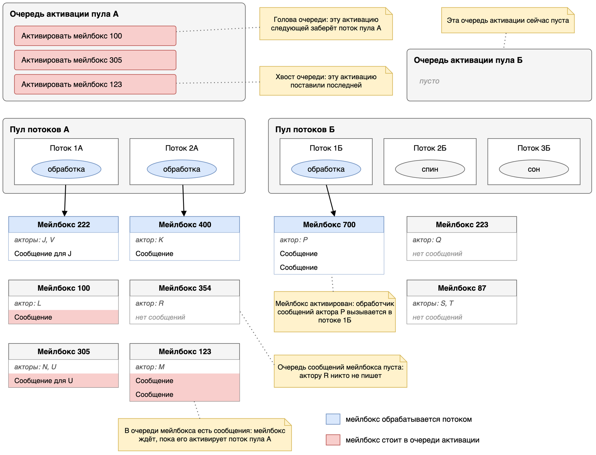

## 2.2 Пулы, акторы, сообщения, мейлбоксы

В этом разделе рассмотрены детали устройства и конфигурации акторной
системы.

Каждый актор имеет уникальный идентификатор --- ActorId, который состоит
из идентификатора ноды и порядкового номера актора на этой ноде. ActorId
новых акторов могут различаться от запуска к запуску системы. При
отправке сообщения необходимо указывать ActorId получателя.

Акторы создаются как обычные объекты C++ с помощью оператора new. Для
регистрации актора вызывается метод Register акторной системы. Register
после регистрации актора вызывает его виртуальный метод Registered.

При посылке сообщения по ActorId адресата находится мейлбокс (почтовый
ящик акторов, FIFO-очередь входящих сообщений), к которому привязан
искомый актор. Сообщение (экземпляр IEventHandle) помещается в очередь
мейлбокса, а идентификатор мейлбокса помещается в очередь активации, если это не
сделано ранее.

Сообщения для одного актора обрабатываются однопоточно в FIFO-порядке.
Для обработки сообщения актор должен получить поток управления, для
этого и предназначена очередь активации. Один из потоков акторной
системы (в смысле потока операционной системы) забирает идентификатор мейлбокса из
очереди активации, забирает из очереди сообщений этого мейлбокса первое
сообщение и выполняет функцию обработки сообщений актора, для которого
предназначено сообщение. И так несколько раз, пока не пройдёт 10
миллисекунд (настраиваемо) либо пока не будут обработаны все сообщения в
очереди.

Имеется несколько пулов потоков, предназначенных для обработки сообщений
акторами, у которых различается характерная длительность обработки
сообщений. Число потоков в каждом из пулов задаётся настройками. Кроме
того, в каждом из пулов могут применяться различные настройки поведения
потоков.

Каждый мейлбокс закреплён за конкретным пулом и не переносится между
пулами в течение своей жизни. В зависимости от конфигурации
активации обслуживают собственные рабочие потоки пула и общие потоки
из TSharedExecutorPool. Общие потоки могут обслуживать несколько пулов. Мейлбокс не привязан к одному рабочему потоку: разные его
активации могут выполняться в разных потоках, обслуживающих этот пул.

Обработка активаций акторов нестрого упорядочена, что означает, что
акторы, активированные примерно в одно и то же время, будут примерно
одновременно обрабатывать свои очереди сообщений. Мейлбоксы не имеют
приоритета, обработка активаций распределяется равномерно между
доступными потоками выполнения.

Можно выбрать, на каком типе мейлбокса будет создан актор. На данный
момент доступно несколько типов мейлбоксов, отличающихся способами
построения MPSC (Multiple Producers Single Consumer) очереди.

-   Simple (TMailboxType::EType::Simple ) --- максимально облегчённый
    мейлбокс, оптимизированный под минимальную цену посылки сообщения при
    отсутствии конкуренции. При одновременном обращении к этому мейлбоксу
    нескольких отправителей сообщений производительность может
    существенно деградировать.

-   Revolving (TMailbox::EType::Revolving ) --- мейлбокс, обеспечивающий
    быстрое добавление сообщения в очередь ценой большей стоимости
    посылки/чтения.

-   ReadAsFilled --- быстрая wait-free очередь, эмулирующая бесконечный
    массив. Рекомендуется для real-time решений, где важна
    предсказуемость времени выполнения операций.

-   HTSwap --- очень быстрая lock-free очередь, основанная на
    использовании atomic exchange. При отсутствии убедительных
    аргументов следует использовать именно её.

Во всех типах мейлбоксов писатели и читатель никогда не должны блокировать
друг друга.

Актор-система работает с сообщениями при помощи хендлов (объектов,
реализующих интерфейс IEventHandle), которые содержат среди прочего
64-битное число-cookie, неинтерпретируемое самой акторной системой. В
основном cookie используется акторами для установления
взаимно-однозначного соответствия между запросами и ответами на них.
Например, актор может отправить несколько запросов, записав в cookie их
порядковые номера, и ожидает, что акторы, отвечающие на его запросы, в
ответах выставят значения cookie, переданные в запросах. Чтобы это
работало, возврат cookie в ответе должен быть предусмотрен прикладным
протоколом. Способ применения cookie выбирает разработчик протокола.

Для семейства событий выделяются непересекающиеся диапазоны
идентификаторов (см. макросы EventSpaceBegin / EventSpaceEnd и их
применение в коде).

Фактическая обработка сообщения произойдёт позже, когда рабочий поток
пула акторной системы извлечёт сообщение из очереди. Будет совершена
попытка найти на мейлбоксе привязанный актор с требуемым local-ID (его
может не быть, если к моменту обработки сообщения актор уже умер), а при
нахождении --- вызвана текущая установленная функция обработки
сообщений. При ненахождении логика обработки аналогична логике обработки
ненайденного мейлбокса.

Если сообщение не доставлено адресату (например, если адресата не
создавали или уже уничтожили), дальнейшее действие определяется флагами
его хендла. Флаг FlagTrackDelivery позволяет получить уведомление
TEvUndelivered с типом исходного сообщения, причиной недоставки и признаком
Unsure, указывающим на неопределённость доставки. В хендле уведомления
сохраняется исходный Cookie; тело исходного сообщения в него не входит.
Отдельный флаг FlagForwardOnNondelivery позволяет переслать само сообщение
указанному актору при недоставке. Если установлены оба флага, выполняется
эта пересылка. Без пересылки исходное сообщение уничтожается.

В рамках одной ноды сообщения не сериализуются и передаются as-is как
поле Event хендла. При необходимости межнодовой передачи сообщение
сериализуется в интерконнекте вызовом виртуальной функции
IEventBase::Serialize. Десериализация буфера в сообщение акторной системой
никогда не производится, это делает принимающий актор, определив тип
сообщения по полю Type хендла. Рекомендуемый способ --- использовать
макросы HFunc, CFunc и т. д. из ydb/library/actors/core/hfunc.h и определить
статическую функцию Load.

Для самых распространенных случаев реализовано два хелпера:

-   TEventLocal из ydb/library/actors/core/event_local.h --- для событий, которые не
    должны покидать одну ноду и не определяют функции сериализации.

-   TEventPB из ydb/library/actors/core/event_pb.h --- для событий, тело которых
    определено как protobuf-message. Основной метод для потенциально
    межнодового трафика.
    Для особых случаев возможна частная реализация, метод сериализации
    никак не ограничивается со стороны библиотеки.

У современной акторной системы есть три настройки:

> UseAutoConfig = true

Если включено, акторная система автоматически подбирает настройки пулов.
Если выключено, то количество и детальные настройки пулов могут быть
заданы в конфигурации акторной системы (не рекомендуется).

NodeType --- тип ноды, определяющий пропорцию распределения ядер по
пулам. Может иметь одно из трех значений:

-   Compute --- вычислительная (динамическая) нода.

-   Storage --- для нод с дисками (статических).

-   Hybrid --- специальный вид ноды для NBS (с равномерно распределённой
    нагрузкой на system, interconnect и user пулы).

CpuCount --- количество ядер, отданных акторной системе. Если не указано
значение или указан 0, берётся количество ядер, доступных в affinity
маске процесса, а если и она не задана, используется общее количество ядер
процессора.

Есть несколько способов отправить сообщение в акторной системе.

Обычный Send, который кладёт сообщение в мейлбокс, и если мейлбокс был
пустой, то он помещается в очередь активации, откуда его заберёт другой
поток.

Есть ленивый lazy send, который кладёт сообщение в мейлбокс. Но, если
мейлбокс был пустой, акторная система не помещает его в очередь активации, а
держит в текущем потоке, пока не закончится текущая активация. После
этого выполняется активация актора, которому отправлялись данные при
помощи lazy send. В результате при обработке посланного lazy send
сообщения может не быть разбужен дополнительный поток.

Но если к моменту завершения активации мейлбокса сделавшего lazy send в
очереди активаций будет ещё какая-то активация, то отложенная для lazy
send активация будет отправлена в очередь, а сам поток выполнения начнёт
обслуживать активацию, вынутую из очереди.

А ещё есть tail send. Это похоже на tail call. Текущая активация
прерывается с завершением обработки текущего сообщения, после чего
оставшийся у этой активации квант времени продолжает использоваться, но
уже для обработки активации актора-получателя сообщения, отправленного
через tail send.

Выбор нужного варианта Send выполняется через шаблонный аргумент,
например вот так: Send\<ESendingType::Lazy\>().

Акторная система использует кооперативную многопоточность. Если актор
долго обрабатывает одно сообщение, он может задерживать выполнение
других акторов, занимая рабочий поток. Поэтому для низкого времени
отклика важно ограничивать длительность обработки каждого сообщения.
Даже один некачественно написанный
актор будет приводить к существенному голоданию многих качественно написанных акторов и кратной
амплификации замедления работы системы в целом, то есть в системе образуется т.н. микроберст
длительностью от 2 до сотен мс, который приводит к образованию пузыря (простоя, bubble) в конвейере.

Для выполнения различных акторов используются одни и те же потоки, это означает, что
актор, который пытается ожидать на мьютексе или спинлоке, не просто ждет, а мешает
нормальному выполнению других акторов. При этом, если актор пытается взять мьютекс,
может произойти вытеснение всего потока, после чего ядро может быть передано какому-либо
другому потоку и продолжение выполнения отдавшего ядро потока акторной системы произойдёт
только когда завершится очень длинный по меркам акторной системы квант времени, таким образом,
ожидающий на мьютексе актор мешает выполняться другим акторам и может существенно ухудшать время отклика системы.
А если есть несколько акторов, делающих спинлок, ОС будет периодически вытеснять поток, взявший спинлок,
остальные акторы будут так же пытаться взять спинлок, в результате распределят по одному на поток и
заблокировано как минимум на квант ОС окажется столько потоков, сколько акторов пытается взять спинлок.
При этом сами эти акторы не будут давать ОС возобновить выполнение вытесненного потока.
Таким образом, спинлоки и мьютексы в коде акторов использовать совершенно недопустимо,
так как страдают от этого не эти акторы, а вся акторная система.
