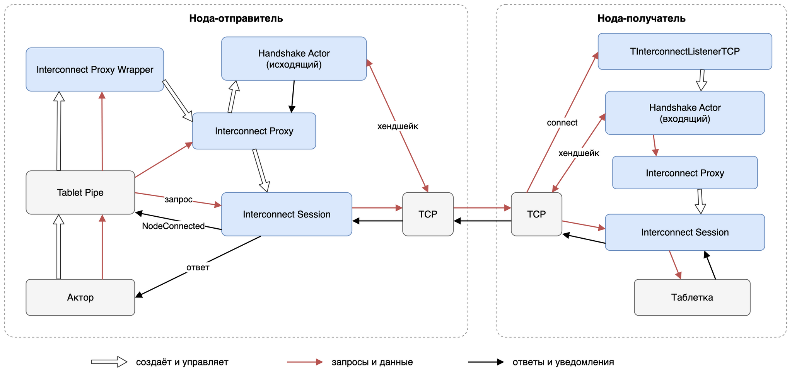

## 2.10 Интерконнект

Интерконнект получает сообщение в том случае, когда оно предназначено
для акторов на другой ноде. Он сериализует сообщение и после установки
соединения с целевой нодой отправляет это сообщение по её
TCP-интерконнекту. Затем сообщение передаётся в мейлбокс
актора-получателя, а при первой попытке его прочтения происходит
десериализация.

Сессия интерконнекта может переживать разрывы TCP-соединения:
интерконнект пытается восстановить соединение и продолжить передачу
в рамках той же сессии. Сессия завершается, если восстановление
невозможно, по настроенному таймауту бездействия CloseOnIdle или
по другим условиям завершения сессии.

В рамках соединения между парой нод существует несколько параллельных
каналов передачи сообщений. При наличии нагрузки полоса разделяется
между ними поровну. Внутри каналов сообщения передаются с сохранением
порядка, но они могут переупорядочиваться, если их отправить по разным
каналам. Можно передавать через один канал множество крупных сообщений
и, не дожидаясь очереди, отправлять с низкой задержкой небольшие
сообщения на ту же ноду, но через другой канал.

Интерконнект состоит из ряда компонентов. Самый верхнеуровневый
компонент --- это interconnect proxy. Прокси отвечает за взаимодействие
с соседней нодой. Для каждой конкретной соседней ноды есть одна
конкретная прокси.

Прокси бывают динамическими и статическими.

Статические создаются для нод из статической конфигурации кластера при запуске и живут всегда.

Динамические создаются в момент первого обращения к целевой ноде, когда
приходит хендшейк с той стороны или когда локальный актор отправляет на
удалённую ноду какое-либо сообщение.

Сессия --- компонент, парный к прокси. Она отвечает за пересылку данных
на конкретную ноду и получение данных с неё в виде сообщений. У каждой
прокси может быть только одна сессия. То есть на двух нодах есть по
прокси для общения друг с другом и по сессии для этой же цели.

Прокси является компонентом, ответственным за запуск сессий, когда в прокси поступает сообщение. Сама прокси ничего не делает --- просто инициирует хендшейк, а
сообщения форвардит в сессию. Прокси умеет копить сообщения у себя в буфере. По
сути, это менеджер сессии: после установки соединения прокси передаёт
накопленные сообщения в сессию, которая уже выполняет всю работу.

Сессия реализована как актор. В поле входящих сообщений записывается actor
id interconnect session. Можно пересылать ответы на полученные
сообщения, чтобы разрыв сессии, через которую отправлен запрос, означал,
что ответ не будет доставлен и наоборот.

Кроме того, есть хендшейк-актор, созданный на базе корутин. Он отвечает
за обмен первоначальным трафиком между двумя нодами. Хендшейки бывают
исходящими и входящими, но актор всё равно один и тот же. У него есть
флажок, определяющий, с входящим или исходящим соединением работает
конкретный инстанс актора.

У одной прокси может быть много хендшейков: 0 или 1 исходящих и сколько
угодно входящих. Специальный алгоритм определяет, какой из хендшейков
победил. Например, гонка может быть между двумя встречными хендшейками,
но на обеих нодах победит обязательно один и тот же. В итоге между парой
нод будет установлено только одно TCP-соединение interconnect.

Когда через сессию отправляется сообщение, интерконнект гарантирует, что
сообщения в рамках одного канала будут доставлены в фиксированном
порядке --- в том порядке, в котором их отправили, --- и не обгонят друг
друга. В случае, если сообщения отправляются между разными каналами, нет
никаких гарантий.

У всех каналов одна сессия. Между разными каналами гарантируется
честность по полосе (bandwidth). Иными словами, если по каналу А
началась отправка 10 мегабайтов данных, а по каналу Б после этого в
момент Ч начнётся отправка 1 мегабайта данных, то, начиная с момента Ч,
пропускная способность TCP-соединения будет разделена между каналами А и
Б поровну, а передача 1 мегабайта по каналу Б завершится примерно тогда
же, когда по каналу А будет отправлен 1 мегабайт данных.

Если вдруг произойдёт разрыв TCP-соединения, то либо будет
переустановлено TCP-соединение, либо прервётся сессия. Если соединение
переустановлено, то никаких потерь сообщений не будет. Кроме акторов, у
интерконнекта есть настоящий поток. Этот поток делает в цикле epoll
wait. Порождает этот poller actor.

Акторы отправляют в poller actor сообщение register «хочу поллить сокет
такой-то». В ответ он отправляет токен, у которого можно попросить «хочу
читать» или «хочу писать». Он делает это через атомики без отправки
сообщений. Когда есть возможность читать или писать, приходит сообщение
тому, кто зарегистрировался.

Этим потоком пользуются Interconnect, HTTP-сервер и другие компоненты,
выполняющие асинхронный ввод-вывод.

В Linux poller использует epoll в режиме edge-triggered. Сокеты
регистрируются с флагом `EPOLLET`, а ожидание готовности к чтению и записи
учитывается во внутренних атомарных флагах. После каждого уведомления не
требуется повторно включать наблюдение за сокетом через `epoll_ctl`.

При подписке на установленную сессию актор получает TEvNodeConnected.
Если подписка направлена в прокси до установления соединения, уведомление
приходит после его установления. При завершении сессии подписчики
получают TEvNodeDisconnected; при неудачной попытке подключения может
прийти только TEvNodeDisconnected.

В рамках одного канала одной сессии сообщения передаются на другую ноду
в порядке отправки. Если сессия завершилась во время передачи, полученная
другой нодой последовательность в каждом канале образует префикс
отправленной. Это не устанавливает общий порядок между разными каналами.

Если при отправке сообщения добавить флаг track delivery, Interconnect
отправит сообщение Undelivered, если сообщение не будет доставлено. Есть
два режима undelivered, переключаемых при помощи флага «generate unsure
undelivered» --- с ложноотрицательным срабатыванием и с
ложноположительным:

-   Interconnect отвечает undelivered для всех сообщений, для которых не
    пришло подтверждение, что другая сторона получила пакет с
    сообщением. В этом режиме случается, что сообщение дошло, но
    отправитель получил undelivered.

-   Interconnect отвечает undelivered, только если сообщение
    гарантированно не отправили в сокет.

Для отслеживания завершения сессии используется TEvNodeDisconnected.
Это уведомление позволяет прекратить ожидание ответа через завершённую
сессию, но не устанавливает результат ранее отправленного запроса:
запрос мог быть обработан, а ответ — не получен. Результат операции
уточняется прикладным протоколом.

Если TCP-соединение удалось восстановить в рамках той же сессии,
интерконнект продолжает передачу без потерь сообщений и сохраняет
их порядок внутри каждого канала.

Если сообщение дошло до другой ноды, где не оказалось актора-получателя,
Undelivered формируется на этой ноде и отправляется обратно источнику
запроса. Это уведомление тоже может потеряться при завершении сессии.
Подписка на TEvNodeDisconnected позволяет обнаружить завершение сессии,
а прикладная пара запрос--ответ — получить результат обработки запроса.

Если для отправки ответов актор использует ту же сессию, через которую
получал запросы, то общающийся с ним актор не может получить сначала
уведомление о разрыве соединения, а потом ответ. Если ответ отправлен
через другую сессию, получатель может получить его после уведомления
о разрыве исходной сессии.

В классической TCP-реализации входящий и исходящий потоки обслуживают
два актора, работающие на общем мейлбоксе. Их обработчики выполняются
последовательно. При смене сессии сообщения старой и новой сессий
передают получателю разные акторы, и сообщения новой сессии могут обогнать
сообщения старой. Такой сценарий и способы учитывать смену сессии
в прикладном протоколе рассмотрены в разделе 12.4.

Подписаться на node disconnected можно двумя путями:

- отправить EvSubscribe или EvConnectNode либо на прокси, либо на
сессию непосредственно. Если необходимо подключиться к ноде, отправляется
подписка на прокси, а если уже есть конкретная сессия, то можно
отправлять подписку на сессию.

- при отправке сообщения добавить флаг subscribe on session, который
делает подписку на сессию.

Когда подписка больше не нужна, актор должен явно отписаться от сессии.
Механизм периодической проверки и удаления подписок завершившихся
акторов отключён, поэтому оставленные подписки сохраняются до
завершения сессии.

Сообщения сериализуются через функцию serialize, которая принимает
указатель на поток (stream). Исходящие сообщения сериализуются с помощью
сериализатора интерконнекта в session actor через корутину. Сообщения
сериализуются по частям. Части сообщений одного канала могут
перемежаться с частями сообщений других каналов. У session actor есть
класс interconnect channel, который всем этим заведует.

Десериализуются сообщения в месте использования. После того, как
приходит сообщение, оно оказывается в акторной системе. Внутри него
находится не событие, а цепочка кусочков буферов (TRope), в которой
содержится сериализованное тело сообщения. Когда актор --- потребитель
сообщения --- его получает и вызывает Get(), цепочка кусочков буферов
конвертируется в событие. Разные кусочки одного буфера могут
использоваться для нескольких переплетённых сообщений. Буфер
освобождается, только когда последний его пользователь его освободит.
Это означает, что длительно хранить или держать в мейлбоксе много
сообщений опасно, так как память может закончиться внезапно.

Сериализацию можно выполнять и заранее, передавая интерконнекту уже
сериализованные данные. Например, актор DS_Queue предварительно
сериализует сообщения и хранит у себя сериализованную копию для
перепосылок. Так как данные передаются с помощью бинарного протобуфа,
используется возможность внести в конец сериализованных данных
дополнительные записи, которые при парсинге добавятся в сообщение или
заменят данные, присутствовавшие до этого. DS_Queue, например, при
перепосылке сообщения переписывает message ID и sequence ID из структуры
msgQoS. Эти поля, по сути, записываются в виде отдельного протобуфа, а
при чтении получают соответствующее значение.

В TEventPB есть набор методов AddPayload, GetPayload и GetPayloadCount.

AddPayload добавляет в некоторый вектор ропу (TRope), которая подаётся
на вход. Она будет сериализоваться вне протобуфа и возвращает порядковый
номер добавленного пейлоада.

Предполагаемый паттерн: отправитель вызывает AddPayload, который
возвращает номер, а отправитель записывает этот номер внутрь
протобуфного сообщения. На принимающей стороне GetPayload просто
возвращает данные, которые были положены в пейлоад с таким номером ранее
и у которых есть GetPayloadCount для валидации.

При наличии payload сериализованное сообщение начинается с маркера
0x06. За ним записываются количество фрагментов и длины всех фрагментов,
затем сами фрагменты и сериализованный protobuf. При чтении поддерживается
также формат с маркером 0x07, в котором длина каждого фрагмента записана
непосредственно перед его данными. Без payload сообщение содержит
сразу сериализованный protobuf. Значения 0x06 и 0x07 не могут быть
первым байтом корректного protobuf-сообщения, поэтому по маркеру можно
однозначно отличить сообщение с payload от обычного protobuf.

Для того чтобы определить ноду, используется well-known actor id сервис
nameserver. Его ActorId можно получить, вызывая функцию
GetNameserviceId. Туда же отправляется TEvResolveNode, когда приходит
запрос на подключение к ноде. В ответ актор получит от nameservice
информацию про ноду: fqdn, адрес на случай, если нет fqdn, и номер
порта. Так интерконнект узнает, куда подключаться.

Когда нода A подключается к ноде Б, нода Б устанавливает встречное
подключение по номеру ноды А. То есть нода Б берёт из локального
нейм-сервиса реквизиты ноды А и подключается туда встречным соединением.
При этом применяется сокращенный протокол --- по сути, нода Б
спрашивает: «Ты нода А?». После правильного ответа на этот вопрос
встречное соединение отключается а прямое продолжает устанавливаться.
Здесь проверяется именно связность --- что А с Б соединится точно так
же, как Б с А. Она нужна, потому что известны случаи несимметричности.

Если в интерконнекте указать все сертификаты и поставить флажок
шифрования, то интерконнект станет подключаться по TLS. Есть три
градации: Required, Optional, Disabled. Если режим с полным
шифрованием, тогда шифрование необходимо для установки соединения, если
optional --- шифрование будет использоваться только в случае настройки
на узлах с обеих сторон.

Кроме того, есть режим, в котором TLS используется только для
аутентификации. Для этого производится протокол с проверкой
сертификатов, после чего шифрованное соединение закрывается и
продолжается обычное.

Когда динамическая нода входит в кластер, она идёт по gRPC в статическую
ноду, через которую выполняет запрос в node broker. Динамическая нода
говорит node broker, что она нода такая-то, сообщает свои реквизиты.
Node broker записывает её себе в табличку, выдаёт node id динамической
ноде, входящей в кластер, устанавливает лизу (lease). После этого нода, входящая в
кластер, уже по interconnect подключается к статическим нодам. В
дальнейшем лиза обновляется уже по interconnect.

Размер сериализованного события ограничивается настройкой
MaxSerializedEventSize. По умолчанию она равна EventMaxByteSize —
140 МиБ ($140 \times 2^{20}$ байт). Предел относится к сериализованному событию,
включая прикреплённые данные, а не только к его protobuf-части.
При обнаружении превышения во время отправки TCP-сессия завершается
с причиной EventTooLarge. Большие данные следует разбивать на несколько
сообщений с учётом этого ограничения.

Есть механизм, предполагающий фильтрацию сообщений интерконнекта между
специально размеченными группами нод (доменами). Однако механизм так
нигде и не включён, список сообщений составлен примерно в 2020 году и с
тех пор не обновлялся.
