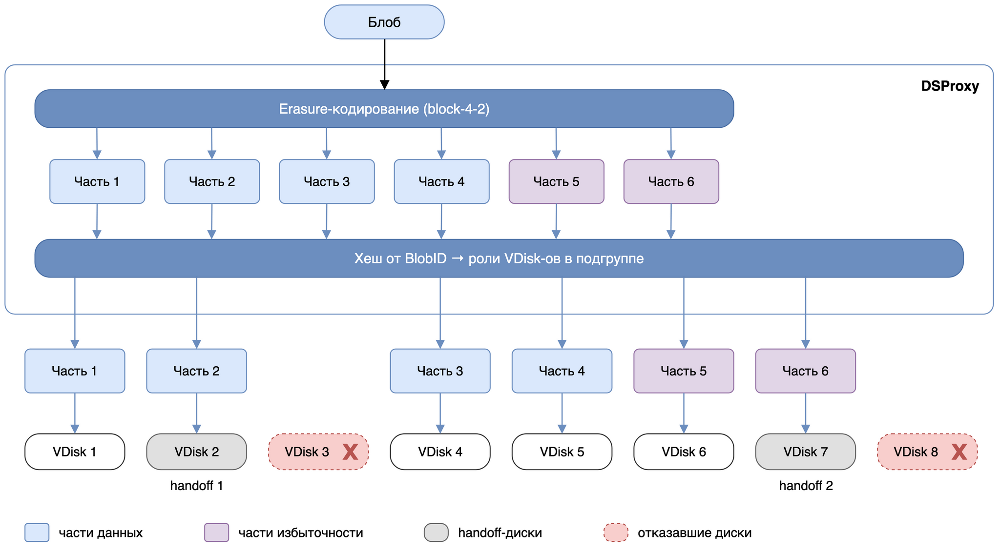

## 3.2 Группы хранения, режимы хранения

Распределённое хранилище состоит из большого количества дисков,
объединённых в группы. Группа, как правило, включает в себя восемь или
девять дисков разных машин. Операции с данными осуществляются не на
отдельных дисках, а с группой.

### Режимы избыточного хранения

Распределённое хранилище YDB поддерживает несколько режимов
обеспечения
избыточности данных. Данные в группе хранения могут распределяться
по дискам несколькими
разными способами. Принципиально можно выделить три из них:

- запись единственной копии блоба на один диск (erasure none);

- запись нескольких идентичных копий блоба на несколько разных дисков
(erasure mirror-3-dc, mirror-3of4);

- разбиение блоба на N частей данных, вычисление дополнительных K
частей избыточности. Для полного восстановления блоба достаточно
получить N из N + K любых частей данных и/или избыточности (например,
`block-4-2`, `block-4-3`, `block-3-3` или `block-8-2`).

#### Режим без избыточности (none)

Режим none предполагает запись единственной копии блоба на один диск без
какой-либо избыточности. Этот режим используется исключительно для
тестирования и разработки, поскольку не обеспечивает никакой защиты от
потери данных при отказе диска. В производственных системах этот режим
не применяется, так как любая потеря диска приводит к безвозвратной потере
всех данных, хранившихся на нем.

#### Режимы репликации

Режимы репликации основаны на создании нескольких идентичных копий каждого
блоба и размещении этих копий на разных дисках группы. Система гарантирует,
что копии одного блоба никогда не окажутся на одном физическом диске,
что обеспечивает защиту от отказа дисков.

Режим mirror-3-dc разработан для геораспределённых конфигураций с тремя
дата-центрами. Группа состоит из девяти дисков, по три диска в каждом
дата-центре. Число полноразмерных копий блоба и их размещение зависят от
тактики записи, настроек и доступности дисков. Успешная запись требует
не менее трёх полноразмерных копий. Если один дата-центр недоступен,
запись выполняется по схеме 2+2: по две реплики на разных VDisk в каждом
из двух доступных дата-центров. Режим рассчитан на сохранение
работоспособности при одновременном полном отказе одного дата-центра
и отказе одной стойки в другом дата-центре.

Режим mirror-3of4 предназначен для развертываний в пределах одного
дата-центра.

При тактике `min-latency`, используемой также по умолчанию, в обычном
случае DSProxy отправляет четыре полноразмерные копии блоба на четыре
разных VDisk и четыре служебные metadata-записи без тела блоба на
остальные четыре VDisk подгруппы. Для успешного завершения не требуется
дождаться всех восьми подтверждений: достаточно подтвердить полноразмерные
копии минимум на трёх VDisk и данные либо метаданные минимум на пяти
VDisk суммарно. При тактике `max-throughput` в обычном случае отправляются
три полноразмерные копии блоба и две metadata-записи на пять разных VDisk.

Если один из предпочтительных дисков недоступен или медленный,
соответствующая реплика может быть отправлена на handoff-диск. Медленные
VDisk сначала исключаются из размещения, но используются во втором
проходе, если без них нельзя собрать кворум.

#### Режимы erasure-кодирования

Режимы erasure-кодирования обеспечивают более эффективное использование
дискового пространства по сравнению с репликацией, сохраняя при этом высокий
уровень отказоустойчивости. Вместо создания полных копий блоба данные
разбиваются на несколько частей, и вычисляются дополнительные части
избыточности с использованием алгоритмов кодирования с исправлением ошибок.

Один из поддерживаемых режимов erasure-кодирования --- `block-4-2`.
Каждый блоб разбивается на четыре части данных
примерно равного размера (N=4), и для них вычисляются две дополнительные
части избыточности (K=2).
В результате получается шесть частей, причем
любых четырех частей достаточно для полного
восстановления исходного блоба.
Группа хранения в этом режиме состоит из
восьми дисков.

С точки зрения использования дискового пространства режим block-4-2
обеспечивает коэффициент избыточности 1.5 (шесть частей вместо четырёх
исходных). Для `mirror-3of4` избыточность зависит от тактики записи и
доступности дисков, но успешная запись требует не менее трёх полноразмерных
копий блоба. Для `mirror-3-dc` избыточность также зависит от ситуации ---
тактики записи, настроек и доступности дисков и дата-центров, --- но
составляет не менее трёх полноразмерных копий; при недоступности одного
дата-центра записываются четыре копии по схеме 2+2.

#### Выбор режима и распределение частей блоба

Выбор конкретного режима хранения определяется при конфигурировании группы
хранения и не может быть изменен. Все блобы в одной
группе хранятся с использованием одного и того же режима избыточности.

Важной особенностью является псевдослучайное распределение частей блоба по
дискам группы на основе хеша от идентификатора блоба. Это означает, что для
разных блобов используются разные подгруппы дисков и разные роли каждого
диска. Такое распределение обеспечивает равномерную нагрузку на все диски
группы и предотвращает ситуации, когда какие-то диски систематически
перегружены, а другие простаивают.

При записи каждого блоба по хешу от его идентификатора определяется роль
каждого из дисков группы. Например,
при использовании erasure block-4-2 по хешу от его идентификатора в
псевдослучайном порядке набирается подгруппа из восьми дисков группы.

Первые четыре диска подгруппы используются только для записи
соответствующих частей блоба, следующие два диска --- только для записи
соответствующих частей избыточности. Последние два диска при нормальной
работе остальных дисков не задействуются, но при необходимости могут
использоваться для записи произвольного количества любых частей блоба.
Это позволяет в случае отказа двух любых дисков расположить все шесть
частей блоба на разных дисках, не дожидаясь восстановления
работоспособности отказавших дисков.

#### Производительность и задержка

Разные режимы хранения имеют различные характеристики производительности.
Режимы репликации обеспечивают наименьшую latency для операций чтения,
поскольку не требуют вычислений для восстановления данных --- достаточно
прочитать одну готовую копию. Однако они требуют больше операций записи
и большего объёма сетевого трафика, так как нужно передать полные копии
блоба на несколько дисков.

Режимы erasure-кодирования требуют вычислительных ресурсов для разбиения
блоба на части и вычисления частей избыточности при записи, а также для
восстановления полного блоба из частей при чтении. Однако общий объём
записываемых данных меньше.
