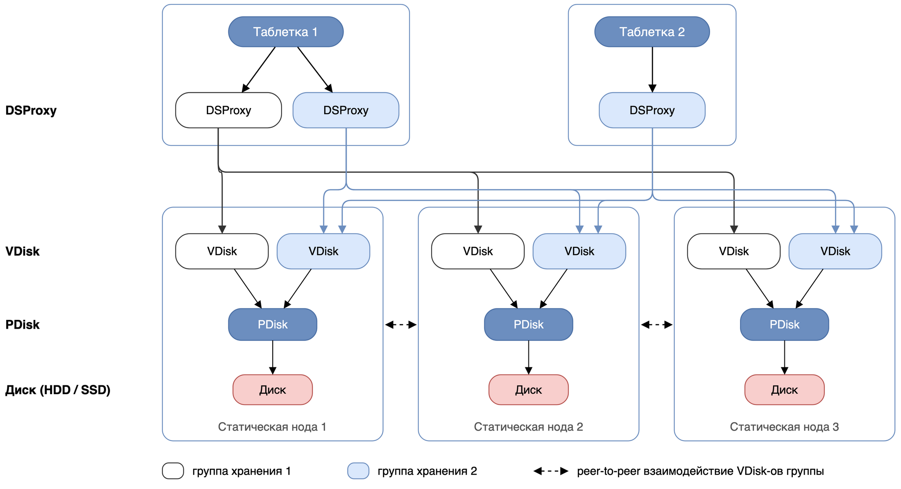
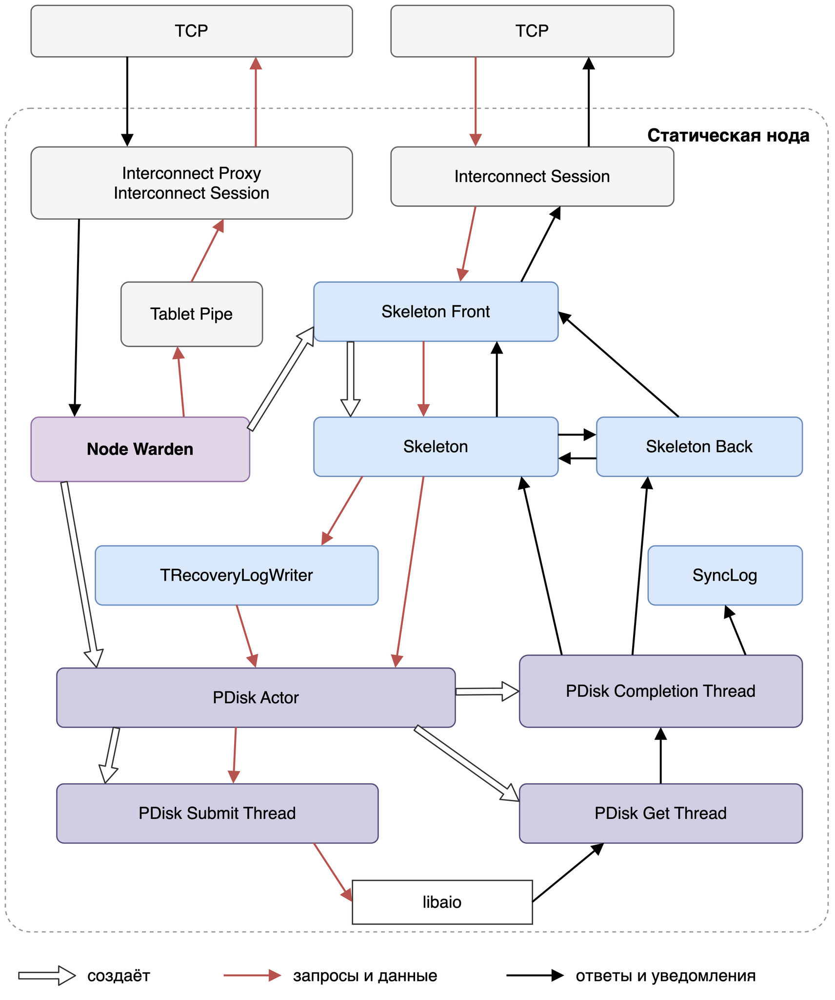

## 3.3 Основные компоненты

В этом разделе описаны основные компоненты распределённого хранилища
и путь прохождения запросов между ними.

На ноде, на которой работает таблетка, запускается локальный сервис
DSProxy. Он берёт запрос, например, на запись и рассылает его по нодам с
дисками, хранящими данные группы. На нодах с дисками работают VDisk и
PDisk. Запрос от DSProxy сначала встает в очередь BSQueue на той же
ноде, что и DSProxy, после чего по сети передаётся в VDisk на ноде с
данными на диске.

Для отправки запроса к DSProxy следует всегда использовать функцию
SendToBSProxy(). Она подставляет правильный сервисный идентификатор
актора DSProxy и отправляет сообщение с указанием форвардинга в случае
отсутствия получателя сервису NodeWarden, который всегда запущен на
каждой ноде. Когда NodeWarden получает сообщение для несуществующей
DSProxy, он получает конфигурацию, создаёт DSProxy и передаёт ей запрос.

DSProxy никак не взаимодействуют между собой, а только с VDisk-ами через
BSQueue. При поступлении запроса DSProxy создаёт актора, который будет
обрабатывать этот запрос, и передаёт ему конфигурацию и набор BSQueue.
Актор запроса обеспечивает выполнение, выбирая, в какие BSQueue какие
запросы отправить. Этот актор инкапсулирует всю сложную логику
взаимодействия с группой хранения: определение, на какие VDisk
отправлять части блоба в соответствии с режимом избыточности
(репликация или erasure-кодирование), выполнение erasure-кодирования
для разбиения блоба на части, управление таймаутами и повторными
попытками, а также сборку результатов от множества VDisk.

BSQueue обеспечивает flow control при взаимодействии с VDisk, занимается
сериализацией данных, снимая часть нагрузки с interconnect. Также он
выступает в роли circuit breaker, отвечая правильно сформированными
сообщениями об ошибках в случае разного рода таймаутов. Очередь в
BSQueue --- FIFO из-за особенностей flow control. Хотя до VDisk запросы
одного типа доставляются с сохранением порядка, обработка запросов и
отправка ответов на запросы происходит в произвольном порядке. Запросы
же разного типа или приоритета доставляются вообще через разные BSQueue
и каналы интерконнекта.

VDisk --- это примерно key-value база данных, позволяющая по LogoBlobID
получить данные блоба.

Данные на VDisk организованы как LSM-дерево (Log Structured Merge tree
--- хорошо описано в «Википедии») и хранятся в PDisk. VDisk объединены в
группы хранения и взаимодействуют peer-to-peer в пределах группы,
выявляя потери данных (например, вызванные заменой жёсткого диска) и
восстанавливая данные за счёт избыточности. Много VDisk разных групп
работают с одним PDisk.

PDisk --- это примерно файловая система, но не настоящая. Система не
использует файловую систему, и PDisk работает с блочным устройством.
PDisk оптимизирован для того, чтобы очень быстро писать множество очень
маленьких записей. При этом каждая из них пишется надёжно, мимо всех
кэшей. PDisk подтверждает запись данных не в момент их попадания
в кэш операционной системы или диска, а после их попадания на основной
носитель. PDisk имеет продвинутый планировщик и честно разделяет ресурсы
оборудования между VDisk-ами.

Чтение данных происходит аналогично записи. Таблетка отправляет запрос через
DSProxy, который создаёт актора чтения. Актор определяет, с каких VDisk
необходимо прочитать части блоба (достаточно получить N из N+K частей для
erasure-кодирования), и рассылает запросы через BSQueue. VDisk ищут
запрошенные данные сначала в memtable в памяти, затем в SSTable на диске,
обращаясь к PDisk для чтения данных из чанков. Полученные части собираются
актором запроса, при необходимости выполняется декодирование, и восстановленные
данные возвращаются таблетке.

