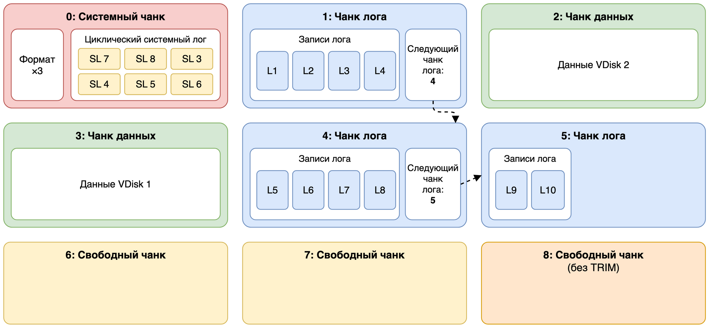
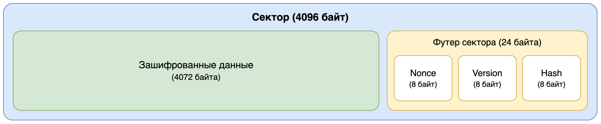
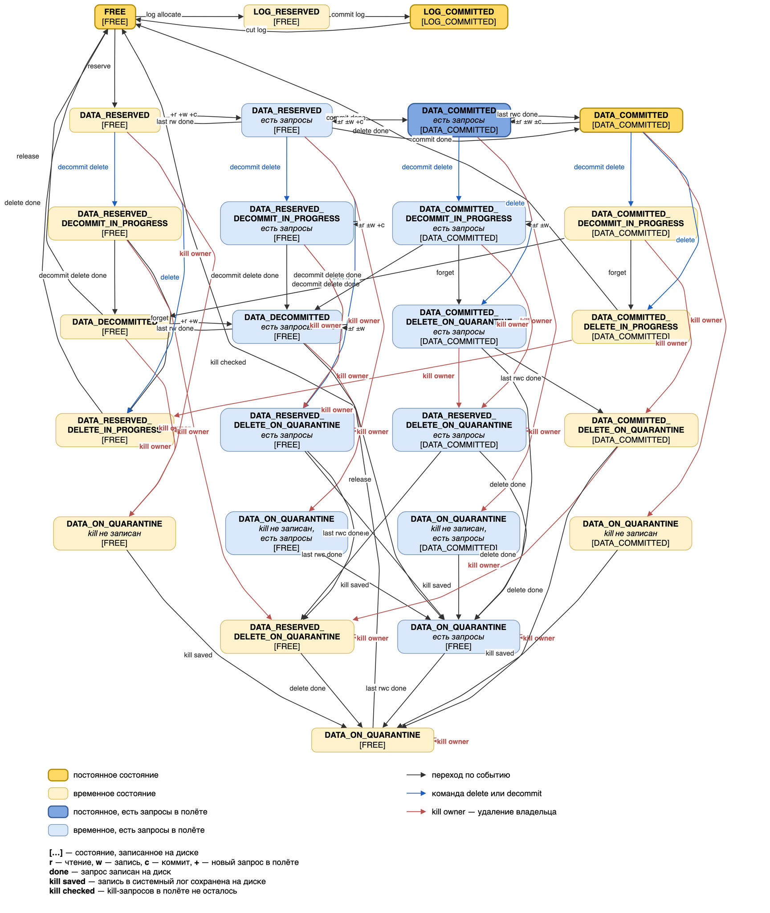
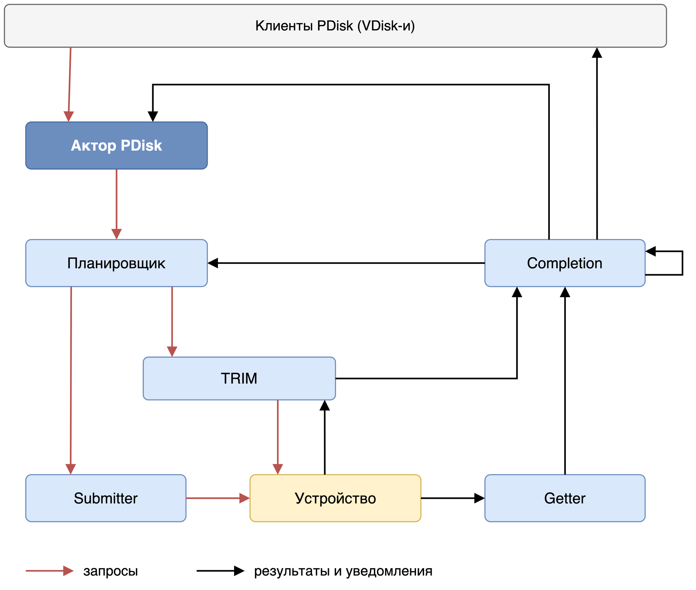
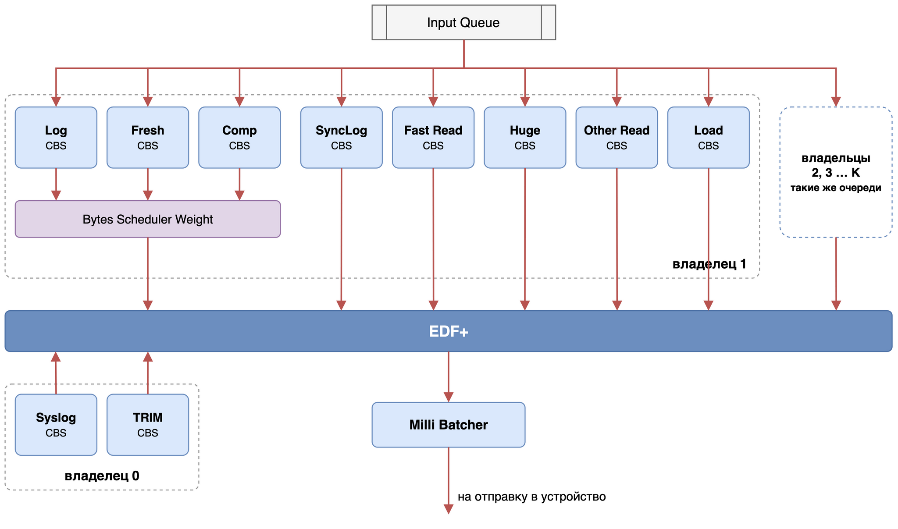
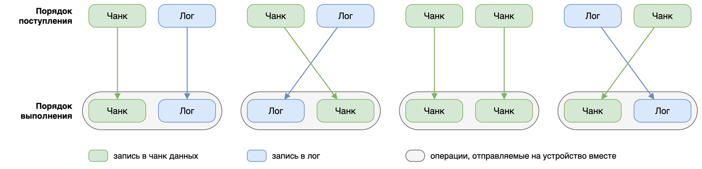
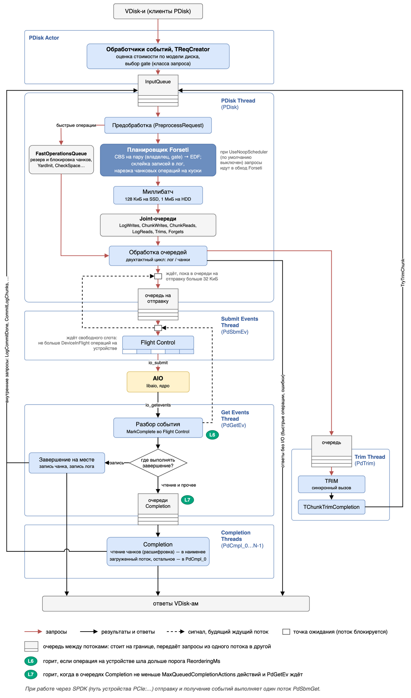

## 3.4 PDisk

PDisk обеспечивает надёжное хранение данных на блочном устройстве. Его
можно рассматривать как файловую систему специального назначения,
обеспечивающую надёжность записи, разделение полосы диска между
пользователями (VDisk-ами) и файлы двух видов --- лог и чанк. В лог
заносятся небольшие записи, которые нужно делать как можно быстрее. В
чанк заносятся большие записи. Сами чанки имеют размер 128 Мб. Внутри
лог реализован как связный список чанков.

Пользователями PDisk-а являются VDisk-и. Один PDisk обслуживает
несколько VDisk-ов, при этом он поддерживает один общий лог и один набор
чанков, которые либо свободны, либо принадлежат разным пользователям.

Лог позволяет:

-   внести запись в лог в привязке к идентификатору владельца
    (владельцем выступает VDisk);

-   прочитать весь лог этого владельца от начала до конца;

-   пометить записи с sequence number \<= такой-то как ненужные.\
    Лог не предполагает произвольного доступа или точечного удаления
    объектов, а предназначен для восстановления после сбоев в работе BS.
    При восстановлении лога читают:

-   PDisk --- для понимания, кому принадлежал какой чанк;

-   VDisk --- для понимания, какие чанки сейчас ему принадлежат.

> Если VDisk записывает в лог PDisk-а какие-то мелкие данные, он делает
> это только для сохранности. Однако он параллельно копит их в памяти и,
> когда накопится много информации, записывает её в чанк.

Чанк позволяет:

-   получить чанк в пользование;

-   прочитать чанк от байта M до байта N;

-   записать данные в чанк (можно с начала, можно в произвольное
    смещение);

-   пометить чанк как ненужный (освободить);

-   атомарно выполнить сразу несколько операций над чанками: коммит
    чанка (подтверждение записи), удаление чанка. Операции записываются
    в лог PDisk-а.

Нулевой чанк (или несколько первых) --- служебный. Используется для
хранения:

-   информации о параметрах форматирования, в том числе собственного идентификатора PDisk-а и ключей шифрования;

-   циклического лога syslog.

В циклическом логе syslog хранится:

-   маппинг номеров пользователей на идентификаторы VDisk-ов;

-   таблица принадлежности чанков (поскольку чанки большие и их немного, 
эта таблица небольшая);

-   nonce и ключи шифрования для чанков;

-   номер чанка самой головы (самой старой записи) лога PDisk.

> Когда лог PDisk разрастается и выполняется его компакшн, в syslog
> пишется новая запись.

PDisk поддерживает непрерывные 64-битные индексы для записей лога
VDisk-ов. Пишет {ui8 owner, ui64 msn}. msn (message sequence number)
разных owner не зависят друг от друга.

Для каждого пользователя поддерживается msn, старше которого записи
более не нужны. Чанки с никому не нужными логами освобождаются.

Сам PDisk является пользователем основного лога.

PDisk разрешает делать записи только с msn, превышающим последнее
использованное значение для данного пользователя.

При этом для эффективного обслуживания нагрузки от множества клиентов у
PDisk есть свой планировщик, который управляет разделением полосы между
различными VDisk. Запросы клиента PDisk-а,
использующего положенную ему полосу или меньше, обслуживаются быстро.
Если же VDisk пытается воспользоваться большей полосой, PDisk предоставляет ему
эту полосу, при условии, что она фактически свободна. При отсутствии лишней полосы
запросы пытающегося потребить больше положенного VDisk начнут вставать в очередь.

Место на PDisk выделяется чанками по 128 MiB и резервируется для:

-   записи формата диска (менее чем 1 чанк);

-   циклического системного лога (несколько чанков);

-   лога данных (200 чанков).

Последний чанк может быть зарезервирован для хранения метаинформации,
используемой системой автоматической конфигурации статической группы.
Оставшееся место доступно VDisk-ам.

**Надёжность**\
Записи «формата», системного лога, сектора с указателем следующего чанка
лога хранятся с тройной репликацией.\
Остальные данные по умолчанию пишутся на PDisk без дополнительной избыточности,
но есть опция, позволяющая записывать с избыточностью лог и чанки данных.
При включении соответствующих опций:

- Сектора записи лога пишутся с избыточностью 4 + 1 (один сектор избыточности на каждые 4 сектора лога).
- Сектора чанков пишутся с избыточностью 14 + 1.

**Шифрование**\
Данные на диске прозрачно зашифрованы, каждый сектор ---самостоятельно.
Шифр --- поточный (Salsa20/8 <http://cr.yp.to/snuffle/spec.pdf>,
ChaCha).

EncryptedData = E~{Key,\ Nonce}~(Data)

Hash = H (SectorOffset, Magic, EncryptedData, Nonce, Version)

Magic = E~Key~ (H(PDiskGuid, SectorType))

На первый взгляд может показаться, что существует всего несколько
состояний чанка: свободен; занят как чанк данных; занят как чанк лога;
занят как системный чанк. Но из-за того, что чанк может быть закоммичен,
освобожден, а владелец чанка может быть удалён, количество состояний
оказывается впечатляющим, несмотря на продолжающиеся операции записи в
его чанки или лог. Диаграмма переходов между этими состояниями приведена
ниже.

По мере того, как место на PDisk заканчивается, он поднимает цветные
флаги, соответствующие проценту неиспользованного количества чанков,
доступного для VDisk.

  |Цвет    |Свободно менее |Цвет флага     |Значение                                      |
  |-------------|---------------|---------------------|----------------------------------------------|
  |$\color{#00B377}{\textsf{■}}$ 00B377 |101 %    |Green = нет флагов   |Все хорошо                                    |
  |$\color{#66E0FF}{\textsf{■}}$ 66E0FF |13 %     |Cyan                 |Алерт «скоро кончится место».                 |
  |$\color{#FBFFB3}{\textsf{■}}$ FBFFB3 |10 %     |LightYellowMove      |Таблетки пытаются сменить группу.             |
  |$\color{#DAE600}{\textsf{■}}$ DAE600 |8 %      |YellowStop           |Таблетки переходят в режим read-only.         |
  |$\color{#BAA600}{\textsf{■}}$ BAA600 |6,5 %    |LightOrange          |Алерт «таблетки не остановились».             |
  |$\color{#996600}{\textsf{■}}$ 996600 |5 %      |PreOrange            |VDisk переходит в режим read-only.            |
  |$\color{#803E00}{\textsf{■}}$ 803E00 |3 %      |Orange               |Все VDisk группы переходят в режим read-only. |
  |$\color{#660000}{\textsf{■}}$ 660000 |1 %      |Red                  |PDisk перестает выдавать новые чанки.         |
  |$\color{#000000}{\textsf{■}}$ 000000 |0,1 %    |Black                |Запас для экстренного восстановления.         |

Принципиальная диаграмма движения сообщений в PDisk выглядит следующим
образом: в актор PDisk-а входит сообщение--запрос. Оно пересылается в
поток планировщика PDisk, который передаёт запрос потоку Submitter.
Задача последнего --- обеспечить своевременную подачу запроса на
устройство, чтобы, например, не возникало пауз между записями групп
секторов, идущих подряд, и вращающиеся диски не делали между двумя этими
записями полный оборот, а писали их сразу друг за другом на максимально
возможной скорости.

Задача потока Getter --- поддерживать правильное представление о статусе
сообщений. Он получает результаты выполнения запросов и передаёт их в
поток completion, выполняющий обработку и отправляющий итоговое
сообщение актору--клиенту PDisk.

Актор в PDisk всего один, а остальные потоки --- настоящие потоки
операционной системы, создаваемые PDisk-ом для себя самостоятельно.

Планировщик делит полосу не только между разными VDisk-ами, но и между
запросами разных классов от одного VDisk. Система учитывает приоритет задач.
Файловые системы так не умеют. Основной поток, входящий в PDisk, --- это
поток записи в лог (от таблеток, от LSM дерева VDisk-а), очень большой
поток очень маленьких записей (порядка 100 байт). Чрезвычайно важно
вносить их с минимальным временем отклика и обслуживать как можно
больший поток. Одновременно с этим идут real-time- и batch‑запросы на
чтение и запись.

Одна из сложностей создания планировщика заключается в том, что диск
не обеспечивает вытесняющей многозадачности: уже переданный ему запрос
нельзя вытеснить, приходится ждать его завершения.
К тому же устройство может переупорядочить несколько
конкурирующих запросов. Если же подавать запросы по одному, пропускная
способность будет очень низкой.

Чтобы учитывать эти особенности, PDisk использует модель, предсказывающую,
сколько времени займет выполнение конкретной последовательности операций.
Эта оценка помогает выстроить расписание для обслуживания запросов
в реальном времени.

Сложная логика планировщика PDisk основана на модифицированном алгоритме
Earliest Deadline First. Поток операций на выходе из него несколько
модифицируется, операции слегка батчуются.

Основным элементом планировщика является CBS (Constant Bandwidth
Server). Почитать о том, как работают CBS, можно в статье про планировщик
HGRUB «Serving non real-time tasks in a reservation environment».

Так как в лог вносится много мелких записей от разных VDisk, можно
переупорядочить операции так, чтобы объединить несколько записей в лог,
записав их подряд.

Каждому чанку данных при открытии записи выдаётся диапазон Nonce. При
коммите записи чанка диапазон Nonce указывается в записи лога о коммите.
Это позволяет иметь последовательные Nonce для всех секторов в пределах
чанка данных и использовать их в том числе для контроля целостности
данных. Так, при поднятии можно проверить целостность последних
записанных чанков данных.

Для предотвращения повторного использования Nonce при записи данных
после падения: периодически (раз в сколько-то Nonce), текущее значение
Nonce для секторов данных пишется в лог. При поднятии Nonce
увеличивается на 2х периода, а новое значение записывается в лог.

