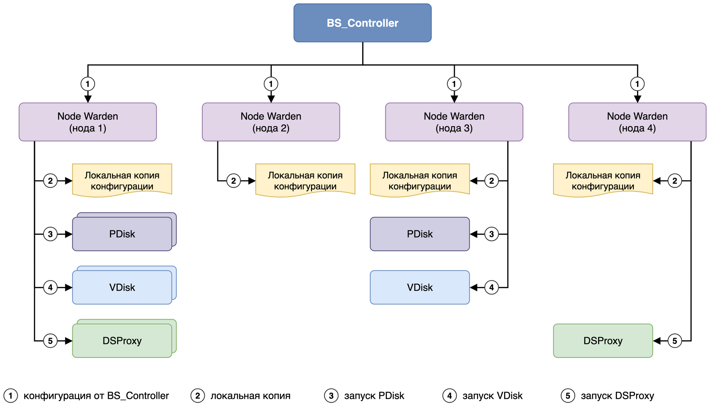
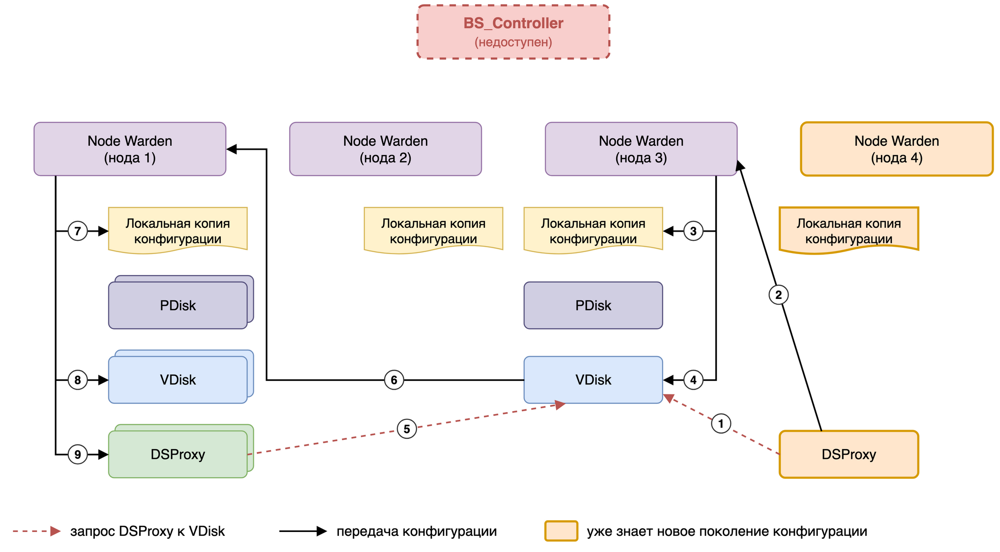

## 3.8 Node Warden

Node Warden --- сервис, запускаемый на каждой ноде кластера. Node Warden
запускает PDisk-и, VDisk-и и DSProxy, получая конфигурацию из файлов
конфигурации для статической группы или от BS_Controller для
динамической группы

Когда первый запрос отправляется в DSProxy, он оформлен специальным
образом так чтобы если DSProxy актор конкретной группы не создан, этот
запрос пересылается в node warden. Node warden заводит нового DSProxy
для того чтобы он обработал этот запрос. У NodeWarden есть справочник
информации по группам --- Group registry. Он содержит информацию о каждой
группе с которой node warden так или иначе сталкивался. Если такой
группы у node warden нету, он запускает процесс резолва группы. Сначала
он отправляет запрос GetGroup в BS_Controller. Он в ответ отправляет
информацию про группу. Если же окажется что BS_Controller не отвечает,
тормозит или вообще не работает, связь с ним потеряна и т. п., тогда
node warden начинает процесс обхода соседей (других node warden на
других нодах) с целью поиска информации об этой группе. Он начинает
заниматься этим если не получил конфигурацию от BS_Controller за 5
секунд. Ноды предоставляют информацию, node warden выбирает конфигурацию
с максимальным поколением и запускает DSProxy.

Когда приходит информация о группе может оказаться что в группе включено
шифрование, но при этом ключ ещё не сгенерирован. Сам
BS_Controller при создании пула не может нагенерировать ключей, потому что
для обеспечения безопасности данных в многопользовательских (мультитенантных)
инсталляциях незащищенный ключ шифрования группы никогда не покидает узлы соответствующей
базы (тенанта), то есть ключи шифрования генерируются в том тенанте в котором группа используется
(подробнее о тенантах в разделе 9.1 Разделение ресурсов между базами).

Сначала отправляем GetGroup, получаем её
конфигурацию и информацию что она без ключа, генерируем ключ локально,
шифруем его и отправляем ProposeGroupKey в BS_Controller. Поскольку несколько нод
может захотеть это сделать одновременно, BS_Controller выберет первый
корректно сформированный запрос и надёжно сохранит шифрованный ключ, на
все запросы он ответит сообщением с итоговой конфигурацией группы
содержащей итоговый зашифрованный ключ.

Сам BS_Controller расшифровать ключ не может.

Группу можно реконфигурировать. Реконфигурация группы --- это либо когда
1 VDisk переехал со своего места на одном пдиске на другой пдиск, либо
если происходит декомиссия групп (вместо группы будет работать
BlobDepot (блобовница)) и меняется способ обращения к группе. В таких случаях
поколение группы увеличивается на 1 и всем VDisk BS_Controller
рассылает новую конфигурацию. Также новую конфигурацию он рассылает всем
нодам заинтересованным в конфигурации этой группы. Но может получиться
так что какая-то нода не смогла получить от BS_Controller сообщение о
том что конфигурация поменялась. Тогда DSProxy отправив очередной запрос
к VDisk получит в ответ статус RACE поскольку запрос отправлен от
DSProxy с поколением конфигурации например 10 а группа уже в поколении
11. В таком случае VDisk когда увидит что к нему обращается DSProxy с
более старым поколением конфигурации автоматом отправит GroupInfo в
ответ. DSProxy распарсит то GroupInfo и отправит в свой NodeWarden, а он
у себя запомнит. Это способ получения конфигурации DSProxy через VDisk.

В обратном направлении DSProxy передаёт актуальную конфигурацию
отставшему VDisk через обслуживающий соединение актор очереди. Например,
если DSProxy уже знает поколение 11, а VDisk остаётся в поколении 10,
актор очереди включает описание группы в поле `RecentGroup` сообщения
проверки готовности `TEvVCheckReadiness`. Конфигурация передаётся при
установлении соединения; дополнительная проверка готовности с новой
конфигурацией может быть отправлена после ответа `RACE` от отставшего
VDisk. VDisk применяет новое поколение и уведомляет свой NodeWarden
сообщением `TEvUpdateGroupInfo`. NodeWarden обновляет сведения о группе
и конфигурацию её локальных компонентов. Поэтому для распространения
уже известной конфигурации при недоступном BS_Controller достаточно
взаимодействия запущенного DSProxy с отставшими VDisk; непрерывный поток
пользовательских запросов не обязателен.

Синхронизация двух VDisk требует совпадения поколений конфигурации
группы. Если один VDisk отправляет запрос `TEvVSync` другому VDisk с
отличающимся поколением, получатель возвращает `TEvVSyncResult` со
статусом `RACE` и собственным идентификатором. Синхронизация при этом
не выполняется. Актуальная конфигурация группы в этом ответе не
передаётся. Syncer завершает текущую попытку со
статусом `Race`, а планировщик назначает следующую. Обработчик такого
ответа не запрашивает новую конфигурацию и не уведомляет NodeWarden
о выявленном расхождении поколений. Пока поколения различаются,
повторные запросы синхронизации также получают ответ `RACE`.

Сообщения синхронизации передаются напрямую через Interconnect и не
проходят через очередь DSProxy, поэтому описанный выше механизм
передачи конфигурации через `TEvVCheckReadiness` здесь не задействован.
Повторные попытки синхронизации сами по себе не устраняют расхождение:
для её возобновления отставший VDisk должен получить обновление другим
путём --- от BS_Controller через NodeWarden либо при взаимодействии
с DSProxy, уже располагающим новой конфигурацией.

