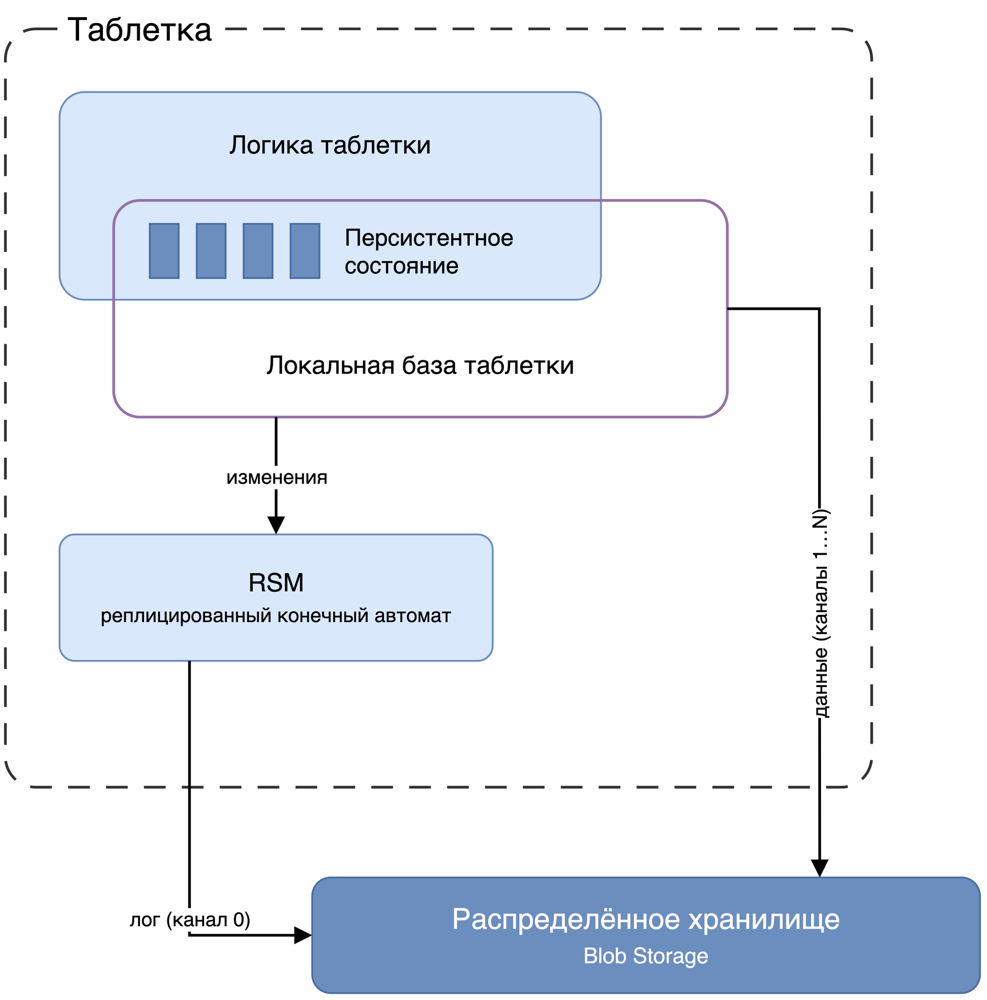
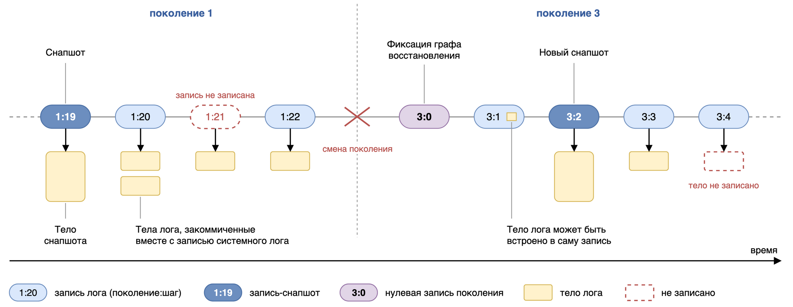
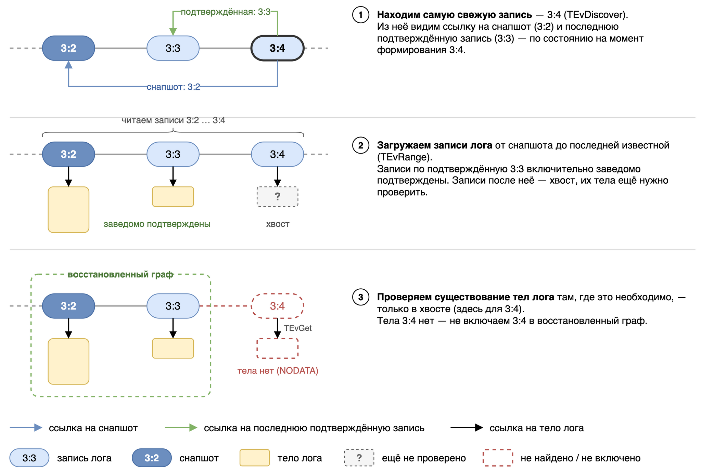
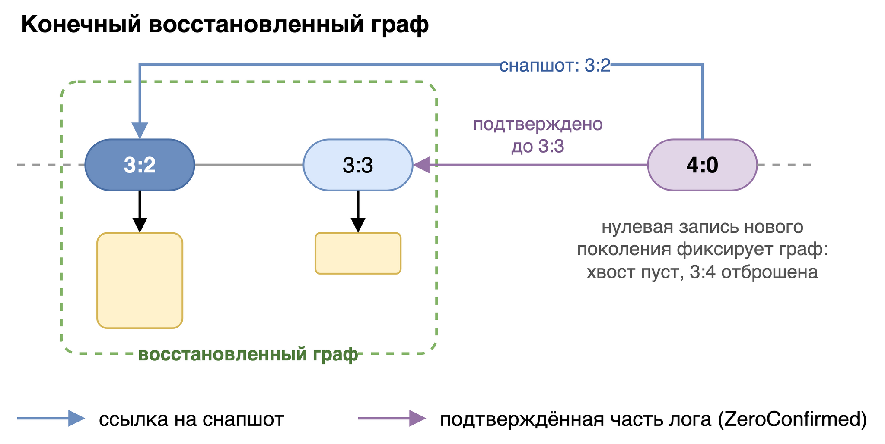

## 4.1 Таблетки

Таблетка (от англ. tablet --- небольшая табличка, фрагмент большой таблицы) --- это центральная абстракция YDB, на основе которой построена практически вся логика системы. Таблетка представляет собой реплицированный конечный автомат (Replicated State Machine, RSM), работающий поверх общего лога в распределённом хранилище. Она является актором с персистентным состоянием и данными, за которые она отвечает. Свои данные таблетка хранит в распределённом хранилище, которое обеспечивает геораспределённость: данные могут храниться в нескольких копиях, доступных в разных дата-центрах.

Ключевое отличие подхода YDB от многих других распределённых систем состоит
в том, что таблетка хранит своё персистентное состояние в распределённом
хранилище Blob Storage, а не на локальном диске узла. Репликацию и
отказоустойчивость хранения обеспечивает Blob Storage. Поэтому отказ
машины, на которой выполнялась таблетка, не приводит к потере её
зафиксированных изменений: новый экземпляр на другой ноде восстанавливает
состояние из сохранённого лога и продолжает работу с сохранением
консистентности. Это позволяет восстанавливать вычисляющую часть
независимо от отказавшей машины. Для запуска нужны доступные ресурсы,
а группы хранения должны оставаться в пределах своей модели отказов.

### Однопоточная модель выполнения

Таблетка работает однопоточно: в каждый момент времени только один поток обрабатывает её сообщения и изменяет её состояние. Все изменения сериализуются через запись лога в распределённое хранилище. За счёт этого достигается уровень изоляции strict serializable без необходимости применения алгоритмов распределённого консенсуса для каждой операции. Однопоточность упрощает разработку логики таблетки, поскольку разработчику не нужно заботиться о блокировках и гонках при доступе к состоянию.

### Обеспечение единственности лидера

В YDB не используется алгоритм консенсуса RAFT для таблеток. Система
опирается на распределённое хранилище и механизм поколений (`generation`),
который защищает состояние таблетки от записи устаревшим лидером.
При смене лидера новый экземпляр получает поколение больше предыдущего.
Перед переходом к работе он блокирует предыдущие поколения операцией
`TEvBlock` в группах хранения каналов таблетки, определяемых по истории
их привязок. После успешной блокировки старый лидер не может продолжать
успешную запись в эти группы, даже если его процесс ещё работает
и не узнал о смене лидера.

Во время перезапуска или при недоступности необходимых компонентов
работающего лидера может не быть. Новый экземпляр должен завершить
блокировку и восстановление состояния, прежде чем сможет обслуживать
операции как действующий лидер.



Чтобы назначить лидера, нужен Hive --- системная таблетка, управляющая жизненным циклом всех остальных таблеток в базе. Чтобы запустить сам Hive, нужен Bootstrapper --- специальный актор, координирующий запуск системных таблеток между нодами. А чтобы не возникало конфликтов между кандидатами в лидеры при одновременном запуске, используется механизм блокировок на группе хранения.

### Жизненный цикл таблетки

Жизненный цикл таблетки управляется Hive (подробнее в разделе 5.4). Hive принимает решение о том, на какой ноде запустить таблетку, отправляет команду локальному сервису Local на выбранной ноде, и Local выполняет запуск. При запуске таблетка проходит несколько этапов: получение нового номера поколения, регистрация в State Storage, блокировка записи предыдущих поколений, восстановление состояния из лога (подробнее в разделе 4.4), и переход в рабочее состояние.

При отказе ноды Hive обнаруживает потерю связи с Local на этой ноде и перезапускает работавшие на отказавшей ноде таблетки на других доступных нодах. Поскольку состояние таблетки хранится в распределённом хранилище, а не на локальном диске, миграция таблетки между нодами не требует копирования данных. Новый экземпляр просто читает лог из распределённого хранилища и восстанавливает состояние. Это делает таблетку отказоустойчивой единицей системы: при проблемах с процессом на ноде или с самой нодой таблетка может быть запущена на доступных ресурсах системы в любом месте кластера.

### Структура хранения

Каждой таблетке при создании назначается набор каналов хранения, каждый из которых привязан к определённой группе Blob Storage. Нулевой канал зарезервирован для системного лога таблетки. Остальные каналы используются для хранения данных. Такое разделение позволяет размещать лог и данные таблетки на группах с разными характеристиками: например, лог --- на быстрых SSD-группах для минимизации задержки записи, а данные --- на более ёмких HDD-группах.

Над базовым механизмом лога работает локальная база (подробнее в разделах 4.2 и 4.3), которая позволяет таблетке оперировать не записями в лог, а таблицами с типизированными колонками через удобное C++ API.

```{=latex}
\begingroup
\floatplacement{figure}{H}
```







```{=latex}
\endgroup
```

### Типы таблеток

На основе таблеточной абстракции в YDB реализовано множество различных сущностей. DataShard хранит пользовательские данные в строковых таблицах. ColumnShard хранит данные в колоночном формате для аналитических запросов. Coordinator и Mediator обеспечивают распределённые транзакции. SchemeShard управляет схемой базы данных. Hive управляет другими таблетками. KeyValue предоставляет простое key-value хранилище. Подробнее о типах таблеток --- в главе 6.
