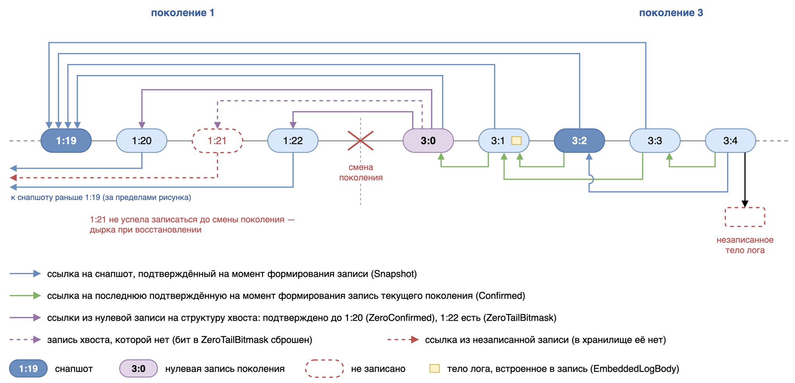

## 4.4 Устройство лога таблетки

В этом разделе рассмотрен процесс записи и восстановления состояния таблетки.

### Устройство лога таблетки

Под системный лог таблетки зарезервирован нулевой канал. В нулевой канал
должна писать только системная логика и только записи специального
формата `TTabletLogEntry`. При формировании `LogoBlobID` записи лога
таблетка всегда использует то поколение, лидером которого является, а в
качестве шага --- монотонно растущее число. Под номером 0 пишется
системная запись о начале поколения.

При формировании записи коммита в запись лога записываются:

-   флаг, является ли эта запись снапшотом

-   последний известный на момент формирования подтверждённый снапшот (в
    виде пары generation:step).

-   последняя запись текущего поколения, до которой лог полностью
    подтверждён.

-   список шагов, от которых зависит текущий шаг из числа ещё
    неподтверждённых.

-   опционально --- список ссылок на логоблобы, от которых зависит данная
    запись лога. Записи должны либо коммититься параллельно, либо быть
    уже закоммичены к моменту формирования записи.

-   опционально --- списки логоблобов для пользовательского трекинга
    мусора.

-   если снапшот --- флаг, является ли запись полным снапшотом (возможно
    восстановление лога при недоступности предыдущих записей).

-   опционально --- встроенное тело пользовательского лога.

Запись лога считается успешной (и рапортуется таковой пользовательскому
коду), когда:

-   успешно записана сама запись в нулевом канале,

-   успешно записаны все блобы, которые коммитятся параллельно
    (перечисленные в references),

-   успешно закоммичены все шаги, от которых зависит текущая запись.

Записи снапшота лога (если это не total-снапшот) считаются зависящими от
всех предыдущих, так как могут содержать неявные ссылки на них.
total-снапшоты считаются не зависящими ни от кого и полностью заменяют все
предыдущие записи лога.

### Восстановление лога

Следующее, что делает кандидат после успешного захвата номера поколения
на себя, --- это восстанавливает лог. Для этого сначала находится самая
свежая запись в нулевом канале (пока --- без проверки успешности коммита
соответствующей записи, нас интересует только само тело записи лога). Из
него извлекается ссылка на снапшот лога и номер подтверждённого шага --
всё это по состоянию на момент формирования найденной самой свежей
записи.

Дальше запросами `TEvRange` зачитываются записи лога между выясненным
снапшотом и самой свежей записью. Диапазонов два:

-   от снапшота до подтверждённого шага --- обычным чтением,

-   от следующего за подтверждённым шагом до самой свежей записи --- с
    флагом `MustRestoreFirst`: DSProxy сначала восстанавливает
    недостающие части блоба и только потом возвращает его. Поэтому при
    повторном восстановлении ответ на вопрос, записана ли запись,
    останется тем же.

Фолловеры читают только первый диапазон, неподтверждённый хвост они
игнорируют.

Если снапшот лога не попадает в то же поколение, что и последняя
запись, то структура лога в промежуточных поколениях восстанавливается
по нулевым записям. Нулевая запись поколения описывает предыдущее
поколение, в котором была хотя бы одна запись: до какого шага оно
подтверждено без пропусков (`ZeroConfirmed`) и какие записи после этого
шага вошли в восстановленный граф (битовая маска хвоста
`ZeroTailBitmask`). Поколения, лидеры которых не успели ничего записать,
пропускаются.

Заведомо подтверждёнными считаются:

-   в самом свежем поколении --- записи до подтверждённого шага,
    указанного в самой свежей записи, включительно. Подтверждённый шаг
    всегда относится к текущему поколению записи;

-   в предыдущих поколениях --- записи до шага `ZeroConfirmed` и записи
    хвоста, отмеченные в битовой маске нулевой записи следующего
    поколения.

Тела и ссылки заведомо подтверждённых записей не проверяются, но сами
записи должны быть прочитаны. Невозможность прочитать такую запись
считается ошибкой. Восстановление лога всё же будет возможно, если
позже в графе найдётся более свежий снапшот: при его добавлении всё,
что было до него, отбрасывается. Записи хвоста, не отмеченные в маске,
игнорируются, даже если они есть в хранилище.

Хвост самого свежего поколения --- записи после подтверждённого шага,
включая саму найденную самую свежую запись, --- анализируется на
возможность быть применённым. Записи проверяются по порядку шагов:

-   проверяется, что запись прочитана. Отсутствующая запись хвоста
    просто не попадает в граф, ошибкой это не считается,

-   проверяется, что записаны тела лога и другие блобы самой таблетки,
    на которые ссылается запись. Для этого отправляется `TEvGet` с
    чтением только индекса, ответ `NODATA` означает, что блоб не был
    записан,

-   проверяется, что все шаги, от которых зависит запись (`DependsOn`),
    заведомо подтверждены или уже включены в восстановленный граф.
    Для снапшота вместо этого достаточно, чтобы он был total-снапшотом
    или шёл сразу за непрерывной цепочкой восстановленных записей.

При выполнении этих условий запись лога добавляется в список
восстановленных записей, иначе она отбрасывается.

Мы считаем блоб незаписанным только в том случае, если можно доказать,
что полное число part-ов блоба не было записано (конкретное условие
зависит от используемой схемы кодирования и скрыто от таблетки за
DSProxy, который в этом случае отвечает `NODATA`). При невозможности
такого доказательства и одновременно невозможности восстановить полное
количество реплик DSProxy возвращает ошибку, и лог восстановлен быть
не может.

Полностью восстановив таким образом лог, мы передаём его на
восстановление пользовательскому коду, а полученную картину хвоста лога
фиксируем в нулевой записи поколения. Работа таблетки начинается только
после успешной записи нулевого шага поколения. За счёт этого
обеспечивается повторяемость восстановления хвоста лога при быстрых
перезапусках лидера.

