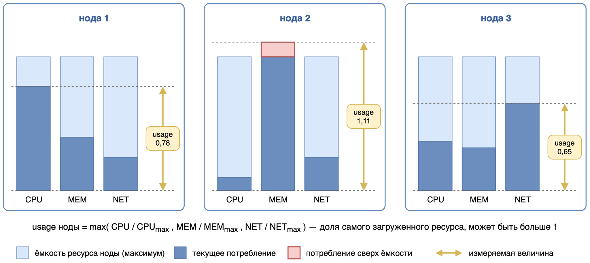
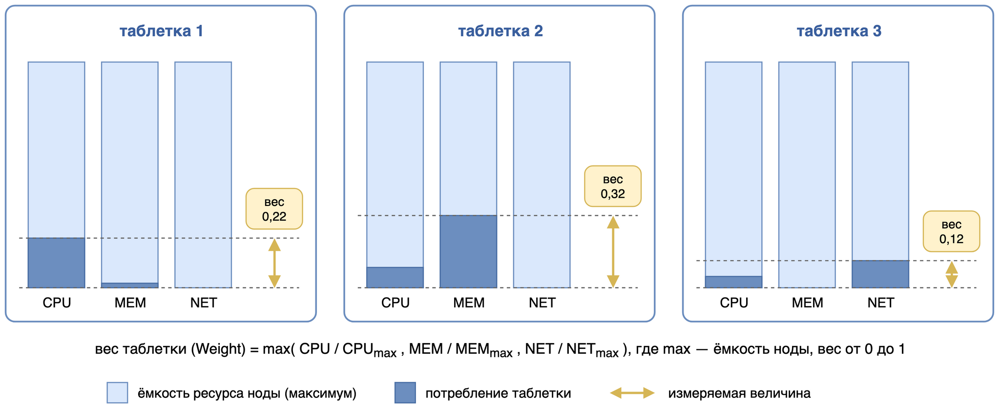
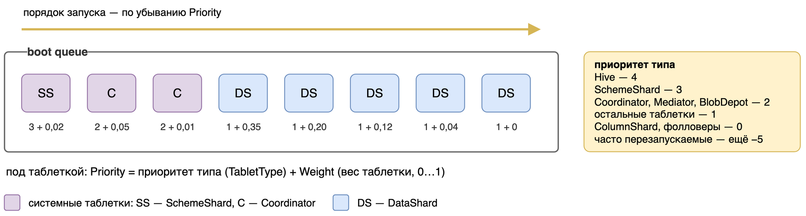
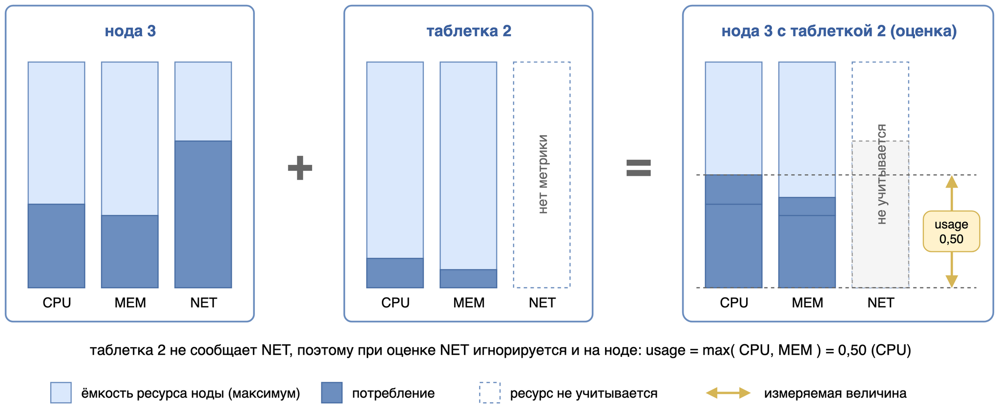
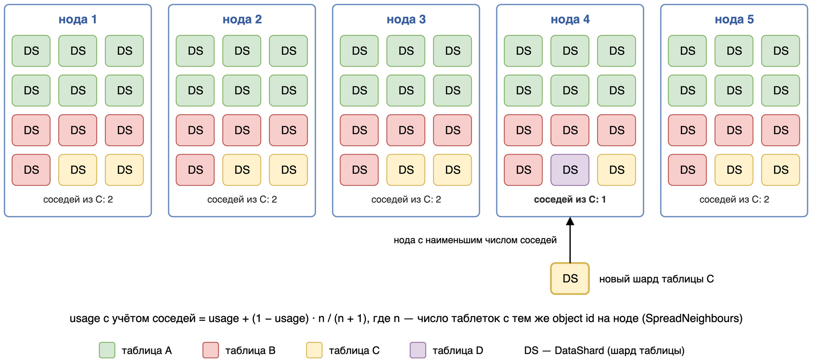
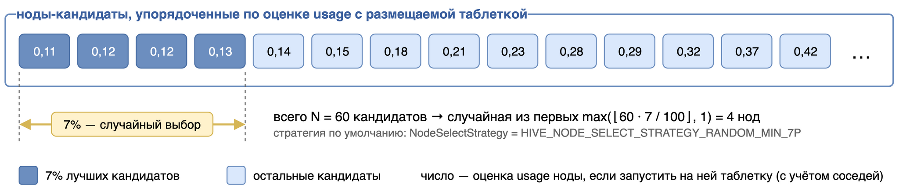
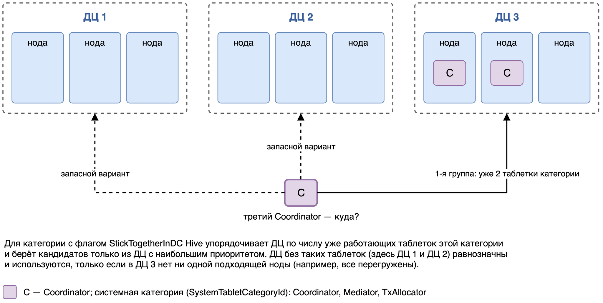
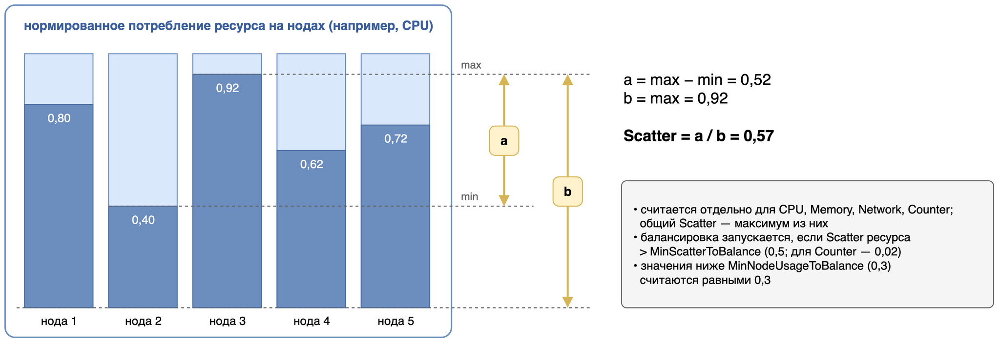
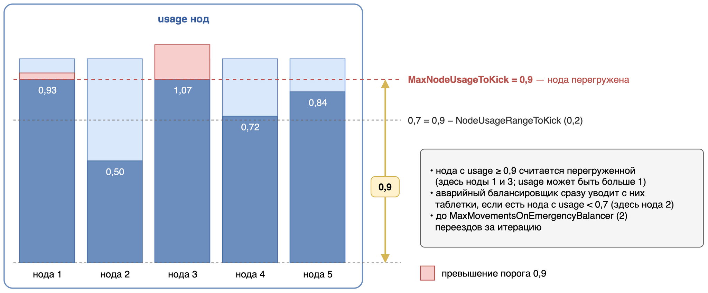
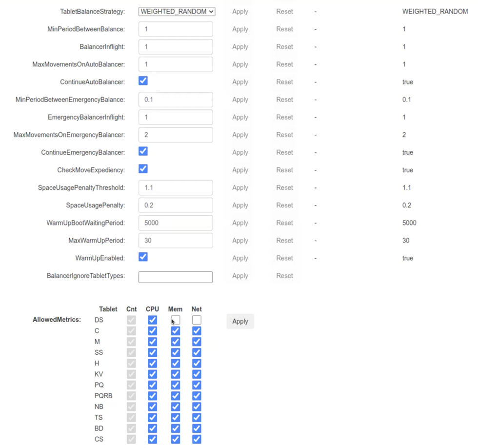

## 5.4 Hive

Управление таблетками базы осуществляет специальная таблетка, называемая
Hive. Hive хранит в локальной базе реестр таблеток своей базы, историю
конфигурации каналов хранения для каждой таблетки, статистику потребления
ресурсов таблетками, информацию о том где и в каком поколении была
запущена каждая из таблеток. Hive управляет запуском таблеток, следит за
их жизненным циклом, умеет их перезапускать при отказе оборудования или
внезапном завершении работы таблетки, выполняет балансировку таблеток по
нодам на основании собираемых со всех узлов кластера метрик загрузки.

В Hive регистрируется каждая нода. За регистрацию отвечает
локал --- локальный сервис на ноде, который
обеспечивает взаимодействие с Hive и исполнение его команд. Локал сообщает
Hive о характеристиках ноды, о том какие таблетки она может запускать и
сколько ресурсов на
ней доступно. Hive использует эту информацию для выбора наиболее подходящей ноды
для запуска таблетки.

При холодном старте Hive не содержит актуальной информации о состоянии
узлов. Hive восстанавливает соединения со всеми нодами,
которые зарегистрированы в его базе, то есть которые были активны до последнего перезапуска.
Для этого он инициирует соединение со всеми ними, отправляя событие ping.
Данный механизм информирует ноду о работоспособности Hive, после чего
нода инициирует пайп к нему.

Механизм предусмотрен для случая, когда локал поддерживает связь с
устаревшей инкарнацией Hive.
В этом случае новый Hive отправляет ноде сообщение о
существовании нового Hive с обновленным поколением, после чего сообщения
от предыдущего поколения Hive игнорируются. Локал устанавливает
пайп. Формально инициатива исходит от локала: он инициирует пайп и
передаёт запрос на регистрацию ноды, а в ответ Hive отправляет ему
запрос на синхронизацию таблеток. По этому запросу локал проводит учёт
всех своих таблеток. Он сообщает Hive о том, какие таблетки
имеются на ноде, какие запущены, какие запускаются. Hive сверяет эти
данные с состоянием,
которое хранится у него относительно этой ноды, и при обнаружении расхождений
предпринимает корректирующие действия: останавливает таблетку или инициирует
её запуск в другом месте.

При возникновении проблем с Hive эффективным решением является его
перезапуск, поскольку при инициализации выполняется полная синхронизация
и инвентаризация всех таблеток.

После этого у Hive может возникнуть необходимость в запуске
таблеток. Например, если определённая таблетка отсутствует на всех
нодах, или попытка установить связь с нодой, где ранее была запущена таблетка,
оказалась неуспешной. В этом случае нода считается отключённой, и её
таблетки перемещаются
в boot queue.

Boot queue представляет собой приоритизированную очередь таблеток,
ожидающих запуска. При необходимости запустить таблетку она сразу
помещается в boot queue. При этом ещё неизвестно, удастся ли её
запустить и имеются ли ноды, способные выполнять эту таблетку.
Hive последовательно обрабатывает элементы очереди,
подбирая для запуска каждой таблетки наиболее подходящий узел
с учётом профиля загрузки этой таблетки. Если Hive удаётся подобрать
подходящий узел, он
отправляет на локал выбранной ноды команду на запуск этой таблетки. Пока
таблетка находится в boot queue, она имеет статус booting. После того, как Hive определил
для неё ноду и отправил запрос на локал, она переходит в статус starting. Далее ожидается
подтверждение от локала о запуске таблетки. Таблетка
выполняет запуск, загружает лог, создаёт снэпшот, и как
только она активизируется, уведомляет локал о завершении запуска. Локал
сообщает об этом Hive, после чего Hive помечает таблетку как running. Если
таблетка на ноде остается в состоянии starting, это означает, что у неё
возникли проблемы
с загрузкой (как правило, с чтением лога).

Запущенные таблетки периодически отправляют информацию о
загрузке в локал. Они сообщают объём потребленного CPU, объём затраченной памяти,
а некоторые таблетки также передают информацию о потреблении
сетевой полосы.

В локале эту информацию отслеживает специальный класс. Он мониторит
изменение метрик, поскольку многие таблетки
находятся в состоянии покоя, не генерируя нагрузку и не потребляя
ресурсов. Передавать эту информацию каждый раз в Hive
нецелесообразно. Помимо метрик таблеток, локал собирает текущее потребление CPU
во всех пулах на ноде, поскольку суммирование данных всех таблеток не даёт
общее потребление CPU в пулах, где присутствует много сторонних
акторов.

Для оценки загрузки ноды по памяти Local использует показатель
MemoryUsedInAlloc, полученный из Whiteboard. В варианте с TCMalloc
его вычисляют как используемую аллокатором физическую память
за вычетом памяти его кэшей. После освобождения объектов память
может оставаться в этих кэшах, поэтому оценка аллокатора может
снижаться раньше AnonRss. Показатель AnonRss не обязан уменьшаться
сразу после снятия нагрузки, но может снижаться при возврате
неиспользуемой памяти операционной системе.

Локал агрегирует эти данные и передаёт статистику в Hive не чаще одного
раза в 2 секунды. Hive обрабатывает эти данные,
используя сглаживание для повышения заметности всплесков потребления на таблетках.
Hive для каждой таблетки хранит агрегированные данные статистики и
сохраняет эти данные каждый раз при их поступлении в локальную
базу. Если это замедляет работу, Hive отправляет
подтверждение получения метрик с большей задержкой, и локал ожидает
подтверждения, прежде чем начинать отсчёт 2 секунд от
его получения, что предотвращает перегрузку Hive. Hive отправляет
подтверждение по завершении коммита в базу.

Обычно загрузка Hive даже на самых больших базах в районе 5--10%.

Hive должен запускать таблетки на различающихся по характеристикам нодах. Они могут различаться как по объёму доступных
ресурсов в принципе, так и по количеству текущих доступных ресурсов. Загрузка нод может
существенно различаться, причем не всю нагрузку
создают таблетки, ноды могут быть перегружены по другим причинам.
Для принятия решений в Hive используется метрика
Usage. Usage --- это нормированный максимальный ресурс на ноде,
который эта нода потребляет. При наличии информации о
ёмкости сетевого адаптера, максимальной
пропускной способности по сети, объёме памяти и количестве
CPU текущее потребление каждого из этих ресурсов
делится на максимальное значение, получается относительное значение
нагрузки, из которых выбирается
максимум. Usage может изменяться от 0 до 1, в некоторых случаях
может превышать 1.

Учитывается потребление CPU в разных пулах, потребление памяти по
отношению к лимиту cgroup, а также сетевая нагрузка, однако на практике этот параметр
обычно не является узким местом. Даже топики не достигают предела пропускной
способности сети. При этом, если
какое-либо событие обрабатывалось длительное время, потребление при завершении его
обработки может скачкообразно превысить 100%, и теоретически оно может
быть выше этого значения.

Если в Hive отображается загрузка по CPU 300%, это означает, что таблетки
сообщили о загрузке
3 ядер. Эти значения представляют проценты от потока, тогда как фактическое usage в Hive
отображается в отдельной колонке в виде нормированного значения, эталонного
показателя. Когда оно приближается к 1, это свидетельствует о приближении
к допустимой ёмкости этой ноды.

Перед Hive стоит задача размещения таблетки, при этом ноды в разной степени загружены, одни из них потребляют больше CPU, а другие
больше памяти, и Hive располагает информацией обо всех этих характеристиках.
Таблетки также различаются, некоторые рассылают большие количества
сообщений, другие потребляют много CPU, третьи почти не потребляют ресурсов.

Hive хранит метрики таблеток по умолчанию за час. Для этого используется 24 интервала
на этом периоде, и при необходимости получить метрику выбирается максимум из
этих интервалов. По мере поступления метрик окно
обновляется. Каждая
таблетка имеет собственные метрики. Также для каждого object id таблеток вычисляется среднее значение
метрик, для каждого типа таблеток существует среднее по метрикам. Назначение этого механизма следующее:
если имеется 5 KV таблеток, каждая из которых сообщает о 100 МБ/с по
сети, при создании 6-й таблетки она должна быть пустой, но
поскольку известно, что 5 KV таблеток сообщали о 100 МБ/с, этой
новой таблетке назначается среднее по этим 5, то есть также 100
МБ/с. Приоритет при этом имеет object id. Это означает, что если
в базе имеется 3 таблицы и происходит сплит одной из таблиц, то новые таблетки,
являющиеся результатом сплита в этой таблице, получат среднее от
таблеток только этой таблицы, поскольку предполагается, что в масштабах
одной таблицы ожидается средняя нагрузка. Это приближенный подход, однако он лучше,
чем создание таблеток с пустыми метриками.

Таблетки различаются между собой, однако иногда необходимо определить, какая таблетка
потребляет больше ресурсов по сравнению с
другими. Для решения этой задачи применяется аналогичный подход: нормируется
потребление таблетки, что называется весом, это значение от 0 до 1, которое позволяет
отличить тяжёлую таблетку от лёгких. Необходимость этого механизма
связана с начальным запуском.

Метрики, вес таблетки и тип
используются для организации очереди загрузки (boot queue). Это
приоритизированная очередь: приоритет таблетки равен сумме приоритета
её типа и её веса. Приоритеты типов по умолчанию: Hive --- 4, схемшард
-- 3, координатор, медиатор и BlobDepot --- 2, остальные таблетки --- 1,
ColumnShard и фолловеры --- 0 (их можно переопределить параметром
`TabletTypeToBootPriority`). Вес обычно не превышает единицы, поэтому
тип оказывает решающее влияние: системные таблетки попадают в начало
очереди независимо от веса. Таблеткам, которые часто перезапускаются,
приоритет понижается на 5.

Далее необходимо распределить таблетки по кластеру. Например, при создании
большого количества датшардов для достижения равномерного баланса распределение начинается с более
тяжёлых таблеток. Сначала более тяжёлые таблетки распределяются по нодам, а затем все
более лёгкие. На практике установлено, что таблетка с большей
нагрузкой, как правило, более активна и участвует в большем количестве
операций, поэтому целесообразнее запустить её первой, чем таблетку не сообщающую метрик, к которой вероятно вообще не будет обращений.

Процесс выбора ноды для запуска выглядит следующим образом: запрашиваются все метрики ноды,
при этом usage не используется. При поиске ноды для таблетки анализируются
её ресурсы. Важно, что таблетка может не сообщать информацию о всех ресурсах. Например,
многие таблетки не сообщают данные о сети, датшард сообщает только о CPU и памяти.
При выборе ноды рассматриваются все кандидаты, и при сравнении того,
какая из них по метрикам более подходит, сеть не
учитывается. В данном случае это означает, что потребление сети
не используется при выборе и игнорируется на нодах. На
рисунке, например, определяющим является CPU. Предполагается, что если таблетка не
сообщает данные о сети, то она её условно не потребляет, и добавление таблетки на
ноду не ухудшит ситуацию с этим ресурсом. Данное предположение не совсем корректно, однако используются
имеющиеся данные.

В общем случае процесс выглядит следующим образом: формируется список кандидатов из нод.
Прежде всего проверяется возможность запуска таблетки на ноде.
На это влияет множество факторов. Например, на ноде превышены
лимиты на количество таблеток, или
нода не может запускать таблетки данного типа.
Ноды могут объявлять о возможности запуска только таблеток
определённого типа. Если нода может запускать таблетки этого типа,
выбор ноды происходит по сложному алгоритму.

Задача Hive состоит в равномерном распределении объекта схемы по кластеру.
В системе используется понятие соседей. При выборе ноды рассматривается
ситуация с большим количеством DataShard, когда ноды примерно одинаково
загружены. При этом учитывается
соседство. При рассмотрении ноды и таблетки для
проверки возможности их совместного размещения анализируется количество
таблеток на ноде с таким же object id, то есть с таким же
идентификатором схемы из схемшарда, как и у размещаемой таблетки.
При наличии таблицы из 100 датшардов
чем больше на ноде датшардов этой таблицы, тем менее предпочтительной
считается эта нода. Используется коэффициент, снижающий вес ноды.
Чем больше соседей датшардов той же таблицы, тем меньше вероятность
выбора этой ноды. В нормальном кластере без пустых нод при
создании новой таблицы из 1000 DataShard её шарды распределяются равномерно по
всем нодам.

Для выбора ноды существует 4 стратегии. Для заданной таблетки Hive
перебирает все ноды, для каждой проверяется возможность запуска таблетки на ноде,
анализируется получаемый вес при их объединении, результат фиксируется --- таким образом формируется список нод-кандидатов для
запуска. Первая версия Hive всегда выбирала минимум, что приводило
к неоптимальным эффектам, особенно при холодном старте системы.
Стратегия по умолчанию сортирует всех кандидатов для данной
таблетки и выбирает случайную ноду из минимальных 7 процентов этих
кандидатов. Таким образом
она стремится разместить таблетку на менее загруженную ноду с некоторым
разбросом.

Дата-центры также влияют на выбор нод. Существует категория системных
таблеток, для которых задано требование размещения в одном дата-центре с другими таблетками той же категории.

При попытке запуска
таблетки на ноде Hive анализирует наличие у неё специальной категории и
настройки «запустить с друзьями». При наличии этой настройки происходит
сортировка нод по дата-центрам. Если имеется 3 дата-центра, формируются 3
группы нод с сортировкой таким образом, чтобы в первую группу попали
ноды из того дата-центра, где уже размещены друзья этой таблетки, то есть
таблетки с той же категорией. Например, при наличии 3 дата-центров
и необходимости запуска третьего координатора, если два из них уже
запущены в 3-м ДЦ, ноды из этого 3-го ДЦ будут помещены
в первую группу. Процесс выбора ноды для запуска продолжается следующим образом: Hive
сначала обрабатывает первую группу и получает оттуда кандидатов. Только если
по каким-либо причинам кандидаты из первой группы отсутствуют, например из-за
перегрузки всех нод, происходит переход ко второй группе. На
практике это означает, что при наличии в одном из ДЦ системных
таблеток новые системные таблетки будут запущены там
же. Это реализовано специально для сокращения длительности выполнения транзакций.

Наиболее ресурсоемкой операцией по нагрузке на CPU является балансировка. В крупных базах с
большим количеством нод и таблеток часто возникает необходимость выполнить
миграцию таблетки на другую ноду.

Балансировка позволяет выравнивать
нагрузку путем постепенного распределения
нагрузки для достижения равномерности. Целесообразно, чтобы
потребление на всех нодах было примерно одинаковым. Эта балансировка
выполняется медленно. Hive стремится не нарушать текущее распределение нагрузки,
исходя из предположения о работоспособности текущей конфигурации с
возможностью её улучшения. Hive стремится к плавному выравниванию потребления
ресурсов,
поскольку снижение потребления ведёт к снижению времени отклика системы.

При необходимости создания нового объекта схемы предпочтительна
равномерная загрузка всего кластера.

В системе реализованы два балансировщика:

Первый балансировщик анализирует разницу между наиболее загруженной нодой и наименее
загруженной в пределах базы. Балансировщик получает
usage всех нод (напомним, usage представляет собой максимум по нормированным
ресурсам), определяет максимум и минимум и
анализирует отношение разницы между максимумом и минимумом к максимуму.
Если это отношение превышает определённый
порог, балансировщик определяет наличие перегруженных нод и начинает
постепенно перемещать таблетки. При появлении новой незагруженной ноды в кластере
это должно сразу активировать scatter (распределение). Это необходимо для немедленного
заполнения пустых нод. Возможны различные стратегии
выбора источника перемещения: выбор
наиболее загруженной ноды (по умолчанию), случайно взвешенные или
просто случайные --- настройки являются конфигурируемыми.
Идея состоит в перемещении одной таблетки за итерацию для
предотвращения большого количества unavailable. Поэтому Hive
функционирует намеренно медленно.

Второй балансировщик активируется при превышении на узле максимального
usage --- порогового значения загрузки, обычно 0,9 от нормированной
ёмкости по доминантному ресурсу, то есть когда
какой-либо ресурс на ноде загружен на 90 процентов. Это особенно критично для
пулов, поскольку это влияет на задержки. В этой ситуации Hive немедленно реагирует
на получение сообщения с ноды о таком уровне потребления
ресурсов и инициирует автоматическое перемещение таблеток с перегруженного узла.
При превышении максимального потребления частота ответов unavailable становится менее важной. Hive стремится как можно
скорее переместить таблетки с ноды на ноду для снятия нагрузки.

Аварийный балансировщик уводит таблетки, только если в базе есть нода,
куда их можно перенести: минимальный usage среди нод должен быть ниже
0,7. Этот порог вычисляется как разность параметров
`MaxNodeUsageToKick` (по умолчанию 0,9) и `NodeUsageRangeToKick` (по
умолчанию 0,2). Если все ноды загружены на 0,7 и выше, перемещение
таблеток не сняло бы перегрузку, а лишь перенесло бы её на другую ноду,
поэтому аварийный балансировщик не запускается.

Скорость перемещения таблеток обоими балансировщиками
настраивается.

Для предотвращения избыточных перемещений таблеток балансировщиком
используется параметр кулдаун (cooldown). После каждого перемещения
таблетки балансировщик не выполняет её повторное перемещение в течение
интервала времени, заданного этим параметром. Таким образом, этот
параметр определяет максимально допустимую частоту миграции отдельной
таблетки. Параметр называется `TabletKickCooldownPeriod`, значение по
умолчанию --- 10 минут (600 секунд).

Наиболее важной колонкой для балансировщика является usage. Анализ
её значения необходим при возникновении нештатных ситуаций с балансировкой. Если
значение usage колеблется вблизи порога autokick, Hive непрерывно
активирует механизм балансировки и перераспределяет таблетки между
узлами. При выполнении балансировки происходит поиск нод,
у которых usage меньше максимального, и если база
сильно загружена и все ноды превысили этот порог, Hive не может
автоматически выполнить балансировку и генерирует метрику для базы,
сигнализирующую о необходимости
расширения базы. Имеются 2 метрики, по которым индицируется
рекомендация автоскейла вверх: когда определено, что все ноды выше
порога, по
которому необходимо перераспределение. Если же все ноды ниже порога,
система сообщает о возможности
сокращения базы и удаления вычислительных нод.

Также в Hive имеется кнопка Balance. При её активации запускается третий балансировщик.
Это отдельный процесс, обходящий все
таблетки. Он анализирует для каждой таблетки целесообразность
её перемещения и при положительном результате выполняет перемещение. Анализ выполняется следующим образом:
имеется 10 нод с определённой нагрузкой, и таблетка размещена
на одной из этих нод. Моделируется её перенос на другую ноду --- её
метрики вычитаются из ноды-источника и добавляются к ноде-приёмнику, и анализируется
влияние на отклонение по usage. Если метрики улучшаются,
такое перемещение обосновано, поскольку оно сглаживает нагрузку на кластер.
Если же перемещение ухудшает среднее, то перемещение нецелесообразно. Идея состояла в том,
что после запуска такого балансировщика происходит перераспределение таблеток, и при
повторном запуске он вероятно уже не выполняет перемещений.

Этот балансировщик вынесен в отдельную кнопку, и при запуске балансировки
можно выбрать режим: постепенное выравнивание нагрузки или немедленное заполнение всех нод таблетками. Например, предусмотрена возможность возврата таблеток в
дата-центр в кратчайшие сроки. В настоящее время имеются 2 кнопки --- одна позволяет
указать максимальное количество перемещений за запуск, вторая предназначена для
перемещения всех таблеток с получением равномерного распределения.

Предусмотрен способ получения одинакового количества таблеток на нодах. В общем случае
количество не является определяющим, таблетки балансируются по метрикам,
однако при необходимости в Hive имеются настройки выбора метрик для
сбора с таблеток. Существует потребление ресурсов: память, сеть, и имеется один
абстрактный ресурс, называемый просто счётчиком. Это реализовано для
обеспечения возможности распределения таблеток по нодам даже если таблетки не
сообщают данные о потреблении ресурсов. Счётчик для всех таблеток равен 1, и при
отсутствии других ресурсов определяющим становится счётчик. Можно для таблеток указать «не
собирать никакие метрики», и все таблетки этого типа будут
балансироваться только по количеству. При использовании этого на реальном
кластере потребление по ресурсам будет изменяться, и в итоге
останется только колонка cnt (счётчик).

В системе используется термин Allocation Unit (единица аллокации). Это размер каждого канала. Таблетка
указывает размер канала в виде определённого количества байт, определённого количества IOPS и
определённого throughput. Если параметры не указаны, применяются значения по умолчанию.
Каждое назначение группы означает потребление соответствующей единицы аллокации.

Рассмотрим пример с 8 пустыми группами и 100 таблетками. При аллокации на первой группе
эта группа становится менее привлекательной, следующая аллокация направляется на другую группу, она также
становится менее привлекательной, и таким образом достигается равномерное распределение
таблеток по группам. При этом учитывается только текущая запись в
истории канала. При перемещении таблетки освобождается
Allocation Unit предыдущего элемента истории и аллоцируется новая в другом месте.
При постоянном количестве таблеток на кластере общее количество Allocation Unit
остается константой. Суммарная ёмкость, на которую
аллоцированы таблетки, не меняется,
тогда как её фактическое распределение по группам
может изменяться в зависимости от различных факторов.

Hive самостоятельно не инициирует переезды каналов, однако таблетка может сообщить
Hive, что одна из используемых ей групп хранения сигнализирует о проблемах
(жёлтый флаг), и запросить перемещение этой таблетки на другую группу.

Для новых таблеток Hive выбирает наилучшую группу сразу.
Например, таблетка запрашивает 3 канала: один с низкой пропускной
способностью и два с высокой.
Hive анализирует, в каких группах есть место и недоиспользуемая пропускная
способность, и назначает каналы на эти группы.

Фактическое потребление таблетки обычно отличается от аллоцированного,
однако в среднем по кластеру отношение аллоцированного к фактическому
потреблению примерно одинаковое, естественный оверкоммит остается приблизительно
постоянным. Таким образом, за счёт распределения таблеток по
аллоцированному объёму фактически достигается распределение данных таблеток.
Однако, поскольку таблетка не удаляет данные из старой
группы до завершения компакций, тогда как Allocation Unit удаляются сразу, возникает некоторый дисбаланс.

Hive способен обрезать историю переезда канала таблетки. К сожалению,
большинство таблеток не поддерживают выполнение этого запроса. Например, NBS не поддерживает данную функцию,
и поэтому каждый переезд для них представляет потенциальную проблему в будущем.

При переназначении канала таблетки Hive блокирует предыдущий
элемент истории канала, используя текущее поколение таблетки.
Имеется специальный актор-блокировщик, которому Hive передаёт tablet
storage info. Актор обходит все каналы, выявляет те, где история не
пустая, определяет предпоследний элемент и запускает для него блокировку. Эта
операция выполняется для всех каналов, даже если перемещался только один канал.

После завершения транзакции переезда Hive запускает блокировку,
переводя таблетку в статус «блокируется». Далее он ожидает ответа, и даже
при неуспешном ответе повторяет попытки блокировки.

В Hive установлен ограничитель скорости переназначений, который предотвращает
выполнение множества последовательных переназначений.

Таблетки NBS имеют особенности запуска и могут запускаться как
стандартным образом, так и в режиме null boot. 
При null boot клиент запрашивает у Hive информацию о таблетке и 
историю каналов, после чего самостоятельно осуществляет запуск.
Клиент получает аренду (lease) на таблетку, и Hive приостанавливает контроль запуска
до истечения срока действия аренды. После истечения аренды Hive возобновляет
управление таблеткой.

В административном интерфейсе Hive узлы помечаются пиктограммами состояния.
Маркер активности (крестик Active) сигнализирует о доступности узла для
размещения таблеток. Выставление крестика Active
отключает запуск на ноде, новые таблетки на ней запускаться не будут, но уже работающие
продолжат функционировать.

Второй значок называется Freeze/Unfreeze. Freeze ограничивает для всех таблеток,
запущенных на данной ноде, возможность запуска, так что запуск становится возможен
только на этой же ноде.

Третий элемент управления --- это kick. При его активации происходит обход всех таблеток
ноды и инициируется их принудительный перезапуск. При этом важно, установлен ли
крестик. Kick с установленным крестиком выполняет миграцию всех таблеток на другие ноды.
При kick таблеток с ноды без крестика происходит распределение
на другие ноды только части таблеток.
Kick выполняется жёстко. Если на ноде размещено 10 тысяч
таблеток, все 10 тысяч одновременно попадают в boot queue и постепенно
запускаются на протяжении продолжительного времени. В некоторых случаях
такой подход нежелателен и требуется мягкий перезапуск таблеток на другой ноде. Для этого предусмотрен
четвертый элемент управления --- drain. Это сложный процесс, для которого запускается
отдельный актор. Он отслеживает количество таблеток в процессе
перемещения и контролирует их количество. При этом не должно быть
более N таблеток перемещённых в boot queue одновременно. Таким образом можно более длительно, но плавно
перемещать таблетки с ноды. Это важно для ограничения количества
ошибок недоступности шардов для клиентов.
