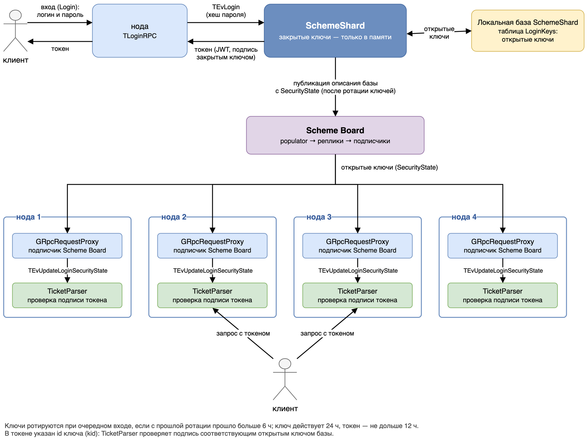

## 5.5 Scheme Shard и Scheme Board

Scheme Shard --- таблетка, хранящая пользовательскую схему: перечень
таблиц в базе, указание ключей, по которым эти таблицы разбиты
по шардам, TabletId таблеток каждого из шардов и прочие метаданные.
В Scheme Shard хранится иерархия объектов схемы и всё, что с ними
связано. Scheme Shard --- единая точка входа для схемных операций.
Корневой Scheme Shard хранит схему корневого домена кластера и сведения
о тенантах. Схемой базы, созданной как external subdomain, управляет
её собственный Scheme Shard. Существуют также базы, которые используют
общий корневой Scheme Shard. Исторически они появились раньше, а затем
понятие субдомена было расширено до external subdomain с собственным
Scheme Shard. Scheme Board при этом общий для всего кластера.

Наличие собственного Hive определяется конфигурацией базы. При создании
shared- и dedicated-баз через Console оно управляется флагом
`EnableExternalHive`, включённым по умолчанию; без собственного Hive
их таблетки размещает корневой Hive. Serverless-база имеет собственный
Scheme Shard и использует ресурсы shared-базы. Её таблетки размещает
Hive shared-базы, а если у той собственного Hive нет --- корневой Hive
(подробнее --- в главе 9).

Топики интегрированы в схему и создаются на том же уровне, что и таблицы,
то есть внутри базы данных.

Scheme Shard инициирует создание и удаление Data Shard-ов и других таблеток. Это
единая точка, которая может делать модификации схемы.

Операции со схемой могут быть сложными, создаются таблетки, запускаются
распределённые транзакции, чтобы их проинициализировать.

Scheme Shard поддерживает операцию describe для объектов схемы,
возвращая протобуф с описанием запрошенного пути.

У объектов схемы есть ACL, которые тоже часть схемы. Система
аутентификации поддерживает разные механизмы, например IAM и Static Credentials.
Static Credentials живут в Scheme Shard. После аутентификации пользователя по
Static Credentials выдаётся токен, который можно очень быстро проверить
публичными
ключами базы; ключи доставляются, как и схема, через Scheme Board
(подробнее --- в разделе «Статические учётные данные» в конце главы).

Источником информации о схеме и держателем схемы метаинформации об
устройстве этого пространства является Scheme Shard. Все операции, которые
схему хотят менять, идут через Scheme Shard, но Scheme Shard реализован одной таблеткой, поэтому большой поток операций
он выдержать не может. Поскольку схема читается значительно чаще, чем
изменяется, над Scheme Shard работает распределённая система Scheme Board
--- кэш с репликами, снимающий нагрузку чтения со Scheme Shard.

Схем-борд --- это распределённое хранилище, которое дублирует собой
состояние Scheme Shard. По сути, это волатильный кэш информации о схеме.
Он предназначен для того, чтобы снять нагрузку со Scheme Shard. Схем-борд
распространяет информацию по подписке. Клиенты подписываются на пути и
при изменениях реплики Scheme Board отправляют их подписчикам. Состоит
Scheme Board из 3 частей:

Центральная часть --- сами волатильные реплики, которые хранят информацию
в памяти о схеме. Вторая часть, которая наполняет эти реплики --- это
популяторы. Это акторы, которые работают рядом с каждым Scheme Shard.
Около каждого Scheme Shard есть актор популятор, который все пути,
которыми владеет этот Scheme Shard, популирует в реплики. Scheme Shard просто
говорит популятору, что у него в результате транзакции обновился путь, и
передаёт его новое описание популятору, чтобы популятор отправил его на
все реплики, на которые он считает нужным. Популятор отправляет,
получает подтверждения, дожидается кворума и уведомляет Scheme Shard о завершении операции. У каждого Scheme Shard есть один актор --- главный популятор,
который порождает дочерних популяторов для каждой реплики, и
репличный популятор контролирует коннект со своей репликой. При разрыве соединения, он восстанавливает соединение, делает хендшейк и либо
узнает, что реплика не умирала, либо что у реплики был рестарт и потеря
данных.

Scheme Shard популятору присылает дифы (а на старте --- описания всех
путей). Популятор получает полное состояние и обновляет его по мере
получения обновленных описаний объектов. Когда нужно наполнить реплику,
репличный популятор у главного популятора постепенно запрашивает описания объектов в заданном диапазоне идентификаторов, и
пересылает их реплике. И так пока не наполнит всю реплику. Если все
хорошо, реплика наполнена, то новые описания объектов попадают в главный
популятор, оттуда по хешу выбирается на какие репличные популяторы нужно
послать это описание, и репличные популяторы передают их репликам,
реплики отвечают подтверждением, главный популятор собирает кворум и
после записи на кворум отвечает Scheme Shard, что он обновил данные на
кворуме реплик, и можно считать, что схемная транзакция выполнилась, потому
что любой клиент, который обратится за описанием, увидит новую версию
этого описания, и тогда Scheme Shard отвечает клиенту, что его транзакция
выполнена.

У Scheme Board есть ещё клиентская часть, подписчики, которые умеют
работать с репликами, подписываясь на N реплик. Там есть главный
подписчик, который порождает репличных подписчиков, им тоже нужно
контролировать состояние соединений и уметь собирать кворум. Все по
такому же принципу. Есть ещё один дополнительный уровень: есть main
subscriber, subscriber proxy и replica subscriber. Subscriber proxy ещё
реализует часть логики про синк-запросы. Это такие запросы, которые
нужны чтобы из неконсистентного кэша получать консистентные состояния на
клиентах. Для того, чтобы с клиента прийти на реплики и получить
актуальное описание пути, мы отправляем специальный синк-запрос, синк вот
такого-то пути, и дальше, если был отправлен синк-запрос и получен
синк-ответ (он пустой, содержит только указание пути), то это
гарантирует отправителю синк-запроса, что его подписчик получил все
обновления, которые реплика хотела ему отправить, потому что она не
отправит ему синк-респонс, пока этого не сделает.

Чтобы упростить жизнь клиенту, клиент не работает с голыми подписчиками,
у него есть обертка, схем-кэш. Схем-кэш внутри работает с подписчиками,
создаёт их если их у него нет, проделывает все необходимое и получает
самое свежее описание используя подписки. А сам кэш работает в режиме
реквест-респонс.

В остальном реплика асинхронная и гарантии достигаются тем, что можно
попросить Scheme Shard уведомить, когда операция закончилась. Уведомление
приходит, когда соответствующая транзакция (по транзакшн ид) больше не
выполняется. Пользователь не уведомляется об успехе, пока информация
пути не уехала на большинство реплик Scheme Board.

То есть, если пользователь делает схемную операцию, ему не посылают ОК
до тех пор, пока Scheme Shard не завершит изменение и информация об
изменениях в затронутых путях схемы не достигнет большинства реплик
Scheme Board. При этом другими путями пользователь может узнать, например,
что create завершился, то есть увидеть путь, но в схем-борде путь ещё не
пророс, путь будет то виден, то не виден, например селект может получать
ошибку «таблица не существует».

Некоторые клиенты используют опрос (polling) для получения обновлений.
Ряд операций внутри Scheme Shard инициирует дочерние операции, так что
Scheme Shard выступает клиентом самого себя и подписывается на результаты
этих действий.

Все изменения схемы выполняются через единственный запрос modify scheme.
Жизненный цикл этой операции такой: сначала в Scheme Shard эта операция
приходит, он её складывает в очередь, если Scheme Shard перегружен, то эта
операция может висеть во входной очереди какое-то заметное время. Дальше
он у этой операции вызывает ignite operation. Это не запуск операции.
Ignite --- это инициализация и верификация того, что спецификация,
пришедшая снаружи, валидна и может быть исполнена. Каждая операция
проверяет множество условий. Операция инициируется только в том случае,
когда Scheme Shard принимает решение, что сможет её выполнить (accept).
При наличии сомнений операция отклоняется (reject).
Отправка односторонней операции в Scheme Shard без ожидания подтверждения не гарантирует её выполнение. Для гарантии выполнения операции необходимо дождаться accept от Scheme Shard, а не просто отправить запрос. При
этом сама операция ещё не началась, её просто обещали. Её надёжно
сохранили в свою базу, и её не потеряют. В Scheme Shard есть внутренний механизм зависимости операций друг с другом --
если операция была принята (accepted), то она на исполнение реальное может пойти, например,
через 5 часов --- когда выполнится предыдущая операция, с которой она
конфликтует по объектам. О факте старта операции оповещения нет, есть
оповещение о конце. Клиент к этому моменту мог уже отвалиться, и если он
хочет знать о факте завершения операции, он может подписаться. У операции
есть id, и можно подписаться, в роли id операции выступает id транзакции.
Scheme Shard изменяет схему, но работает в рамках механизма распределённых
транзакций, сам Scheme Shard исполняет пассивную роль, ему клиент должен
прислать номер транзакции, в рамках которой она работает. А вот его либо
получают от генератора номеров транзакций, либо обращение идёт не
напрямую, а через tx proxy, который создаёт транзакцию с её номером и
пересылает транзакцию уже с известным TxId. Клиент должен подписаться на
эту операцию по номеру транзакции. Ему Scheme Shard ответит. Механизм подписки не сохраняет историю запросов, поэтому необходимо дождаться accept. Если попросить нотификацию, не дождавшись accept, Scheme Shard скажет,
что такой операции нет, хотя предполагается, что операции
идемпотентные. Когда клиент подписывается на операцию, Scheme Shard может ответить,
что операция уже завершена. Важно понимать, что нотификация сообщает
о завершении, а не об успехе. Надёжный способ (используемый в tx proxy):
послать операцию в Scheme Shard, дождаться accept и только после этого
подписаться на нотификацию.

В Scheme Shard есть понятие пул кайнда, соответствующий пул кайнд --- у
него может быть один или несколько сторадж пулов. Когда Scheme Shard хочет
создавать таблетку, у него есть настройки того, какой канал должен быть
на каком пул-кайнде. Он мапит это в конкретные сторадж пулы. При
создании таблетки Scheme Shard отправляет в Hive указание, какой канал на
каком сторадж-пуле должен быть.

Если необходимо у живой таблетки подменить маппинг, повторно вызывается
create tablet с другим конфигом. Протокол Hive такой: делаешь create
tablet и указываешь, какую таблетку создать. Для изменения конфигурации
делается create tablet с указанием существующего tablet id или owner
index, что позволяет идентифицировать конкретную таблетку, с другим
конфигом. После этого Hive добавит каналы и выполнит переконфигурацию.

### Статические учётные данные

YDB умеет аутентифицировать пользователей
самостоятельно. Хранится список пользователей с их секретами (а также
список групп с членством пользователей и других групп). Пользователь
проводит аутентификацию, указав свой логин и пароль, а в ответ выдаётся
cookie, с которым можно дальше работать как с обычным токеном.

Помимо собственной системы управления правами (пользователи и группы),
YDB поддерживает интеграцию с внешними источниками аутентификации,
такими как IAM. При интеграции происходит маппинг внешних пользователей
и их прав на внутренние группы YDB. Например, права на конкретную базу во внешней системе отображаются на группы YDB, привязанные к этой базе, а к каждой из этих групп уже привязаны права в YDB. 

Пользователи и группы YDB создаются и управляются через Scheme Shard
с помощью отдельного API: создать / обновить / удалить
пользователя / группу, управлять членством, получить в виде списка
раскрытое дерево всех групп, в которых состоит пользователь. При этом
пользователи и группы не являются
объектами схемы. ACL зафиксированы в схеме и изменяются схемными
операциями, но сами субъекты (пользователи и группы) хранятся в
Scheme Shard.

Schemeshard отвечает за проведение первичной аутентификации (логина)
пользователя. Для этого в нём есть операция Login(name, password).
Запрос на логин принимает нода. По параметрам хеширования пароля
пользователя, которые она берёт из SchemeCache, нода вычисляет хеш
пароля и отправляет его в Scheme Shard (`TEvLogin`). Там запрос
превращается в транзакцию: хеш сравнивается с сохранённым, и
генерируется cookie-токен в формате JWT, подписанный
(алгоритмом PS256) текущим (последним) мастер-ключом. Срок действия
токена задаётся параметром `LoginTokenExpireTime` (по умолчанию 12 часов),
но не может превышать 12 часов (`MAX_TOKEN_EXPIRE_TIME`). Токен
пользователь использует в
дальнейшем для запросов (как gRPC, так и HTTP). При работе через SDK
токеном может управлять провайдер учётных данных. Например, в C++ SDK
провайдер логина и пароля вызывает Login, сохраняет полученный токен
и планирует повторный Login до истечения его срока действия.
При успешном обновлении последующие запросы используют новый токен.
Если же приложению передать готовый токен через статический провайдер,
сам этот провайдер его не обновляет.
Также поддерживается аутентификация по клиентскому сертификату на
gRPC-соединении. В этом случае Login выполняется на основе CN
клиентского сертификата, а остальная логика аналогична.

Ключ относится к базе, а не к пользователю. В Schemeshard есть
небольшой стейт, в котором ключи базы лежат, и он
ассоциирован с базой данных: для каждой базы хранится текущий открытый
ключ и предыдущие, ещё не истекшие. Публикуются изменения в базе данных и
обновляется этот стейт, в котором есть ключи. Пользователь его даже
может через дискрайб прочесть.

Schemeshard отвечает за ротацию мастер-ключей. Ротация выполняется только
внутри транзакции логина (`TTxLogin`) и только когда это нужно: ключей ещё
нет, для последнего ключа нет закрытой части или с прошлой ротации прошло
больше 6 часов (`KEYS_ROTATION_PERIOD`). Открытые ключи сохраняются в
локальной базе Schemeshard (таблица `LoginKeys`), а закрытые хранятся
только в памяти. Поэтому после перезапуска Schemeshard первый же логин
создаёт новый ключ, а без логинов ключи не ротируются вовсе. Новая пара
ключей --- RSA длиной 2048 бит, ей присваивается следующий по порядку
номер. Ключ действует 24 часа, после этого он удаляется вместе с другими
истекшими. Обновлённый список открытых ключей публикуется в Scheme Board
вместе с описанием базы и так доходит до всех нод.

Открытые ключи для валидации токена распространяются через Scheme Board.
На каждой ноде `GRpcRequestProxy` подписывается в Scheme Board на
описание базы и при его изменении передаёт открытые ключи из
`SecurityState` в `TicketParser`, который и проверяет подпись токена.
Вместе с ключами в `SecurityState` приходит список пользователей и групп
с членством, по нему `TicketParser` определяет группы пользователя.
SchemeCache тоже получает `SecurityState`, но использует его только при
логине: берёт оттуда параметры хеширования пароля пользователя. Токены
по нему не проверяются.

### Разбор тикетов

Ticket Parser --- сервисный актор, запущенный на каждой динамической
ноде. Он принимает аутентификационный токен (строку), определяет его тип
и выполняет валидацию. Для JWT-токенов, выданных при логине через
Scheme Shard, Ticket Parser проверяет подпись на текущем (и доступных
предыдущих) публичных мастер-ключах базы, используя kid --- поле
JWT-токена с номером ключа, которым подписан токен. Если подпись верна,
из токена извлекается user id
и время действия, и дальше нода знает, что это за пользователь. Группы пользователя Ticket Parser в Scheme Shard не
запрашивает: он берёт их из того же `SecurityState`, полученного через
Scheme Board (если группы не записаны в сам токен).

Поле kid также помогает бороться с задержкой доставки открытых ключей
на ноды. Номера ключей
растут монотонно. Если kid больше номера последнего известного ноде
ключа, значит, новый ключ просто ещё не доставлен: ошибка считается
повторяемой, и проверку можно повторить позже, когда ключ придёт. Если
kid меньше номера самого старого известного ключа, ключ уже истек, и
токен отклоняется.

Помимо JWT, Ticket Parser поддерживает
интеграцию с внешними системами аутентификации (IAM, сертификаты).

