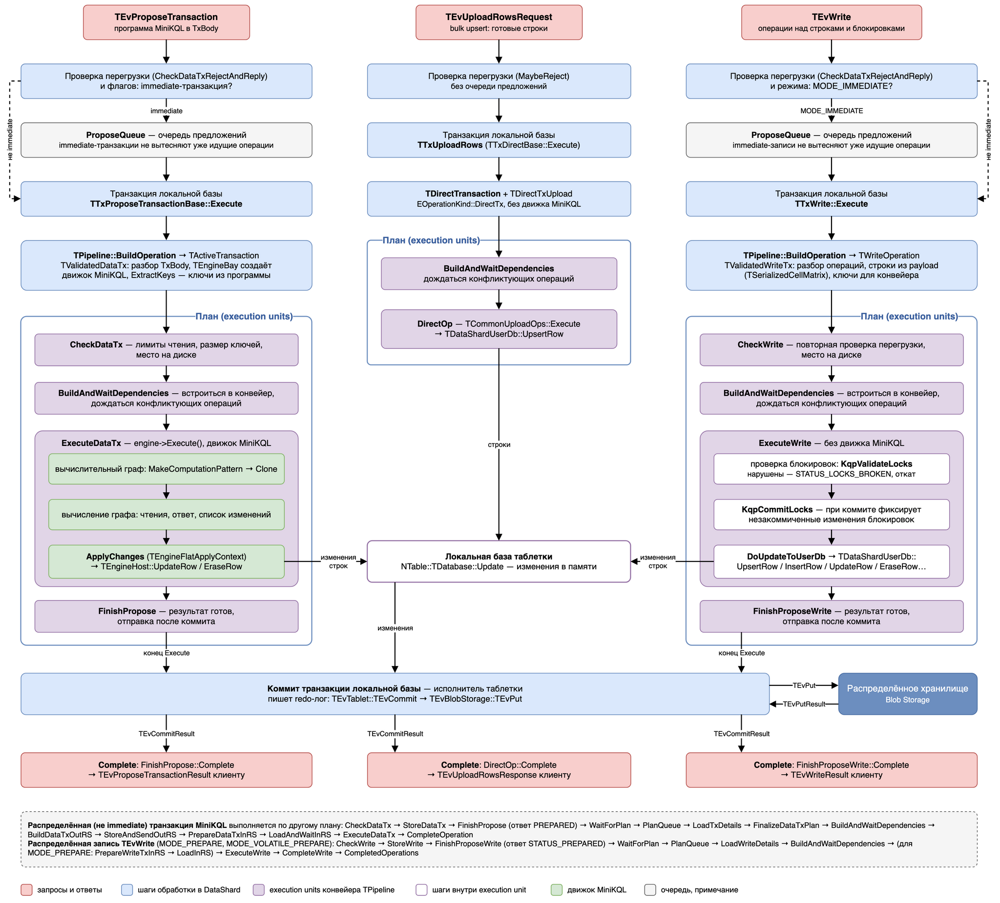

## 6.2 DataShard

DataShard --- таблетка YDB, отвечающая за хранение и обработку фрагмента
строковой таблицы. Через DataShard-ы выполняются чтения и записи данных
строковых таблиц. Разбиение таблицы на DataShard-ы позволяет распределять
её данные и нагрузку между нодами кластера.

### Модель данных

Строковая таблица представляет собой
упорядоченный набор строк, каждая из которых состоит из набора колонок.
Таблица упорядочена по первичному ключу --- подмножеству столбцов,
определяющему порядок строк и их уникальность. Каждый DataShard отвечает за
непрерывный диапазон первичных ключей таблицы. Таблица может состоять из
одного или нескольких DataShard-ов, в крупных кластерах работают миллионы
DataShard-ов, обслуживающих фрагменты таблиц различных пользователей.

Внутри DataShard данные хранятся в локальной базе таблетки, построенной на
LSM-дереве. Все строки диапазона ключей, за который отвечает DataShard,
размещаются в его локальной базе. В той же локальной базе в служебных
таблицах хранятся различные метаданные. Расчётный объём данных,
обрабатываемых одним DataShard-ом, составляет около 2 гигабайт.

### Шардирование и автоматическое разделение

DataShard-ы используют шардирование по диапазону ключей. Границы диапазонов
динамические: система автоматически разделяет (split) и объединяет (merge)
DataShard-ы в зависимости от объёма данных и нагрузки.

Разделение может происходить, когда DataShard превышает пороговый объём
данных или испытывает чрезмерную нагрузку. При split система выбирает ключ,
разделяющий диапазон ключей DataShard на две части. Создаются два новых
DataShard-а, каждый из которых берёт на себя свою часть диапазона. Исходный
DataShard после этого прекращает обслуживать запросы. Если клиент
обращается к уже разделённому DataShard-у, он получает информацию о новых
шардах и перенаправляет запрос туда. Обратная операция --- merge --- может
выполняться, когда соседние DataShard-ы содержат мало данных, не нагружены
и могут быть объединены для снижения накладных расходов.

Настройки автошардирования (split by size, split by load) задаются на
уровне таблицы в SchemeShard. Пользователь может также явно задать
начальное количество DataShard при создании таблицы.

### Выполнение транзакций

DataShard выполняет два типа транзакций: одношардовые и распределённые.

Одношардовые транзакции затрагивают ключи только из диапазона одного
DataShard-а. Такие транзакции выполняются DataShard-ом самостоятельно, без
обращения к координаторам и медиаторам. Это самый быстрый путь исполнения. 
Одношардовая транзакция выполняется за один раунд записи в лог таблетки.

Распределённые транзакции затрагивают данные нескольких DataShard-ов. В
этом случае каждый участвующий DataShard сначала принимает свою часть
транзакции и сообщает, в каком интервале шагов готов её выполнить, после
чего координатор назначает транзакции шаг планирования (PlanStep). Медиатор доставляет план до DataShard-ов.
Они учитывают логический порядок `(PlanStep, TxId)` при работе с
версиями данных и зависимостями; независимые операции могут исполняться
конкурентно. Для согласованного результата участники также проверяют
блокировки и обмениваются данными и решениями о фиксации. Подготовка,
планирование и завершение транзакции подробнее рассмотрены в главе 7.

По умолчанию распределённые транзакции над строковыми таблицами
выполняются как volatile-транзакции (флаг
`EnableDataShardVolatileTransactions`). В этом режиме DataShard до
получения плана хранит свою часть транзакции только в памяти, а не в
локальной базе. После выполнения изменения записываются как ещё не
подтверждённые, и DataShard ждет решений остальных участников, которые
приходят ему в readset-ах. Если все участники готовы зафиксировать
изменения, транзакция становится закоммиченной, иначе изменения
откатываются. Одношардовые транзакции, а также транзакции с колоночными
таблицами или топиками volatile-режим не используют.

### Блокировки

Интерактивные YQL-транзакции (BEGIN ... COMMIT) работают с DataShard через
механизм блокировок. На уровне изоляции Serializable, который используется
по умолчанию, блокировки оптимистичные. Чтения транзакции берут
блокировки на затрагиваемые ключи и диапазоны ключей. Записи
откладываются: они копятся в буфере на стороне KQP, а если отправляются
на DataShard до коммита, то хранятся там как незакоммиченные изменения,
невидимые другим транзакциям. На этапе коммита DataShard проверяет, что
ни одна из ранее взятых блокировок не была инвалидирована конкурентными
транзакциями. Если проверка успешна, изменения применяются атомарно.
Если блокировка нарушена, транзакция завершается с ошибкой "transaction
locks invalidated", и клиент может повторить её.

Для уровней изоляции Snapshot и Read Committed KQP выбирает другие
режимы блокировок: `OPTIMISTIC_SNAPSHOT_ISOLATION` и `PESSIMISTIC_NONE`
соответственно. В DataShard поддерживаются и пессимистичные блокировки
строк: в Read Committed KQP с их помощью, например, проверяет уникальность
ключей уникальных индексов.

### Взаимодействие с другими компонентами

DataShard занимает центральное место в архитектуре обработки запросов.
Акторы слоя выполнения (KQP) обращаются к DataShard-ам для чтения и
записи данных.

Чтение идёт через итератор чтения: актор отправляет
`TEvDataShard::TEvRead` с набором ключей или диапазонов, а при
необходимости с MVCC-снимком (`Snapshot`), на котором нужно читать, и
с `LockTxId`, если транзакции нужны блокировки. DataShard возвращает
результат порциями (`TEvReadResult`), а читатель подтверждает их
получение `TEvReadAck` и лимитами `MaxRows` и `MaxBytes` регулирует,
сколько данных шард может прислать дальше.

Запись идёт событием `NEvents::TDataEvents::TEvWrite`. В нём передаётся
список операций над строками (`UPSERT`, `INSERT`, `UPDATE`, `REPLACE`,
`DELETE`, `INCREMENT` и другие) и режим выполнения: `MODE_IMMEDIATE` для
одношардовой записи, которая выполняется сразу, или `MODE_PREPARE` и
`MODE_VOLATILE_PREPARE` для части распределённой транзакции, которая
выполнится после получения плана. В DataShard такая запись проходит свой
конвейер execution units (`CheckWrite`, `BuildAndWaitDependencies`,
`ExecuteWrite` и т.д.).

KQP не отправляет каждую запись на шард сразу. Записи транзакции
накапливаются в буферном акторе сессии (`TKqpBufferWriteActor`) и
уходят на DataShard-ы при коммите. Раньше буфер сбрасывается, если ему
не хватает памяти. Записи с `INSERT` отправляются отдельным шагом перед
коммитом: в отличие от остальных операций записи она может завершиться
ошибкой (ключ уже существует), и эту ошибку нужно получить до фиксации
транзакции. Записи, отправленные до коммита, передаются с `LockTxId`: DataShard
применяет их к локальной базе как незакоммиченные изменения, привязанные
к блокировке транзакции. При коммите KQP отправляет `TEvWrite` с
операцией над блокировками `Commit`: DataShard проверяет блокировки и
фиксирует накопленные изменения. При откате (`Rollback`) изменения
удаляются.

Событие `TEvProposeTransaction` с программой MiniKQL --- более старый
способ выполнить транзакцию на DataShard. Слой выполнения KQP им для
работы с данными больше не пользуется, но сам путь сохранился. Он и
массовая загрузка строк (bulk upsert, `TEvUploadRowsRequest`) показаны
на схеме ниже.

DataShard также отвечает за поддержание асинхронных индексов: при изменении
данных он формирует записи об изменениях и доставляет их в DataShard-ы
индексных таблиц через механизм TabletPipe. При накоплении очереди
недоставленных изменений DataShard может начать отклонять пишущие
транзакции, создавая обратное давление.

Hive балансирует DataShard-ы по нодам кластера на основе метрик потребления
CPU и памяти, стремясь к равномерному распределению нагрузки. При
балансировке Hive учитывает принадлежность DataShard-ов к одной таблице
(object id схемного объекта), чтобы шарды одной таблицы не
концентрировались на одной ноде.

