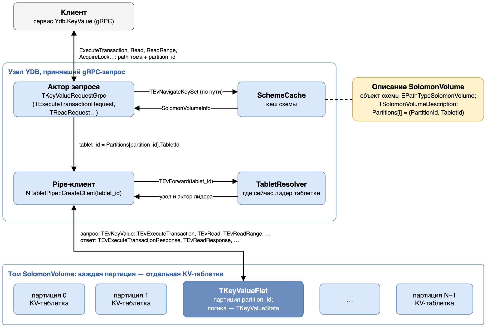
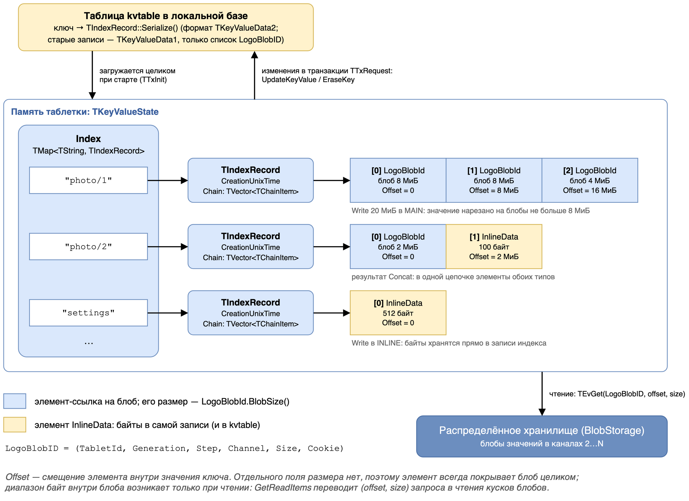
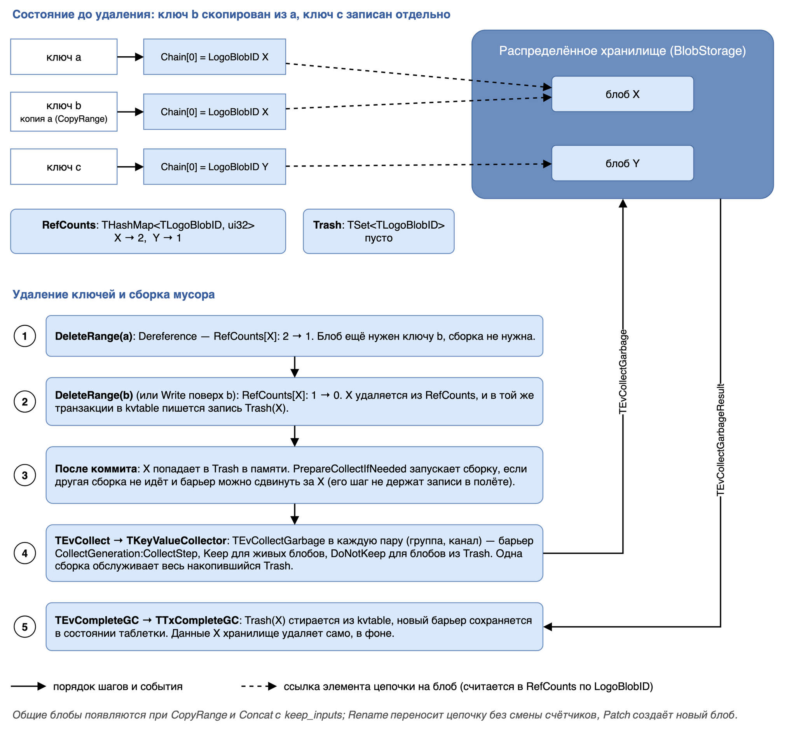
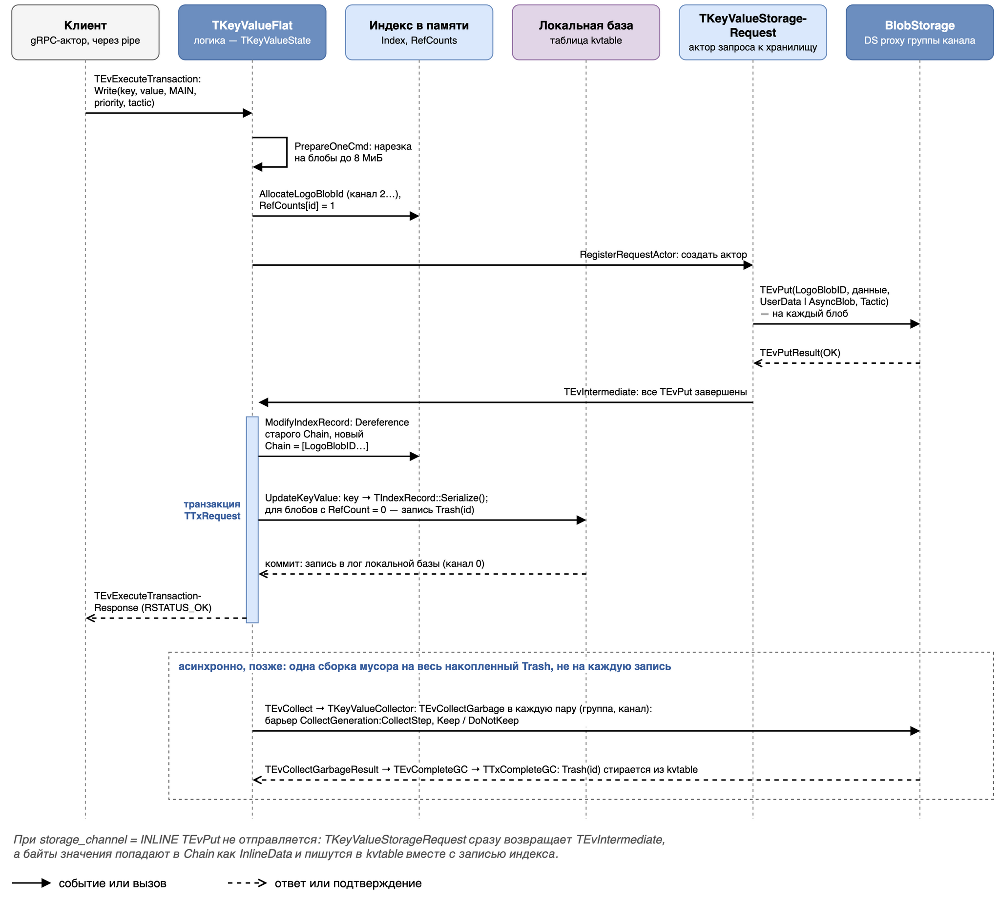

## 6.3 KeyValue

KeyValue таблетка появилась как попытка предоставить минималистичный
интерфейс, дружественный к пользователю, к Blob Storage для
использования его как key-value-хранилища. Таблетка позволяет хранить
порядка 100 000 пар ключ-значение. Значение может храниться непосредственно
в индексе (inline) или в виде цепочки блобов в BlobStorage. Индекс
хранится в таблице в локальной базе. При
запуске таблетки он полностью вычитывается в память, и во время работы
таблетки из локальной базы ничего не читается, только вносятся новые
записи и удаляются старые.

Для одного ключа таблетка может держать не только один блоб, но и целую
их цепочку. При этом копирование ключей приводит к тому, что два ключа
начинают ссылаться на одни и те же блобы. KV-таблетка следит за
рефкаунтом блобов и удаляет ненужные.

Необходимость в KV-таблетке возникла на ранних этапах разработки YDB,
в те далекие времена локальная база была ещё древовидной, а
производительность кластера из 32 машин составляла жалкие сотни операций
в секунду. Одним из первых проектов, для которого планировалось применить
YDB была система мониторинга, использовавшая для хранения timeseries со значениями тысяч сенсоров с сотен узлов базу RRD. Низкая на тот момент
производительность локальной базы стала причиной создания
специализированного хранилища для системы мониторинга.

Система мониторинга была разработана на Java и часть хранилища, выполняющая кодирование timeseries, их компактификацию, периодическое прореживание и прочие операции также были разработаны на Java, для упрощения работы с распределённым хранилищем была разработана KV-таблетка, предоставляющая
упрощённый интерфейс для хранения блобов с произвольными строковыми
идентификаторами и инкапсулирующая сложную сборку мусора и код
базовой таблетки. Интерфейс KV-таблетки предполагает использование
для каждой таблетки единственного клиента, который в начале работы с
KV таблеткой выполняет её блокировку, подобно тому как экземпляр
таблетки блокирует группу хранения.

KV-таблетка, однако, задумана именно как компонент, предоставляющий
удобный интерфейс для реализации логики специального хранилища
для timeseries на Java, а не как самостоятельная база данных. Так, KV-таблетка полностью полагается на своего пользователя в вопросе выбора
количества и размера хранимых блобов. Неаккуратное её использование
может приводить к потреблению неоправданно большого количества ресурсов
как на уровне KV-таблетки, так и на уровне распределённого хранилища.

Первоначально планировалось, что KV-таблетка будет
временным решением, которое в дальнейшем будет заменено на
DataShard или ColumnShard через 2-3 года, но решение, состоящее
из KV-таблетки и «высокоуровневой таблетки» на Java
оказалось крайне удачным и показало существенно превосходящие ожидания
характеристики, его эксплуатация продолжается уже около десяти лет.

### Маршрутизация запросов

KeyValue таблетки создаются внутри Volume (тома), который описывается
в схеме базы данных как `SolomonVolume`. Volume состоит из нескольких
партиций, и каждая
партиция представляет собой отдельную KeyValue таблетку.

Когда клиент обращается к KeyValue через gRPC, он указывает путь к
Volume и идентификатор партиции. gRPC-слой выполняет навигацию по
схеме через `SchemeCache`: находит описание `SolomonVolume` по пути,
извлекает `tablet_id` нужной партиции и устанавливает pipe-соединение
непосредственно к таблетке. После этого запрос передаётся в таблетку
через `NTabletPipe`, где обрабатывается актёром `TKeyValueFlat`.

### Внутреннее устройство таблетки

Основу таблетки составляет актёр `TKeyValueFlat`, делегирующий логику
классу `TKeyValueState`. Состояние таблетки — это индекс ключей,
хранящийся в памяти в виде `TMap<TString, TIndexRecord>`. При запуске
таблетки индекс полностью вычитывается из локальной базы (таблица
`kvtable`), после чего во время работы таблетки из локальной базы
ничего не читается — только вносятся новые записи и удаляются старые.

Каждая запись `TIndexRecord` содержит цепочку элементов `Chain[]`,
которая представляет значение ключа. Элемент цепочки может быть
двух типов:

- **inline** — данные хранятся непосредственно в сериализованном
  представлении записи индекса, в локальной базе. Используется для
  небольших значений.
- **LogoBlobID** — ссылка на блоб в распределённом хранилище
  BlobStorage. Используется для больших значений.

Элемент цепочки всегда ссылается на блоб целиком: в нём хранится только
`LogoBlobID` и смещение элемента внутри значения (`Offset`), а размер
берётся из самого `LogoBlobID`. Диапазон байт внутри блоба возникает
только при чтении, когда запрошенный кусок значения переводится в
чтения частей блобов. Большие значения при записи нарезаются на блобы
размером не больше 8 МиБ. Сериализованное представление записи индекса
хранится в формате `TKeyValueData1` (список `LogoBlobID`) или
`TKeyValueData2` (смешанный формат: inline-данные и `LogoBlobID`).

Блобы могут разделяться между ключами. При копировании ключей
(`CopyRange`) и при склейке значений (`Concat`) с флагом `keep_inputs`
новый ключ ссылается на те же блобы, что и исходные. Это реализует
семантику copy-on-write: данные не дублируются, а учитываются по
рефкаунту, который ведётся для каждого блоба (`LogoBlobID`) отдельно.
`Rename` переносит цепочку под новое имя, не меняя рефкаунтов, а
`Patch` создаёт новый блоб. Когда рефкаунт блоба падает до нуля, блоб
попадает в список мусора (`Trash`). Сборка мусора не запускается на
каждое удаление: KV-таблетка периодически отправляет `CollectGarbage`
в BlobStorage сразу для всего накопленного мусора, и только после
этого хранилище физически удаляет блобы.

Архитектура таблетки определяет ряд ограничений. Индекс хранится
в памяти целиком, поэтому количество ключей ограничено порядком
100 000. Хранение большого количества маленьких значений отдельными
блобами в BlobStorage неэффективно; для небольших значений предусмотрен
режим INLINE. Интерфейс таблетки предполагает единственного клиента,
который в начале работы выполняет блокировку таблетки через
`AcquireLock`, подобно тому как экземпляр таблетки блокирует группу
хранения. Таблетка полностью полагается на пользователя в вопросе
выбора количества и размера хранимых блобов, поэтому неаккуратное её
использование может приводить к потреблению неоправданно большого
количества ресурсов как на уровне KV-таблетки, так и на уровне
распределённого хранилища.

### Операции

KV-таблетка поддерживает следующий набор команд:

- **Read** — чтение значения по ключу с указанием смещения и размера.
- **ReadRange** — чтение диапазона ключей с опциональным лимитом по
  размеру результата.
- **Write** — запись пары ключ-значение.
- **Delete** — удаление значения по ключу.
- **DeleteRange** — удаление диапазона ключей.
- **Patch** — частичное изменение значения существующего ключа.
- **Rename** — переименование ключа (цепочка блобов переносится под
  новое имя, старый ключ удаляется).
- **ExecuteTransaction** — пакет из нескольких команд, выполняемых
  атомарно в рамках одной транзакции.
- **AcquireLock** — захват эксклюзивной блокировки таблетки.

Команда `Write` принимает два параметра, влияющих на способ хранения
данных:

**Storage Channel** определяет, где будет храниться значение:

- `MAIN` — значение записывается в один или несколько блобов в BlobStorage. Используется
  для больших значений.
- `INLINE` — значение хранится непосредственно в индексе, в локальной
  базе таблетки. Используется для небольших значений и позволяет
  избежать обращения к BlobStorage при чтении.

**Priority** определяет приоритет операций в BlobStorage. Значение
`REALTIME` маппится на `FastRead` при чтении и `UserData` при записи.
Значение `BACKGROUND` маппится на `AsyncRead` и `AsyncBlob` соответственно.
Эти значения выбирают класс обслуживания запроса в хранилище,
а не синхронный или асинхронный способ вызова API.
Дополнительно параметр **Tactic** (`MIN_LATENCY` или
`MAX_THROUGHPUT`) управляет стратегией записи в BlobStorage, выбирая
между минимальной задержкой и максимальной пропускной способностью.

