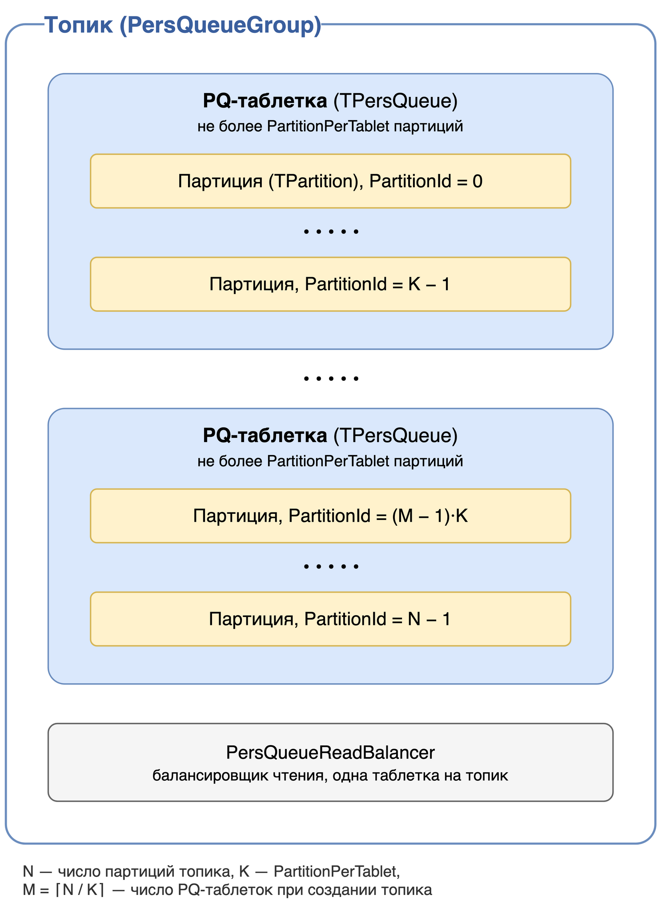

## 6.4 PersQueue: партиции топиков

Таблетка PersQueue (PQ) предназначена для хранения персистентной
очереди и построена поверх KeyValue-таблетки. Свежие записи, поступающие
в очередь, записываются в отдельные ключи. После того как накапливается
определённое количество свежих данных, все они компактно записываются
ещё раз в один ключ, а множество отдельных ключей удаляется. Так
таблетка хранит в KeyValue под собой небольшое количество крупных
записей, каждая из которых размером порядка 8 мб.

Топики организованы в виде партиций по принципу, аналогичному Apache Kafka. При этом разные партиции могут жить в одной таблетке: число партиций на таблетку задаётся параметром `PartitionPerTablet`, по умолчанию это одна партиция, максимум --- 1000.

Каждая таблетка PersQueue --- надстройка над KeyValue. Все
партиции внутри таблетки используют её хранилище и реализованы как
отдельные акторы, запускаемые таблеткой. При обработке запроса клиент
сначала определяет топик и его топологию --- список таблеток с
указанием, какая партиция где работает. Запрос направляется по пайпу
в таблетку, которая перенаправляет его актору партиции. Актор
партиции выполняет окончательную проверку, формирует данные для записи
и передаёт их обратно актору таблетки. Актор записывает данные через API KeyValue таблетки, после записи таблетка
подтверждает успех партиции, а та отвечает клиенту.

Ключи делятся на служебные (хранящие информацию о source ID)
и ключи с данными. Ключи данных формируются особым образом: новые
данные записываются в конец, ключ монотонно возрастает. Когда
накапливается слишком много мелких записей, таблетка компактит их
в одну крупную.

Удаление данных по TTL. Retention настраивается в секундах, и по времени
данные удаляются. Есть retention по стораджу.

Чтобы запомнить, что конкретный консьюмер (читатель) дочитал до
конкретного offset, таблетка коммитит offset.

### Балансировщик чтения

Помимо PQ-таблеток у каждого топика есть одна таблетка
PersQueueReadBalancer (PQRB). Она отвечает за то, что касается топика
целиком:

-   распределяет партиции между сессиями чтения консьюмера. Сессия
    регистрируется в балансировщике (`TEvRegisterReadSession`), а он
    выдаёт ей партиции (`TEvLockPartition`) и при необходимости забирает
    их, выравнивая нагрузку между сессиями;

-   соблюдает порядок чтения при автопартиционировании. Дочерние
    партиции, появившиеся после split или merge, выдаются на чтение
    только после того, как родительские дочитаны: сессия дошла до конца
    партиции или закоммитила offset до конца. Пока родитель не
    закоммичен до конца, он и его дочерние партиции читаются в одной
    сессии (семейство партиций, `TPartitionFamily`), чтобы сохранить
    порядок сообщений одного источника (SourceId);

-   принимает от партиций сигналы о том, что их нужно разделить или
    объединить (`TEvPartitionScaleStatusChanged`), и отправляет в
    SchemeShard изменение топика (`ESchemeOpAlterPersQueueGroup`);

-   опрашивает PQ-таблетки (`TEvStatus`) и периодически отправляет в
    SchemeShard объём данных топика (`TEvPeriodicTopicStats`);

-   сообщает клиентам, на каких таблетках и нодах находятся партиции
    (`TEvGetPartitionsLocation`).

### Запись в транзакциях: supportive-партиции

Запись в топик может быть частью транзакции: транзакции YDB, которая
пишет в топик через Topic API, или транзакции Kafka. Сообщения такой
транзакции не должны стать видимы читателям до коммита, поэтому
PQ-таблетка пишет их не в саму партицию, а во вспомогательную
(supportive) партицию. Это отдельный актор партиции внутри той же
таблетки. Он создаётся при первой записи транзакции в партицию, свой
для каждой пары «партиция, транзакция». Транзакция определяется
идентификатором `WriteId`: для Topic API это идентификатор блокировки
транзакции KQP, для Kafka --- идентификатор продюсера и его эпоха.
Внутренние номера supportive-партиций начинаются с 100 000, чтобы не
пересекаться с номерами обычных партиций. Консьюмеров у supportive-партиции
нет, читать из неё нельзя.

При коммите PQ-таблетка участвует в распределённой транзакции наравне с
другими таблетками. Основная партиция запрашивает у supportive-партиции
список её блобов (`TEvGetWriteInfoRequest`) и добавляет их в конец своих
данных: ключи блобов переименовываются, сами данные не копируются.
Именно в этот момент сообщения получают offset-ы основной партиции, и
обновляется информация об их source ID. После этого supportive-партиция
удаляется. Если транзакция откатывается или теряется (PQ-таблетка
следит за состоянием блокировки транзакции через LongTxService),
supportive-партиция удаляется вместе с записанными в неё данными.
