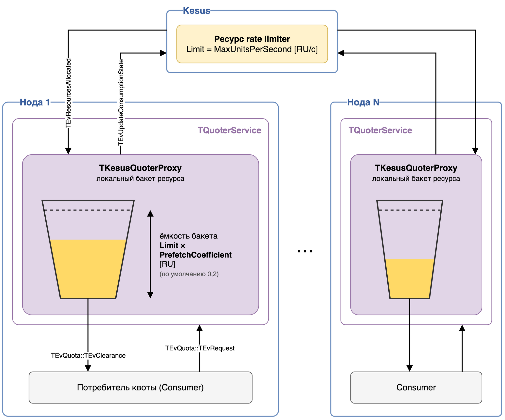

## 6.6 Kesus

Kesus --- это таблетка, реализующая узел координации (coordination service): набор примитивов для координации распределённых приложений. На уровне пользовательского API узел координации является схемным объектом базы данных, создаваемым наряду с таблицами и топиками. Внутри он реализован как таблетка. Kesus предоставляет два основных механизма: семафоры и распределённый rate limiter. С помощью Kesus можно решать задачи, которые традиционно выполняются с помощью таких систем, как Apache ZooKeeper, etcd или Consul, без необходимости разворачивать и поддерживать отдельную инфраструктуру.

### Семафоры

Семафоры Kesus --- это именованные объекты с числовым счётчиком (лимитом), ограничивающим количество одновременных захватов, а также с возможностью хранить небольшой объём произвольных данных. Клиент может создать семафор (create), запросить его захват (acquire), освободить (release), получить содержимое и состояние (describe) и удалить (delete). Семафоры не являются рекурсивными: операции захвата и освобождения идемпотентны.

YDB поддерживает два типа семафоров: персистентные и эфемерные. Персистентный семафор перед захватом необходимо явно создать, и он существует до момента явного удаления или до удаления самого узла координации. Эфемерные семафоры создаются автоматически в момент первого захвата и удаляются при последнем освобождении, что удобно для сценариев распределённой блокировки заранее неизвестных сущностей.

Типичные сценарии использования семафоров Kesus: распределённые блокировки и мьютексы для координации доступа к общему ресурсу, выбор лидера среди группы однородных процессов (один из них захватывает эксклюзивный семафор и становится лидером), обнаружение сервисов (service discovery), очереди задач (task queues), публикация небольших объёмов данных с возможностью получать оповещения об изменениях, а также управление степенью параллелизма (семафор с лимитом N позволяет не более чем N клиентам одновременно выполнять защищённую операцию).

Kesus является таблеткой, поэтому состояние семафоров персистентно и переживает перезапуски. При миграции таблетки на другую ноду все данные о семафорах и сессиях восстанавливаются из лога. Клиенты после кратковременного разрыва переподключаются к новому расположению Kesus через стандартный механизм tablet pipe. Работа с узлами координации и семафорами осуществляется через выделенные методы в YDB SDK.

### Распределённый rate limiter

Второй ключевой функцией Kesus является распределённый rate limiter. Настройки rate limiter хранятся в Kesus в виде ресурсов, образующих иерархию. Путь ресурса состоит из имён, разделённых косой чертой, и начинается с имени корневого ресурса. Главный параметр ресурса --- максимальная скорость потребления `MaxUnitsPerSecond` в абстрактных единицах в секунду (в бессерверных базах это request unit). У корневого ресурса скорость обязательна. Дочерние ресурсы по умолчанию наследуют настройки родителя, а их скорость не может превышать скорость родителя.

Пользователи приходят на разные машины кластера и потребляют квоту локально. Распределённый квотировщик призван на каждой ноде локально принимать быстрое решение о допустимости запроса, жертвуя мгновенной точностью квотирования ради минимальной задержки. На каждой ноде работает сервис квот `TQuoterService`. Для ресурсов Kesus он создаёт прокси `TKesusQuoterProxy`, по одному на узел координации. Прокси держит сессию с таблеткой Kesus и локальный бакет каждого ресурса. Потребитель отправляет в сервис `TEvQuota::TEvRequest` с нужным количеством единиц и дедлайном и получает `TEvQuota::TEvClearance`: разрешение, отказ по дедлайну или ошибку. Решение принимается по локальному бакету, без обращения к Kesus на каждый запрос.

Ёмкость локального бакета равна `MaxUnitsPerSecond × PrefetchCoefficient`. По умолчанию коэффициент равен 0,2, то есть в бакете помещается квота на 200 мс. Когда в бакете остаётся меньше доли `PrefetchWatermark` от полного размера (по умолчанию 0,75), прокси сообщает Kesus, что начинает потреблять ресурс (`TEvUpdateConsumptionState`). После этого Kesus начинает присылать ему порции квоты (`TEvResourcesAllocated`). Когда бакет снова заполнен, прокси перестаёт запрашивать квоту. Если связь с Kesus теряется, прокси продолжает пополнять бакет со средней скоростью прошлых выделений, постепенно её уменьшая.

В самом Kesus квота распределяется алгоритмом иерархического Deficit Round Robin (HDRR). Десять раз в секунду каждый ресурс получает порцию, равную десятой части его скорости, и раздаёт её по кругу тем, кто сейчас запрашивает квоту. Дочерние ресурсы получают доли пропорционально весу (`Weight`, по умолчанию 1), сессии прокси --- поровну. Никто не получает больше, чем запросил, а нераспределённый остаток достаётся остальным. Так при нехватке квоты она делится между нодами поровну, а не пропорционально их аппетиту. С некоторым отставанием от реального времени квотировщик обеспечивает правильные в среднем характеристики ограничения скорости.

Квоту можно не только запрашивать заранее, но и списывать по факту потребления (флаг `IsUsedAmount` в запросе). Такой запрос не ждёт, баланс бакета может уйти в минус, и следующим запросам придётся подождать, пока долг не будет погашен. Для ресурсов с включённым учётом (`AccountingConfig`) прокси периодически отправляет в Kesus фактическое потребление (`TEvAccountResources`). Из него формируются метрики для биллинга: потребление в пределах выделенного лимита, сверх него (on-demand) и сверх on-demand лимита.

Rate limiter Kesus используется, в частности, для ограничения скорости потребления request unit в бессерверных базах данных (подробнее в разделе 9.2), а также может использоваться прикладными сервисами для ограничения скорости обращений к внешним системам.

