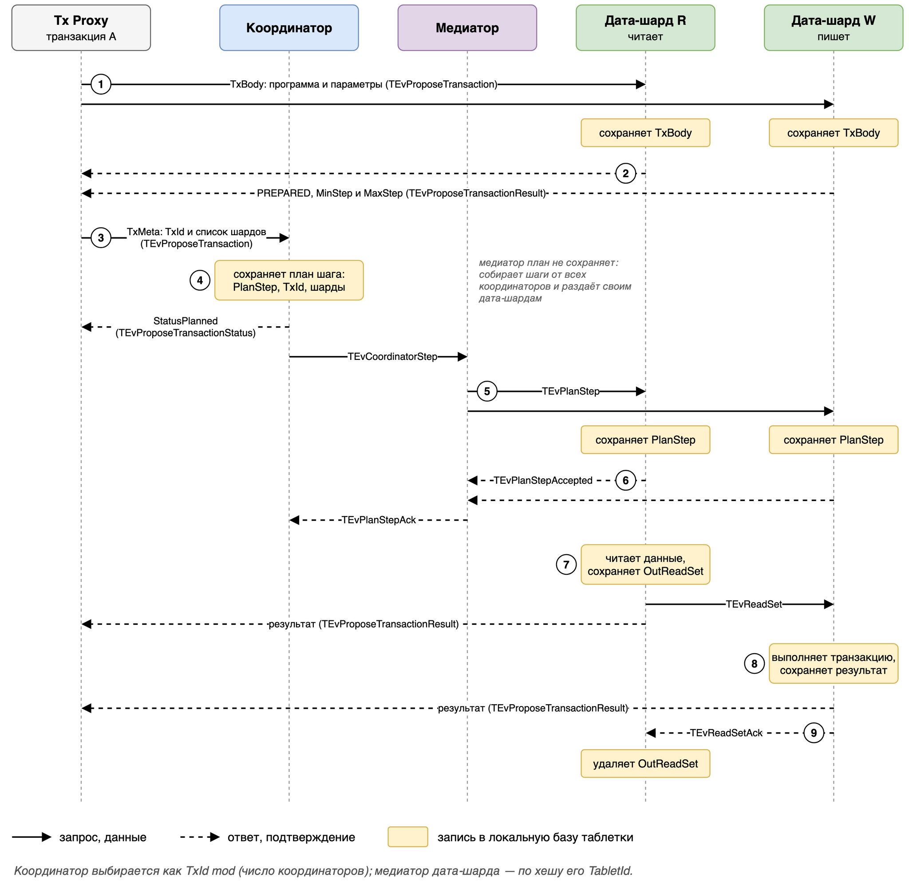

## 7.1 Общий принцип

Транзакция может изменять строки одной или нескольких таблиц. Если
данные находятся на двух или более таблетках, транзакция является
распределённой. Транзакции в YDB ---
ACID, то есть атомарны (применяются либо все изменения транзакции, либо
ни одно), консистентны (сохраняются ограничения целостности данных),
надёжны (подтверждённые изменения сохраняются и не теряются при сбоях
в пределах гарантий хранения) и изолированы. Есть разные уровни
изоляции; в режиме Serializable YDB обеспечивает строгую
сериализуемость.

Далее рассматривается планирование распределённых транзакций над
строковыми таблицами. Транзакции выполняются конкурентно, а система
согласует их логический порядок. Идея использования общего порядка
для детерминированных операций над разными шардами была почерпнута
в статье Alexander Thomson и других авторов
[Calvin: Fast Distributed Transactions for Partitioned Database Systems](https://www.cs.yale.edu/homes/thomson/publications/calvin-sigmod12.pdf).

Если операции выполняются детерминированно, заданный порядок позволяет
согласованно исполнять их части на разных шардах. В YDB эта идея
дополнена управлением версиями данных, проверками конфликтов,
обменом данными и решениями между участниками и восстановлением после
сбоев. SQL-транзакция может включать несколько стадий чтения и записи;
знать все конкретные ключи до её начала не требуется.

Сначала каждый участвующий DataShard получает свою часть
распределённой транзакции, сохраняет её в соответствии с режимом
подготовки и сообщает, в каком интервале шагов готов её выполнить.
Инициатор собирает ответы и определяет общий допустимый интервал.
Затем он отправляет координатору идентификатор транзакции, интервал
и сведения об участниках. Координатор назначает шаг планирования
(`PlanStep`) с учётом этого интервала и уже сформированного плана.
Через медиаторов план поступает в DataShard-ы. Медиаторы объединяют
планы координаторов и доставляют каждому участнику относящуюся к нему
часть общего порядка. Подробности хранения и доставки плана описаны
в следующем разделе.

Планируемые транзакции упорядочены по паре `(PlanStep, TxId)`:
сначала по шагу, затем по идентификатору транзакции внутри шага.
DataShard-ы учитывают этот порядок при работе с версиями данных
и зависимостями между операциями. Независимые операции могут
исполняться конкурентно. Не каждая операция проходит через такое
планирование: например, immediate-операции и чтения по снимку
используют другие пути исполнения.

После подготовки и принятия плана DataShard-ы проверяют блокировки
и при необходимости обмениваются readset-сообщениями, содержащими данные
или решения commit/abort.
При нарушении условий фиксации транзакция может быть отменена и после
назначения шага. Для интерактивных транзакций оптимистические
блокировки позволяют обнаружить изменения прочитанных данных между
стадиями исполнения; этот механизм рассмотрен в разделе 6.2.

На схеме ниже показан успешный сценарий с персистентной подготовкой
и передачей тела через `TEvProposeTransaction`. Существующий путь
записи из KQP использует `TEvWrite`, описанный в разделе 6.2.
Показанные записи тела и плана не следует переносить на volatile-режим
без учёта его особенностей.

В этом обмене `StatusPlanned` подтверждает назначение шага.
`TEvPlanStepAccepted` от DataShard и последующий `TEvPlanStepAck`
от медиатора координатору подтверждают принятие плана участником.
Результат выполнения транзакции передаётся отдельно.

Для массовой загрузки предусмотрен отдельный API BulkUpsert
(раздел 8.6), выполняющий запись вне пользовательской SQL-транзакции.
