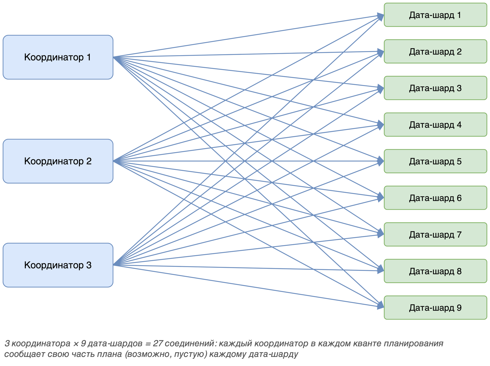
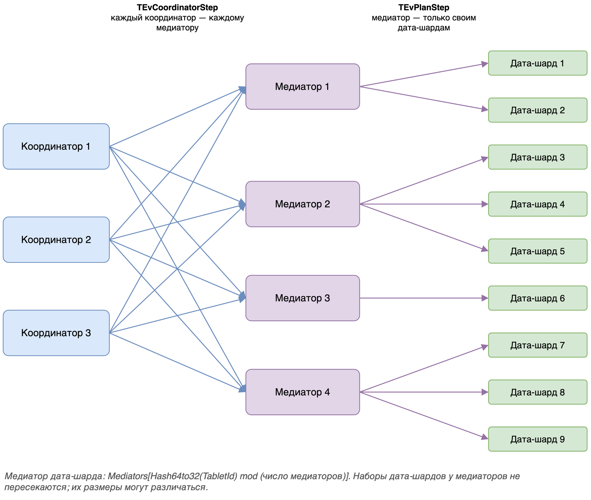

## 7.2 Координаторы, медиаторы, дата-шарды

В этом разделе рассмотрены роли координаторов, медиаторов и дата-шардов
в планировании и выполнении распределённых транзакций.

Наивная запись каждой транзакции в локальную базу единственного
координатора являлась бы узким местом в системе с миллионами
дата-шардов.

Перед обращением к координатору каждый участвующий DataShard получает
свою часть распределённой транзакции --- описание операций и необходимые
для их выполнения параметры. Эти данные могут быть объёмными, поэтому
координаторам и медиаторам передаются только метаданные, необходимые для
планирования, в том числе идентификатор транзакции и сведения об
участвующих DataShard-ах.

Способ хранения полученной части транзакции на этапе подготовки зависит
от режима выполнения. В режиме с персистентной подготовкой DataShard
сохраняет её в локальной базе до подтверждения готовности. В
volatile-режиме подготовленная часть транзакции хранится в памяти, без
предварительного сохранения в локальную базу. Особенности выполнения
volatile-транзакций описаны в разделе 6.2.

Координатор определяет место транзакции в логическом порядке, а сами
операции выполняются на DataShard-ах. Координатор объединяет транзакции
в шаги планирования, что позволяет пакетировать работу. Интервал между
шагами зависит от режима планирования и нагрузки: при простое шаги
могут формироваться реже, а для volatile-транзакций предусмотрен
более быстрый путь.

Для персистентных транзакций координатор сохраняет план в локальной
базе перед его передачей участникам. Сведения о volatile-транзакциях
хранятся в памяти; при выполнении условий быстрого пути план может
передаваться без ожидания новой записи на координаторе. Это опирается
на заранее надёжно сохранённую границу шагов `LastBlockedStep`.
Продление этой границы требует записи, а шаг с персистентными
транзакциями требует сохранения их плана.

При смене поколения координатор пытается получить состояние из памяти
предыдущего поколения у отдельного state actor. Если состояние
недоступно, новые шаги назначаются после сохранённой границы: уже
выданные шаги не используются заново. При этом незавершённая
volatile-транзакция может быть отменена. Надёжность успешно
зафиксированных изменений обеспечивается сохранением эффектов на
DataShard-ах и протоколом завершения и восстановления транзакции.

Для распределения нагрузки создаётся конфигурируемое число
координаторов. Их список, как и список медиаторов, задан параметрами
обработки транзакций соответствующего домена. Координатор выбирается
по TxId: остаток от деления TxId на число координаторов определяет
индекс в этом списке. Каждый координатор строит свою часть общего
плана.

Представим сначала схему без медиаторов, в которой каждый координатор
напрямую сообщает дата-шардам свою часть плана. Чтобы исполнять
транзакции в общем порядке, дата-шарду потребовалась бы информация
о продвижении всех координаторов: иначе неизвестно, появится ли ещё
более ранняя работа от другого координатора. Даже координатор без
новых транзакций должен был бы сообщать о продвижении пустыми планами.
Такая гипотетическая схема показана ниже.

При большом числе дата-шардов такая рассылка слишком дорога. Поэтому
в YDB используется промежуточный слой медиаторов. Каждый медиатор
получает планы от всех координаторов своего домена и объединяет
относящиеся к его дата-шардам части. Он передаёт шаг дальше, когда
информация от всех координаторов позволяет исключить появление
пропущенной работы на этом или более ранних шагах. Сообщение с более
поздним шагом также даёт такую информацию: получать от каждого
координатора сообщение с одним и тем же номером шага необязательно.

За медиатором закреплён свой набор дата-шардов; каждый DataShard
получает план от одного медиатора. Медиатор выбирается по хешу
идентификатора таблетки: остаток от деления `Hash64to32(TabletId)`
на число медиаторов определяет индекс в их списке. Количество
медиаторов конфигурируется.

Пустые планы сообщают медиаторам о продвижении координаторов. При
передаче промежуточные пустые шаги могут быть объединены: достаточно
последнего, покрывающего этот интервал. Медиатор отправляет
`TEvPlanStep` затронутым таблеткам, а сведения о продвижении времени
распространяет также через timecast. Поэтому каждому DataShard не
требуется отдельный пустой план на каждый квант. Координаторы также
подписываются на продвижение шагов друг друга, чтобы поддерживать
продвижение общего плана при неравномерной нагрузке.

Для выполнения транзакций им назначаются уникальные TxId. Они
выделяются через Tx Proxy, который получает диапазоны от TxAllocator.
Tx Proxy --- локальный сервис на ноде, а TxAllocator --- таблетка.
Несколько таких таблеток обслуживают общее пространство идентификаторов
кластера.

TxId состоит из 64 бит. Нижние 48 бит используются для номеров внутри
диапазонов одного TxAllocator. Старшие 16 бит образуют его префикс,
полученный из младших 16 бит идентификатора таблетки TxAllocator;
у разных allocator эти префиксы должны различаться. Перед ответом
клиенту TxAllocator сохраняет границу зарезервированного диапазона
в локальной базе. Это предотвращает повторную выдачу идентификаторов
после рестарта. Неиспользованные номера могут пропадать, поэтому
последовательность TxId не обязана быть непрерывной и не задаёт
хронологический порядок запросов.

При старте Tx Proxy запрашивает диапазоны у каждого настроенного
TxAllocator и затем пополняет запас по мере расходования. В реализации
клиент запрашивает по 5000 TxId и начинает пополнение, когда в диапазоне
остаётся около трети номеров. Стандартная генерация YAML-конфигурации
создаёт три TxAllocator; их состав задаётся конфигурацией. При
исчерпании своего пространства TxAllocator отвечает отказом.
Добавление allocator с новым префиксом требует изменения конфигурации
и не происходит автоматически.
