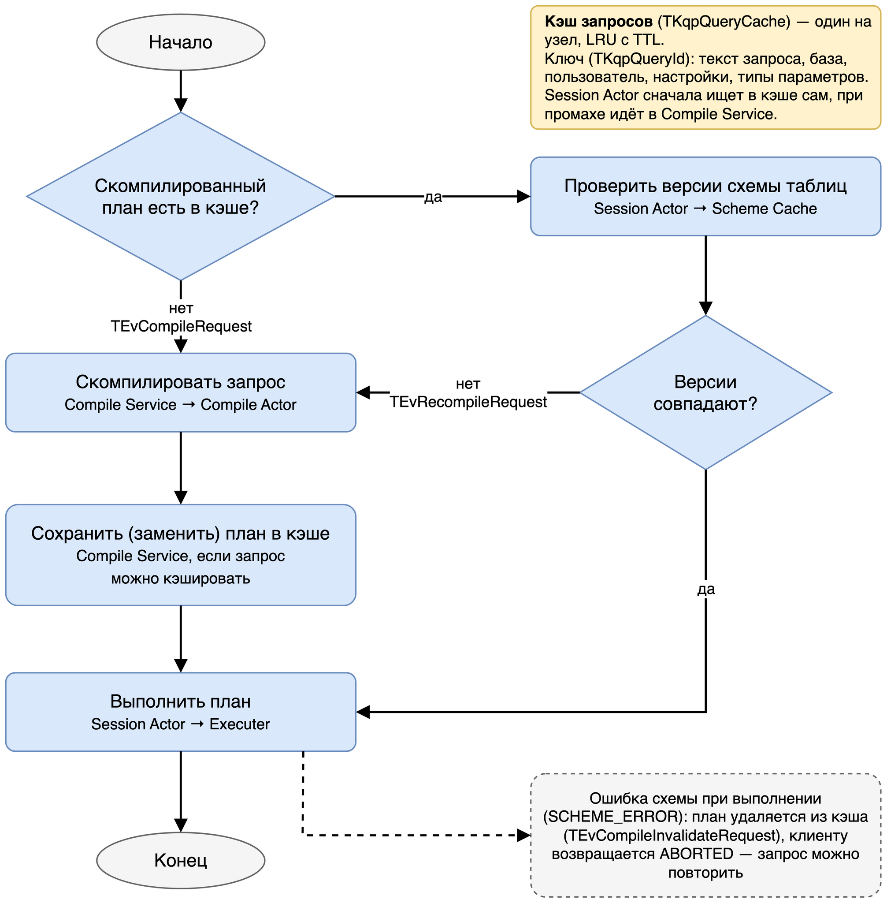

## 8.3 Основные компоненты слоя

Обработка запроса состоит из двух этапов: компиляции и выполнения.
Компиляция требует значительных ресурсов, поэтому её результат
кэшируется и используется повторно.

Для компиляции используется специальный локальный сервис, который
называется compile service. Вся работа непосредственно выполняется
YQL-конвейером. Это другой мир без акторов, где все на future.
Выполняются все стандартные оптимизации трансформов. Запрос парсится, получается AST, и
над ним производятся многократные преобразования, чтобы в конце получить
физический план выполнения запроса --- такой DAG (directed acyclic
graph), который показывает, что, как и где нужно выполнять, а также как
узлы будут обмениваться данными между собой. Физический план, по сути,
это результат компиляции.

Физический план представляет собой набор физических транзакций.
Например, чтение и запись делаются в разных физических транзакциях.
План помещается в LRU-кэш, и при последующих выполнениях такого же запроса
уже используется готовый. Кэш (`TKqpQueryCache`) один на ноду, он общий
для compile service и сессий, работающих на этой ноде, и это волатильное
хранилище. Сессия сначала сама ищет план в кэше и обращается в compile
service, только если плана там нет. Перед использованием найденного плана
сверяются версии схемы таблиц. Если они изменились, запрос
перекомпилируется.

Сессия пользовательская порождается серверной балансировкой так, чтобы
сессии создавались равномерно на разных нодах. После создания сессии
клиент старается обращаться напрямую к той ноде, на которой для него
создана сессия, чтобы избежать лишнего хопа. В целом вся первая часть
происходит на одной ноде.

Далее выполняется физический план. Этим занимается session actor,
который оркестрирует высокоуровневое выполнение: умеет по порядку
выполнять физические транзакции, описанные в плане. Между собой они
связаны параметрами, и он подставляет нужные. А для распределённого
выполнения есть KQP Executor. Их бывает два типа --- data executor и kqp
scan executor. На каждый запрос создаётся KQP Executor actor правильного
типа. Этот актор получает конкретную физическую транзакцию, и начинается
распределённое выполнение. Executor определяет, из каких таблиц
выполняется чтение и в какие --- запись, какие шарды задействованы
в данной физической транзакции.
Этап называется partition pruning.

Физический план --- это набор стейджей, связанных между собой
коннекшенами, стейдж --- это код, а коннекшен --- это обмен данными.

Система инстанцирует стейджи, начиная с листьев, читает из таблицы, определяет,
сколько нужно задач на чтение создать. На каждую затронутую партицию
создаётся отдельная задача. Когда задачи верхнего уровня инстанцированы,
дальше действуем эвристически. Достраиваем все остальные задачи, которые
будут участвовать в запросе, после чего запускаем их.

Задача выполняется отдельным актором. Для тех, кто читает из
шардов, запускается compute actor рядом с дата-шардами. В системе есть shard resolver
cache, который примерно знает, на каких нодах запущены шарды. Он не
идеален и может ошибаться, но это не важно. Читающие compute actor при
помощи итераторных интерфейсов читают данные и процессят уже первые
листовые задачи.

Для каждой задачи есть набор ченнелов, в которые задача должна отправлять
данные, и инструкция что делать. Другие участники ждут
данные по конкретным ченнелам и знают, что с этими данными делать
дальше. Таким образом, executor запускает набор компьют-акторов
и контролирует, что все находится в рабочем состоянии. Когда compute
actor завершается, он сообщает об этом executor-у. При ошибке
executor прерывает запрос и корректно завершает остальные compute actors.
После того как все compute actor успешно выполнились, финальный
результат отправляется либо executor для дата-запроса, либо
compute-actor. И если все успешно, то executor отдаёт результат выше.

Локи проверяются следующим образом: сам факт слома локов определяет
дата-шард, и он сообщает compute actor, а тот --- executor. Тогда
executor, узнав, что у одного из участников сломаны локи, сообщает
наверх, и весь запрос завершается с ошибкой aborted с issue про
transaction lock invalidated. Для read-only-запроса инвалидация обычно не
возникает, если запрос выполняется из фиксированного snapshot или из head
в режиме immediate-транзакции.
