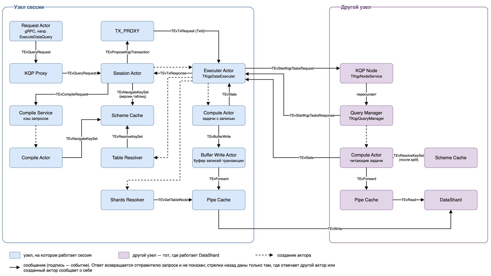

## 8.4 Путь прохождения запроса

Рассмотрим путь прохождения запроса на вставку по основным компонентам.

Самое начало --- есть request actor, который создаётся непосредственно
на gRPC request. В этом случае, например, execute data query
ответственен за то, чтобы ответить пользователю. Этот актор идёт в
локальный сервис KQP Proxy (входной сервис для KQP, он нужен для
роутинга на случай, если сессия на самом деле на другой ноде, --- именно
он отправит запрос на другую ноду и вернет оттуда ответ) и управляет
сессиями. Каждый execute data query выполняется в конкретной сессии,
сессия --- это тоже актор, session actor. Именно KQP Proxy умеет ставить
session ID в соответствие с конкретным актором и поэтому может
перенаправить этот запрос в session actor.

Дальше запрос оказывается в session actor, и тут уже много развилок.
Чтобы получить скомпилированный запрос, session actor сначала сам ищет
его в кэше запросов (`TKqpQueryCache`). Кэш один на узел и общий с
compile service. Если плана в кэше нет, session actor обращается в
compile service, который создаёт compile actor для компиляции одного
запроса и сохраняет результат в кэш. Далее session actor для выполнения
транзакции создаёт executor actor, в данном случае data executor. Для
запуска executor нужно получить TxId, и за ним система обращается в TX_PROXY.

Data executor начинает выполнять транзакцию. Он создаёт table resolver
actor, который занимается резолвом таблиц и ключей, то есть ходит в
scheme cache. Также он обращается в shard
resolver actor --- это актор, который кэширует текущее расположение
шардов по хостам. Он получает данные от pipe cache. А pipe ко всем
шардам могли устанавливаться ранее, поэтому данных может и не быть, а
те, которые есть, могут и устареть.

Если нет данных про шард, то запуск происходит либо на случайной ноде,
либо локально на том же узле. Есть эвристика: если запрос не очень большой и
нечитающих compute акторов достаточно мало (порядка 10), то их запускают
локально на том же узле. После этого, чтобы запустить удалённый актор,
executor actor отправляет `TEvStartKqpTasksRequest` в сервис KQP Node
другой ноды. Тот передаёт запрос менеджеру запросов (`TKqpQueryManager`),
который и запускает compute actor-ы. Локально на том же узле executor
создаёт акторов без участия KQP Node.

Следующий этап --- compute actor. Если он pure, то есть вычисляет, то
общается только с другими compute actor-ами. Если он читающий, то там
могут быть обращения в scheme cache, потому что там происходит чтение из DataShard.
Если шард был разделён (split), то при попытке обратиться к нему выясняется, что shard
offline. Нужно снова пойти в scheme cache и порезолвить новые
появившиеся партиции, чтобы продолжить чтение. При обращении в качестве
хинта compute actor-у передаётся tablet ID дата-шарда, так что на
основном пути выполнения транзакции нет обращения в scheme cache.

Читающие compute actor-ы обращаются к DataShard через pipe cache
событием `TEvRead`. Записи compute actor-ы не отправляют на шарды сами:
они передают их в буферный актор записи сессии (`TEvBufferWrite`). Тот
копит записи транзакции и отправляет их в DataShard-ы через pipe cache
событием `TEvWrite` (подробнее --- в разделе 6.2).

Затем результат идёт обратно: сначала ответ в executor, тот --- в
session actor, и если это финальный ответ последней физической
транзакции, то session actor возвращает его в локальный или удалённый
kqp proxy и потом в request.

