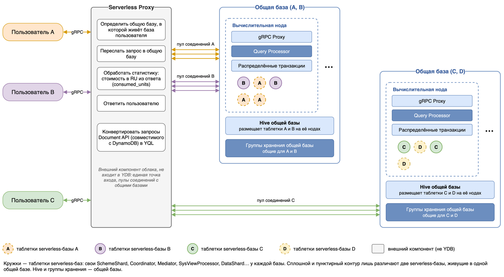

## 9.2 Бессерверный режим

В бессерверном режиме пользователь работает с отдельной логической базой, а вычислительные ресурсы предоставляются из общего пула. Ему не требуется закреплять за базой собственный набор постоянно работающих нод. Такое устройство позволяет организовать оплату за выполненные операции, однако правила тарификации, оплаты хранения и изменения доступной мощности относятся к конкретному сервису, предоставляющему YDB.

Потребление ресурсов запросом может выражаться в request units (RU). Это условные единицы, расчёт которых учитывает процессорное время и показатели ввода-вывода, например число и объём прочитанных строк. Конкретный расчёт зависит от вида операции. Сведения о потреблении могут передаваться клиенту вместе с ответом.

В основе совместного размещения лежит различие между базой, которой принадлежат данные, и ресурсным доменом, предоставляющим ресурсы. Serverless-база сохраняет своё пространство имён, ACL и таблетки, но в режиме общих вычислений использует ноды shared-базы. Таблетки разных serverless-баз при этом работают на одном оборудовании и в одних процессах ОС.

На рисунке показан пример совместного размещения с внешним serverless proxy; его роль в этой инсталляции описана ниже.

Каждая serverless-база имеет собственные таблетки для управления схемой, транзакциями и пользовательскими данными. Их состав зависит от конфигурации и используемых возможностей. В описываемой схеме собственного Hive у неё нет: размещением занимается Hive общей базы, а если у общей базы собственного Hive нет --- корневой Hive. Пулы хранения предоставляются ресурсным доменом, поэтому таблетки разных баз могут использовать общие группы хранения. При этом каждая база сохраняет отдельную схему и свои пользовательские данные.

Режим использования вычислительных ресурсов задаётся отдельно: помимо Shared, в реализации предусмотрен Exclusive, при котором для размещения выбираются ноды самой базы. Изменение этого режима разрешает флаг EnableServerlessExclusiveDynamicNodes, выключенный по умолчанию.

Распределённый квотировщик позволяет ограничивать скорость потребления
ресурсов отдельной базой, в том числе в request units. Это помогает
сдерживать влияние её нагрузки на соседей по общему пулу. При оплате
операций по RU такое ограничение также позволяет ограничить скорость
роста расходов, например из-за ошибочного цикла запросов в приложении.

Интеграция с квотировщиком есть в обработчиках gRPC-запросов YDB:
настройки определяют ресурс квотирования, проверку перед запросом
и учёт потребления по ответу. Квота задаёт допустимую нагрузку;
выделение CPU и памяти настраивается отдельно.
Доступные пользователю лимиты и способы их изменения задаёт сервис.

В описываемой облачной инсталляции перед YDB расположен внешний serverless proxy. Он предоставляет единую точку входа, направляет запросы на ноды нужного общего пула и переиспользует соединения. Использование такого прокси определяется архитектурой конкретного сервиса.

В этой же инсталляции serverless proxy предоставляет интерфейс, совместимый с DynamoDB, переводя обращения document API в запросы YQL. Созданные таким способом таблицы доступны и через YQL. Преобразование API и совместное использование ресурсов --- разные функции, хотя здесь они объединены в одном сервисе.
