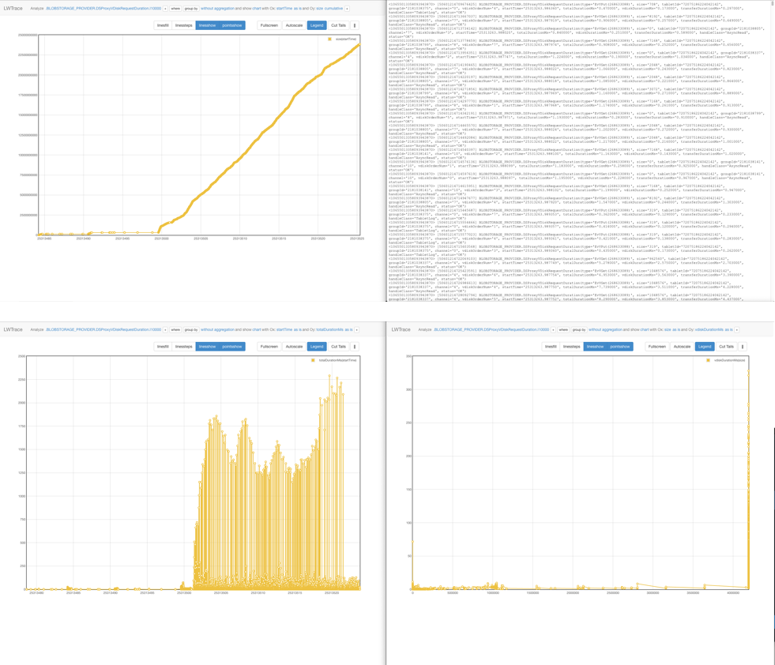
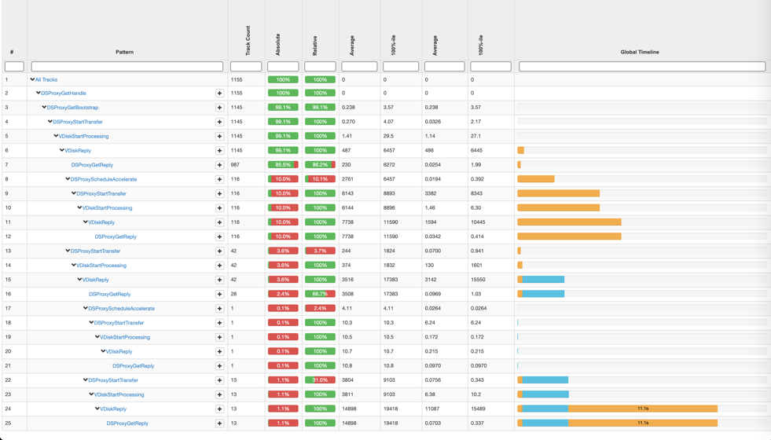

## 11.2 LWTrace и LWTrack

Light-Weight Trace (LWTrace) --- библиотека для трассировки процессов по
требованию в реальном времени и с минимальным снижением их
производительности.

LWTrace позволяет «подключиться» к исполняющемуся процессу, выполнить
его трассировку и «отключиться», когда действия больше не нужны. Это
исключительно полезно для трассировки непосредственно в
продакшн-условиях. Для трассировки в коде программы нужно определить
набор датчиков (probe) и добавить их вызовы. При выполнении
подготовленной таким образом программы пользователь может с помощью
запроса начать её трассировку.

Процесс трассировки заключается в том, что при срабатывании датчиков
выполняются инструкции, указанные пользователем на специальном языке.
Как правило, этот набор инструкций записывает в журнал имя датчика и
информацию о состоянии переменных.

LWTrace работает в userland и не требует установки или поддержки на
уровне ядра ОС. Каждый инструментированный поток хранит в памяти журнал
ограниченного размера. Это позволяет с минимальным влиянием на
производительность писать информацию о миллионах операций в секунду.

Множество различных датчиков уже расставлено по коду YDB, а для
включения трассировки и анализа результатов имеется удобный
веб-интерфейс.

LWTrace на основном пути обработки трассировочного запроса выполняет
все операции с использованием индивидуальных копий буферов для каждого
потока, таким образом даже включённый и трассирующий запросы LWTrace
не приводит к возникновению возможности блокировки одного потока вторым.
Только в редкие моменты, когда пользователь идёт смотреть на графики в
LWTrace, возникает в принципе взаимодействие между потоками, так как смотрит
пользователь из потока, отличного от потока, который писал лог. 

LWTrace имеет механизм отслеживания треков, называемый LWTrack.
В этом режиме запись событий происходит не в специальные per-thread
буферы, а в «лог» перемещающегося с «орбиты» на «орбиту» «шаттла».
Количество одновременно отслеживаемых «шаттлов» ограничено. LWTrack
позволяет анализировать такие логи.

Исходный код LWTrace находится в репозитории YDB:

<https://github.com/ydb-platform/ydb/tree/main/library/cpp/lwtrace>

