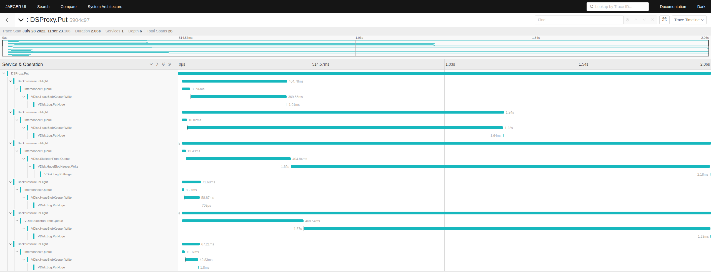

## 11.3 Трассировка Wilson

Wilson Tracing предоставляет средства распределённой трассировки
и отправляет спаны в OTLP-совместимый коллектор, например Jaeger.
В конфигурации кластера задаётся коллектор, а в коде создаются спаны —
отрезки времени, соответствующие выполнению отдельных действий. Существует класс NWilson::TSpan, позволяющий завести
спан. Он рекурсивный, поэтому при указании спана указывается родитель. И
существует ряд методов, позволяющих задавать атрибуты, отмечать события
внутри спана (спан идёт от начала до конца, а посередине могут быть ещё
какие-то точечные события). Проще всего поискать по коду примеры
использования.

Wilson --- прослойка для распределённой трассировки запросов, которая
умеет сливать полученные результаты по протоколу OTLP
(<https://opentelemetry.io/docs/>).

Трассы, полученные в Wilson, выглядят примерно так:

```{=latex}
\begingroup
\floatplacement{figure}{H}
```



```{=latex}
\endgroup
```

Система позволяет проследить ход выполнения запроса через все узлы
кластера, которые в этом участвуют, отмечая время начала и окончания
различных действий и позволяя записывать параметры, связанные с этими
действиями. При этом есть возможность задать уровень детализации трассы.

### Как настроить

В cluster.yaml нужно добавить следующие строки:

```yaml
tracing_config:
  backend:
    opentelemetry:
      collector_url: grpc://collector.example.com:4317
      service_name: ydb
  external_throttling:
    - max_traces_per_minute: 10
```

collector_url задаёт адрес коллектора, service_name — имя сервиса
в экспортируемых трассах. Схема grpc:// означает соединение без TLS,
а grpcs:// — с TLS. Пример разрешает трассировку до 10 запросов в минуту
с внешним trace-id на каждом узле; автоматическая выборка запросов
задаётся отдельно в секции sampling.

Если Wilson нужно запустить вне kikimr, то нужно создать экземпляр
uploader с помощью CreateWilsonUploader(TWilsonUploaderParams) и
зарегистрировать его как сервис MakeWilsonUploaderId().

Для проверки работоспособности можно включить WILSON на уровне DEBUG,
тогда он будет писать про запуск и отгрузку трасс в логи.

### Как добавить трассировку в код

#### Идентификатор трассировки

Для отправки спанов Wilson использует акторную систему с
зарегистрированным Wilson Uploader. В обработчике события TSpan
может получить указатель на акторную систему из текущего контекста.
Вне обработчика этот указатель нужно явно передать конструктору;
при завершении спана используется сохранённый указатель.
Поэтому начало и окончание трассируемой операции не обязаны
находиться внутри обработчиков событий. Акторная система должна
оставаться доступной до отправки завершённого спана.

Трасса состоит из набора отрезков, представленных классом
NWilson::TSpan. Все отрезки трассы формируют древовидную структуру.
Дочерние отрезки могут символизировать как часть выполнения операции,
представленной родительским отрезком, так и последующие действия, не
связанные с родителем. Время жизни родительских и дочерних отрезков
никак не связано, они могут даже не пересекаться.

Для передачи метаданных трассировки используется класс
NWilson::TTraceId, который содержит в себе следующую информацию:

-   trace_ID всей трассы (16 байт) --- уникальный идентификатор, по
    которому потом можно будет собрать всю трассу;

-   родительский span_ID для будущих отрезков (8 байт), которые будут
    отщепляться от этого NWilson::TTraceId;

-   TTL --- максимально допустимая глубина дерева трассировки;
    уменьшается на один с каждым уровнем вложенности;

-   verbosity --- допустимый уровень детализации трассировки;
    отрезки с более высоким уровнем не экспортируются, но сохраняют
    контекст для создания дочерних отрезков с допустимым уровнем;

NWilson::TTraceId содержится в поле IEventHandle::TraceId и может
заполняться для любых событий. Учитывая структуру трассировки, имеет
смысл задавать этот параметр в запросах. В сообщениях-ответах TraceId не
имеет особенного смысла. В запросах же ему присуща семантика
идентификатора родительского отрезка, от которого будут отщепляться
дочерние отрезки в процессе выполнения запроса.

NWilson::TTraceId --- это move-only тип. Так сделано для предотвращения
случайного копирования идентификаторов, чтобы минимизировать ошибки в
коде. Если использовать NWilson::TTraceId, из которого было перенесено
значение, это приведёт к Y_VERIFY_DEBUG, например:

```cpp
NWilson::TTraceId traceId = NewTraceId(...);
NWilson::TTraceId x = std::move(traceId);
// выстрелит Y_VERIFY_DEBUG:
NWilson::TSpan span(..., std::move(traceId), ...);
```

Если нужно сделать копию NWilson::TTraceId, то, скорее всего, вам не
нужно делать копию. Можно несколько раз сделать Span.GetTraceId() для
получения дочернего TraceId для конкретного отрезка. Но всё же, если
очень хочется, можно вызвать явный конструктор копирования.

Если трассировка для запроса не включена, то NWilson::TTraceId имеет
пустое значение, создаваемое конструктором по умолчанию. Все отрезки,
создаваемые с пустым родителем, также будут пустыми и не будут
передавать никакой информации в collector.

#### Отрезок

Для создания отрезка вызывается конструктор TSpan следующим образом:

```cpp
TSpan span(verbosity, std::move(parentTraceId), name[, flags]);
```

Уровень детализации текущего отрезка задаётся параметром verbosity.
Если он превышает допустимый уровень из TTraceId, отрезок
игнорируется и не отправляется в collector. При этом GetTraceId()
сохраняет контекст: дочерние отрезки с допустимым уровнем могут
попасть в трассу, связываясь с ближайшим неотфильтрованным предком.
Пропущенный уровень также расходует TTL.

ParentTraceId имеет тип NWilson::TTraceId и определяет идентификатор
родительского отрезка. Если parentTraceId пустой, то созданный отрезок
тоже будет пустым и будет игнорировать все манипуляции с ним. Если
parentTraceId инвалидирован перемещением, то выстрелит Y_VERIFY_DEBUG
(при отключённой отладке поведение будет аналогичным пустому).
Фильтрация по verbosity сохраняет контекст для потомков;
TTL ограничивает дальнейшее порождение дочерних идентификаторов.

Name --- это строковое имя отрезка, которое отображается в системе
трассировки. Его не стоит делать очень вариативным, например добавлять
какие-то параметры в имя, поскольку это приведёт к неудобствам в
пользовании UI Jaeger.

Flags --- флажки, которые могут менять поведение отрезка. При добавлении
флажка EFlags::AUTO_END при вызове деструктора отрезка не
появится сообщение об ошибке, а будет автоматически вызван метод End().

Пример использования: 

<https://github.com/ydb-platform/ydb/blob/6d9746b2f39370e838f2718bf65b0fb2bc5e5d1b/ydb/core/blobstorage/backpressure/queue.h#L59>

Здесь создаётся отрезок с уровнем детализации VDiskTopLevel (уровни
описаны в ydb/library/wilson_ids/wilson.h), при этом parentTraceId забирается из
входящего события.

При создании отрезка ему присваивается свой NWilson::TTraceId, который
принадлежит той же трассе, что и parentTraceId, и имеет parent_span_ID
соответствующий span_ID parentTraceId.

С отрезком можно выполнять следующие манипуляции:

-   задать новое имя через span.Name();

-   добавить KV-атрибут через span.Attribute();

-   добавить точечное событие через span.Event(),
    например: <https://github.com/ydb-platform/ydb/blob/6d9746b2f39370e838f2718bf65b0fb2bc5e5d1b/ydb/core/blobstorage/vdisk/huge/blobstorage_hullhuge.cpp#L222>;

-   добавить связь с другим отрезком, возможно, вообще с другой трассой
    через span.Link();

-   завершить: успешно, с ошибкой, просто завершить;

-   получить NWilson::TTraceId для этого отрезка через GetTraceId(),
    чтобы передать его в дочерние запросы.

Каждый отрезок требует явного завершения. Если его не завершить в коде,
то деструктор автоматически завершит отрезок с ошибкой unterminated
span. Чтобы этого не случилось, при создании отрезка следует указать
флажок AUTO_END. Если деструктор вызывается при проходе исключения, то в
любом случае возникнет ошибка span terminated due to stack unwinding.
Если класс активного отрезка перезаписать другим, то первый завершится с
ошибкой TSpan instance incorrectly overwritten.

В момент завершения отрезок упаковывается и отправляется в Wilson
Uploader, который передаст его в Collector.

Стоит отметить, что отрезок нельзя завершить дважды. Также после
завершения нельзя проводить с ним никаких операций --- это приведёт к
Y_VERIFY_DEBUG. Однако можно вызывать GetTraceId() для передачи вниз.

Создаваемый конструктором TSpan отрезок получает атрибут node_id, содержащий числовой
идентификатор узла, на котором находится этот отрезок.

Он всегда начинается и оканчивается на одном и том же узле. Как правило,
удобно выбирать время жизни отрезка таким, чтобы оно примерно совпадало
с временем жизни актора, который выполняет запрос, либо с временем жизни
некоторого элемента в очереди запросов. Время жизни отрезка всегда нужно
явно завершать вызовом span.End\*().

#### Создание новой трассы

Трассу можно принимать как запрос извне, однако можно начинать трассы
изнутри системы. Например, DSProxy выбирает запросы для собственной
трассировки в EnableWilsonTracing.

В настройках DS proxy через WebUI можно задавать вероятность выборки
для Get, Put и Discover. Для запросов без входящего TraceId дополнительно
действует общий для DSProxy в процессе ограничитель: между созданием
новых трасс должно пройти не менее одной секунды. Запросы, уже имеющие
TraceId, продолжают свою трассу и этим ограничителем не отбрасываются.

Wilson uploader отправляет спаны пакетами. Среднюю скорость экспорта
с узла можно ограничить параметром `max_exported_spans_per_second`
в секции `tracing_config.uploader`; по умолчанию
отдельное ограничение скорости экспорта не задано. Размер пакета,
время его накопления и число одновременно отправляемых пакетов
настраиваются отдельно. Ограничение экспорта спанов отличается
от ограничения числа запросов, выбранных для трассировки.

Создать новый идентификатор можно также статическим методом
NewTraceId(verbosity, TTL) класса NWilson::TTraceId. Если TTL = Max(), то
выбирается максимально возможный TTL (в данный момент 4095). Verbosity
указывает на самый детальный уровень, который требуется увидеть в трассе.
Чем выше verbosity, тем более детальной может быть трасса.
Потомки отфильтрованного отрезка могут попасть в трассу, если
соответствуют выбранному уровню verbosity.
