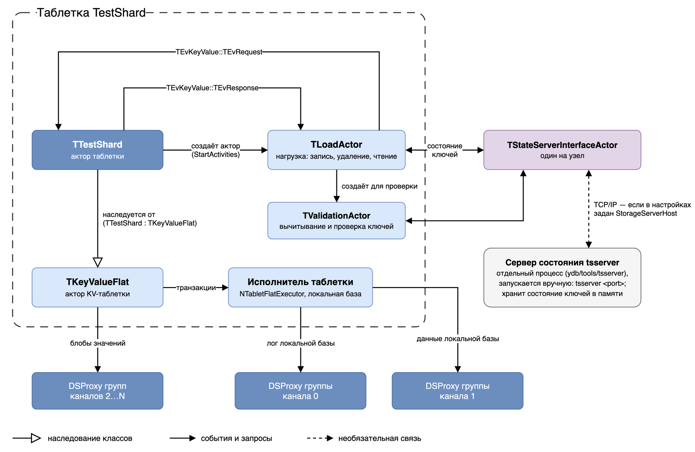

## 11.11 Тест-шард

Тест-шард является надстройкой над KV-таблеткой. Он
умеет генерировать нагрузку на KV и валидировать записанное: пишет
случайный поток данных, периодически вычитывает, а после проверяет,
вычитано ли все записанное, не испортилось ли оно в процессе. Часть
данных тест-шард удаляет, поддерживая в занятом состоянии настраиваемый
объём между минимумом и максимумом, заданными в конфигурации. Валидация
запускается периодически. Чтобы хранить информацию о том, что было
закоммичено, а что --- нет, используется специальный отдельный сервис
(самостоятельная программа). Тест-шард подключается к нему по TCP/IP. В
этом сервисе хранится информация о том, что тест-шард записал, а что
удалил.

Сервис тест-сервер --- это отдельная программа, которая запускается вручную.
