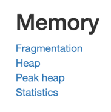
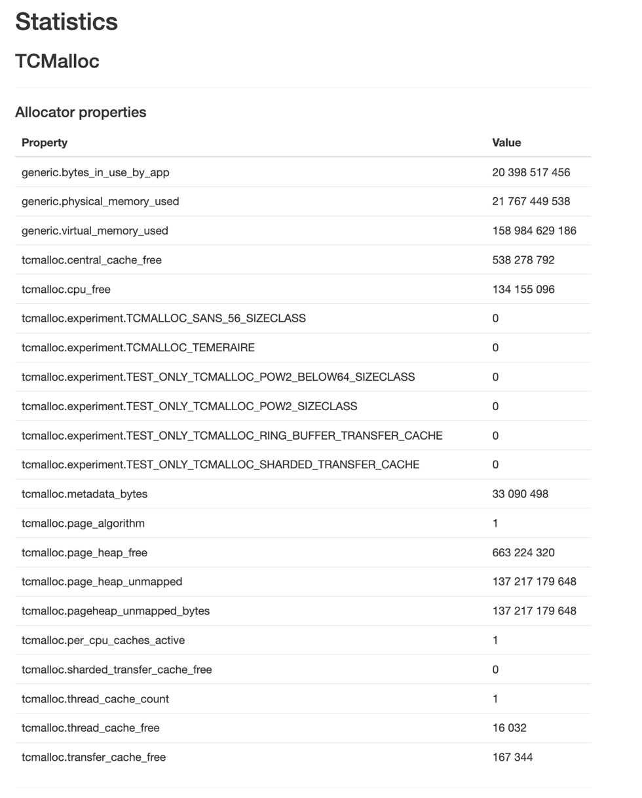
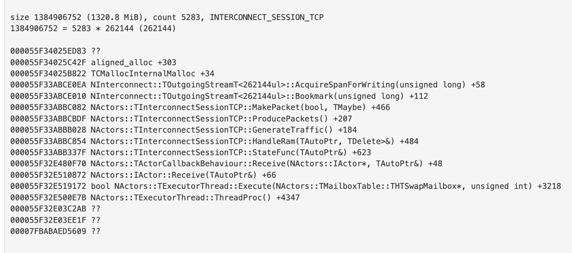

## 11.13 Диагностика аллокатора

```{=latex}
\begingroup
\floatplacement{figure}{H}
```

TCMalloc можно грубо представить как иерархию кэшей: он перетаскивает
странички между этими кэшами туда-сюда. Основной мониторинг того, что он
делает, --- мониторинг размеров кэшей. Диагностические данные доступны
через веб-интерфейс и в виде набора мониторинговых счётчиков.

В веб-интерфейсе есть раздел Memory с диагностикой аллокатора.


{width=30%}

{width=87%}

bytes_in_use_by_app --- количество байт, аллоцированных и используемых
на данный момент приложением через аллокатор TCMalloc.

physical_memory_used --- то же самое, плюс кэши аллокатора, то есть
объём потребленной физической памяти.

virtual_memory_used --- потребленная виртуальная память.

У аллокатора есть central_cache, и central_cache_free --- количество
пустых страниц в этом кэше.

cpu_free --- per-CPU-кэши.

metadata_bytes --- метаданные самого аллокатора.

Page_heap --- количество байт, которое аллокатор получил от ОС при помощи mmap.

Page_heap_unmapped --- количество байт, которое к текущему моменту аллокатор успел размапить.

В стандартной Linux-сборке `ydbd` TCMalloc по умолчанию использует локальные
кэши, привязанные к логическим процессорам (per-CPU). Если необходимый для
этого механизм `rseq` недоступен, используются кэши потоков (per-thread).
Фактический режим отражает счётчик `tcmalloc.per_cpu_caches_active`.

Кроме статистики про кэши, раз в определённое количество аллоцированных
байт TCMalloc пускает аллокацию по особому пути с записью стека. Такие
аллокации обслуживаются особым образом, они не такие, как все остальные,
поскольку к ним прикрепляется стек. За счёт этого TCMalloc получает
семплированную статистику, которую он экстраполирует на полный объём
аллокаций. Помимо стека, при семплировании акторная система передаёт
аллокатору идентификатор текущей активности, что позволяет разметить
аллокации вызвавшими их активностями.
Статистика аллокаций по активностям выгружается в мониторинг, а
детальная статистика доступна в веб-интерфейсе.

Указывается общий экстраполированный размер аллокаций с определённым
стеком, количество аллокаций, размер одной аллокации и
стек-трейс.



Через Immediate Control Board можно настроить частоту семплирования
статистики. Важно понимать, что при высокой частоте семплирования оно
будет существенно влиять на производительность системы.

При достижении определённого уровня потребления памяти, близкого к
значению, после которого может произойти OOM, аллокатор записывает
текущую статистику в лог. При этом он использует специальный
разделитель, позволяющий при помощи sed преобразовать строки записей в
удобочитаемые стеки.

Кроме того, при новом максимуме потребления памяти за время работы
аллокатора он сохраняет набор семплов. Это позволяет посмотреть
статистику аллокаций в момент пика потребления памяти.

```{=latex}
\endgroup
```
