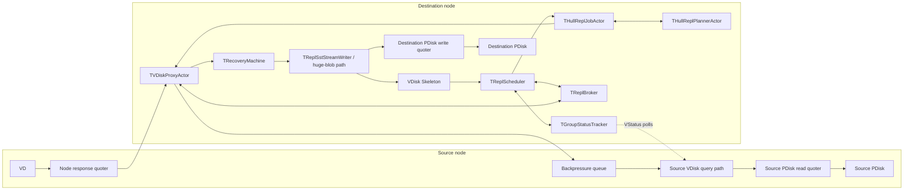

# VDisk Replication Architecture

This document describes full VDisk replication: the recovery process that fills a
new or incomplete VDisk with the blob parts it must store. It focuses on component
ownership, resource-control boundaries, and the data flow between source VDisks and
the destination VDisk.

Full replication scans the destination's Hull LogoBlob index, finds locally missing blob
parts, reads those parts from peers or a donor, reconstructs them when necessary,
and writes them into the destination's local Hull database.

## Binding model

The same replication operation crosses several ownership scopes. In particular,
an actor running for one VDisk may consume a limiter owned by its node or PDisk.

| Component or resource | Binding | Responsibility |
|---|---|---|
| NodeWarden | Node | Creates PDisks and VDisks, creates the node replication broker, and distributes shared replication quoters to local VDisks. |
| `TReplBroker` | Node, with token queues per local PDisk | Serializes replication sessions on each PDisk, orders them by group health when enabled, and limits aggregate in-flight replication memory on the node. |
| PDisk read/write quoters | One pair per PDisk | Limit aggregate replication reads from and replication writes to that physical disk across all VDisks using it. |
| Node request/response quoters | Node | Limit aggregate replication network traffic across all local VDisks. |
| VDisk Skeleton | VDisk | Owns the destination's Hull and PDisk contexts, starts the replication scheduler, persists recovered huge blobs, and publishes the resulting VDisk state. |
| `TReplCtx` | VDisk replication lifetime | Shares the destination VDisk, Hull, PDisk, group, configuration, monitoring, and write-accounting objects with replication children. |
| `TReplScheduler` | Destination VDisk | Owns the complete replication pass, peer queues, donor order, replication-token lifecycle, quantum progression, retry/relaxation, and completion reporting. |
| `TGroupStatusTracker` | One active replication scheduler | Polls all other VDisks in the group and converts their status into this scheduler's replication-token priority. |
| Backpressure queue clients | Source VDisk, created by one destination scheduler | Maintain connectivity and flow control from a destination VDisk to every peer VDisk and donor it may read. |
| `THullReplJobActor` | One destination VDisk quantum | Executes one bounded unit of recovery: plan, fetch, merge/reconstruct, and write. |
| `THullReplPlannerActor` | One quantum; Batch pool | Scans a Hull snapshot and constructs the bounded set of missing parts to recover. |
| `TVDiskProxyActor` | One source VDisk within one quantum | Batches `VGet` requests, preserves result order, prefetches data, and accounts for in-flight memory and requesting-node traffic. |
| VDisk query/read actors | Source VDisk | Serve replication `VGet` requests and apply source-side PDisk-read and node-response limits. |
| `TRecoveryMachine` | One quantum | Combines replies, performs erasure reconstruction, classifies missing/phantom-like blobs, and produces recovered records. |
| `TReplSstStreamWriter` | Destination VDisk, one quantum | Builds and commits replicated small-blob SST data to the destination Hull LogoBlob level index. |
| Group topology and quorum checker | Group metadata, read locally | Determine which parts belong on the destination and, optionally, how urgent its recovery is under the group's failure model. |

`PDisk` binding in this table means a physical-disk resource boundary, not that
the replication scheduler runs inside the PDisk actor. A node can host several
PDisks, each PDisk can host several VDisks, and every VDisk belongs to one group.

## Component and data flow

The diagram omits the other peer VDisks: a generic recovery quantum may create a
proxy for every relevant peer in the blob's subgroup. The job merges their ordered
responses and uses the erasure codec if the exact required part is unavailable but
enough other parts exist.

## Lifecycle of a replication pass

### 1. Creation and commencement

After VDisk recovery has produced the Hull and PDisk contexts, Skeleton creates a
`TReplCtx` and a long-lived `TReplScheduler`. The context is specific to that VDisk;
it contains the current group information and references to local storage state,
but it does not own node-wide quotas.

The scheduler creates backpressure queue clients for all group peers. It also
creates two queue clients for every configured donor: an asynchronous replication
read queue and a fast online-read queue. A donor is an older VDisk slot retained in
read-only donor mode to accelerate copying into its replacement. Donors are tried
before ordinary group peers and are dropped through NodeWarden after they have been
successfully exhausted.

Replication may start immediately or remain in the relaxation state until
`EvCommenceRepl`, depending on VDisk startup configuration and front-end state.

### 2. Planning a quantum

The scheduler creates one `THullReplJobActor`. The job starts a
`THullReplPlannerActor` in the Batch pool. The planner repeatedly takes consistent
Hull snapshots and scans the LogoBlob index from the saved key.

For every kept blob it compares ingress information with
`PartsWeMustHaveLocally()`. Missing local parts become recovery tasks. Garbage that
is no longer kept by barriers is skipped. Planning is bounded both by the recovery
machine's task capacity and `ReplMaxQuantumBytes`; `ReplPlanQuantum` also limits how
long one planner activation scans before it yields and takes another snapshot.

Planning happens before the replication token is acquired. This prevents scarce
PDisk admission from being held while the Batch-pool scan prepares work.

### 3. Admission on the destination PDisk

Once a non-empty plan is ready, the job sends `TEvReplStarted` and waits for
`TEvReplResume`. The scheduler asks the node-local `TReplBroker` for a token keyed
by the destination `PDiskId`.

The broker grants at most one token per local PDisk. This token is a concurrency
control, not a bytes-per-second quota. The scheduler also waits until a donor queue
is connected or enough group-peer queues are connected; after a timeout it allows
the job to attempt progress and handle individual request failures.

If replication-token priority is disabled, requests use the default priority and
the broker preserves FIFO order. If it is enabled, the scheduler first waits for a
group-status result as described in [Replication-token priority](#replication-token-priority).

### 4. Reading peers

After `TEvReplResume`, the job creates a `TVDiskProxyActor` for each source it
needs. A proxy groups blob IDs into extreme-data `VGet` requests using the
`AsyncRead` handle class. Requests travel through the scheduler's backpressure
queue client to the source VDisk.

Before issuing a request, the proxy reserves its estimated reply size from the
node-wide replication memory budget in `TReplBroker`. The token is corrected to the
actual serialized response size when the reply arrives and released after that
reply is consumed. The broker may allow one oversized allocation when no other
memory token exists, which guarantees progress instead of deadlocking on an item
larger than the configured budget.

On the source VDisk, the normal query path recognizes the request as replication:

- physical chunk reads are delayed by the source PDisk's replication-read quoter;
- the completed `VGetResult` is delayed by the source node's replication-response
  quoter before it is sent;
- the existing VDisk queue provides connection state and backpressure.

On the requesting node, the proxy applies the node replication-request quoter as
response bytes are accepted and uses the same quoter's packet capacity to bound
the requested response size. Consequently, the names `request` and `response`
identify the two sides of replication network accounting; they are not additional
PDisk limits.

### 5. Reconstruction and destination writes

The job merges proxy streams by LogoBlob ID. `TRecoveryMachine` collects the
available parts and either uses an exact requested part or reconstructs missing
parts with the group's erasure codec. It also records transiently unrecoverable and
phantom-like blobs for later passes.

Recovered small blobs are accumulated by `TReplSstStreamWriter`, written as Hull
SST chunks, and committed through the destination LogoBlob level-index actor.
Recovered huge blobs are sent through Skeleton's huge-blob path. Both physical
write paths use the destination PDisk's replication-write quoter before issuing
the write.

The read and write limits therefore apply at different physical locations:

- a peer read consumes the source PDisk's read quota;
- the recovered record consumes the destination PDisk's write quota;
- node network and memory limits are shared by all replication running on that
  node.

### 6. Quantum completion and final state

The job returns `TEvReplFinished` with its next scan key, statistics, EOF state,
and any records that could not be recovered. The scheduler either starts another
quantum while retaining the token or cooperatively releases the token if a more
urgent request is waiting.

At the end of a full scan, unresolved blobs are retried in later passes after
`ReplTimeInterval`. A completely successful pass reports `EReplDone::Finished` to
Skeleton. Skeleton combines replication completion with durability and scrub state
before publishing the VDisk as `READY`; otherwise it remains `REPLICATING`.

The scheduler is long-lived even after successful replication so it can continue
to serve monitoring and lifecycle events. Group-generation changes are forwarded
to peer queues and the group-status tracker. Shutdown poisons child actors and
returns any requested or held broker token.

## Replication-token priority

`EnableReplTokenPriority` changes only contention for the per-PDisk replication
token. It does not alter byte-rate quotas, the erasure algorithm, or which blobs a
VDisk must recover.

While a scheduler is actively replicating, its `TGroupStatusTracker` sends
`TEvVStatus` to every other VDisk in the group. A peer counts as healthy only when
the response is `OK`, the VDisk has joined the group, and it reports replication
complete. The destination itself, nonresponding peers, and unhealthy peers are
treated as failed for this calculation.

The group quorum checker returns the number of additional worst-placed VDisk
failures required to violate the failure model. This number is the token priority:
a smaller value means greater urgency. The calculation accounts for the erasure
scheme and failure-domain/failure-realm layout, not only the raw number of failed
VDisks.

The tracker waits up to three seconds for a poll and starts the next poll five
seconds after completing the current one. It sends only changed priorities to its
scheduler. The broker stores an arbitrary number of priority levels and uses FIFO
within each level. If a higher-priority request appears, a holder that declared
yield support receives `TEvYieldReplToken`; active replication yields after its
current quantum, while a scheduler waiting for peer queues can release immediately.

The tracker is bound to a destination scheduler, not shared by the group. If two
VDisks of the same group replicate concurrently, both poll the group and compute
their priorities independently, potentially on different nodes. The broker is
also node-local, so priority orders only token contenders sharing a PDisk on that
node; it does not form a cluster-wide replication queue.

## Rate and resource controls

NodeWarden reads `TReplBrokerConfig` and supplies shared quoter objects to every
local VDisk. Runtime configuration updates change the existing quoter objects, so
active replication observes new rates without restarting its VDisk.

| Setting | Enforcement point | Effective scope |
|---|---|---|
| `TotalRequestBytesPerSecond` | Requesting-side `TVDiskProxyActor` | Aggregate per node |
| `TotalResponseBytesPerSecond` | Source VDisk query actor before sending a replication response | Aggregate per node |
| `MediaTypeQuota.ReadBytesPerSecond` | Source VDisk/PDisk read boundary | Aggregate per PDisk; configured by media type |
| `MediaTypeQuota.WriteBytesPerSecond` | Destination replication write paths | Aggregate per PDisk; configured by media type |
| `MaxInFlightReadBytes` | Memory tokens in `TReplBroker` | Aggregate per node; fixed when the broker starts |
| Replication token | `TReplBroker` queue selected by destination `PDiskId` | One active holder per PDisk |
| VDisk queue/backpressure settings | Queue client between destination and one source | Per source connection/client |
| `ReplMaxQuantumBytes` and request/prefetch settings | Scheduler job and proxy batching | Per destination VDisk job |

The per-PDisk quoters are separate objects even when two PDisks have the same media
type and configured rate. All local VDisks on one PDisk share that PDisk's objects.
The two node quoters and the broker memory budget are shared across PDisks.

Balancing also consumes some replication quoters and the broker's per-PDisk token,
but it uses the default token priority and does not participate in cooperative
priority yielding. It is a co-consumer of these resources, not part of the full
VDisk replication state machine described above.

## Source map

| Area | Source |
|---|---|
| Scheduler, group-status tracker, pass lifecycle | [`repl/blobstorage_repl.cpp`](repl/blobstorage_repl.cpp) |
| Replication context | [`repl/blobstorage_replctx.h`](repl/blobstorage_replctx.h) |
| Broker token and memory protocol | [`repl/blobstorage_replbroker.h`](repl/blobstorage_replbroker.h) |
| Broker implementation | [`repl/blobstorage_replbroker.cpp`](repl/blobstorage_replbroker.cpp) |
| Quantum planner, job, merge, and writes | [`repl/blobstorage_hullrepljob.cpp`](repl/blobstorage_hullrepljob.cpp) |
| Recovery and erasure reconstruction | [`repl/blobstorage_replrecoverymachine.h`](repl/blobstorage_replrecoverymachine.h) |
| Small-blob SST writer | [`repl/blobstorage_hullreplwritesst.h`](repl/blobstorage_hullreplwritesst.h) |
| Peer request proxy and memory accounting | [`repl/blobstorage_replproxy.cpp`](repl/blobstorage_replproxy.cpp) |
| Source PDisk-read enforcement | [`query/query_readactor.cpp`](query/query_readactor.cpp) |
| Source network-response enforcement | [`query/query_extr.cpp`](query/query_extr.cpp) |
| Skeleton ownership and completion handling | [`skeleton/blobstorage_skeleton.cpp`](skeleton/blobstorage_skeleton.cpp) |
| VDisk configuration and shared quoter references | [`common/vdisk_config.h`](common/vdisk_config.h), [`common/vdisk_context.h`](common/vdisk_context.h) |
| NodeWarden service and runtime configuration | [`../nodewarden/node_warden_impl.cpp`](../nodewarden/node_warden_impl.cpp) |
| Per-PDisk quoter creation | [`../nodewarden/node_warden_pdisk.cpp`](../nodewarden/node_warden_pdisk.cpp) |
| Quoter propagation into VDisks | [`../nodewarden/node_warden_vdisk.cpp`](../nodewarden/node_warden_vdisk.cpp) |
| Configuration schema | [`../../protos/blobstorage.proto`](../../protos/blobstorage.proto) |
| Group failure-model priority | [`../groupinfo/blobstorage_groupinfo.cpp`](../groupinfo/blobstorage_groupinfo.cpp) |
