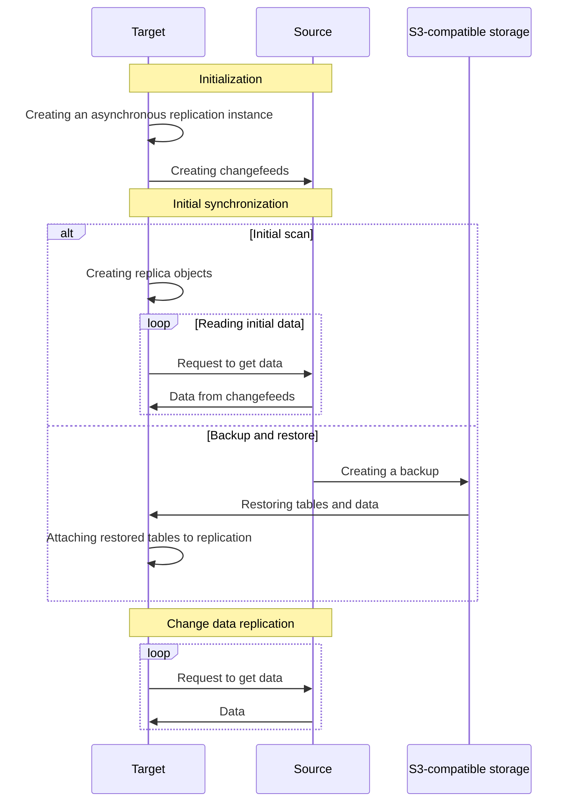

# Asynchronous Replication

Asynchronous replication allows for synchronizing data between {{ ydb-short-name }} [databases](glossary.md#database) in near real time. It can also be used for data migration between databases with minimal downtime for applications interacting with these databases. Such databases can be located in the same {{ ydb-short-name }} [cluster](glossary.md#cluster) as well as in different clusters.

## Overview {#how-it-works}

Asynchronous replication is based on [Change Data Capture](cdc.md) and operates on logical data. The following diagram illustrates the replication process:

As shown in the diagram above, asynchronous replication involves two databases:

1. **Source**. A database with [replicated objects](glossary.md#replicated-object).
2. **Target**. A database where an [asynchronous replication instance](glossary.md#async-replication-instance) and [replica objects](glossary.md#replica-object) will be created.

Asynchronous replication consists of the following stages:

* [Initialization](#init)
* [Initial synchronization](#initial-sync)
* [Change data replication](#replication-of-changes)

### Initialization {#init}

Initialization of asynchronous replication includes the following steps:

* Creating an asynchronous replication instance on the target database using the [CREATE ASYNC REPLICATION](../yql/reference/syntax/create-async-replication.md) YQL expression.
* Establishing a connection with the source database. The target database connects to the source using the [connection parameters](../yql/reference/syntax/create-async-replication.md#params) specified during the creation of the asynchronous replication instance.



The user account that is used to connect to the source database must have the following [permissions](../security/short-access-control-notation.md#access-rights):

* Read permissions for schema objects and directory objects
* Create, update, delete, and read permissions for changefeeds



* [Changefeeds](glossary.md#changefeed) are created automatically on the source for the specified set of source objects.
* If the initial scan is enabled, [replica objects](glossary.md#replica-object) are created automatically on the target. With synchronization using backup and restore, the target tables are restored from a backup first and then attached to replication.



Replica objects are created or attached using the account that created the asynchronous replication instance.



### Initial Synchronization {#initial-sync}

Initial synchronization transfers the existing source data to the target before proceeding to change data replication. The synchronization method is selected with the [INITIAL_SCAN](../yql/reference/syntax/create-async-replication.md#params) parameter when creating the replication instance.

#### Initial Scan {#initial-scan}

With `INITIAL_SCAN = TRUE`, replication automatically creates the target tables and transfers the source data through changefeeds. This is the standard synchronization method. If the parameter is omitted, the server setting is used; the initial scan is enabled by default.

During the [initial table scan](cdc.md#initial-scan) the source data is exported to changefeeds. The target runs [consumers](datamodel/topic.md#consumer) that read the source data from the changefeeds and write it to replicas.

You can get the progress of the initial table scan from the [description](../reference/ydb-cli/commands/scheme-describe.md) of the asynchronous replication instance.

#### Synchronization Using Backup and Restore {#export-import-sync}

With `INITIAL_SCAN = FALSE`, the initial data is transferred using server-side [backup to S3](../reference/ydb-cli/export-import/export-s3.md) and [restore from S3](../reference/ydb-cli/export-import/import-s3.md) operations. This method uses the backup mechanism to transfer large datasets.

Replication is created in the `PAUSED` state and prepares changefeeds without an initial scan. After all changefeeds are ready, the user creates a backup of the source tables and restores them on the target. Changes on the source accumulate in the changefeeds during the transfer. The target tables are not attached to replication at this stage.

After the restore is complete, the user switches replication to `STANDBY` using [ALTER ASYNC REPLICATION](../yql/reference/syntax/alter-async-replication.md). The target checks the restored table schemas, attaches the tables as replica objects, and starts applying accumulated changes. Attached tables become read-only.

To ensure data completeness, changefeeds must be ready before the backup is created, and accumulated records must be read before their [retention period](cdc.md#retention-period) expires. For the procedure and checks, see the [guide to initial synchronization using backup and restore](../devops/async-replication-initial-sync.md).

#### Choosing an Initial Synchronization Method {#initial-sync-comparison}

Both methods require reading the source data and writing it to the target. Their additional costs differ:

| Cost | [Initial scan](#initial-scan) | [Backup and restore](#export-import-sync) |
| --- | --- | --- |
| Data processing | Each source row is serialized into a CDC message, written to a changefeed, read, and applied on the target | Data is exported and imported by server-side operations; only changes pass through CDC |
| Temporary storage | Initial data and changes are stored in changefeeds until deleted under the retention policy | A consistent copy of the tables on the source and a backup in S3 are required; changefeeds store changes |
| Network transfer | Initial data is transferred from the source changefeeds to the target | Data is transferred from the source to S3 and then from S3 to the target; export compression can reduce the transfer volume |
| Setup and operation | Synchronization starts automatically when replication is created | Requires S3 storage, separate backup and restore operations, checking their completion, and starting replication |

An initial scan is simpler to set up and suits small datasets. For large datasets, backup and restore can reduce the cost of processing the initial data through CDC, but require additional storage and S3 operations. Actual costs and duration depend on data volume, the rate of changes, cluster resources, compression, and the terms of S3 usage.

### Change Data Replication {#replication-of-changes}

After initial synchronization, consumers continue reading changes from the source and writing them to replica objects.

Each change data block has its *creation time* ($created\_at$). Consumers track the *reception time* of the change data ($received\_at$). Thus, you can use the following formula to calculate the *replication lag*:

$$
replication\_lag = received\_at - created\_at
$$

You can also get the replication lag from the [description](../reference/ydb-cli/commands/scheme-describe.md) of the asynchronous replication instance.

## Restrictions {#restrictions}

* The set of replicated objects is immutable and is generated when {{ ydb-short-name }} creates an asynchronous replication instance.
* {{ ydb-short-name }} supports the following types of replicated objects:

  * [row-based tables](datamodel/table.md#row-oriented-tables)
  * [directories](datamodel/dir.md)

    {{ ydb-short-name }} will replicate all row-based tables that are located in the given directories and subdirectories at the time the asynchronous replication instance is created.

* During asynchronous replication, you cannot [add or delete columns](../yql/reference/syntax/alter_table/columns.md) in the source tables.
* During asynchronous replication, replicas are available only for reading.

## Error Handling During Asynchronous Replication {#error-handling}

Possible errors during asynchronous replication can be grouped into the following classes:

* **Temporary failures**, such as transport errors, system overload, etc. Requests will be resent until they are processed successfully.
* **Critical errors**, such as access violation errors, schema errors, etc. Replication will be aborted, and the [description](../reference/ydb-cli/commands/scheme-describe.md) of the asynchronous replication instance will include the text of the error.



Currently, asynchronous replication that is aborted due to a critical error cannot be resumed. In this case, you must [drop](../yql/reference/syntax/drop-async-replication.md) and [create](../yql/reference/syntax/create-async-replication.md) a new asynchronous replication instance.



For more information about error classes and how to address them, refer to [Error Handling](../reference/ydb-sdk/error_handling.md).

## Consistency Levels of Replicated Data {#consistency-levels}

### Row-Level Data Consistency {#consistency-level-row}

The Change Data Capture used for asynchronous replication [guarantees](cdc.md#guarantees) that changes to the same [primary key](datamodel/table.md) are delivered in the exact order in which they occurred at the source. This ensures row-level data consistency.

Data written to replica objects in this mode becomes available for reading immediately.

### Global Data Consistency {#consistency-level-global}

When [transactions](transactions.md) are performed at the source, several rows in a table or even rows in different table partitions may be atomically modified. Global data consistency at the target implies preserving atomicity: changes "appear" (become available for reading) in a consistent manner.

To ensure global data consistency, changefeeds must be created with [barriers](cdc.md#barriers) enabled. Data is buffered directly in the partitions of replica objects between barriers. When the next set of barriers from all topics is received, the changes are committed and become available for reading. As a result, the data at the target is consistent as of the timestamp specified in the barrier. If we assume that barriers are created every 10 seconds at the source (the default value), then under normal conditions the target also commits and publishes the set of changes from the source every 10 seconds.

#### Change Commit Interval {#commit-interval}

By default changes are committed no more than once every 10 seconds. You can override the change commit interval by specifying the [COMMIT_INTERVAL](../yql/reference/syntax/create-async-replication.md#params) option when creating an asynchronous replication instance.



The change commit interval directly affects the barrier emission interval in the changefeed — the parameter values are synchronized. Thus, changes are usually committed at the same frequency as barriers appear in the changefeeds. However, in some cases, for example, if there is an uneven load across tables, barriers in changefeeds may appear at significantly different times, which can increase the change commit interval. You can find information about the lag in the [description](../reference/ydb-cli/commands/scheme-describe.md) of the asynchronous replication instance.



## Asynchronous Replication Completion {#done}

Completion of asynchronous replication might be an end goal of data migration from one database to another. In this case the client stops writing data to the source, waits for the zero replication lag, and completes replication. After the replication process is completed, replicas become available both for reading and writing. Then you can switch the load from the source database to the target database and complete data migration.



You cannot resume completed asynchronous replication.





{{ ydb-short-name }} currently supports only **forced** completion of asynchronous replication, when no additional checks are performed for data consistency, replication lag, etc.



To complete asynchronous replication, use the [ALTER ASYNC REPLICATION](../yql/reference/syntax/alter-async-replication.md) YQL expression.

## Dropping an Asynchronous Replication Instance {#drop}

When you drop an asynchronous replication instance:

* Changefeeds are deleted in the source tables.
* The source tables are unlocked, and you can add and delete columns again.
* Optionally, all replicas are deleted.
* Asynchronous replication instance is deleted.



If asynchronous replication is dropped without prior [completion](#done) and replica objects are not deleted, they will remain available only for reading.



To drop an asynchronous replication instance, use the [DROP ASYNC REPLICATION](../yql/reference/syntax/drop-async-replication.md) YQL expression.
