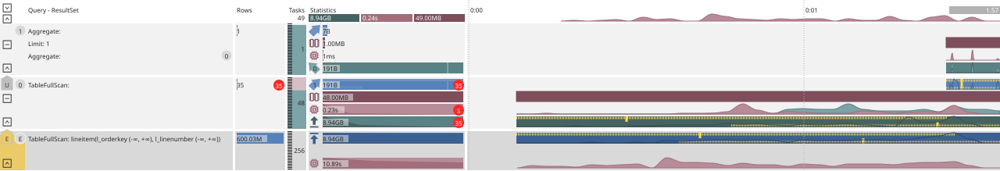

# Information Layout in a Query Plan

The graphical SVG query plan with metrics is obtained after the query has actually been executed. The diagram columns are discussed below.

The images embedded in the documentation have no interactive elements — open the plan in a separate browser tab to use stage collapsing and tooltips.

## Individual Regions (Columns) {#regions}

Below is a plan for a simple query:

```sql
SELECT count(*) FROM lineitem
```

{inline=false}

The plan is displayed as a table: on the left — [the stage structure](structure.md#stages), on the right — columns with metrics and charts.

| Column | Purpose | Details |
| --- | --- | --- |
| `Query - ...` | Structure of stages and operators | [Plan structure](#structure) |
| `Rows` | Statistics on stage operators | [Operator statistics](#operators) |
| `Tasks` | Number of [tasks](#progress) and execution progress | [Number of stage tasks and their execution progress](#progress) |
| `Statistics` | Aggregate metrics for the [stage](structure.md#stages) | [Stage metrics](#statistics), [Query metric visualization](metrics.md) |
| Timeline | Metric charts over time | [Time charts](#timeline), [Query metric visualization](metrics.md) |

## `Query - ...` -- Plan Structure {#structure}

The leftmost column is the [plan stage structure](structure.md). Each table row corresponds to one [stage](structure.md#stages); operators within a stage are data processing steps (for more details, see [Structure of an actual query plan](structure.md)).

The header starts with the common prefix `Query`; the second part of the header depends on the type of query being executed:

- `ResultSet` (as in the example above) — queries with a selection (`SELECT`);
- `Sink` — modifying queries (`INSERT`, `UPDATE`, `DELETE`);
- `Precompute` — separately executed plan fragments, see [Composite structures](structure.md#complex).

## `Rows` -- Operator Statistics {#operators}

A [stage](structure.md#stages) consists of one or more operators. If at least one physical operator reports statistics, the `Operators` column is filled; stages without operator reporting have an empty cell. The column content complements the picture of the [stage structure](structure.md) and the aggregate metrics in `Stages`.

## `Tasks` -- Number of Stage Tasks and Their Execution Progress {#progress}

In {{ ydb-short-name }}, a query is executed in a distributed manner: the same [stage](structure.md#stages) can be processed in parallel by multiple [tasks](#progress) on one or more [nodes](../../concepts/glossary.md#node) of the [cluster](../../concepts/glossary.md#cluster).

The `Tasks` column shows the number of [tasks](#progress) scheduled for the stage. When hovering the cursor, the tooltip shows how many of them have already completed. On the left in the same column, progress is shown as a dashed bar.

The column background color reflects the CPU consumption intensity of the [stage](structure.md#stages); see [CPU consumption](metrics.md#cpu).

## `Statistics` -- Stage Metrics {#statistics}

The `Statistics` column contains aggregate metrics for all [tasks](#progress) of the stage. Some metrics are described in [Query metric visualization](metrics.md). A common property: these are calculated values at a certain point in time (usually at the end of query execution).

Identical metrics across different stages are brought to the same scale so they can be quickly compared with each other, for example, CPU or memory consumption. For more details, see [Metric scale](metrics.md#scale).

## Timeline {#timeline}

The column conventionally named `Timeline` (this name is not displayed in the plan; time marks are shown in its place) shows the same values as `Statistics`, but over the entire query execution interval. The time grid step is selected automatically. The query duration is shown in a gray rectangle in the upper-right corner of the column.

## Interactive Features {#interactive}

Open the query plan in a separate browser tab. For a large query, the plan takes up many rows and it is convenient to simplify it on the screen:

- Each [stage](structure.md#stages) has a button  that collapses the subtree starting from that stage (the button changes to  to expand).
- The button  switches the [stage](structure.md#stages) to `slim` mode: only one metric (`Output`) remains in height. The normal view is restored by any action on the stage.
- In the upper-left corner of the plan, the button  enables `slim` mode for all [stages](structure.md#stages), and the button  restores the full view and expands all subtrees.
