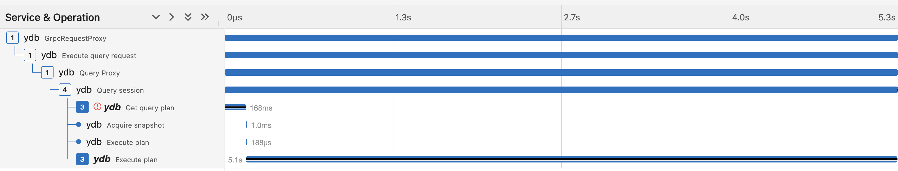
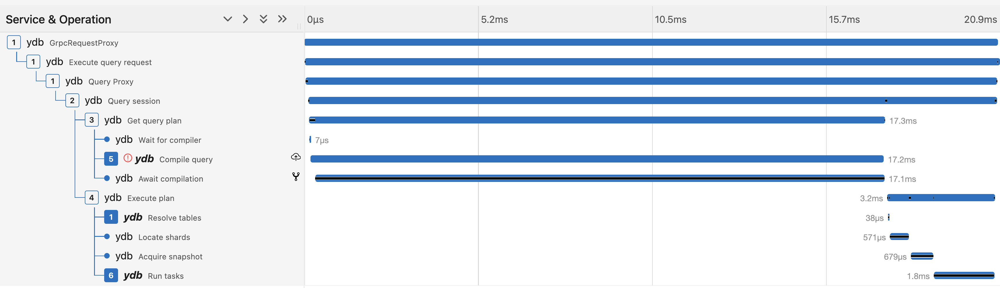
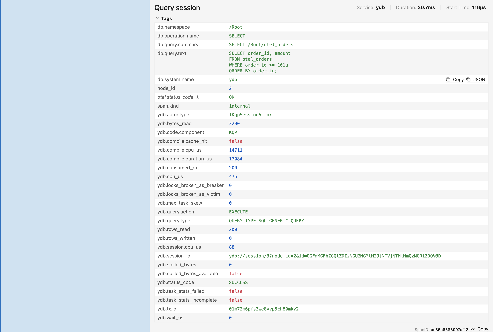
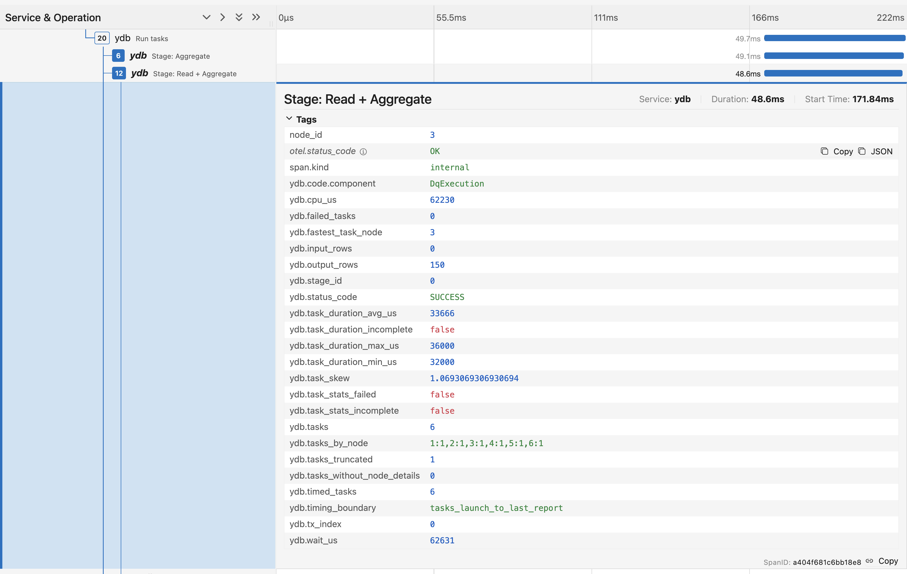
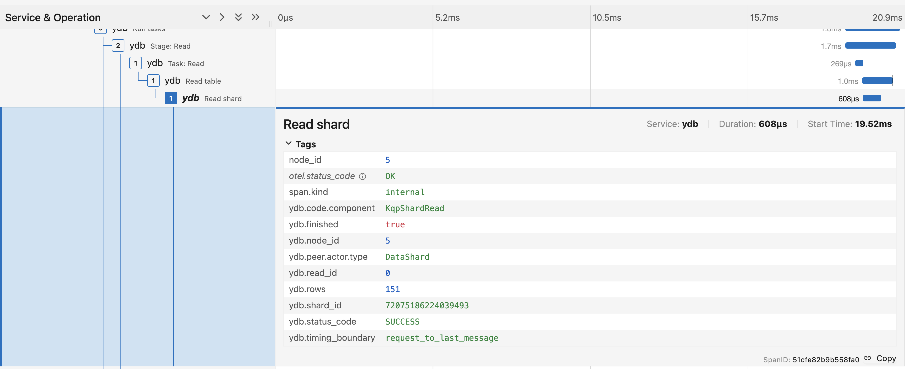
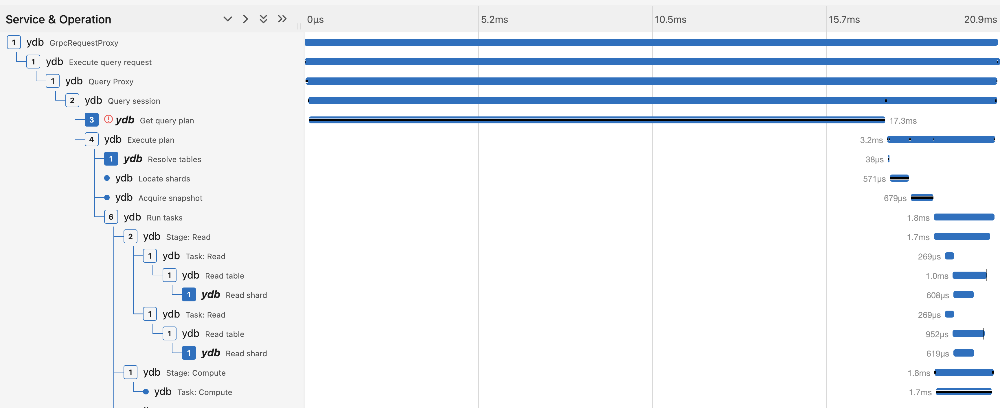

# Query execution tracing

A [trace](setup.md) shows the path of a query through all {{ ydb-short-name }} components: from reception at the gRPC proxy to accesses to shards and disk. Most of this path runs inside the query processor: it is the component that compiles the query, waits for resources, distributes tasks across nodes, and reads or writes data. Therefore, when a query takes longer than expected, the answer to the question "where was the time lost" is usually found in the query processor spans.

A query trace lets you find out:

- at which stage the query spent its time: in the queue, in compilation, in plan execution, or in transaction commit;
- whether the work was performed evenly or whether the delay was caused by a particular task, node, or shard;
- whether the trace metrics can be trusted if the query was interrupted or the statistics were collected incompletely.

In a trace, each query is represented by a `Query session` span. Its attributes provide a summary of the query: the operation type, status, CPU time, and the number of rows read. Nested spans show the execution phases, plan stages and tasks, and accesses to tables and shards. The higher the detail level, the deeper this tree is expanded.

How to enable tracing and choose a detail level is described in the articles on [configuring tracing](setup.md) and [passing an external trace-id](external-traces.md). Here it is assumed that traces are already being collected and opened in a trace viewer.

## Query processor {#query-processor}

The [query processor](../../../concepts/query_execution/index.md) prepares the query execution plan, starts computations, and reads and writes data. Preparing the plan is called compilation. The spans of these operations help you understand how much time the query spent on preparation, waiting, and execution.

This section describes the spans created by the query processor. In the overall trace, they may have child spans from other components involved in query execution.

### Detail levels {#levels}

The [trace detail level](setup.md#tracing-levels) determines which spans appear in the trace viewer. A higher level includes the spans of the previous levels.

| Minimum `level` | Query processor level | What you can see |
| --- | --- | --- |
| 1 | `TopLevel` | The entire query, its final status, and summary metrics. |
| 6 | `Basic` | The overall query compilation interval (`Compile query`), plan execution, waiting for execution to start, individual tasks, and data reads and writes. |
| 10 | `Detailed` | Internal query compilation phases, preparation of table information, plan stages with task summaries, and transaction commit phases. |
| 14 | `Diagnostic` | `Read shard` and `Scan shard` spans, events with read statistics and shard acknowledgements. |

At level 0, no query processor spans are created. For queries selected by sampling rules, the level is set by the `level` field. A query with an external trace-id gets level 13 if it passes the [`external_throttling`](setup.md#external-throttling) limits. For the query processor, this corresponds to `Detailed` detail: `Read shard` and `Scan shard` spans of the `Diagnostic` level are not included in such a trace.

### Span structure {#structure}

The `Query Proxy` span covers query processing on the receiving node, including waiting for a response from the session. The nested `Query session` covers the execution of a single query in the session. For other actions, the names `Prepare query`, `Explain query`, `Validate query`, `Begin transaction`, `Commit transaction`, and `Rollback transaction` are used.

The `Query session` span relates to a single query, not to the entire lifetime of the session or transaction. Multiple queries of the same transaction can be matched by the `ydb.tx.id` attribute, if present.

If a query is redirected to another node, the trace may contain several `Query Proxy` spans. The redirect is shown by the `KQP redirect` span: its `ydb.source_node_id` and `ydb.target_node_id` attributes indicate the source and destination nodes.



#### Main phases {#phases}

Span names help determine at which phase the query spent its time. A span appears if the corresponding operation was performed and a sufficient detail level was selected.



| Span | What it describes |
| --- | --- |
| `Queued` | Waiting for permission to execute in a [resource pool](../../../concepts/glossary.md#resource-pool). The `ydb.pool_id` attribute lets you identify the pool whose limits were applied to the query. |
| `Get query plan` | A call to the compilation service: obtaining a plan found by the service in the cache, or waiting for it to be compiled. If a ready plan is found in the node's cache while still in the session, the span is absent. |
| `Compile query` | Creating the query execution plan. See [Compilation and cache](#compilation) for details. |
| `Load metadata`, `Load statistics` | Obtaining information about the table structure and statistics of its data to build the plan. The table is indicated in `db.collection.name`. |
| `Acquire snapshot` | Obtaining a [data snapshot](../../../concepts/query_execution/mvcc.md) to be used for reading. |
| `Execute plan` | Executing the plan or part of it. A single query may have several such spans. |
| `Resolve tables` | Obtaining information about tables before execution. The nested `Metadata` and `Partitioning` show obtaining the table description and information about its partitioning into shards. |
| `Locate shards` | Determining the location of the shards to be accessed. |
| `Run tasks` | Executing tasks on database nodes. |
| `Stage: …`, `Task: …` | A [plan stage and an individual task](#stages-and-tasks) of that stage. |

At the `Basic` level, task spans are already available, but the `Run tasks` and `Stage: …` spans that group them are not yet created.

#### Compilation and cache {#compilation}

If a ready plan is found in the node's cache, recompilation is not needed: the `Get query plan` and `Compile query` spans are absent, and `Query session` is immediately followed by `Execute plan`. Cache usage is indicated by `ydb.compile.cache_hit=true`.

If the same query is already being compiled, a new query may wait for the ready plan. In this case, `ydb.trace.coverage=joined_in_progress` appears on `Get query plan`. The `Compile query` span belongs to the query that performs the compilation. If its trace is available, a link to its `Get query plan` span is added, allowing you to find the cause of the wait.

Table information for compilation is visible as `Load metadata` and `Load statistics`; the table is indicated in `db.collection.name`, and the purpose of the request in `ydb.compile_dependency.purpose`.



A `Load statistics` error, such as `ydb.status_code=UNAVAILABLE`, means that column statistics were not obtained. Compilation continues without them, and the query may complete successfully. The trace viewer may mark collapsed parent spans, including `Compile query`, with such an error: check the status of the span itself.



### Query attributes {#query-attributes}

The `Query session` attributes help you find the desired query and evaluate its execution without examining all nested spans. Some fields appear only after the corresponding phase has completed.



| Attribute | Value |
| --- | --- |
| `db.namespace` | Database path. |
| `db.operation.name` | Operation type, for example `SELECT`, `UPSERT`, `DDL`, or `EXECUTE SCRIPT`. |
| `db.query.summary` | A brief description of the operation, for example `SELECT /Root/Orders`. The table path is added if it can be unambiguously determined. |
| `db.query.text` | Query text. The field is absent if the text is unavailable or exceeds 64 KiB. For queries with sensitive data, a message about its concealment may be shown instead of the text. |
| `ydb.session_id`, `ydb.tx.id` | Session and transaction identifiers for matching related queries. |
| `ydb.status_code` | Query result: for example, `SUCCESS` means success, `ABORTED` means interruption, `CANCELLED` means cancellation. |
| `ydb.cpu_us` | Total CPU time of plan execution, in microseconds. |
| `ydb.compile.cpu_us`, `ydb.compile.duration_us` | CPU time and duration of compilation, in microseconds. |
| `ydb.compile.cache_hit` | Whether a ready plan from the cache was used. |
| `ydb.rows_read`, `ydb.bytes_read` | Number of rows and bytes read. |
| `ydb.rows_written` | Total number of rows written and deleted. |

Starting from the `Basic` level, metrics for waiting, spilling intermediate data to disk, and differences in task durations are also available. They are described below.



A span's duration shows how much time elapsed between the start and completion of the operation. CPU time and wait time are summed across tasks that may run in parallel, so these sums may exceed the query duration. Metrics of parent and nested spans may account for the same work: they cannot be added together to obtain the total time.



### Stages and tasks {#stages-and-tasks}

To find the long-running part of execution, at the `Detailed` level expand `Execute plan` and find the `Stage: …` spans. Each of them groups the work on a part of the [query plan](../../../concepts/query_execution/optimizer.md), for example reading data or computing aggregates. Such a part is called a stage.

The nested `Task: …` spans show the individual tasks among which the stage's work is distributed. For example, several `Task: Read` inside `Stage: Read` may read different parts of the data in parallel. Comparing the durations of these tasks helps you understand whether the entire stage is slow or whether the delay is caused by a particular task.



Stage and task names show the operations being performed: reading (`Read`), lookup by keys (`Lookup`), join (`Join`), filtering (`Filter`), aggregation (`Aggregate`), sorting (`Sort`), and writing (`Write`). A single span may combine several operations. If the name is abbreviated, for example to `Task: Read + Filter + ...`, the full list can be found in `ydb.stage.operations` or `ydb.task.operations`. The name `Compute` is used for computations without specifying the operation.

The `ydb.stage_id` and `ydb.task_id` identifiers help you find the spans of the stages and tasks indicated in the execution summary.

When analyzing a trace:

1. Find the stage that takes a significant portion of the `Execute plan` time. Stages may run simultaneously and pass data to each other, so their durations cannot be added together to obtain the query execution time.
2. Compare the tasks within the selected stage. If one task is noticeably longer than the others, find it by `ydb.task_id` and check the nested read or write operations. If the durations are similar, examine the overall stage metrics.
3. Compare the CPU time `ydb.cpu_us` with the wait time `ydb.wait_us`. A large wait for receiving or transmitting data means that, for further analysis, you need to check the related operations on which the task depends. Before drawing conclusions, check the [completeness of the statistics](#statistics-availability).

#### Duration and work distribution {#task-timing}

The duration of `Stage: …` is measured from the start of the tasks to the receipt of confirmation that they have completed. If the query is interrupted, the stage statistics may be incomplete.

| Stage attribute | How to read it |
| --- | --- |
| `ydb.tasks`, `ydb.reported_tasks` | The total number of tasks and the number of tasks from which completion information was received. |
| `ydb.cpu_us`, `ydb.wait_us` | Total CPU time and wait time for receiving and transmitting data, in microseconds. |
| `ydb.input_rows`, `ydb.output_rows` | Total number of rows at the input and output of the tasks. |
| `ydb.task_duration_min_us`, `ydb.task_duration_avg_us`, `ydb.task_duration_max_us` | Minimum, average, and maximum measured task duration, in microseconds. |
| `ydb.timed_tasks` | The number of tasks for which duration is available. |
| `ydb.task_skew` | How many times longer the longest of the measured tasks is than the average. |
| `ydb.fastest_task_node`, `ydb.slowest_task_node` | The nodes with the fastest and the longest of the measured tasks. |
| `ydb.failed_tasks` | The number of tasks that completed with an error. |

For example, `ydb.task_skew=3` means that the longest of the measured tasks ran three times longer than the average. The `ydb.max_task_skew` attribute on the execution or query span contains the maximum such ratio among the accounted stages. If there are no measurements or their total duration is zero, the value is 0; this does not confirm that execution was even.

In `ydb.ranked_tasks`, you can see details about at most five tasks selected for diagnostics: those with errors, read retries, spilling of intermediate data to disk, or large wait or execution time. This is a sample; the full set of task spans may be larger.

On an individual task span, `ydb.queue_delay_us`, if available, shows the time it waited to start, in microseconds.

#### Statistics completeness and spilling to disk {#statistics-availability}

Before comparing metrics, check which data was collected. An interrupted query or a limit on the volume of diagnostic data may result in incomplete statistics.

| Attribute | Value |
| --- | --- |
| `ydb.task_stats_incomplete` | When `true`, the task information is incomplete. |
| `ydb.task_duration_incomplete` | When `true`, the duration is not known for all accounted tasks. Available on stage and execution spans. |
| `ydb.spilled_bytes_available` | Whether [spilling of intermediate data to disk](../../../concepts/query_execution/spilling.md) statistics are available. |
| `ydb.spilled_bytes` | The volume of intermediate data written to disk during execution, in bytes. |

Enabling tracing alone does not enable full execution statistics. The `ydb.spilled_bytes` metric should be interpreted only when `ydb.spilled_bytes_available=true`; collecting it requires the query statistics mode `FULL` or `PROFILE`. When `false`, a zero volume does not prove that there was no spilling to disk.

### Reading and writing data {#data-access}

Read and write spans help determine which table and operation the delay is associated with. They measure the time of working with data on the query processor side.

| Span | Operation |
| --- | --- |
| `Read table` | Reading table rows. |
| `Lookup rows` | Looking up rows by keys. |
| `Full-text search` | Obtaining data for full-text search. |
| `Scan table` | Scanning a table; available from the `Detailed` level. |
| `Check rows` | Reading existing rows when preparing a write. |
| `Lock rows` | Operations with row locks. |
| `Buffer rows` | Passing rows for subsequent writing. |
| `Write rows` | Writing rows. |

Read spans may include `db.collection.name` with the table name, `ydb.rows` with the number of rows received, and `ydb.read_retries` with the number of read retries. The latter metric relates to retries of individual reads, not to retries of the entire query by the application.

#### Shard accesses {#shards}

At the `Diagnostic` level, `Read shard` and `Scan shard` are available. They let you compare the durations of accesses to individual shards by the `ydb.shard_id` attribute. The `ydb.node_id` attribute indicates the node, `ydb.rows` contains the number of rows received, and `ydb.finished=true` means that the read completed successfully. On an error or when reading is stopped, the value is `false`.

The duration of these spans is measured on the query processor side: from sending the request to the shard to the last message or the stopping of the read. This interval includes message delivery and waiting for a response.



The `Shard read statistics` events on a read span contain summaries of at most five selected shards. They help find accesses with errors, retries, or long durations.

The `ydb.shard_stats_incomplete=true` attribute means that some accesses or accumulated information could not be saved due to limits on the volume of diagnostic data. A value of `false` does not mean that the events contain the full list of shards: the limit of five summaries applies in any case. The number of summaries not included in the events is indicated in `ydb.shard_summaries_dropped`.

#### Transaction commit {#commit}

If the delay occurs when finishing a write, check the `Flush effects`, `Commit`, and `Rollback` spans: they show the sending of accumulated changes, the commit, and the transaction rollback.

At the `Detailed` level, individual commit phases may be visible: `Prepare shards`, `Coordinator`, and `Apply commit`. They show how much time the query processor spent preparing the changes, coordinating their commit, and waiting for completion. The set of phases depends on the transaction execution method.

At the `Diagnostic` level, the `Shard acknowledged` events show the receipt of acknowledgements from shards. The list of events may be truncated; the number of dropped events is indicated in `ydb.shard_events_dropped`.

### Errors and incomplete traces {#errors}

Start analyzing an error with the `ydb.status_code` of the query span, then find the nested span of the phase in which the error occurred. A successfully completed phase may have the status `OK` even if the query failed later.

For the described spans, `SUCCESS` corresponds to the status `OK`, and an error corresponds to `ERROR`. If the final result of the operation is unknown, the span may complete without marking success or error. For example, a stopped read may have `ydb.finished=false` and `ydb.status_code=STATUS_CODE_UNSPECIFIED`.

If a query is rejected early at `Query Proxy`, `ydb.rejected=true` appears. In this case, execution spans may be absent, since the query was not started.

The absence of an expected span does not always mean a tracing failure: the operation may not have been performed, may be hidden by the selected detail level, or may not have reached the collector due to [export limits](setup.md#uploader). Also check the [completeness of the statistics](#statistics-availability).

### Read analysis example {#read-example}

Let's look at how to distinguish plan preparation time from data read time. The example uses the `otel_orders` table with the order identifier `order_id` of type `Uint64` and the order amount `amount`. The following [`SELECT` query](../../../yql/reference/syntax/select/index.md) selects orders with an identifier of at least 101 and sorts the result by identifier:

```yql
SELECT order_id, amount
FROM otel_orders
WHERE order_id >= 101u
ORDER BY order_id;
```

To view stages and tasks, you need a trace with a detail level of at least `Detailed`. The traces below were captured at the `Diagnostic` level, so they also show shard accesses. The durations shown are rounded values from a test run. On other data and in a different environment, the values will differ.

The first run completed with `ydb.status_code=SUCCESS`. The `ydb.compile.cache_hit=false` attribute shows that a ready plan was not used. Let's compare the main phases:

| Span | Duration |
| --- | --- |
| `Get query plan` | 17.3 ms |
| Nested `Compile query` | 17.2 ms |
| `Execute plan` | 3.2 ms |

Almost all of the plan retrieval time was taken by compilation. Execution itself turned out to be significantly shorter, so in this run the query duration was primarily determined by plan preparation. There is no need to add the times of `Get query plan` and the nested `Compile query`: the compilation time is already included in the plan retrieval duration.

Let's expand `Compile query`. The nested `Load statistics` completed with the status `UNAVAILABLE`: column statistics are unavailable, but compilation completed successfully.

Now let's expand execution. In `Stage: Read`, two `Task: Read` tasks are visible: the table is split into two shards, and each task read its own. The stage as a whole took 1.7 ms, the `ydb.tasks=2` attribute. The nested `Read table` took 1.0 and 0.95 ms and returned 151 and 49 rows (`ydb.rows`), with `ydb.read_retries=0` in both cases. Below them, `Read shard` shows accesses to two different shards on different nodes, both with `ydb.finished=true`. There are no signs of delay on retries in this run.



Re-running the same query in the same session shows how much plan preparation cost. Below are a pair of such runs: the first with compilation, the second with a ready plan from the node's cache, `ydb.compile.cache_hit=true`.

| Span | First run | Re-run |
| --- | --- | --- |
| `Query session` | 18.4 ms | 2.6 ms |
| `Get query plan` | 15.2 ms | absent |
| Nested `Compile query` | 15.1 ms | absent |
| `Execute plan` | 3.1 ms | 2.4 ms |

The plan preparation spans are absent in the second run, while `Execute plan` remained close to the first run: the ready plan was reused, and the work with data did not change. Such a comparison lets you evaluate plan preparation and work with data separately.
