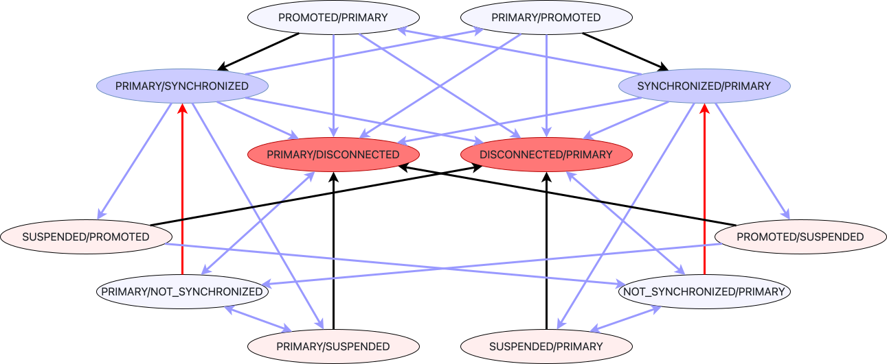

# Режим работы кластера Bridge



Режим bridge — это режим работы кластера {{ ydb-short-name }}, при котором данные хранятся с синхронной репликацией между несколькими частями кластера, называемыми [pile](glossary.md#pile).

Режим bridge расширяет базовые режимы распределённого хранилища: каждый pile использует один из [режимов работы](topology.md#cluster-config) {{ ydb-short-name }}, например `mirror-3-dc` или `block-4-2`, и сам по себе отказоустойчив. Bridge добавляет синхронную репликацию между pile и управляемые failover и switchover нагрузки между ними. Это обеспечивает дополнительный уровень отказоустойчивости поверх выбранной топологии. Режим bridge требует больше оборудования и сложнее в эксплуатации; он особенно полезен для кластеров в двух датацентрах и систем с повышенными требованиями к доступности, например когда необходимо сохранять доступность при отказе трёх датацентров из четырёх.

## Описание режима {#description}

В режиме bridge узлы кластера разделяются на несколько [pile](glossary.md#pile), обычно по одному pile в датацентре. При отказе pile хранилище в режиме bridge становится недоступным до выполнения команды отключения этого pile. После отключения кластер возобновляет работу.

{{ ydb-short-name }} поддерживает произвольное количество pile, однако некоторые сценарии ниже для простоты рассматривают два pile.

На уровне [распределённого хранилища](glossary.md#distributed-storage) в режиме bridge реализуется синхронная репликация Active/Active между pile. На уровне [узлов баз данных](glossary.md#database-node) возможно резервирование Active/Passive.

Каждая [группа хранения](glossary.md#storage-group) в режиме bridge имеет по одной части в каждом pile. Внутри каждого pile может использоваться любой поддерживаемый для хранения данных [режим работы](topology.md#cluster-config) {{ ydb-short-name }}.

В режиме bridge может быть достигнут [switchover](https://en.wikipedia.org/wiki/Switchover) без простоя. При [failover](https://en.wikipedia.org/wiki/Failover) для возобновления работы необходимо явно отключить репликацию в отказавший pile. При отказе любого участвующего pile обработка запросов к группам в режиме bridge приостанавливается до отключения репликации в этот pile.

Pile не являются самостоятельными кластерами {{ ydb-short-name }}, а представляют собой части одного кластера со сложной топологией:

- [таблетки](glossary.md#tablet) в режиме bridge запускаются в единственном экземпляре;
- в каждом pile работает отдельная [статическая группа](glossary.md#static-group) и части групп хранения с обычными [VDisk](glossary.md#vdisk). Доступ к группам в режиме bridge осуществляется через bridge proxy, который предоставляет таблеткам интерфейс [DS-proxy](glossary.md#ds-proxy) и выполняет операции через DS-proxy участвующих pile;
- в каждом pile работает свой набор реплик [StateStorage](glossary.md#state-storage), [SchemeBoard](glossary.md#scheme-board) и [Board](glossary.md#board). Доступ к StateStorage, SchemeBoard и Board осуществляется через аналогичные proxy-компоненты.

## Состояния pile {#pile-states}

Режим работы кластера определяется состояниями всех его pile. Например, для кластера из pile A и pile B состояния записываются как (A, B), где порядок имеет значение.

{inline=false}

Каждый pile может находиться в одном из следующих состояний:

- `PRIMARY`. Основной pile, в котором работают ведущие таблетки. Только один pile может быть `PRIMARY`; этот pile всегда синхронизирован.

- `SYNCHRONIZED`. Ведомый pile, содержащий все подтверждённые записи и готовый к повышению до `PRIMARY`. В синхронизированных pile работают ведомые таблетки.

- `DISCONNECTED`. Отключён от кластера: его узлы не могут подключаться, а сам pile не участвует в операциях.

- `NOT_SYNCHRONIZED`. Подключённый pile, группы хранения которого синхронизируются. Он не может быть повышен до `PRIMARY`. API объединяет внутренние состояния первого и второго этапов. После завершения синхронизации {{ ydb-short-name }} автоматически переводит pile в `SYNCHRONIZED`.

- `PROMOTED`. Pile, который плавно переводится из `SYNCHRONIZED` в `PRIMARY`. После завершения перехода {{ ydb-short-name }} автоматически переводит его в `PRIMARY`.

- `SUSPENDED`. Pile, который плавно переводится в `DISCONNECTED`. После завершения перехода {{ ydb-short-name }} автоматически переводит его в `DISCONNECTED`.

- `INACTIVE`. Pile указан в `bridge_config`, но ещё или уже не имеет ресурсов. Его узлы не могут подключаться к кластеру.

В норме пара pile работает в режиме `PRIMARY/SYNCHRONIZED` или `SYNCHRONIZED/PRIMARY`. Один pile является `PRIMARY` и содержит ведущие таблетки, а другой — `SYNCHRONIZED` и содержит ведомые. Запись считается подтверждённой только после успешной записи с требуемой избыточностью в каждый pile, участвующий в кворуме данных.

## Пулы в режиме bridge и обычные пулы {#storage-pools}

Кластер bridge может использовать пулы хранения двух видов. **Неоднородное хранилище** — это режим кластера, позволяющий этим видам пулов существовать одновременно. Он включается параметром `bridge_config.enable_non_uniform_storage` и не может быть отключён после включения.

**Пул в режиме bridge** хранит по одной части каждой группы в каждом pile за bridge proxy. Запись ожидает подтверждения от каждого pile, входящего в кворум данных. После failover один оставшийся pile может обслуживать группу самостоятельно.

**Обычный пул** содержит обычные группы хранения с привычной схемой избыточности, чтение и запись в которые выполняются через обычный DS-proxy. После включения неоднородного хранилища новые обычные группы размещаются между pile в соответствии с геометрией ДЦ и стоек. Обычный пул `mirror-3-dc` размещает по одному кольцу в каждом ДЦ, а один ДЦ соответствует одному pile.

В следующем примере сравниваются `block-4-2` в режиме bridge в каждом из трёх pile и обычный `mirror-3-dc` в трёх pile:

| Характеристика | `block-4-2` в режиме bridge | Обычный `mirror-3-dc` |
| --- | --- | --- |
| Расход сырого дискового пространства на байт данных | 4,5× | 3× |
| Задержка записи | Определяется самым медленным pile | Три ДЦ с одной репликой или два ДЦ с двумя репликами; самый удалённый ДЦ не требуется |
| Отказ одного ДЦ, уровень хранилища | Запись ожидает failover | Работа продолжается, допускается отказ ещё одного диска |
| Отказ одного ДЦ, уровень базы данных | Ожидание failover | В большинстве случаев также ожидание failover |
| Отказ двух ДЦ | Работа продолжается после `failover --pile B --pile C` | Недоступность до возвращения ДЦ; при безвозвратной потере обоих ДЦ данные теряются |
| Разделение 1+2, после failover остаётся один ДЦ | Работает | Нет кворума на запись |
| Разделение 1+2, после failover остаётся пара ДЦ | Работает | Работает |

Обычные базы данных используют общую с bridge подсистему управления. Ведущие таблетки запускаются только в pile `PRIMARY`, ведомые — в pile `SYNCHRONIZED`, а State Storage и корневой домен всегда работают в режиме bridge. Поэтому при отказе pile запуск таблеток и обнаружение ведущих таблеток для обычных баз данных по-прежнему ожидают завершения перехода bridge. Обычные пулы уменьшают расход дискового пространства и задержку записи, но не обеспечивают независимый failover.

Настройка пулов и изменение их режима описаны в статье [Управление кластером в режиме bridge](../devops/deployment-options/manual/bridge-management.md#pool-mode).

### Переходы между состояниями {#transitions-between-states}

| Состояние до | Состояние после | Как происходит | Пояснение |
| --- | --- | --- | --- |
| `PRIMARY` | `SYNCHRONIZED` | Автоматически | Завершение планового переключения. |
| `PRIMARY` | `DISCONNECTED` | Вручную — [failover](../reference/ydb-cli/commands/bridge/failover.md) | Аварийное отключение недоступного `PRIMARY` с выбором нового `PRIMARY`. |
| `PRIMARY` | `SUSPENDED` | Вручную — [takedown](../reference/ydb-cli/commands/bridge/takedown.md) | Плановое отключение текущего `PRIMARY` с выбором нового `PRIMARY`. |
| `SYNCHRONIZED` | `PRIMARY` | Вручную — [failover](../reference/ydb-cli/commands/bridge/failover.md) | Аварийное отключение недоступного `PRIMARY` с выбором нового `PRIMARY`. |
| `SYNCHRONIZED` | `DISCONNECTED` | Вручную — [failover](../reference/ydb-cli/commands/bridge/failover.md) | Аварийное отключение недоступного `SYNCHRONIZED`. |
| `SYNCHRONIZED` | `PROMOTED` | Вручную — [switchover](../reference/ydb-cli/commands/bridge/switchover.md) | Старт плановой смены `PRIMARY`. |
| `SYNCHRONIZED` | `SUSPENDED` | Вручную — [takedown](../reference/ydb-cli/commands/bridge/takedown.md) | Старт планового отключения `SYNCHRONIZED` pile. |
| `DISCONNECTED` | `NOT_SYNCHRONIZED` | Вручную — [rejoin](../reference/ydb-cli/commands/bridge/rejoin.md) | Возврат pile в кластер после обслуживания или восстановления. |
| `NOT_SYNCHRONIZED` | `SYNCHRONIZED` | Автоматически | Завершение синхронизации данных. |
| `NOT_SYNCHRONIZED` | `DISCONNECTED` | Вручную — [failover](../reference/ydb-cli/commands/bridge/failover.md) | Аварийное отключение недоступного `NOT_SYNCHRONIZED`. |
| `PROMOTED` | `PRIMARY` | Автоматически | Завершение планового переключения. |
| `PROMOTED` | `PRIMARY` | Вручную — [failover](../reference/ydb-cli/commands/bridge/failover.md) | Аварийное отключение недоступного `PRIMARY` с выбором нового `PRIMARY`. |
| `PROMOTED` | `DISCONNECTED` | Вручную — [failover](../reference/ydb-cli/commands/bridge/failover.md) | Аварийное отключение недоступного `PROMOTED`. |
| `SUSPENDED` | `NOT_SYNCHRONIZED` | Вручную — [rejoin](../reference/ydb-cli/commands/bridge/rejoin.md) | Отмена планового отключения pile. |
| `SUSPENDED` | `DISCONNECTED` | Автоматически | Завершение планового отключения. |
| `SUSPENDED` | `DISCONNECTED` | Вручную — [failover](../reference/ydb-cli/commands/bridge/failover.md) | Аварийное отключение недоступного `SUSPENDED`. |

## Сценарии изменения состояния {#state-change-scenarios}

### Отказ pile {#failover}

При отказе pile хранилище в режиме bridge становится недоступным. Для возобновления работы кластера отказавший pile необходимо отключить, переведя его в `DISCONNECTED`.

Администратор может выполнить переход из `PRIMARY/SYNCHRONIZED` или `SYNCHRONIZED/PRIMARY` в `PRIMARY/DISCONNECTED` или `DISCONNECTED/PRIMARY`. Команда изменяет конфигурацию групп хранения и способ записи в них. [Interconnect](glossary.md#actor-system-interconnect) разрывает сессии со всеми узлами pile в `DISCONNECTED`; сессии обмена данными не устанавливаются, хотя TCP-соединения для обмена метаданными о состояниях pile могут оставаться активными. Дальнейшие операции чтения и записи выполняются без pile в `DISCONNECTED`. Если изменился `PRIMARY`, таблетки перезапускаются в нём.

Аналогичный переход выполняется, если отказавший pile находился в любом состоянии, а назначаемый `PRIMARY` — в одном из допустимых состояний: `PRIMARY`, `SYNCHRONIZED` или `PROMOTED`.

Если назначаемый `PRIMARY` находился в `DISCONNECTED`, `NOT_SYNCHRONIZED` или `SUSPENDED`, штатный переход невозможен, поскольку этот pile может не содержать полную актуальную реплику данных.

### Восстановление pile {#rejoin}

После восстановления узлов отказавшего pile его необходимо повторно подключить к кластеру, переведя в `NOT_SYNCHRONIZED`.

Администратор может выполнить переход из `PRIMARY/DISCONNECTED` в `PRIMARY/NOT_SYNCHRONIZED` или из `DISCONNECTED/PRIMARY` в `NOT_SYNCHRONIZED/PRIMARY`. Узлы обмениваются конфигурацией; сессии interconnect устанавливаются только между узлами с одинаковой конфигурацией. Команда запускает синхронизацию групп хранения. По её завершении автоматически выполняется переход из `PRIMARY/NOT_SYNCHRONIZED` в `PRIMARY/SYNCHRONIZED` или из `NOT_SYNCHRONIZED/PRIMARY` в `SYNCHRONIZED/PRIMARY`.

### Плановое переключение PRIMARY pile {#switchover}

Для плановой смены `PRIMARY` назначаемый pile необходимо перевести в `PROMOTED`.

Администратор может выполнить переход из `PRIMARY/SYNCHRONIZED` в `PRIMARY/PROMOTED` или из `SYNCHRONIZED/PRIMARY` в `PROMOTED/PRIMARY`. Команда не изменяет способ записи в группы хранения, но обновляет их конфигурацию и инициирует смену `PRIMARY` с плавным переносом таблеток. По завершении переключения прежний `PRIMARY` становится `SYNCHRONIZED`, а `PROMOTED` — `PRIMARY`.

### Плановое отключение pile {#takedown}

Для планового отключения pile его необходимо перевести в `SUSPENDED`.

Администратор может выполнить переход из `PRIMARY/SYNCHRONIZED` в `PRIMARY/SUSPENDED` или из `SYNCHRONIZED/PRIMARY` в `SUSPENDED/PRIMARY`. Узлы pile в `SUSPENDED` планово отключаются и переводятся в `DISCONNECTED`. Система стремится минимизировать влияние этого процесса на работу кластера. После перехода pile в `DISCONNECTED` его узлы можно выключить для обслуживания.

Затем выполните штатное восстановление pile, переведя его в `NOT_SYNCHRONIZED`.

### Восстановление при разделении кластера с несовместимой конфигурацией (split brain) {#split-brain}

Может возникнуть ситуация, когда pile A и pile B изолированы друг от друга, после чего pile A переконфигурирован так, что стал `PRIMARY`, а pile B — `SYNCHRONIZED`, и одновременно pile B переконфигурирован так, что стал `PRIMARY`, а pile A — `SYNCHRONIZED`. Это приводит к разделению кластера с несовместимой конфигурацией ([split-brain](https://en.wikipedia.org/wiki/Split-brain_(computing))). В таком состоянии каждая часть кластера может оставаться работоспособной.

Для восстановления единого кластера выберите, какой pile будет очищен. Остановите все его узлы, дождитесь полной остановки, очистите все диски на всех узлах и снова запустите узлы очищаемого pile. Затем выполните штатное восстановление pile, переведя его в `NOT_SYNCHRONIZED`.

### Нештатное восстановление pile

В сложных ситуациях, например при последовательных отказах pile, возможен следующий сценарий: сначала отказал pile A, он был переведён в `DISCONNECTED`, и кластер продолжил работу; затем произошёл необратимый отказ pile B; после этого pile A был восстановлен. В таких случаях кластер можно восстановить на основе pile A.

Если необходимо возобновить работу кластера, когда работоспособен только pile в `DISCONNECTED`, `NOT_SYNCHRONIZED` или `SUSPENDED`, администратор может выполнить переход из `PRIMARY/DISCONNECTED` в `DISCONNECTED/PRIMARY` или аналогичный для `NOT_SYNCHRONIZED` и `SUSPENDED` со специальным параметром `force`. Это приведёт к разделению кластера с несовместимой конфигурацией. В зависимости от фактического состояния данных в pile, переводимом в `PRIMARY`, кластер может быть восстановлен в корректном или внутренне неконсистентном состоянии. Корректная работа такого кластера не гарантируется.

Если кластер оказался работоспособным, можно продолжить восстановление до нормального состояния. Перед восстановлением отключённого pile полностью очистите данные и метаданные на всех его узлах, затем переведите pile в `NOT_SYNCHRONIZED`.

## Эксплуатация кластера bridge {#management}

Преобразование, добавление и удаление pile, изменение режимов пулов, мониторинг и диагностика описаны в статье [{#T}](../devops/deployment-options/manual/bridge-management.md).

## Особенности реализации режима bridge {#bridge-implementation-details}

Подробнее об устройстве режима bridge см. в [{#T}](../contributor/bridge.md).
