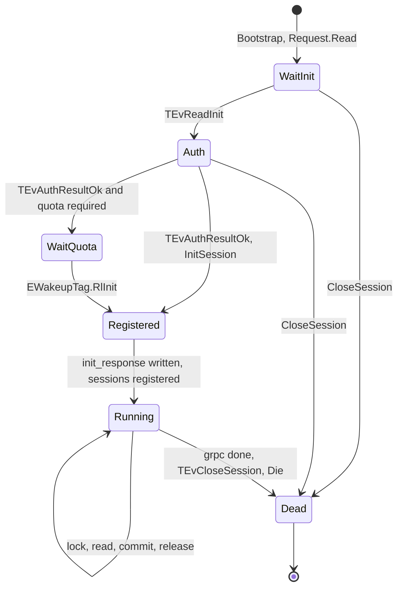
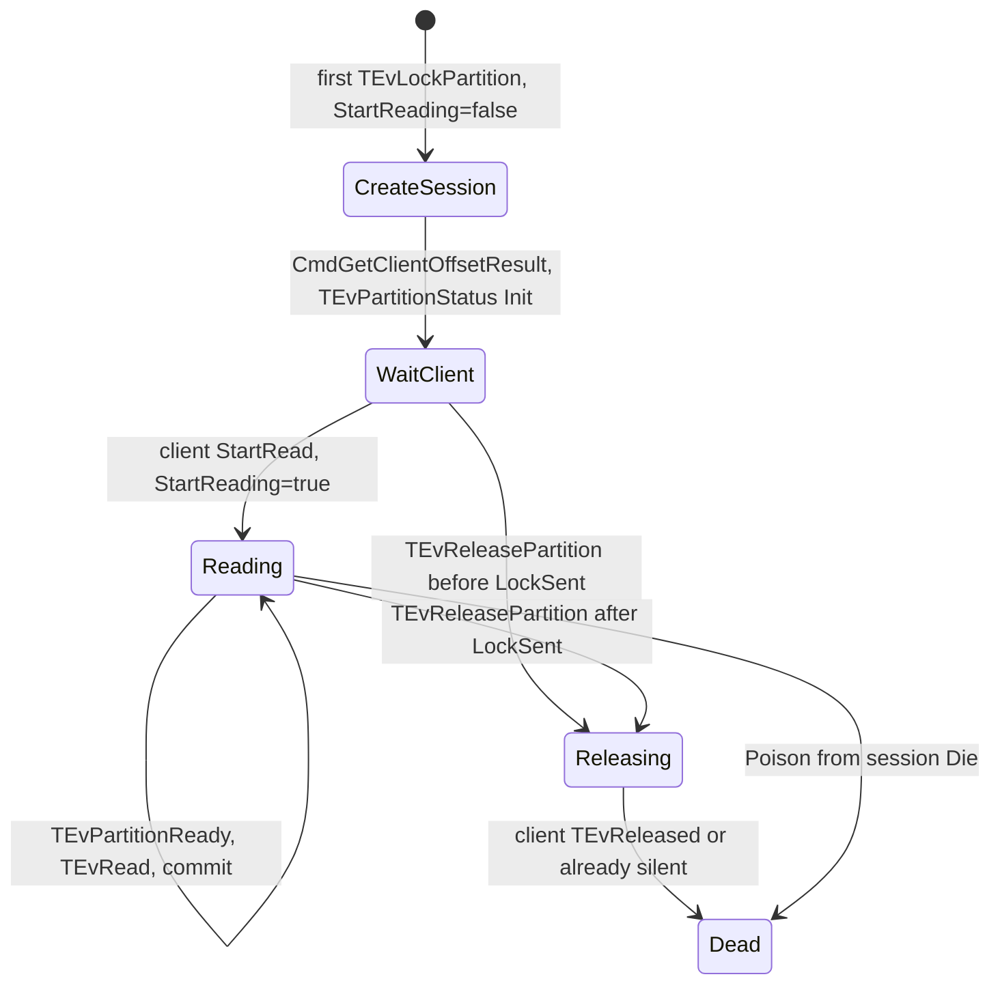
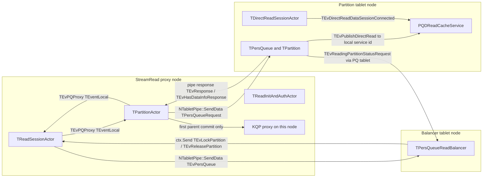
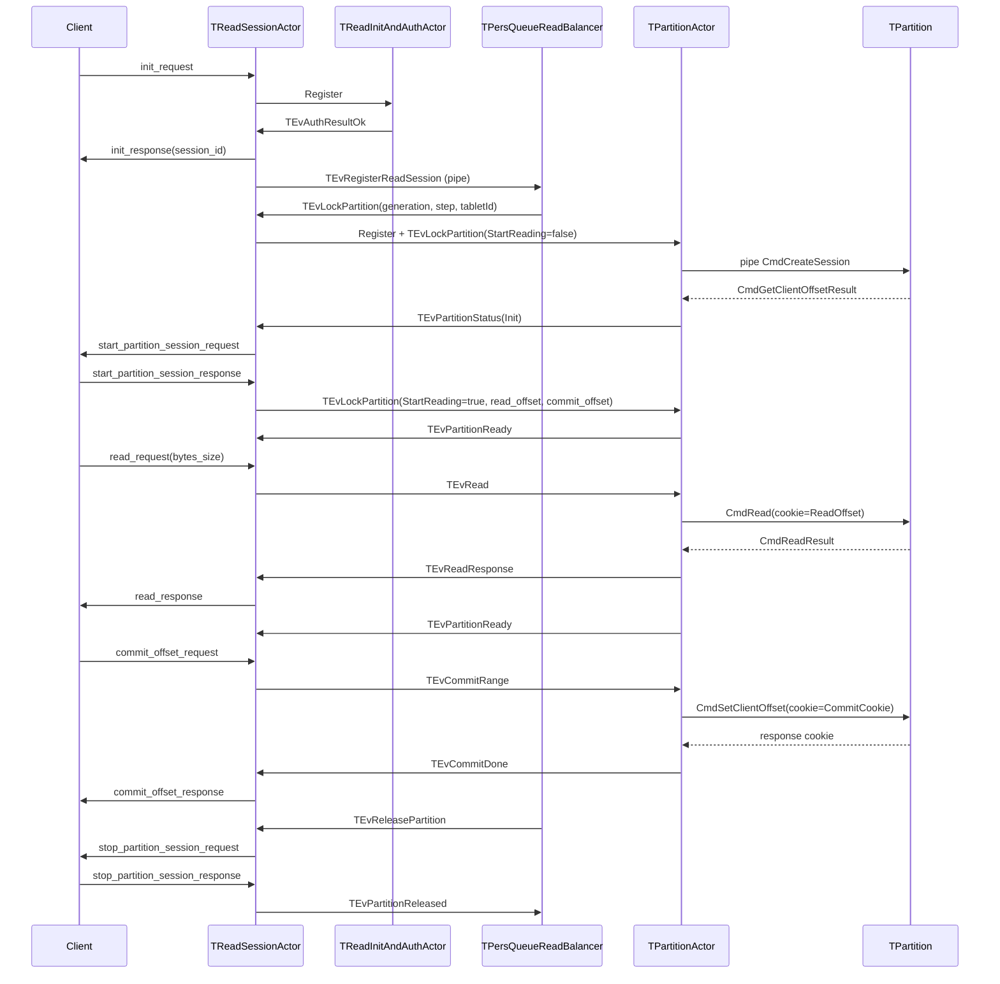
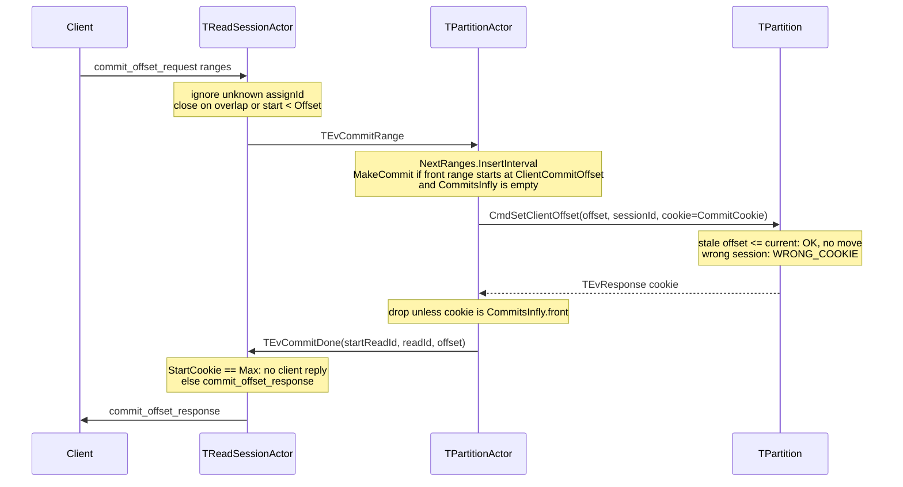
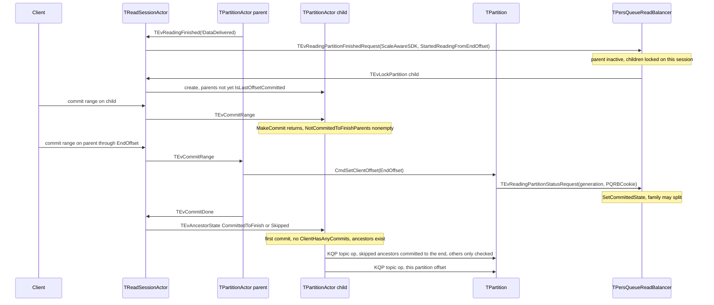

# TReadSessionActor

`TReadSessionActor` is the gRPC StreamRead session on a proxy node. It is not a tablet actor. One instance owns one client stream, the pipes to each topic's `TPersQueueReadBalancer`, and one `TPartitionActor` per locked partition. Partition bytes and the committed offset live on the partition tablet (`TPersQueue` / `TPartition`). Assignment lives on the balancer.

This file is the Topic API and PersQueue v1 (PQv1) actor in [`ydb/services/persqueue_v1/actors/read_session_actor.h`](read_session_actor.h). It is not the deprecated v0 actor in `ydb/services/deprecated/persqueue_v0/grpc_pq_read_actor.cpp`, and not `NKafka` read sessions under `ydb/core/kafka_proxy`. Those were not traced here.

Balancing rules for split/merge (locks, families, Finish, Commit, explicit partitions) are defined by [`ydb/core/persqueue/pqrb/README.md`](../../../core/persqueue/pqrb/README.md). Where this text says "the balancer", that README is the source of truth for *why* a partition is locked. This text says what the session does when the balancer (or the session itself) locks it. The README says a leaf never receives Finish or Commit. `Handle(TEvReadingFinished)` and `SendReadingFinished` do not check for a leaf. `ProccessReadingFinished` returns immediately when `ScalingSupport()` is false, so that function does not attach or split families. See [4. Main path](#4-main-path) and [Matrix](#matrix).

## Baseline

The main path is the Topic protocol (`TReadSessionActor<EProtocol::Topic>`), which is what `TPQReadService` registers for `TEvStreamTopicReadRequest`.

| Flag | Baseline value | Where it is set |
| --- | --- | --- |
| Consumer | non-empty `init_request.consumer` | [`Handle(TEvReadInit)`](read_session_actor.cpp) |
| Assignment | `partition_ids` empty | same function, `TopicGroups` stays empty |
| `direct_read` | false | ctor default; Topic init copies `init.direct_read()` |
| `auto_partitioning_support` | false | ctor default; Topic init copies `init.auto_partitioning_support()` |
| `RangesMode` | **true** | Topic init forces it. PQv1 uses `init.ranges_mode()` and defaults to false in the ctor |

`RangesMode` is not optional on the Topic stream: commits are offset ranges, never cookies. PQv1, `direct_read`, `auto_partitioning_support`, several topics, an explicit partition list, and read-without-consumer are deltas in later sections.

There is no identifier `autoscaling_aware` on this actor. The SDK flag is `auto_partitioning_support`, forwarded to the balancer as `ScaleAwareSDK` on Finish. Topic split/merge itself is `SplitMergeEnabled` (`TBalancer::ScalingSupport`). Those are different switches. See [Autopartitioning and ScaleAwareSDK](#autopartitioning-and-scaleawaresdk).

## 1. Role and lifetime

### Who creates it

`TGRpcRequestProxy` forwards `TEvStreamTopicReadRequest` and `TEvStreamPQMigrationReadRequest` to the node service `GetPQReadServiceActorID()` (`TActorId(0, "PQReadSvc")`). [`TPQReadService::HandleStreamPQReadRequest`](../grpc_pq_read.h#L109-L147) registers the actor on **that proxy node**:

```text
ctx.Register(new TReadSessionActor<Protocol>(request, cookie, schemeCache, newSchemeCache, counters, clientDC, *TopicsHandler))
```

`StreamDirectRead` does **not** create this actor. It creates `TDirectReadSessionActor`. That second stream is how `direct_read` bytes leave the node; see [direct_read](#direct_read).

The actor activity is `FRONT_PQ_READ`. [`Bootstrap`](read_session_actor.cpp) attaches the gRPC context and issues one `Request->Read()`. There is a single `StateFunc` for the whole life of the actor. The phases below are flags (`InitDone`, partition flags), not actor states.



`InitDone` flips true at the end of [`InitSession`](read_session_actor.cpp), after `init_response` is written. Locks that arrive before the partition graph knows the partition are queued in `Locks` and replayed after the next auth refresh ([`Handle(TEvLockPartition)`](read_session_actor.cpp), [`Handle(TEvAuthResultOk)`](read_session_actor.cpp)).

### What it owns

- The gRPC stream (`Request`). One read from the client is in flight; the handler calls `ReadFromStreamOrDie` again after it has accepted the message.
- `Topics`: one [`TTopicHolder`](../../../services/lib/actors/type_definitions.h#L67-L93) per resolved topic. With a consumer, `PipeClient` is a tablet pipe to that topic's balancer tablet (`TTopicHolder::TabletID`).
- `Partitions`: `assignId -> TPartitionActorInfo`. `assignId` is `NextAssignId++` on this actor, not the partition id.
- Child actors: `TReadInitAndAuthActor` (while an ACL check runs) and one `TPartitionActor` per assign. Both are `ctx.Register` on the same node. [`Die`](read_session_actor.cpp) poisons them, closes balancer pipes, and sends `TEvPQProxy::TEvSessionDead(Cookie)` to `TPQReadService`.

Session id, built once in init:

```text
ClientPath + "_" + nodeId + "_" + Cookie + "_" + random64 + "_v1"
```

`Cookie` is the proxy-local session id used by `TPQReadService::Sessions`. It is not the commit cookie and not the balancer step.

### Partition-actor lifetime

`TPartitionActor` (`FRONT_PQ_PARTITION`) is created in [`Handle(TEvPersQueue::TEvLockPartition)`](read_session_actor.cpp). The session immediately sends `TEvPQProxy::TEvLockPartition(0, {}, false, false, {})` so the child opens a pipe and runs `CmdCreateSession` **before** the client has answered `start_partition_session`. The client's answer is a second `TEvPQProxy::TEvLockPartition` with `StartReading=true` ([`Handle(TEvStartRead)`](read_session_actor.cpp) → [`InitStartReading`](partition_actor.cpp)).



Flags on `TPartitionActorInfo` that the session actually branches on: `LockSent`, `Reading`, `Releasing`, `ReleaseSent`, `Stopping`, `Released`, `ReadingFinished`. `LockSent` becomes true only when the init `TEvPartitionStatus` is sent to the client. A release that arrives before that skips the client and drops the child ([`Handle(TEvReleasePartition)`](read_session_actor.cpp)).

## 2. Session structure

### Per session

| Field | Role |
| --- | --- |
| `Topics` | Internal topic name → `TTopicHolder`. Balancer pipe, `Groups`, partition tablet ids, `TPartitionGraph`. |
| `FullPathToConverter` | Primary and secondary path → converter. Balancer replies are matched on this, not on the client path string. |
| `TopicGroups` | Explicit partitions. Empty means automatic assignment. Topic API stores `partition_id + 1`. PQv1 stores `partition_group_ids` as given. |
| `ReadFromTimestamp`, `MaxLagByTopic` | Per topic. Topic `read_from` / `max_lag`. PQv1 also has session-level `ReadTimestampMs` / `MaxTimeLagMs`; [`GetReadFrom`](read_session_actor.cpp) takes the max of the two timestamps. |
| `Partitions` | `assignId → TPartitionActorInfo`. |
| `ActualPartitionActors` | Child actor ids that are still alive. Events from a poisoned child are ignored. |
| `AvailablePartitions` | `TSet<TPartitionInfo>` ordered by `(WTime, AssignId)`. Read scheduling takes the oldest write time first. |
| `PartitionToReadResponse` | Child actor → the `TFormedReadResponse` it is currently filling. |
| `PartitionToControlMessages` | Control messages held until the in-flight read for that partition is answered. Key is `TPartitionId` with `AssignId` forced to 0. |
| `Reads` / `ReadSizeBudget` | PQv1: queue of client `TEvRead`. Topic: byte budget from `read_request.bytes_size`. |
| `BalancerGeneration` | Written on lock as `(generation, step)`, erased in `DropPartition`. **Never read.** The generation check is on the partition tablet, not here. |
| `Commits`, `CommitInterval` | Declared on the actor. **Not used** by this `.cpp`. Per-partition commit state is on `TPartitionActor`. |

`TTopicHolder::Groups` is copied from `TopicGroups` in `InitSession`. The balancer sees them as `TEvRegisterReadSession.groups`.

### Per partition (`TPartitionActorInfo`)

[`TPartitionActorInfo`](read_session_actor.h#L31-L98): child `Actor`, `TPartitionId` (`DiscoveryConverter`, partition id, `AssignId`), `Topic` converter, `Commits` deque (unused by the handlers below), `NextCommits` / `NextRanges` (what the client has submitted and the session has not yet acked), `Offset` (last offset acked to the client, or the init committed offset), `ReadIdToResponse` / `ReadIdCommitted` (PQv1 cookies), `DirectReads`, `EndOffset`, `ReadingFinished`, `Generation` / `NodeId` (filled for `direct_read` location).

`IsLastOffsetCommitted()` is `ReadingFinished && (EndOffset == Offset || StartedFromEnd)`. `StartedFromEnd` means the partition finished without delivering any data. [`NotifyDescendants`](read_session_actor.cpp) uses it after a `TEvCommitDone` that updates `Offset`, and from `Handle(TEvReadingFinished)`. The start commit (`StartCookie == Max<ui64>()`) returns before `Offset` changes, so it leaves this false unless `StartedFromEnd` was already set. It is not the balancer's `Commited` bit.

### Per partition actor

[`TPartitionActor`](partition_actor.h#L58-L303) holds the pipe to the **partition** tablet (`TabletID` from the lock), `Generation`/`Step` from the balancer lock, the read cursor (`ReadOffset`, `EndOffset`, `ClientReadOffset`, `ClientCommitOffset`, `CommittedOffset`), `NextCommits` / `NextRanges`, `Offsets` (cookie → offset, only when `!RangesMode`), and `CommitsInfly` (at most `MAX_COMMITS_INFLY == 1`).

`NotCommitedToFinishParents` lists every ancestor locked in this session that is not yet `IsLastOffsetCommitted`. It is filled when the child is locked and then updated by `TEvAncestorState`: a later Lock of an ancestor adds it, and a Release or a commit to the end removes it. `SkippedParents` lists ancestors that finished without delivering data. The first child commit writes those to `EndOffset`. An ancestor locked only by another session is in neither set; `SendCommit` still checks `AllParents` on the tablet. See [Commit during split/merge](#during-split-or-merge).

## 3. Local messages and cross-node events

Both actors sit on the proxy node. Anything they `ctx.Send` to each other is a same-node delivery. `TEvPQProxy` messages are `TEventLocal` (not serializable), except `TEvReadSessionStatus` / `TEvReadSessionStatusResponse`, which are `TEventPB` and are only the status-builder RPC.

Tablet pipes and balancer→session locks are the messages that leave the node.



`PQDReadCacheService` is a per-node service. Publish is sent on the **tablet** node (`MakePQDReadCacheServiceActorId()` with no node id, i.e. the sender's node). The client's `TDirectReadSessionActor` must be on that same node to see the bytes. The StreamRead actor tells the client which node via `partition_location`.

### What is local

| Event | From → to | If it is late or duplicated |
| --- | --- | --- |
| `TEvPQProxy::TEvRead`, `TEvCommitCookie`, `TEvCommitRange`, `TEvStartRead`, `TEvReleased`, `TEvDirectReadAck`, `TEvGetStatus` | session → itself, from the gRPC parser, then to the child | Unknown `assignId`: ignored (commit, start, status, direct-read ack) or, for a bad range/cookie, `CloseSession`. |
| `TEvReadResponse`, `TEvDirectReadResponse`, `TEvPartitionReady`, `TEvPartitionStatus`, `TEvCommitDone`, `TEvPartitionReleased`, `TEvUpdateSession` | child → session | Dropped when `ev->Sender` is not in `ActualPartitionActors`. |
| `TEvAncestorState` | session → descendant | `Locked` adds the ancestor to the wait, unless the first KQP commit has already started or the ancestor is already skipped. `Skipped` records it in `SkippedParents` and clears the wait. `CommittedToFinish` and `Released` only clear the wait. The child then calls `MakeCommit`. A repeated erase is a no-op. |
| `TEvReadingFinished` | child → session | After the topic is found, the session sends `TEvReadingPartitionFinishedRequest`, then looks the child up by `ev->Sender`. Unknown sender closes the session (`Inconsistent state #04`, [`Handle(TEvReadingFinished)`](read_session_actor.cpp)). A missing topic returns before that, with no close. |
| `TEvReadingStarted` | child → session | [`Handle(TEvReadingStarted)`](read_session_actor.cpp) returns if the topic is missing and otherwise sends `TEvReadingPartitionStartedRequest`. It does not look at `ev->Sender` and does not close the session. |

Same-node actor delivery is not reordered by a network. The session still treats a child that has already been poisoned as stale, because `Die` / `DropPartition` is asynchronous with messages already queued.

### What crosses nodes

These are `TEventPB` in `TEvPersQueue` ([`ydb/core/persqueue/events/global.h`](../../../core/persqueue/events/global.h)). The session sends them with `NTabletPipe::SendData`. The balancer sends locks and releases with `ctx.Send(Session->Sender, ...)`.

`Session->Sender` is `ev->Sender` of `TEvRegisterReadSession` as delivered to the tablet. The pipe server forwards the payload with the original sender preserved ([`tablet_pipe_server.cpp`](../../../core/tablet/tablet_pipe_server.cpp#L110-L135)), and that sender is the proxy actor that called `SendData` (`TReadSessionActor`). So a lock is a **direct** actor send back to the proxy, not a second pipe message. If the proxy node is not the balancer node, interconnect carries it. A restart of either node drops an in-flight lock; the balancer does not retry that send. The partition stays locked in `TPartitionFamily::LockedPartitions` until the pipe disconnects or the session releases it.

| Event | Direction | Stale / duplicate check |
| --- | --- | --- |
| `TEvRegisterReadSession` | session → balancer pipe | Ignored if consumer, session, or pipe is empty, or the pipe is not in `Sessions`. While the tablet is still initing, the event is queued (`HandleOnInit`). A non-streaming consumer gets `TEvError`, which closes the session. |
| `TEvLockPartition` | balancer → session | Ignored if the path is not in `FullPathToConverter`. Ignored if `PipeClient` in the record is not the topic's current pipe (read-without-consumer skips that check). Unknown partition id is queued and triggers a new auth, which refreshes `TPartitionGraph`. **No dedup by partition id.** A second lock for the same partition on the same pipe creates another `assignId` and another `TPartitionActor`. |
| `TEvReleasePartition` | balancer → session | Ignored when `PipeClient` in the record is not the current pipe. Unknown partition id **closes the session** (`releasing unknown partition`). Already `Releasing`: ignored. |
| `TEvPartitionReleased` | session → balancer pipe | [`TPartitionFamily::Unlock`](../../../core/persqueue/pqrb/read_balancer__balancing.cpp#L227-L257) returns false unless `Session->Pipe == sender`, status is `Releasing`, and the id is still in `LockedPartitions`. A release from an old pipe does not unlock. |
| `TEvReadingPartitionStartedRequest`, `TEvReadingPartitionFinishedRequest` | session → balancer pipe | Dropped when the pipe is not in `Sessions`, or the consumer is unknown. See the README line "Finish, Started, and Commit events from an already dead pipe are dropped" — Started and Finish match that. Commit does not come from this pipe. |
| `TEvReadingPartitionStatusRequest` | partition tablet → PQ tablet → balancer | This is the balancer's **Commit**. It carries `(consumer, partitionId, tabletGeneration, PQRBCookie)`. [`TPartition::SetCommittedState`](../../../core/persqueue/pqrb/read_balancer__balancing.cpp#L65-L75) applies it only when `generation` is newer, or generation is equal and `cookie` is newer. Older or equal cookies return false and do not clear `Commited`. |
| `TEvRequest` / `TEvResponse` (`CmdCreateSession`, `CmdRead`, `CmdSetClientOffset`, direct-read cmds) | partition actor ↔ partition tablet | Cookie and session checks below. |
| `TEvHasDataInfo` / `TEvHasDataInfoResponse` | partition actor ↔ partition tablet | Response cookie must be in `WaitDataInfly`, else dropped. |
| `TEvError` | balancer → session | [`Handle(TEvError)`](read_session_actor.cpp) closes the session with the record's code. Used for a bad register and for `StopReadingSession`. |

### Pipe loss, retry, and idempotency

**Balancer pipe** ([`CreatePipeClient`](read_session_actor.cpp)): `RetryLimitCount = 21`, 10 ms … 5 s, backoff 2, first retry immediate. The comment in the header says that is about a minute. `CheckAliveness = false`.

- `TEvClientConnected` with `Dead`: session closes, "one of topics is deleted".
- Connected but not `OK`: session closes, `TABLET_PIPE_DISCONNECTED`.
- `TEvClientDestroyed`: [`ProcessBalancerDead`](read_session_actor.cpp). If `topic->PipeClient` is already a different actor, the event is ignored (`Other pipe. Events was reordered`). Otherwise every partition of that topic is force-released (`SendReleaseSignal(..., kill=true)` if `LockSent`) and `ReleasePartition`, then a **new** pipe is opened and `RegisterSession` is sent again.

`ReleasePartition` calls `InformBalancerAboutRelease` on the pipe that just died. That send is best-effort. The balancer's real cleanup of a dead session is `TEvServerDisconnected` → [`UnregisterReadingSession`](../../../core/persqueue/pqrb/read_balancer__balancing.cpp#L1185-L1252), which clears Finish on partitions that session was reading and **keeps Commit**. If that was the last session, `TConsumer` is erased, so both Finish and Commit are gone (README, "Session change").

**Partition pipe** ([`RestartPipe`](partition_actor.cpp)): 6 retries inside the new client, 10–100 ms. Each failed restart bumps `PipeGeneration` unless the error was `OVERLOAD`. At `MAX_PIPE_RESTARTS` (100) without a successful init/read/commit (those reset `PipeGeneration` to 0) the child asks the session to close (`TABLET_PIPE_DISCONNECTED`).

On the new pipe, [`ResendRecentRequests`](partition_actor.cpp) resends `CurrentRequest` if `RequestInfly`, every `CommitsInfly` entry, and wait-for-data. Direct read instead runs `RestartDirectReadSession` (restore session, then prepare / publish / forget). That is the retry for a lost partition-tablet response.

**Create-session generation.** The lock's `generation` is `TBalancer::TabletGeneration()` (PQRB tablet generation) and `step` is `NextStep()` per lock ([`MakeEvLockPartition`](../../../core/persqueue/pqrb/read_balancer__balancing.cpp#L773-L791)). The child puts both on `CmdCreateSession`. [`TPartition::CommitUserAct`](../../../core/persqueue/pqtablet/partition/partition.cpp#L4615-L4645):

- Same session id, same generation, same step: treated as a retry, `GetClientOffset` is answered again.
- Otherwise, if a session is already set and (`generation` is older, or generation is equal and `step` is not greater): `WRONG_COOKIE`, "set offset in already dead session". `CLIENTID_WITHOUT_CONSUMER` skips this check.
- `WRONG_COOKIE` on `TEvResponse` closes the proxy session ([`Handle(TEvResponse)`](partition_actor.cpp)). It is not retried.

**Read / commit cookies on the partition pipe.** `CmdRead` / direct-read prepare set the request cookie to `ReadOffset`. A response whose cookie is not the current `ReadOffset` is logged and dropped ([`partition_actor.cpp`](partition_actor.cpp)). `CmdSetClientOffset` sets the cookie to the commit's `readId` (`CommitCookie`, the contiguous cookie id, `0`, or `Max<ui64>()` for the start commit). [`CommitDone`](partition_actor.cpp) accepts only the cookie at the front of `CommitsInfly`. Any other cookie is dropped, including a duplicate that arrives after the front was already popped.

The tablet treats `CmdSetClientOffset` with a non-empty session and `offset <= userInfo.Offset` as success without moving the offset ([`partition.cpp`](../../../core/persqueue/pqtablet/partition/partition.cpp#L4655-L4658)). A resent commit is therefore safe on the tablet, and the child's single-inflight cookie check drops the second reply.

`CmdRead` / `TEvHasDataInfo` with a session id that is not `userInfo.Session` returns `READ_ERROR_NO_SESSION` or `SessionInvalidated`. Both close the proxy session. The tablet does not silently attach the read to the new owner.

## 4. Main path

One topic, consumer set, `partition_ids` empty, `direct_read` false, `auto_partitioning_support` false, Topic protocol, `RangesMode` true. The balancer still runs the family algorithm. With split/merge off, `ScalingSupport()` is false and `IsReadable` is true for every partition. Finish and Commit stay on this path: there is no leaf check and no `auto_partitioning_support` check on the sends. [`Handle(TEvReadingFinished)`](read_session_actor.cpp) sends `TEvReadingPartitionFinishedRequest` when the topic is in `Topics`. The tablet sends `TEvReadingPartitionStatusRequest` from [`SendReadingFinished`](../../../core/persqueue/pqtablet/partition/partition_read.cpp#L68-L69) when [`LastOffsetHasBeenCommited`](../../../core/persqueue/pqtablet/partition/partition.cpp#L181-L185) ([`partition.cpp`](../../../core/persqueue/pqtablet/partition/partition.cpp#L4192-L4193), [`partition.cpp`](../../../core/persqueue/pqtablet/partition/partition.cpp#L4822-L4823)). That predicate is `!IsActive()` and the offset at the end, or an empty partition. An active partition does not raise has-data `ReadingFinished` or this predicate, so those sends stay quiet for that reason. On the balancer a leaf hits `Y_DEBUG_ABORT_UNLESS(PartitionHasChildren)` in [`FinishReading`](../../../core/persqueue/pqrb/read_balancer__balancing.cpp#L1523-L1527) and in [`TConsumer::SetCommittedState`](../../../core/persqueue/pqrb/read_balancer__balancing.cpp#L1306-L1309). With `NDEBUG` the macro does not abort, so `SetFinishedState` / `SetCommittedState` still run; a debug build aborts and does not continue. [`ProccessReadingFinished`](../../../core/persqueue/pqrb/read_balancer__balancing.cpp#L1312-L1314) returns immediately when `!ScalingSupport()`, so that function does not attach or split families while split/merge is off. `ScaleAwareSDK` does not make that function return. The session registers with empty `groups` and waits for locks.



### Session start and resolve

[`Handle(TEvReadFinished)`](read_session_actor.cpp) demuxes the gRPC message onto a self-send so the handler runs in `StateFunc`. For Topic, `init_request` requires at least one topic. Empty consumer selects read-without-consumer (not this baseline). `TopicsList = TopicsHandler.GetReadTopicsList(...)`. `ReadOnlyLocal` is forced true on Topic, so only the local cluster is resolved.

[`RunAuthActor`](read_session_actor.cpp) registers `TReadInitAndAuthActor`. On success the session stores one `TTopicHolder` per internal name, refuses mixed metering modes, then either waits for rate-limit quota (`EWakeupTag::RlInit`) or calls `InitSession`.

`InitSession` writes `init_response.session_id`, arms another client read, opens one balancer pipe per topic, and [`RegisterSession`](read_session_actor.cpp). An empty `groups` vector is the automatic-assignment session (`TSession::WithGroups()` is false). The balancer creates `TConsumer` on the first session for that consumer and schedules `Balance`.

ACL is rechecked on a timer (`PQConfig.ACLRetryTimeoutSec`) only if a token exists and either the token was refreshed or some client request arrived since the last check (`RequestNotChecked`). A failed refresh dies the actor.

### Lock and the client handshake

[`Handle(TEvLockPartition)`](read_session_actor.cpp) allocates `assignId`, remembers `(generation, step)` in the unused `BalancerGeneration` map, and passes `notCommitedToFinishParents` into the child. The child is told `DirectRead=false`, `RangesMode=true`, `maxLag` and `readTimestampMs` from [`GetReadFrom`](read_session_actor.cpp).

[`InitLockPartition`](partition_actor.cpp) opens the partition pipe and sends `CmdCreateSession` with `ClientId`, `Session`, `Generation`, `Step`, `PartitionSessionId=assignId`. The tablet's reply is a get-offset result. [`HandleInit`](partition_actor.cpp) sets:

```text
CommittedOffset = ReadOffset = ClientCommitOffset = result.Offset or 0
EndOffset, SizeLag, WriteTimestampEstimateMs, ClientHasAnyCommits
RetainedStartOffset = result.StartOffset if present
```

Because `StartReading` is still false, the child emits init `TEvPartitionStatus`. The session sets `LockSent`, stores `Offset` / `EndOffset` / `ConsumerHasAnyCommits`, and writes `start_partition_session_request` ([`Handle(TEvPartitionStatus)`](read_session_actor.cpp)): `partition_session_id = assignId`, `committed_offset = Offset`, `partition_offsets.start/end`, and `retained_start_offset` when the tablet sent one. This write uses `SendControlMessage(..., buffer=false)`, so it is not delayed behind a read.

The client answers `start_partition_session_response`. The session ignores it if the assign is gone or already `Releasing`. Otherwise it forwards `read_offset`, optional `commit_offset`, `has_read_offset` as `VerifyReadOffset`, and optional `max_offset + 1` (the proto field is inclusive; the actor's `MaxOffset` is exclusive).

[`InitStartReading`](partition_actor.cpp) sets `ReadOffset = max(CommittedOffset, ClientReadOffset)`. With `VerifyReadOffset` it closes the session if the client read or commit cursor is behind the tablet, or if read is behind the commit cursor. `ClientMaxOffset` must be ≥ `ReadOffset` and ≥ `ClientCommitOffset`. A `commit_offset` above `CommittedOffset` is sent to the tablet immediately with cookie `Max<ui64>()` (see [Commit](#6-commit)); the session does not tell the client about that one. Then, if there is no timestamp/lag filter and `ReadOffset < EndOffset` (and `< ClientMaxOffset` when set), the child sends `TEvPartitionReady`. Otherwise it waits with `TEvHasDataInfo`.

The first `TEvPartitionReady` also sends `TEvReadingStarted`. [`Handle(TEvReadingStarted)`](read_session_actor.cpp) sends `TEvReadingPartitionStartedRequest`. [`TConsumer::StartReading`](../../../core/persqueue/pqrb/read_balancer__balancing.cpp#L1441-L1492) clears `ReadingFinished` when it was set and can release children. Attaching children is [`ProccessReadingFinished`](../../../core/persqueue/pqrb/read_balancer__balancing.cpp#L1312-L1314), which returns immediately when `!ScalingSupport()`.

### Read loop

[`Handle(TEvRead)`](read_session_actor.cpp) adds `bytes_size` to `ReadSizeBudget` and calls [`ProcessReads`](read_session_actor.cpp).

Topic stops after **one** partition per `TFormedReadResponse` (the `break` at the end of the inner loop). PQv1 can pack several partitions into one response until message count or size is exhausted, and it also caps `ReadsInfly` at `MAX_INFLY_READS` (10). Both stop when `BytesInflight_ + RequestedBytes` would reach `MAX_INFLY_BYTES` (25 MiB).

For the chosen partition the session sends `TEvPQProxy::TEvRead(guid, count, size, maxLag, readTimestampMs)` with `count`/`size` scaled by `LAG_GROW_MULTIPLIER` (1.2) from the lag reported in `TEvPartitionReady`, then clamped by the remaining budget. `MaxReadSize` for Topic is `MAX_READ_SIZE` (100 MiB) because the client does not pass a per-read size other than the budget. The partition is removed from `AvailablePartitions` and marked `Reading`.

The child builds `CmdRead` ([`MakeReadRequest`](partition_actor.cpp)): offset `ReadOffset`, cookie `ReadOffset`, session id, `MaxTimeLagMs`, `ReadTimestampMs`, `TimeoutMs = 1000`, `ReadToBlobEnd`, `CanReadBatches` from `init.is_batching_supported()`. The tablet rejects the read if `SessionId` is not the current session. If the requested offset is below `GetStartOffset()` and `PartNo == 0`, the tablet **raises the read offset to `GetStartOffset()`** ([`partition_read.cpp`](../../../core/persqueue/pqtablet/partition/partition_read.cpp#L884-L904)). `PartNo > 0` in that situation is `READ_ERROR_TOO_SMALL_OFFSET` and closes the session.

`GetReadFrom` on the tablet ([`partition_read.cpp`](../../../core/persqueue/pqtablet/partition/partition_read.cpp#L34-L66)) is `max(now - maxTimeLagMs, readTimestampMs, consumer.ReadFromTimestampsMs)`. `GetReadOffset` then skips to an estimated offset. The messages in `CmdReadResult` already start at that offset. The proxy's `ReadOffset` advances with the filled batch. **The committed offset does not move.**

The child sends `TEvReadResponse` (payload, not a direct-read id). [`Handle(TEvReadResponse)`](read_session_actor.cpp) clears `Reading`, merges the single `partition_data` into `TFormedReadResponse`, and on the last outstanding partition either charges rate-limit quota or [`ProcessAnswer`](read_session_actor.cpp). `ProcessAnswer` writes `read_response` only when `HasMessages` is true. An empty result is not written; budget is returned and `ProcessReads` runs again. PQv1 re-queues the same guid.

After the response the child either sends `TEvPartitionReady` again or, if `ReadOffset >= EndOffset` or the in-flight memory limit is hit, sets `WaitForData` and sends `TEvHasDataInfo` (deadline ~10 s, up to two cookies in flight, plus a 1 s wakeup). A response cookie not in `WaitDataInfly` is dropped. `SessionInvalidated` closes the session.

`PartitionInFlightMemoryController` (limit `init.partition_max_in_flight_bytes`) delays the next `TEvPartitionReady` until a commit moves `CommittedOffset` forward and `Remove` drops usage under the limit. `MaxAllowedSize == 0` is unlimited: [`IsMemoryLimitReached`](../../../core/persqueue/public/inflight_limiter.cpp#L102-L108) returns false, and `Add` does not count bytes. The Topic proto default is 0, so the baseline does not stall on this limit.

Control messages other than the initial assign (`stop_partition_session`, `end_partition_session`) are queued while `PartitionToControlMessages.Infly > 0` and flushed in `ProcessAnswer`, so the client sees the read payload before the release for that partition.

### Release

The balancer releases a whole family: one `TEvReleasePartition` per locked partition ([`TPartitionFamily::Release`](../../../core/persqueue/pqrb/read_balancer__balancing.cpp#L196-L225)). The session sets `Releasing` and, if `LockSent`, [`SendReleaseSignal`](read_session_actor.cpp) (`stop_partition_session_request`, `graceful=true`, `committed_offset=Offset`). The client must answer `stop_partition_session_response`. [`Handle(TEvReleased)`](read_session_actor.cpp) rejects a release that was not requested, then [`ReleasePartition`](read_session_actor.cpp): `TEvPartitionReleased` to the balancer, poison the child, erase the assign. If that child was the last outstanding read in a `TFormedReadResponse`, the response is completed without it.

The session does not read from a `Releasing` partition (`ProcessReads` skips it). A `TEvStartRead` for it is ignored.

### Stop

Client stream closed: `TEvNotifiedWhenDone` or a failed read/write calls `Die` or `TEvDone` → `CloseSession(OK)`. `CloseSession` with a non-OK code writes a status message and `WriteAndFinish`. `Die` does not send `TEvPartitionReleased`. The balancer observes the pipe drop.

## 5. Deltas from the baseline

### Explicit partition list

Topic `partition_ids` are stored as `id + 1` in `TopicGroups` and sent as `groups`. PQv1 uses `partition_group_ids` directly; `0` or a value above `Max<ui32>` closes the session.

On the balancer a non-empty group list is `TSession::WithGroups()`. The README's [Explicit partitions](../../../core/persqueue/pqrb/README.md#L151-L164) applies: those partitions are locked even when parents are not inactive, the family on that session stays a single partition, and children are not attached to it. The session actor does not implement that rule. It only forwards `groups` and accepts whatever locks come back.

An explicit id the topic does not have fails `RegisterSession` handling with `TEvError` ("no group N"), which closes the session. Read-without-consumer checks the same thing locally in `SendLockPartitionToSelf` and closes with `no partition N`.

Commit, the read loop, and pipes are unchanged. `assignId` is still allocated per lock, not equal to the partition id.

### Several topics

`init_request.topics_read_settings` may list many paths. Each internal name gets its own `TTopicHolder`, balancer pipe, and `RegisterSession`. `assignId` is one sequence for the whole stream. `AvailablePartitions` is one ordered set, so `ProcessReads` picks the oldest `(WTime, AssignId)` across topics. Topic protocol still returns one partition per `read_response`, so a multi-topic session is "fair" only by that order, not by a per-topic budget.

Mixed metering modes close the session at auth time. A later auth that sees a new topic, or a changed metering mode, also closes it. The partition graph is refreshed in place on later auth (`SetPartitionGraph`).

A dead balancer pipe restarts only that topic's partitions (`ProcessBalancerDead` compares `TabletID`). Other topics keep their children.

Commits stay per `assignId`. Nothing in `TEvCommitDone` batches two topics into one gRPC message.

### direct_read

Two actors, two streams:

| | StreamRead with `init.direct_read` | `StreamDirectRead` |
| --- | --- | --- |
| Actor | this `TReadSessionActor` | `TDirectReadSessionActor` |
| Created by | `TEvStreamTopicReadRequest` | `TEvStreamTopicDirectReadRequest` ([`grpc_pq_read.cpp`](../grpc_pq_read.cpp#L146-L180)) |
| Bytes | not written on this stream | `TEvDirectReadSendClientData` from the cache, then `direct_read` server messages |

`direct_read` is stored only for the Topic protocol. PQv1 init does not read the field.

What changes inside this actor and `TPartitionActor`:

1. `CmdCreateSession` has `PartitionSessionId > 0`. The PQ tablet treats that as a direct-read session, records the pipe's session id, and sends `TEvRegisterDirectReadSession` to the **tablet node's** `PQDReadCacheService` ([`HandleCreateSessionRequest`](../../../core/persqueue/pqtablet/pq_impl.cpp#L1522-L1548)).
2. `start_partition_session_request.partition_location` is `(NodeId, TabletGeneration)` from the partition pipe's `TEvClientConnected` ([`Handle(TEvPartitionStatus)`](read_session_actor.cpp)). After a pipe restart, `TEvUpdateSession` becomes `update_partition_session` with the new node and generation.
3. `CmdRead` carries `DirectReadId`. The tablet prepares a direct read instead of returning blobs. The child handles `CmdPrepareReadResult` then `CmdPublishRead` ([`partition_actor.cpp`](partition_actor.cpp)). Publish on the tablet sends `TEvPublishDirectRead` to the local cache ([`HandlePublishReadRequest`](../../../core/persqueue/pqtablet/pq_impl.cpp#L2122-L2150)) and returns `CmdPublishReadResult` with no payload.
4. The child tells the session `TEvDirectReadResponse(assignId, readOffset, directReadId, byteSizeEstimate)`. [`ProcessAnswer`](read_session_actor.cpp) does **not** `Write` a `read_response`. It records `DirectReads[id]` and counts those bytes in `BytesInflight_` until the client acks.
5. The client confirms with `direct_read_ack` in strict order (`MaxProcessedDirectReadId + 1`). A gap or more than `MAX_PENDING_DIRECT_READ_ACKS` (10) ahead of `LastDirectReadId` closes the session. The session then sends `TEvDirectReadAck` to the child, which `CmdForgetRead`s. Forget also goes to the cache.
6. `stop_partition_session_request` includes `last_direct_read_id`. [`SendReleaseSignal`](read_session_actor.cpp) also sends `TEvDirectReadDestroyPartitionSession` (`TEventLocal`) to the proxy node's `PQDReadCacheService`. That send does not retire the cache session. [`PQDReadCacheService::HandlePartitionSessionReleased`](../../../core/persqueue/dread_cache_service/caching_service.cpp#L162-L167) looks up `AssignByProxy` by `ev->Sender` and returns when that actor is absent. `AssignByProxy` is filled with the `TDirectReadSessionActor` from `TEvDirectReadDataSessionConnected` ([`caching_service.cpp`](../../../core/persqueue/dread_cache_service/caching_service.cpp#L105-L140)). The server session is registered on the tablet node ([`pq_impl.cpp`](../../../core/persqueue/pqtablet/pq_impl.cpp#L1543-L1547)). The read-session sender is not in that map, so the handler ignores it. `stop_direct_read_partition_session` is written when the tablet-node cache calls [`DestroyPartitionSession`](../../../core/persqueue/dread_cache_service/caching_service.cpp#L732-L742) and that send reaches `TDirectReadSessionActor`. A graceful release is rejected while `DirectReads` is non-empty. The non-graceful branch (`!Graceful && DirectRead`) requires `Stopping` and has a TODO to filter direct reads; it does not check `DirectReads`.

Pipe restart does not resend the plain `CurrentRequest` first. It runs `RestartDirectReadSession`: `CmdCreateSession(RestoreSession=true)`, then re-prepare, re-publish, and forget, in id order. A reply whose direct-read id is not the head of the restore queue is ignored. An empty queue while that stage expects a reply closes the session (the comments call a soft-ignore a hang). `TEvUpdateSession` after restore is how the client learns the new `partition_location`.

`TDirectReadSessionActor` is only the data stream. On `start_direct_read_partition_session` it sends `TEvDirectReadDataSessionConnected{Session, assignId, generation, last_direct_read_id+1}` to the local cache and writes back `start_direct_read_partition_session_response`. It does not lock partitions and does not commit.

Commit on a `direct_read` session is the same `TEvCommitRange` path as the baseline. Ack of a direct read is not a commit. In-flight byte accounting is released on ack, not on `TEvCommitDone`.

### Autopartitioning and ScaleAwareSDK

Two independent mechanisms:

| In code | What it is |
| --- | --- |
| `TBalancer::ScalingSupport()` → `SplitMergeEnabled(TabletConfig)` | The topic can split and merge. The balancer builds `TPartitionFamily` and will not lock a child until every parent is inactive, unless the session listed that partition explicitly. |
| `auto_partitioning_support` on `init_request`, stored as `AutoPartitioningSupport` | Copied into every `TEvReadingPartitionFinishedRequest` as `ScaleAwareSDK`, together with `StartedReadingFromEndOffset = !DataDelivered`. `DataDelivered` becomes true only when a response actually carries messages. A direct read takes that from `HasWriteTimestampMS` on the filtered prepared result, not from the raw tablet batch. The README states this on purpose: the flag is **not** a field of `TSession`. |

Until the first Finish, the balancer does not know that the SDK is scale-aware. Assignment of a still-active parent is the same for both SDKs.

`TPartition::IsInactive` ([balancing.cpp](../../../core/persqueue/pqrb/read_balancer__balancing.cpp#L43-L45)):

```text
Commited || (ReadingFinished && (StartedReadingFromEndOffset || ScaleAwareSDK))
```

[`NeedReleaseChildren`](../../../core/persqueue/pqrb/read_balancer__balancing.cpp#L47-L49) (children stay on the parent's session) is false once the parent is `Commited`, or once it is `ReadingFinished` **without** `ScaleAwareSDK`. So:

- Scale-aware Finish, not yet Commit: children are locked on the **same** session as the parent (README split step 2).
- Old SDK Finish: children are not attached. If the reader did not start at `EndOffset`, the partition is not inactive. The balancer schedules `TEvWakeupReleasePartition` after `min(1 << Iteration, LifetimeSeconds)` seconds ([`FinishReading`](../../../core/persqueue/pqrb/read_balancer__balancing.cpp#L1498-L1544)), then another session may observe `StartedReadingFromEndOffset`. The wakeup is ignored when `partition.Cookie` has changed or `Commited` is already set.
- Commit (offset == `EndOffset` on an inactive partition): children may move to other sessions. The family can split.

`end_partition_session` is sent to the client **only** when `Protocol == Topic && AutoPartitioningSupport` ([`Handle(TEvReadingFinished)`](read_session_actor.cpp)), with `adjacent_partition_ids` and `child_partition_ids` from the tablet's has-data response. The balancer Finish is sent either way.

Finish is raised from `TEvHasDataInfoResponse.ReadingFinished`, once ([`partition_actor.cpp`](partition_actor.cpp)). The tablet sets that when the partition `!IsActive()` and there is nothing left at the waited offset for this timestamp ([`ProcessHasDataRequest`](../../../core/persqueue/pqtablet/partition/partition_read.cpp#L146-L168)). The child then sets `ReadOffset = max(ReadOffset, EndOffset)`. Finish carries `StartedReadingFromEndOffset = !DataDelivered`. A read that filtered every message, including a direct read, leaves `DataDelivered` false.

### Read without a consumer

`init.consumer` empty → `ReadWithoutConsumer`, `ClientId = CLIENTID_WITHOUT_CONSUMER`, no balancer pipe ([`InitSession`](read_session_actor.cpp)).

- Topic, not `AutoPartitioningSupport`, and `partition_ids` empty: session closes (`explicitly specify the partitions when reading without a consumer by non-autoscale aware client`).
- `AutoPartitioningSupport` and no explicit list: the session locks every current root (`GetRootPartitions`) by sending `TEvLockPartition` **to itself** with `generation=1`, `step=1`.
- Explicit list: it locks those ids the same way.
- On `end_partition_session`, if still read-without-consumer and `Groups` is empty, each child id is self-locked the same way.

The README does not describe this path. Family merge, the old-SDK delay, and `TEvPartitionReleased` are not used. `CLIENTID_WITHOUT_CONSUMER` also skips the tablet's stale-generation rejection.

Client commits are rejected (`can't commit when reading without a consumer`, and `commit_offset` on start is rejected). `start_partition_session_request.committed_offset` is sent as 0, not the tablet offset. `stop_partition_session_response` from the client is rejected.

### PQv1 versus Topic

Same actor template. Differences that change the main path:

| | Topic (baseline) | PQv1 |
| --- | --- | --- |
| Client messages | `StreamReadMessage` | `MigrationStreamingRead*` |
| `RangesMode` | always true | `init.ranges_mode()`, ctor default false (cookies) |
| Explicit partitions | `partition_ids` | `partition_group_ids` |
| Read budget | `bytes_size` accumulates | one `TEvRead` per client read; up to 10 responses in flight; several partitions per `data_batch` |
| Empty read | not written; budget returned | same guid pushed back onto `Reads` |
| Assign message | `start_partition_session_request` | `assigned` |
| Release | `stop_partition_session_request` (`graceful`) | `release` (`forceful_release`) |
| Commit reply | `commit_offset_response.committed_offset` | `committed.cookies` or `committed.offset_ranges` |
| `direct_read`, `auto_partitioning_support`, `end_partition_session` | yes | not set / not sent |
| `ReadOnlyLocal` | forced true | `init.read_only_original()` |
| Timestamp / lag | per topic only | per topic, and session-level `start_from_written_at_ms` / `max_lag_duration_ms` (max of the two timestamps) |

Cookie commits on Topic hit `AFL_ENSURE` in `Handle(TEvCommitDone)`. Range commits on a cookie session, and cookie commits on a range session, close the session at [`Handle(TEvCommitCookie)`](read_session_actor.cpp) / [`Handle(TEvCommitRange)`](read_session_actor.cpp).

## 6. Commit

A commit is per `assignId`. The session never orders commits across partitions or topics. One client message may list many partitions; the gRPC parser sends one `TEvCommitRange` (or `TEvCommitCookie`) per assign. Each `TEvCommitDone` becomes its own gRPC message, except the start commit (`StartCookie == Max<ui64>()`), which returns before the reply.



### Who checks what

**Session, before the child sees the range** ([`Handle(TEvCommitRange)`](read_session_actor.cpp)): unknown assign is ignored (the partition was already released). `b >= e`, overlap with `NextRanges`, or `b < Offset` closes the session. Otherwise the interval is inserted and the event is forwarded. The session does **not** require `b == Offset`. A range that starts in the future is stored and waits.

**Child** ([`Handle(TEvCommitRange)`](partition_actor.cpp), [`MakeCommit`](partition_actor.cpp)): `MakeCommit` returns immediately when `!PipeClient`, `!InitDone`, `NotCommitedToFinishParents` is non-empty, or `CommitsInfly.size() >= 1`. In ranges mode it sends only the interval whose start equals `ClientCommitOffset`, and it sends `offset = end` of that interval. The interval is erased locally before the tablet answers. Further ranges wait for `CommitDone`, which calls `MakeCommit` again.

**Tablet** ([`CommitUserAct`](../../../core/persqueue/pqtablet/partition/partition.cpp#L4634-L4817)): wrong session id → `WRONG_COOKIE`. `offset <= current` with a non-empty session → OK, offset unchanged. Non-strict offset above `EndOffset` is clamped to `EndOffset` (the session's `CmdSetClientOffset` does not set `Strict`). Strict offset below `GetStartOffset()` is raised to `GetStartOffset()`; the session path is not strict. Applying the act on an inactive partition refuses a rewind below `EndOffset` when the stored offset is already `EndOffset` (`SET_OFFSET_ERROR_COMMIT_TO_PAST`), unless `AllowInactiveRewind` (not set by this actor).

`LastOffsetHasBeenCommited` ([`partition.cpp`](../../../core/persqueue/pqtablet/partition/partition.cpp#L181-L185)) is `!IsActive() && (offset == EndOffset || StartOffset == EndOffset)`. Only then does `SendReadingFinished` notify the balancer. A commit that does not land on the end does not change families.

### Cookies (PQv1, `RangesMode == false`)

[`Handle(TEvCommitCookie)`](partition_actor.cpp) rejects a cookie `<= ReadIdCommitted`, a cookie `>= ReadIdToResponse` (not yet read), a repeated cookie, and cookie `0` unless nothing has been committed in this assign. `MakeCommit` then takes the contiguous run `ReadIdCommitted+1, +2, ...` and one `CmdSetClientOffset` at the offset stored for the highest cookie in that run (`Offsets`, filled when a batch is handed to the session). Cookie `0` means "commit what the previous session had read". When `ClientReadOffset <= ClientCommitOffset` the child sends a local `TEvCommitDone` whose offset is `CommittedOffset` ([`partition_actor.cpp`](partition_actor.cpp)), with no tablet round-trip. Init stored that same value in `partition.Offset` ([`Handle(TEvPartitionStatus)`](read_session_actor.cpp)). While `CommittedOffset` is still that value, [`Handle(TEvCommitDone)`](read_session_actor.cpp) hits `AFL_ENSURE(partition.Offset < msg->Offset)` before any cookie reply. `AFL_ENSURE` does not return, so an unchanged offset is not a successful local completion. The branch that commits `ClientReadOffset` when it is ahead of `ClientCommitOffset` ([`partition_actor.cpp`](partition_actor.cpp)) is the one that can get past that check.

The session's `Handle(TEvCommitDone)` for PQv1 cookies emits every cookie in `[StartCookie, LastCookie]` and erases them from `NextCommits` only after that ensure. Topic cannot take this branch.

More than `PQConfig.MaxReadCookies` outstanding cookies or ranges closes the session, on the child.

### Start commit, before any message

On `start_partition_session_response`, `commit_offset` (if greater than the tablet offset) is `CommitsInfly` entry `(Max<ui64>(), offset)` and `SendCommit`. [`Handle(TEvCommitDone)`](read_session_actor.cpp) returns immediately when `StartCookie == Max<ui64>()`. The client does not get `commit_offset_response` for the cursor it just proposed. That return is before `partition.Offset` is updated and before `NotifyDescendants`. A parent moved to `EndOffset` only by this `commit_offset` does not send `TEvAncestorState`. `IsLastOffsetCommitted` stays false unless `StartedFromEnd` was already set, so in-session descendants stay in `NotCommitedToFinishParents`. The scale-aware sequence diagram is the normal range commit, where `NotifyDescendants` does run. The next range the session will accept still has to be `>=` the init `Offset` (the previous committed offset), not the cursor the client just sent. The child's `ClientCommitOffset` does move. A following range that starts at the new cursor can be sent by the child, while the session still believes `Offset` is the old one until a normal `TEvCommitDone` arrives.

I did not find a later write of `partition.Offset` from that `Max` commit. A client that then commits `[newCommit, ...)` with `newCommit > partition.Offset` is accepted by the session (only `b < Offset` is fatal) and waits on the child until `ClientCommitOffset` matches. A client that commits `[oldOffset, newCommit)` is also accepted.

`VerifyReadOffset` (Topic sets this from `has_read_offset`) closes the session if `read_offset < commit_offset` or either cursor is behind the tablet.

### Scale-aware commit



`ScaleAwareSDK` does not change `CmdSetClientOffset`. It changes when the child is locked, and the first commit of a child whose parents are in the graph takes a different pipe.

[`SendCommit`](partition_actor.cpp): if `ClientHasAnyCommits` is false and `AllParents` is non-empty, the child does not use the partition pipe. It builds `TDistributedCommitHelper` with one record per ancestor and one record for itself (`Offset = the commit end`, `OnlyCheckCommitedToFinish = false`, `ReadSessionId = Session`). A skipped ancestor is committed to the end (`Offset = Max<i64>()`, `OnlyCheckCommitedToFinish = false`, `ReadSessionId` empty), because another session may still hold it. Any other ancestor is only checked (`OnlyCheckCommitedToFinish = true`, `ReadSessionId = Session`). The helper sends a KQP `QUERY_ACTION_TOPIC` to `MakeKqpProxyID(self node)` ([`distributed_commit_helper.cpp`](distributed_commit_helper.cpp)): `force_commit`, `only_check_commited_to_finish`, `read_session_id`, `partition_offsets.end`. The KQP cookie is the same `readId` `CommitDone` expects.

On the parent partition the check fails the predicate when the partition `IsActive()` or `userInfo.Offset != EndOffset` ([`partition.cpp`](../../../core/persqueue/pqtablet/partition/partition.cpp)). So "committed to finish" here is the stored offset at `EndOffset` on an inactive partition, which is the same condition as `LastOffsetHasBeenCommited`. A failed predicate comes back as `Ydb::StatusIds::ABORTED`, and any non-SUCCESS `TEvQueryResponse` closes the session.

Later commits of the same child see `ClientHasAnyCommits` true (set in `CommitDone`) and use `CmdSetClientOffset` on the pipe.

`NotCommitedToFinishParents` lists every ancestor locked in this session that is not yet `IsLastOffsetCommitted`, not only direct parents. `MakeCommit` will not send while that set is non-empty. [`NotifyDescendants`](read_session_actor.cpp) runs from `Handle(TEvLockPartition)` (`Locked`), from `DropPartition` (`Released`), and from `Handle(TEvReadingFinished)` and `Handle(TEvCommitDone)` when `IsLastOffsetCommitted()` (`Skipped` if `StartedFromEnd`, otherwise `CommittedToFinish`). Those events go to every locked descendant of the same topic. The `TEvCommitDone` path does not run for `StartCookie == Max<ui64>()`. A parent moved to `EndOffset` only by `commit_offset` on `start_partition_session_response` therefore does not send, and in-session descendants stay in the wait set. An ancestor locked by another session does not block `MakeCommit`. The KQP check still sees it, using the skipped-ancestor list from the child's Lock. A child commit that is already in KQP when that ancestor's Lock arrives is not pulled back into the wait.

### Matrix

Rows are the baseline plus one switch. "Same" means `Handle(TEvCommitRange)` → `MakeCommit` → `CmdSetClientOffset` → `TEvCommitDone` → `commit_offset_response`, one in flight per assign.

| Switch | Commit behavior |
| --- | --- |
| Baseline, one partition, steady, no scale | Same. Ranges must not overlap or start before `Offset`. Only the prefix that starts at `ClientCommitOffset` is sent. |
| Many partitions | Same per assign. No cross-partition order. One client request becomes N events and N replies. |
| Many topics | Same. `assignId` is global; the topic is implied by the child. |
| Explicit partitions | Same pipe commit for a steady partition. The balancer locks a requested child even while a parent is still active, and that parent may be held by another session. The child waits only for ancestors locked in this session. A requested parent that this session never receives is checked by the transaction, not waited for locally. |
| PQv1 cookies | One tablet commit covers a contiguous cookie run, at the offset of the highest cookie. Reply lists each cookie. Cookie `0` with an unchanged offset sends a local `TEvCommitDone` of `CommittedOffset` and fails `AFL_ENSURE(partition.Offset < msg->Offset)` before a cookie reply. Committing `ClientReadOffset` when it is ahead of `ClientCommitOffset` is what can pass that check. |
| PQv1 ranges | Same range machine as Topic. Reply is `committed.offset_ranges` from the previous `Offset` to the new one, not the client's original intervals. |
| `direct_read` | Commit path unchanged. `direct_read_ack` only forgets a published read and frees `BytesInflight_`. |
| Not scale-aware, leaf partition | Finish and Commit are still sent. `Handle(TEvReadingFinished)` sends `TEvReadingPartitionFinishedRequest` with no scale-aware or leaf check. The tablet sends `TEvReadingPartitionStatusRequest` from `SendReadingFinished` when `LastOffsetHasBeenCommited`. `ProccessReadingFinished` returns immediately when `!ScalingSupport()` (split/merge off) and then does not attach or split families. `ScaleAwareSDK` false does not make that function return. |
| Scale-aware, steady leaf | A leaf still takes Finish and Commit. Both hit `Y_DEBUG_ABORT_UNLESS(PartitionHasChildren)`, in `FinishReading` and in `TConsumer::SetCommittedState`. With `NDEBUG`, `SetFinishedState` / `SetCommittedState` still run; a debug build aborts. `ProccessReadingFinished` still runs while `ScalingSupport()` is true. |
| Scale-aware, split/merge in progress | Child `MakeCommit` waits on every in-session ancestor, including a grandparent behind a skipped parent. First child commit is the KQP topic operation. Parent commit of `EndOffset` is also the balancer Commit. |
| Read-without-consumer | Client commits are rejected before any of this runs. |
| Read-from-timestamp | The read cursor may jump. The commit cursor does not, except that the first commit of a child writes each skipped ancestor to `EndOffset`. |
| Retention | The session does not watch `StartOffset`. The tablet may clamp a read or an important consumer's stored offset. |

### Read-from-timestamp and the commit cursor

`read_from` / `max_lag` are passed into `CmdRead` and `TEvHasDataInfo`. The tablet skips messages older than `GetReadFrom(...)`. The offset returned by `CmdGetClientOffset` — and therefore `committed_offset` on `start_partition_session_request` — is the stored consumer offset, not the skipped-to offset.

A commit before the first message exists only as `commit_offset` on the start response (the `Max<ui64>()` cookie), or as cookie `0` on PQv1. Cookie `0` whose offset is still the init `CommittedOffset` does not produce a cookie reply. The read path does not auto-commit a timestamp gap inside one partition. The first commit of a child does commit ancestors that this session, or the balancer, marked skipped.

Because `MakeCommit` only sends a range that starts at `ClientCommitOffset`, a client that commits only the offsets it was shown (the post-skip messages) leaves a hole. The hole sits in `NextRanges` until a range that starts at the cursor arrives. The session does not close for that hole. It closes for overlap, an inverted range, or a start below `Offset`.

If every remaining message is older than the timestamp and the partition is inactive, has-data returns `ReadingFinished`, the child jumps `ReadOffset` to `EndOffset`, and Finish is signaled with `StartedReadingFromEndOffset` because `DataDelivered` is still false. The stored commit offset stays where it was until a descendant commit writes it to `EndOffset`, or the client commits this partition.

### Retention

The session reports `retained_start_offset` from `CmdGetClientOffsetResult.StartOffset` and then does not track it. Subsequent movement shows up only on the next read, status, or commit reply (`EndOffset` on `TEvCommitDone`, status via `TEvGetStatus`).

On the tablet, a user read with `offset < GetStartOffset()` and `PartNo == 0` is executed from `GetStartOffset()` ([`partition_read.cpp`](../../../core/persqueue/pqtablet/partition/partition_read.cpp#L884-L886)). Important consumers (or those with `AvailabilityPeriodMs > 0`) have `userInfo.Offset` raised to `GetStartOffset()` when it falls behind ([`partition.cpp`](../../../core/persqueue/pqtablet/partition/partition.cpp#L4180-L4181), and on read-rule reinit). After that, `AnyCommits` is false when `offset <= StartOffset`. `LastOffsetHasBeenCommited` is also true when `StartOffset == EndOffset`, so an empty retained partition counts as committed to the end and the balancer is notified.

A non-strict commit (this session's `CmdSetClientOffset`) below the start offset is stored as requested, then the important-consumer pass may raise it on apply. I did not trace a non-important consumer whose stored offset stays behind `StartOffset` through every compaction; the read path above is what the next `CmdRead` does.

`ReadTimestampForOffset` gives up when `userInfo.Offset < GetStartOffset()` and sets timestamps from `LifetimeSeconds` instead of reading the lost blob ([`partition_read.cpp`](../../../core/persqueue/pqtablet/partition/partition_read.cpp#L1062-L1075)). That affects lag timestamps, not the session's accept/reject of a range.

The session's own check remains `b >= partition.Offset`, where `Offset` is whatever the last init status or `TEvCommitDone` said. If retention has moved the tablet forward but this session has not heard about it, a range that starts at the session's old `Offset` is still accepted locally. The tablet then clamps or accepts as above.

## 7. Failures

### Client disconnect

`TEvNotifiedWhenDone`, a failed `Request->Read`, or a failed `Request->Write` ends in `Die` or `CloseSession` then `Die`. Children are poisoned. Balancer pipes are closed. There is no `TEvPartitionReleased`. The balancer's `TEvServerDisconnected` runs `UnregisterReadingSession`: Finish is cleared on partitions that session held; Commit stays as long as another session keeps `TConsumer` alive. The last session destroys `TConsumer`, so the next session starts from roots only (README).

In-flight `CmdSetClientOffset` may still be applied. The client will not see `TEvCommitDone`. The next session's `CmdCreateSession` observes the stored offset.

### Partition pipe failure

`TEvClientDestroyed` / a failed connect → `RestartPipe`. Reads and commits in flight are resent. Direct reads are restored. A response that belonged to the previous attempt is dropped when its cookie or direct-read id does not match the current wait. Two successful replies for one resent commit: the first pops `CommitsInfly`, the second is "unwaited" and dropped. The tablet's `offset <= current → OK` makes the resend idempotent.

`WRONG_COOKIE`, `BAD_REQUEST`, and `READ_ERROR_NO_SESSION` do not restart the pipe. They close the session. Other error codes restart it. A non-OK msgbus status with no `ErrorCode` also closes the session.

100 restarts without a successful init, read, or commit close the session.

### Balancer restart

`TEvClientDestroyed` on the topic pipe → `ProcessBalancerDead`: force `stop_partition_session` (`graceful=false` / PQv1 `forceful_release`) for every locked partition of that topic, drop the children, open a new pipe, `RegisterSession` again. A destroy for an older pipe actor is ignored.

While the pipe is down, locks and releases from that tablet are either undelivered or fail the `PipeClient` match and are ignored (locks) or, for a release that still matches a live pipe, processed. A release whose pipe does not match is ignored, not fatal. A lock that was in flight to the old session actor after `Die` is delivered to a dead actor and disappears.

`TEvServerDisconnected` on the tablet side clears Finish for that pipe. Commit remains if the consumer survives. A new register is a new `TSession` on the same `TConsumer` when the consumer name matches and the consumer was not erased. The new pipe gets new locks and new `assignId`s. The client's old `partition_session_id`s are dead; commits for them are ignored.

### Split/merge racing a commit

- Finish and Commit are different events. Finish can lock children before the parent offset is committed. Those children accept ranges into `NextRanges` but do not send them until `TEvAncestorState` clears every in-session ancestor from `NotCommitedToFinishParents`.
- If the parent commit is applied on the tablet and the proxy dies before `TEvCommitDone`, `SendReadingFinished` has already run inside the user-act apply. The balancer can observe Commit even though the client never saw `commit_offset_response`.
- If the session dies after Finish and before Commit, Finish is cleared and children that were handed out because of Finish are destroyed (`StopReading` → `NeedReleaseChildren`). Commit, if any, stays.
- A duplicate `TEvReadingPartitionStatusRequest` with the same or older `(generation, cookie)` does not flip `Commited` again (`SetCommittedState` returns false).
- A Finish from a pipe that is already gone is dropped. A Commit from the partition tablet is not a pipe event; it is dropped only when the consumer is gone, the partition is not readable, or `(generation, cookie)` is stale.
- `TEvWakeupReleasePartition` (old SDK delay) checks `partition.Cookie`. `SetFinishedState` and `SetCommittedState` both move that cookie (`SetCommittedState` only when the generation/cookie is newer). A delayed release does not run after a newer Finish or Commit.

### Duplicate commit from the client

Ranges: overlap with `NextRanges`, or start `< Offset`, closes the session. The child also rejects a cookie that was already committed or submitted. The tablet answers OK and does not move the offset if the resent offset is `<=` current, so a proxy retry is not a second commit. A client retry of a range that was already acked (`b < Offset`) is a session error, not a second tablet write.

### Lost global event

| Lost message | What recovers it |
| --- | --- |
| `TEvRegisterReadSession` | Nothing inside the pipe handler. The session does not resend register until `ProcessBalancerDead` after the pipe client is destroyed. A register that the tablet accepted is not acked to the session at all; the session just waits for locks. |
| `TEvLockPartition` | Not retried. The family stays locked with no child until the pipe dies or a later `Balance` releases and locks again. I did not find a timeout in the session that detects a missing lock. |
| `TEvReleasePartition` | Not retried by the session. The balancer keeps the family in `Releasing` until `Unlock` or the pipe disconnects (`UnregisterReadingSession` force-resets the family). |
| `TEvPartitionReleased` | The balancer stays in `Releasing`. The session has already dropped the child. A retry is not sent. Recovery is the pipe disconnect. |
| `CmdRead` / `CmdSetClientOffset` response | `RestartPipe` → `ResendRecentRequests`. |
| `TEvReadingPartitionFinishedRequest` | Not resent. `ReadingFinishedSent` on the child is already true, so a later has-data will not send Finish again. The balancer may never see that Finish unless something else commits the end offset (`SendReadingFinished` from the tablet). |
| KQP commit response | A missing `TEvQueryResponse` leaves `CommitsInfly` occupied (`MAX_COMMITS_INFLY == 1`), so no further commit is sent. Pipe restart calls `SendCommit` again for that inflight entry, which starts a **second** KQP transaction with the same cookie. I did not confirm that the tablet's `force_commit` plus `offset <= current` collapse those two transactions. A late reply with the old cookie is dropped once the front has been popped; a late reply that arrives first completes `CommitDone`. |

## Source notes

The balancer README matches the code that was read for: lock vs unlock, Finish vs Commit as separate events, `ScaleAwareSDK` living on the Finish event, families, the old-SDK delay, explicit partitions as single-partition families, and loss of Finish (not Commit) when a session dies while the consumer remains. The README sentence that a leaf never receives Finish or Commit is not what `Handle(TEvReadingFinished)` or `SendReadingFinished` do. Commit events are not filtered by pipe id; Started and Finish are. That dead-pipe sentence is broader than the `Handle` that implements Commit.

`BalancerGeneration`, `TReadSessionActor::Commits`, and `CommitInterval` are unused. Do not look there for generation checks or commit batching.

Not traced far enough to state as behavior: whether two overlapping KQP commits from a pipe restart are collapsed by `force_commit`; the Kafka read-session actor; the deprecated v0 read actor. A failed `only_check_commited_to_finish` predicate is `Ydb::StatusIds::ABORTED`.
