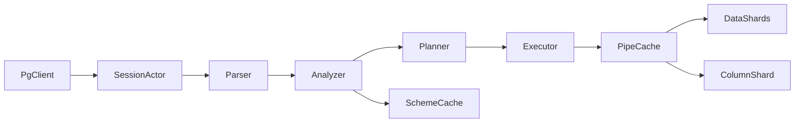

# PostgreSQL-протокол и SQL-сервис в YDB

Код сервиса: [`ydb/services/sql`](ydb/services/sql) (в дереве сервисы лежат во множественном числе). Сборка и старт по образцу Kafka: сырой TCP через [`ydb/core/raw_socket`](ydb/core/raw_socket), инициализатор рядом с `TKafkaProxyServiceInitializer` в [`ydb/core/driver_lib/run/kikimr_services_initializers.cpp`](ydb/core/driver_lib/run/kikimr_services_initializers.cpp). gRPC `AddService` для протокола не используется.

Ориентиры при реализации. Чужой код не подключается как библиотека и не линкуется. Код PostgreSQL можно копировать в `ydb/services/sql` и переписывать на C++. KQP не копируется.

- актуальный PostgreSQL (ветка 18): `src/backend/tcop`, `parser` (`scan.l`, `gram.y`), `optimizer/planmain.c`, `optimizer/path`, `optimizer/plan/createplan.c`, `executor/execMain.c`, `src/backend/libpq` (протокол)
- KQP только как карта поведения: scheme cache в [`kqp_table_resolver.cpp`](ydb/core/kqp/executer_actor/kqp_table_resolver.cpp), чтение в [`kqp_read_actor.cpp`](ydb/core/kqp/runtime/kqp_read_actor.cpp), запись через `TEvWrite`

Запрет: `PEERDIR` и вызовы `yql/` и `ydb/core/kqp/`. Вендоренный парсер в `yql/essentials/parser/pg_wrapper` не линкуем и не копируем.

Разбор SQL — перевод `scan.l` и `gram.y` на C++ в [`ydb/services/sql/parse`](ydb/services/sql/parse). Не bison, не ANTLR и не отдельная грамматика: правило `gram.y` становится методом, узел — структурой. Неподдержанное правило отвечает `0A000` там, где в `gram.y` оно начинается. Новый кусок грамматики копируется из `gram.y` тем коммитом, которому он нужен.

Вся логика сервиса и любые последующие исправления лежат в `ydb/services/sql`. Каталоги [`ydb/core/tx/datashard`](ydb/core/tx/datashard) и [`ydb/core/tx/columnshard`](ydb/core/tx/columnshard), их события и протобуфы не редактируются. Сервис вызывает уже существующие `TEvRead`, `TEvWrite` и сообщения columnshard. Если готового вызова не хватает, обход делается в сервисе либо запрос отвечает `0A000`. Подключение слушателя — `ya.make`, поле конфига и инициализатор рядом с Kafka — единственные правки вне нового каталога.

Изменения идут веткой `postgres-sql-service` форка [nshestakov/ydb](https://github.com/nshestakov/ydb), remote `fork` (`git@github.com:nshestakov/ydb.git`). Ветка отведена от `official/main`. В `official` (`git@github.com:ydb-platform/ydb.git`) ничего не пушится.

Каждый шаг — один небольшой коммит, который можно прочитать целиком: одна возможность и тесты на неё. Коммит без теста не делается. Грамматика, кодек и исполнитель наращиваются тем коммитом, которому они нужны, а не заранее на все операторы. Если в диффе две независимые возможности, он делится. Пока коммита нет, конструкция отвечает `0A000`.

Этот файл — согласованный план. Задачи для ИИ лежат отдельными файлами в [`ydb/services/sql/tasks`](ydb/services/sql/tasks), по файлу на коммит. В начале файла статус `pending` или `done`, поле `commit` пустое, пока коммита нет. Описание задачи читается без остального плана.

Перед каждым коммитом прогоняются все тесты поддержки PostgreSQL:

```bash
./ya make --build relwithdebinfo -tA ydb/services/sql ydb/tests/functional/sql
```

Коммит создаётся только если этот прогон зелёный. Результат команды проверяет тест сессии: `TSqlClient` в `ydb/services/sql/wire/ut/sql_client.h` шлёт текст в `CreateSqlSession` и читает `TEvExecuteResult` (тег, столбцы, ячейки, `SQLSTATE`). Сокет и кадры протокола такой тест не открывает. Протокол остаётся в `wire`: startup, каталог рукопожатия и позже extended. Старые тесты на `pg8000` не переписываются. Юнит кадра, парсера и кодека остаётся на C++ рядом с подмодулем. После коммита и выполнения задачи в её файле ставится `done` и хеш коммита. Правка отметки входит в следующий коммит. Отдельный коммит только ради отметки не делается.

Каталог `ydb/services/sql` делится на подмодули, у каждого свой `ya.make` и узкий `PEERDIR`. Новый код не дописывается в общий `sql.h` / `sql.cpp`. Файл — одна сущность. Актор лежит в своём `.cpp`: правка одного актора не пересобирает остальные. Заголовок, которому нужны только указатель или ссылка, подключает `fwd.h` модуля, а не его полный заголовок. Полный заголовок включает `.cpp`, который эту сущность реализует. Цикл включений разрывается предварительным объявлением.

Код, который не крутится на каждую строку, пишется через стратегию и виртуальные функции. Так устроены разбор команды, выбор пути плана, DDL, кодек типа и повтор вызова шарда: у каждого варианта свой класс с понятным именем, общий интерфейс — виртуальные методы. Вызов на одну строку или ячейку в чтении и записи остаётся прямым: там цена виртуального вызова уже сравнима с самой работой.

Подмодули, по мере коммитов, а не все сразу:

- `wire` — кадры протокола и слушатель
- `session` — выполнение текста и `TEvExecuteResult`, без кадра
- `parse` — лексер и дерево оператора
- `analyze` — привязка к scheme cache
- `codec` — тип шарда и формат протокола, по файлу на семейство типов
- `plan` — пути и выбор цены
- `exec` — чтение, запись, соединение, агрегация, каждый исполнитель в своём файле
- `ddl` — таблицы, индексы и последовательности: создание, изменение и удаление
- `tx` — commit на одном и на нескольких шардах
- `index` — выбор индекса и запись impl-таблицы
- `datashard` — только `TEvRead` и `TEvWrite` row-таблицы
- `columnshard` — только `TEvRead` и `TEvWrite` колоночной таблицы

Юнит кадра, парсера и кодека лежит рядом с подмодулем. Смена `plan` не пересобирает `wire`. Функциональный тест сервиса лежит в `ydb/tests/functional/sql` и не пересобирает эти юниты.

Клиент PostgreSQL в репозитории — библиотека [`contrib/python/pg8000`](contrib/python/pg8000) (`PY3_LIBRARY`, версия 1.31.5, `pg8000.dbapi`). Ею уже пользуется коннектор. Отдельной собранной libpq нет, а дерево `yql/essentials/parser/pg_wrapper` по-прежнему не линкуем. Обёртку `ydb/library/yql/providers/generic/connector/tests/utils/clients/postgresql.py` тоже не подключаем: она тянет код YQL.

Функциональный тест поднимает `ydbd` через `KiKiMR`, включает `SqlConfig` и ходит в слушатель `pg8000`: соединение, simple query, `SQLSTATE`, DDL и `SELECT`. Схему после DDL проверяет клиент кластера из `ydb.tests.library`, а не scheme cache из процесса C++-теста. `ya.make` теста — как у [`ydb/tests/functional/scheme_tests`](ydb/tests/functional/scheme_tests/ya.make): `PY3TEST`, `INCLUDE` [`harness_dep.inc`](ydb/tests/harness_dep.inc), `PEERDIR` на `ydb/tests/library` и `contrib/python/pg8000`. Автокоммит и `execute` без параметров, пока нет extended query.

Внутри сервиса данные хранятся в собственных структурах: строка, ячейка, буфер кадра, путь плана. Типы стандартной библиотеки остаются там, где своей структуры не нужно. На вызове `TEvRead`, `TEvWrite` и scheme cache значение переводится в тип, который уже требует событие.

Память и сеть учитываются в каждом коммите. Система распределённая: вызов шарда по сети дороже локальной работы со строкой, поэтому план выбирает путь с меньшим числом вызовов и меньшим числом шардов. В один вызов входят только нужные столбцы и суженный ключ или диапазон; ключи одного шарда собираются в один `TEvRead`, а не по вызову на строку. `TEvRead` ограничивает объём через уже существующие `MaxRows`, `MaxBytes` и `TotalRowsLimit`; продолжение читается по `TEvReadAck`, и каждый такой ответ тоже считается вызовом. На той же ноде строки остаются в локальном batch события до кадра протокола: собственная структура смотрит на эти байты без копии, копия появляется в исходящем буфере. Отдельный буфер на строку и повторная сериализация локального события не делаются.

В конфиг сервиса можно добавить опции этих пределов и цены: размер пачки чтения, потолок байт одного ответа шарда, размер буфера протокола, цена одного сетевого вызова, цена байта сети, цена строки CPU, число повторов на шард, общее число повторов и пауза между ними. Цена вызова по умолчанию заметно выше цены байта и строки. Смена не требует правки шардов.

Повторяется только ошибка, после которой тот же вызов ещё корректен. На чтении, как в акторе чтения KQP: `OVERLOADED` — снова, с `ThrottleDelayMs`, если шард его прислал; `INTERNAL_ERROR` — снова, пока не выбран предел повторов; `NOT_FOUND` и обрыв pipe — заново resolve этого шарда и повтор только его. `SCHEME_ERROR` план не повторяет: описание таблицы в кэше сбрасывается. `BAD_REQUEST`, отмена и нарушение ограничения не повторяются. Если часть шардов уже отдала строки без общего снимка, запрос целиком не перечитывается. Запись одного шарда `MODE_IMMEDIATE` повторяет `OVERLOADED` и `INTERNAL_ERROR`. У распределённой транзакции повтор одного участника после prepare остальных не делается: транзакция откатывается. Код повторов datashard и columnshard лежит в своих каталогах.



`ColumnShard` подключается в последнем срезе. До него analyzer отвечает `0A000` на колоночную таблицу.

Исполнение row-таблицы без MiniKQL. Resolve отдаёт список партиций, и запрос идёт на каждый затронутый datashard:

- путь и ключ: `TEvTxProxySchemeCache::TEvNavigateKeySet` и `TEvResolveKeySet` ([`scheme_cache.h`](ydb/core/tx/scheme_cache/scheme_cache.h)); у партиции есть tablet id и границы ключа
- чтение: по одному `TEvDataShard::TEvRead` / `TEvReadResult` на шард ([`datashard.h`](ydb/core/tx/datashard/datashard.h) около строки 1024), доставка `TEvPipeCache::TEvForward`, слияние строк в сервисе
- запись одного шарда: `NEvents::TDataEvents::TEvWrite` с `MODE_IMMEDIATE` ([`data_events.h`](ydb/core/tx/data_events/events.h))
- запись нескольких шардов: `MODE_VOLATILE_PREPARE` на каждого участника, затем `TKqpLocks.Op = Commit` с `SendingShards`, `ReceivingShards` и при необходимости `ArbiterShard` ([`data_events.proto`](ydb/core/protos/data_events.proto))

Данные идут в шард готовыми `TEvRead` и `TEvWrite`. Создание и изменение таблицы идут в schemeshard готовым `TEvTxUserProxy::TEvProposeTransaction` с `ESchemeOpCreateTable` или `ESchemeOpAlterTable`, без правки schemeshard. Колоночная таблица до своего среза в запросах данных — `0A000`. `CREATE TABLE` в первых DDL-коммитах создаёт row-таблицу.

## Типы

Кодек в `ydb/services/sql` переводит уже хранимый тип столбца в тип протокола PostgreSQL и обратно. Новых типов в datashard и columnshard не появляется. Столбец, которого нет в таблице ниже, даёт `0A000` до обращения к шарду. `NULL` — пустая ячейка optional, отдельным типом не считается.

В `CREATE TABLE` и `ALTER TABLE` тип столбца пишется именем PostgreSQL. Оно складывается в нижний регистр и выбирает ближайший тип YDB:

- `bool` → `Bool`
- `smallint` / `int2` → `Int16`
- `integer` / `int4` → `Int32`
- `bigint` / `int8` → `Int64`
- `real` / `float4` → `Float`
- `double precision` / `float8` → `Double`
- `text`, `varchar`, `char` → `Utf8`
- `bytea` → `String`
- `numeric(p, s)` при p от 1 до 35 → `Decimal(p, s)`; `numeric` без точности → `Decimal(22, 9)`, это `DECIMAL_PRECISION` и `DECIMAL_SCALE` в [`scheme_type_id.h`](ydb/public/lib/scheme_types/scheme_type_id.h)
- `uuid` → `Uuid`
- `json` → `Json`, `jsonb` → `JsonDocument`
- `date` → `Date64`
- `timestamp` и `timestamp(p)` → `Timestamp64`; `timestamp(0)` → `Datetime64`
- `interval` → `Interval64`

Для времени берут 64-битный тип: `Date64` для даты, `Datetime64` и `Timestamp64` для меток, `Interval64` для интервала. В типах шарда есть `Date` и `Date32`, типа `Date64` нет. Пока его нет, столбец `date` отвечает `0A000`, и тип в шард не добавляется. `"Date"` и `"Date32"` по-прежнему создают эти существующие типы. `timestamptz`, `time` и `timetz` тоже `0A000`. `DyNumber` не используется ни при создании столбца, ни в кодеке: уже лежащий столбец этого типа отвечает `0A000`.

Явный тип YDB задаётся идентификатором в двойных кавычках: `"Int8"`, `"Uint32"`, `"Date"`, `"Timestamp"`, `"String4k"`. Кавычки сохраняют имя, и в schemeshard уходит именно оно. Без кавычек `int8` — это `bigint` PostgreSQL, то есть `Int64`, а не однобайтовый `Int8`. Неизвестное имя — `0A000`, столбец не создаётся.

| Тип шарда | Тип PostgreSQL | Row | Column | Неполнота |
| --- | --- | --- | --- | --- |
| Bool | bool | да | да | в columnshard значение хранится как uint8, в протоколе остаётся bool |
| Int8 | int2 | да | да | в PostgreSQL нет однобайтового целого, на проводе int2 |
| Int16 | int2 | да | да | |
| Int32 | int4 | да | да | |
| Int64 | int8 | да | да | |
| Uint8 | int2 | да | да | диапазон 0..255, знак PostgreSQL не используется |
| Uint16 | int4 | да | да | диапазон 0..65535 |
| Uint32 | int8 | да | да | диапазон 0..4294967295 |
| Uint64 | numeric | да | да | в PostgreSQL нет uint8; значения выше 2^63−1 остаются в numeric |
| Float | float4 | да | да, не ключ | columnshard не принимает Float в первичном ключе |
| Double | float8 | да | да, не ключ | columnshard не принимает Double в первичном ключе |
| Utf8 | text | да | да | varchar(n) и char(n) не обрезаются и не дополняются пробелами: длина столбца не ограничена этим правилом |
| String | bytea | да | да | |
| String4k | bytea | да | да | не длиннее 4096 байт, ограничение уже у типа столбца |
| String2m | bytea | да | да | не длиннее 2 МиБ, ограничение уже у типа столбца |
| Decimal(p, s) | numeric(p, s) | да | да | p от 1 до 35, s от 0 до p; `numeric` без точности хранится как `Decimal(22, 9)`; NaN и Infinity не представляются |
| Uuid | uuid | да | да | |
| Date | date | да | да | дни uint16 от 1970-01-01, календарь 1970-01-01 .. 2105-12-31 |
| Date32 | date | да | да | дни int32, диапазон шире Date, включая даты до 1970 |
| Datetime | timestamp(0) | да | да | секунды от 1970-01-01, до 2105-12-31, без часового пояса |
| Datetime64 | timestamp(0) | да | да | секунды int64, диапазон шире Datetime, без часового пояса |
| Timestamp | timestamp | да | да | микросекунды от 1970-01-01, до 2105, без часового пояса |
| Timestamp64 | timestamp | да | да | микросекунды int64, диапазон шире Timestamp, без часового пояса |
| Interval | interval | да | да | только микросекунды int64; месяцы и дни интервала PostgreSQL отвергаются |
| Interval64 | interval | да | да | то же ограничение состава, диапазон микросекунд int64 |
| Json | json | да | да | текст JSON; операторов json в языке пока нет |
| JsonDocument | jsonb | да | да | текст совпадает с JSON, двоичный вид PostgreSQL jsonb не воспроизводится |

Пока не делаем, у шарда нет такого значения или нет честного типа PostgreSQL:

- `timestamptz`, `time`, `timetz`, `money`, `bit` / `varbit`, `xml`, массивы, составные, range, enum, геометрические и сетевые типы, `tsvector`
- столбец `NTypeIds::Pg`: это обёртка YQL, не отдельный тип ячейки, который мы вводим
- `Yson`, `ActorId`, `StepOrderId`, `PairUi64Ui64`, `DyNumber`
- `Date64`: имя для `date`, в scheme types его нет

`String4k` в columnshard проходит тем же стрелочным путём, что `String`. Ограничение длины остаётся правилом типа.

## Команды SQL

Закрытый список. Любая другая команда — `ErrorResponse`, SQLSTATE `0A000`, текст `not supported`, сессия остаётся. Пока коммита конкретной команды нет, она отвечает так же.

Делаем:

- `SELECT`, включая согласованные члены: `WHERE` (`AND`, `OR`, `NOT`, скобки, `IN` / `NOT IN` / `EXISTS` / `ANY` / `ALL` и сравнение с подзапросом), `LIMIT`, `INNER` / `LEFT` / `RIGHT` / `CROSS` / `FULL JOIN`, `ORDER BY`, `GROUP BY`, `HAVING`, `DISTINCT`, `UNION` / `INTERSECT` / `EXCEPT`, подзапрос, `WITH` / `WITH RECURSIVE`, окна, `OFFSET` / `FETCH`, `FOR UPDATE` на row-таблице
- `INSERT`, включая `ON CONFLICT`, `RETURNING` и, отдельным коммитом, `INSERT ... SELECT`
- `UPDATE` одной таблицы и `DELETE` одной таблицы, включая `RETURNING`
- `CREATE TABLE`
- `ALTER TABLE`
- `DROP TABLE`
- `CREATE INDEX` и `CREATE UNIQUE INDEX`
- `DROP INDEX`
- `CREATE SEQUENCE`
- `ALTER SEQUENCE`
- `DROP SEQUENCE`
- `CREATE SCHEMA`, `ALTER SCHEMA` и `DROP SCHEMA`
- `SELECT` из перечисленных ниже отношений `information_schema`
- `BEGIN` и `START TRANSACTION`
- `COMMIT` и `END`
- `ROLLBACK` и `ABORT`
- `SET` и `SHOW` параметров, которые сессия уже хранит
- `EXPLAIN` уже разобранного оператора: текст выбранного пути, без чтения шарда и без `EXPLAIN ANALYZE`
- `PREPARE`, `EXECUTE` и `DEALLOCATE`: оператор запоминается в сессии и выполняется отдельной командой
- `SELECT INTO`: новая row-таблица из результата `SELECT`, без выдачи строк клиенту

Не делаем, в том числе: `MERGE`, `TRUNCATE`, `COPY`, прочий `DROP` и `CREATE`, `CREATE VIEW`, `CREATE DATABASE`, `GRANT`, `REVOKE`, `VACUUM`, `ANALYZE`, `CALL`, `DO`, `LOCK`, `COMMENT`, `VALUES` и `TABLE` как отдельные команды. `WITH` относится только к `SELECT`. Функции, включая `nextval`, в список команд не входят и отвечают `0A000`. Отношение `information_schema`, которого нет в списке ниже, тоже `0A000`.

## Ограничения SQL

Поддержанный язык — подмножество синтаксиса PostgreSQL, законное для row-таблиц YDB. Всё прочее — `ErrorResponse`, SQLSTATE `0A000` (`feature_not_supported`), без падения сессии.

Первый срез языка:

- `SELECT` со списком колонок или `*`, `FROM` одной таблицы, `WHERE` из сравнений и `AND` по колонкам первичного ключа, необязательный `LIMIT`
- `INSERT` со списком колонок и константами, одна строка, необязательный `ON CONFLICT` по первичному ключу: `DO NOTHING` или `DO UPDATE SET`, необязательный `RETURNING` списка столбцов или `*`
- литералы, параметры `$1` в extended-протоколе позже
- идентификаторы без кавычек и в двойных кавычках

Синтаксис `SELECT` покрывается целиком, каждый следующий кусок — отдельный коммит. Пока коммита нет, конструкция отвечает `0A000`. Порядок коммитов `SELECT`: `WHERE` и `LIMIT`, затем по коммиту `INNER JOIN`, `LEFT JOIN`, `RIGHT JOIN`, `CROSS JOIN`, `FULL JOIN`, затем `ORDER BY`, `GROUP BY`, `HAVING`, затем остальные члены оператора. `SELECT FOR UPDATE` на колоночной таблице и `NOWAIT` остаются `0A000`: в готовых событиях шарда этого нет.

Явно unsupported, пока нет своего коммита: перечисленные члены `SELECT`, вторичные индексы, `UPDATE`, `DELETE`, `DROP`, `CREATE INDEX`, `SET`, `SHOW`, `COPY`, функции, `CREATE SCHEMA` / `ALTER SCHEMA` / `DROP SCHEMA`, `information_schema`, `pg_catalog` кроме фиксированного минимума для рукопожатия, колоночные таблицы. `CREATE TABLE` и `ALTER TABLE` поддержаны отдельными коммитами. Параметр или действие, которому нет поля в описании таблицы schemeshard, отвечает `0A000`, и схема не меняется. Неизвестный тип столбца — тоже `0A000`. Векторные, полнотекстовые, JSON и локальные индексы остаются `0A000`. Число datashard само по себе ошибкой не является.

## Планировщик

Те же стадии, что в PostgreSQL, свои структуры:

- parser: сырое дерево (аналог `RawStmt`)
- analyzer: привязка к схеме YDB, типы, отказ на несовместимом (аналог `Query`)
- rewriter: пустой проход, views позже
- planner: перебор путей и выбор дешёвого (аналог `RelOptInfo` / `Path` / `PlannedStmt`)
- executor: интерпретация плана

Пути первого среза и соответствие шарду:

- point lookup: равенство по полному PK, один шард, `TEvRead.Keys`
- prefix range: префикс PK, `TEvRead.Ranges` на каждую партицию, которую пересекает диапазон
- full scan: все партиции, высокая цена
- residual filter и project: в процессе сервиса только для того, что шард не принял. У row-datashard `TEvRead` поле `Program` отвергается текстом `PushDown is not supported`, поэтому в шард уходят ключ или диапазон, список столбцов, `Reverse` и пределы строк. У columnshard фильтр, проекция, `GROUP BY` и `DISTINCT`, которые помещаются в `TOlapProgram` ([`ssa.proto`](ydb/library/formats/arrow/protos/ssa.proto)), уходят в `OlapProgram` его `TEvRead`. Программу собирает каталог `columnshard`, без компилятора YQL. `ORDER BY` и `LIMIT` в этой программе нет.
- modify: строки группируются по шарду; один шард — `MODE_IMMEDIATE`, несколько — распределённый commit. Обычный `INSERT` — `OPERATION_INSERT`; `ON CONFLICT` — вставка или обновление найденной строки
- index scan: равенство или префикс по ключу вторичного индекса, чтение impl-таблицы и при необходимости основной; путь появляется в срезе индексов

Модель цены как в `costsize.c`: `startup_cost`, `total_cost`, оценка строк. Параметры под распределённую YDB: цена одного сетевого вызова шарда, байт сети, строка CPU. Вызов — это `TEvRead`, `TEvWrite` или следующий `TEvReadAck` на один шард, в том числе если таблетка оказалась на той же ноде. Число вызовов равно числу затронутых шардов плюс продолжения по `TEvReadAck`, а не числу строк. Число шардов и селективность по границам PK берутся из resolve. Поэтому точечное чтение одного шарда дешевле префикса через несколько партиций, а тот дешевле полного скана. Локальные фильтр, проекция и соединение не добавляют сетевой вызов. Перебор порядка соединений, как `standard_join_search`, включается коммитом `INNER JOIN`. До коммита конкретного вида соединения этот вид отвечает `0A000`.

Кеш планов на ноде — свой, внутри `ydb/services/sql`, один на ноду и общий для сессий этой ноды. Кеш компиляции KQP (`TKqpQueryCache` в `kqp_proxy_service`) устроен так же, но лежит в KQP и не вызывается. Ключ — путь базы, текст запроса и типы параметров, без значений параметров. В записи лежит разобранный оператор и выбранный вид пути, без списка таблеток и без строк данных. Границы партиций каждый раз берутся из scheme cache. Попадание сверяет версию схемы таблиц: версия другая — запись выбрасывается. `SCHEME_ERROR` тоже выбрасывает запись. Размер и TTL задаются в конфиге сервиса. Подготовленный оператор сессии может ссылаться на эту запись, но сам живёт в сессии.

На той же ноде уже есть и используются два чужих кеша. Scheme cache (`MakeSchemeCacheID`) держит описание пути, столбцы, индексы и границы партиций. Pipe cache (`MakePipePerNodeCacheID`) держит канал до таблетки и доставляет локальный вызов без повторного поиска узла. Кеш строк результата не делается.

## Подзадачи

Ниже технические границы. Там, где в пункте несколько возможностей, каждая названная возможность — свой коммит со своим тестом.

1. Каркас сервиса. Один коммит. Каталог `ydb/services/sql` с `ya.make` корня, который только собирает подмодули, `RECURSE` в [`ydb/services/ya.make`](ydb/services/ya.make), `PEERDIR` в [`ydb/core/driver_lib/run/ya.make`](ydb/core/driver_lib/run/ya.make). Первым подмодулем появляется `wire`. Конфиг в [`config.proto`](ydb/core/protos/config.proto): включение, адрес, порт (по умолчанию 5432). Инициализатор слушает сокет. В логах переиспользовать коды `PGWIRE` / `LOCAL_PGWIRE` из [`services.proto`](ydb/library/services/services.proto). Юнит на мини-кластере по образцу Kafka: [`test_client.cpp`](ydb/core/testlib/test_client.cpp) и `TServer`.

2. Сессия протокола 3.0, два коммита. Первый: StartupMessage, AuthenticationOk (trust), ParameterStatus (`server_version`, `client_encoding=UTF8`, `DateStyle`, `integer_datetimes`, `standard_conforming_strings`), BackendKeyData, ReadyForQuery; тест доходит до ReadyForQuery. Параметр `database` строки подключения — путь базы YDB, от него строятся пути каталогов и таблиц. Пустой или неизвестный путь не доводит сессию до ReadyForQuery. Кодировка сессии всегда UTF-8: `client_encoding` в ParameterStatus равен `UTF8`, другой кодировки нет. Второй: Simple Query `Q` отвечает `ErrorResponse` `0A000` и снова ReadyForQuery; Cancel и SSL request не роняют слушатель. Extended (`P`/`B`/`D`/`E`/`S`) до своего коммита тоже `0A000`.

3. Минимальный каталог для драйвера. Фиксированные ответы, которых хватает, чтобы `psql` дошёл до приглашения: `SELECT version()`, пустой или урезанный `pg_type` / `pg_catalog` запросы, которые шлёт libpq при старте. Список снимается с реального `psql` к PostgreSQL 18 и фиксируется тестом. Лишние каталоговые запросы — `0A000`.

4. Разбор, три коммита, без кластера там, где нет scheme cache. Лексер и грамматика — перевод `scan.l` и `gram.y` PostgreSQL 18 на C++. Первый коммит: `SELECT` списка столбцов и `FROM`. Второй: `WHERE` и `LIMIT`. Третий: analyzer резолвит путь через scheme cache и проверяет имена столбцов; тест на неизвестный столбец. Грамматика `INSERT`, `ON CONFLICT` и `RETURNING` приходит коммитами вставки. Индексы из `TIndexDescription` analyzer запоминает в коммите синхронного IndexScan: тип (`EIndexTypeGlobal`, `EIndexTypeGlobalAsync`, `EIndexTypeGlobalUnique`), состояние, ключевые и покрывающие колонки, путь impl-таблицы. Цель конфликта не по первичному ключу до коммита уникального индекса — `0A000`, несовпадение с ключом — SQLSTATE `42P10`. Незнакомая конструкция — `0A000` с текстом узла.

5. Планировщик среза. Построение путей point / prefix / full scan, выбор минимума `total_cost`, физический план: список партиций, ключ или диапазон на каждую, список column id, остаточный фильтр, проекция. В описании таблицы с самого начала есть вид хранения (row или column): column на этом шаге не получает путей и отвергается analyzer. Тесты планировщика без кластера: на фиктивной схеме с несколькими диапазонами ключа план выбирает point, а не full scan; диапазон через границу партиций перечисляет оба шарда.

5.1. `CREATE TABLE` и `ALTER TABLE`, синтаксис PostgreSQL, каждый коммит со своим тестом. Вызов — `TEvTxUserProxy::TEvProposeTransaction` ([`proxy.h`](ydb/core/tx/tx_proxy/proxy.h)), тело `TModifyScheme` ([`flat_scheme_op.proto`](ydb/core/protos/flat_scheme_op.proto)).

- `CREATE TABLE`: столбцы, тип именем PostgreSQL или явным типом YDB в кавычках, `PRIMARY KEY` в `KeyColumnNames`, `NULL` / `NOT NULL`, `DEFAULT` литералом в `DefaultFromLiteral`, `IF NOT EXISTS` через `FailOnExist`. Тест: `int8` создаёт `Int64`, `"Int8"` создаёт однобайтовый столбец, `timestamp` создаёт `Timestamp64`, таблица видна в scheme cache. `ALTER TABLE ADD COLUMN` принимает те же имена.
- `UNIQUE (...)`: отдельный коммит, индекс `EIndexTypeGlobalUnique` в `TableIndexes`. Тест: повтор ключа индекса даёт `23505` после коммита вставки.
- `ALTER TABLE ADD COLUMN` и `DROP COLUMN`: два коммита, `ESchemeOpAlterTable`, списки `Columns` и `DropColumns`.
- `ALTER COLUMN SET NOT NULL`, `DROP NOT NULL`, `SET DEFAULT`, `DROP DEFAULT`: один коммит, поля `NotNull` и `DefaultValue` столбца.
- Нет поля в `TTableDescription` или `TColumnDescription` — пункт отвечает `0A000` (`not supported`), propose в schemeshard не отправляется. Сюда входят `PARTITION BY`, `INHERITS`, `TABLESPACE`, `WITH`, `ON COMMIT`, `COLLATE`, `CHECK`, `REFERENCES`, `LIKE`, смена типа столбца, `RENAME`, `SET SCHEMA`. Тест: `CREATE TABLE ... PARTITION BY` и `CHECK` не создаёт таблицу. Исключение одно и позднее: `WITH (store = column)` в срезе колоночных таблиц.

5.2. `CREATE SEQUENCE` и `ALTER SEQUENCE`, два коммита в подмодуле `ddl`. В schemeshard это уже есть: `ESchemeOpCreateSequence` и `ESchemeOpAlterSequence`, описание `TSequenceDescription` в [`flat_scheme_op.proto`](ydb/core/protos/flat_scheme_op.proto). Тот же `TEvTxUserProxy::TEvProposeTransaction`. Sequence shard и schemeshard не меняются.

Поля, которые схема принимает: `DataType` (`Int16`, `Int32`, `Int64` — в синтаксисе `smallint`, `integer`, `bigint`, по умолчанию `bigint`), `Increment`, `MinValue`, `MaxValue`, `StartValue`, `Cache`, `Cycle`. `ALTER` дополнительно меняет тип и делает `RESTART` через `Restart` и `SetVal`. Проверка границ уже в `GetAlterSequenceDescription` и `FillSequenceDescription`.

`TEMPORARY`, `UNLOGGED` и `OWNED BY` в описании последовательности полей нет: эти пункты отвечают `0A000`, последовательность не создаётся и не меняется. Другой тип, кроме трёх целых, schemeshard отвергает: клиенту уходит ошибка схемы, не новый тип. Выдача следующего значения (`nextval`) в эти коммиты не входит.

5.3. Остальные согласованные команды схемы и сессии, каждая своим коммитом и тестом. Тот же propose в schemeshard, код schemeshard не меняется.

- `DROP TABLE`: `ESchemeOpDropTable`, тело `TDrop`. `IF EXISTS` при отсутствии пути завершает команду без ошибки.
- `DROP SEQUENCE`: `ESchemeOpDropSequence`, то же правило `IF EXISTS`.
- `CREATE INDEX` и `CREATE UNIQUE INDEX`: `ESchemeOpCreateTableIndex` и `TIndexCreationConfig`. Обычный индекс — `EIndexTypeGlobal`, уникальный — `EIndexTypeGlobalUnique`. `INCLUDE` пишет покрывающие столбцы в `DataColumnNames`. `CONCURRENTLY`, `TABLESPACE`, `USING` и `WHERE` у индекса отвечают `0A000`, индекс не создаётся. Асинхронный индекс этой командой не создаётся.
- `DROP INDEX`: путь индекса находится через scheme cache, затем `ESchemeOpDropTableIndex` и `TDropIndex`.
- `UPDATE` и `DELETE`, два коммита после чтения и транзакций: одна таблица, `WHERE` как у `SELECT`, `SET` литералом или столбцом той же строки. Запись — `OPERATION_UPDATE` и `OPERATION_DELETE`. Несколько шардов идут коммитом распределённой транзакции. `FROM` другой таблицы и присваивание сложнее литерала или столбца — `0A000`. Таблица с синхронным или уникальным синхронным индексом на этих коммитах — `0A000`: KQP пишет такой индекс в той же физической программе, что и основную таблицу (`ItUsedForWrite` для `GlobalSync` и `GlobalSyncUnique`). Асинхронный индекс сервис не пишет, таблица только с ним принимается.
- `RETURNING` у `UPDATE` и `DELETE` — отдельный коммит, тот же протокол, что у `INSERT RETURNING`.
- `SET` и `SHOW` — один коммит. Меняются и показываются параметры, которые сессия уже хранит после рукопожатия (`DateStyle`, `TimeZone`, `standard_conforming_strings`). `SHOW client_encoding` возвращает `UTF8`. `SET client_encoding` в другое значение — `0A000`, кодировка остаётся UTF-8. Неизвестный параметр и `SET TRANSACTION` — `0A000`. `search_path` в этом коммите нет.

5.4. `CREATE SCHEMA`, `DROP SCHEMA` и `ALTER SCHEMA`. Схема PostgreSQL — один каталог непосредственно под корнем базы YDB. `CREATE SCHEMA app` создаёт путь `<база>/app`. Имя `app.t` — путь `<база>/app/t`. Имя без схемы — объект в корне базы. Вложенный каталог схемой не является. `information_schema` и `pg_catalog` каталогами не создаются.

- `CREATE SCHEMA`: `ESchemeOpMkDir`, тело `TMkDir`, `WorkingDir` — корень базы. Без `IF NOT EXISTS` ставится `FailOnExist`, повторное имя — ошибка схемы. С `IF NOT EXISTS` существующий каталог принимается. `AUTHORIZATION` и объекты внутри команды (`CREATE TABLE` в теле `CREATE SCHEMA`) полей у `TMkDir` не имеют: `0A000`, каталог не создаётся. Тест: после команды каталог виден в scheme cache, а `CREATE SCHEMA ... CREATE TABLE` каталог не создаёт.
- `DROP SCHEMA`: `ESchemeOpRmDir`, тело `TDrop`. Schemeshard отклоняет непустой каталог (`NotChildren`). Поэтому `CASCADE` — `0A000`, каталог и его объекты остаются. Пустой каталог удаляется; это и есть поведение `RESTRICT`. `IF EXISTS` при отсутствии пути завершает команду без ошибки.
- `ALTER SCHEMA`: у каталога нет операции переименования (`ESchemeOpMoveTable` каталог не переносит) и нет смены владельца. `RENAME TO` и `OWNER TO` отвечают `0A000`, propose не отправляется. Тест: имя каталога после `ALTER SCHEMA ... RENAME TO` прежнее.

5.5. `information_schema`, отдельные коммиты после того, как `SELECT` уже умеет вернуть `DataRow`. Это не каталог в базе и не запись в шард. Планировщик узнаёт отношение и берёт метаданные из того готового источника, где уже есть нужные поля: scheme cache, системное представление или другой существующий вызов. Источник выбирается в коммите отношения. Scheme cache не обязателен. В запрос попадает один каталог, если `schema_name` в `WHERE` — равенство константе. Обход всей базы и чтение описаний, которые запросу не нужны, не делаются. Запись в `information_schema` — `0A000`.

Имена отношений и столбцы, которые отдаём. Лишнего столбца нет: неизвестный столбец — `0A000`.

- `schemata`: `catalog_name` (имя базы), `schema_name` (имя каталога среди прямых детей корня). `schema_owner` отдаётся, только если выбранный источник уже содержит владельца. Если владельца нет ни в одном источнике, столбца нет.
- `tables`: `table_catalog`, `table_schema`, `table_name`, `table_type`. Строка есть у `KindTable` и `KindColumnTable`, `table_type` у обеих — `BASE TABLE`. Объект в корне базы имеет пустой `table_schema`: схемы `public` нет, пока такой каталог не создан. Индексы, последовательности, топики и прочие виды детей в это отношение не входят.
- `columns`: `table_catalog`, `table_schema`, `table_name`, `column_name`, `ordinal_position`, `data_type` (имя из таблицы соответствия типов), `is_nullable`, `column_default`. `column_default` — текст литерала из `DefaultFromLiteral`. Значение из последовательности полем выражения не является, поэтому `column_default` для него пустой.
- `table_constraints` и `key_column_usage` — один коммит. Ограничения: первичный ключ (`PRIMARY KEY`, показываемое имя `<таблица>_pkey`, в схеме такого имени нет) и уникальный индекс (`UNIQUE`, имя индекса). Столбцы: `constraint_catalog`, `constraint_schema`, `constraint_name`, `table_name`, `constraint_type`; у `key_column_usage` ещё `column_name` и `ordinal_position`. `CHECK` и внешний ключ не хранятся, строк для них нет.
- `sequences`: `sequence_catalog`, `sequence_schema`, `sequence_name`, `data_type`, `numeric_precision`, `start_value`, `minimum_value`, `maximum_value`, `increment`, `cycle_option`. Это поля описания последовательности. Текущее значение последовательности сюда не входит.

Любое другое отношение `information_schema` (`views`, `routines`, `triggers`, `check_constraints`, `referential_constraints`, `*_privileges` и остальные) — `0A000`. Права YDB в привилегии PostgreSQL не переводятся.

6. Чтение, после отдельных коммитов кодека (целые и bool, text и bytea, дата и интервал, decimal, uuid, json; каждый со своим юнитом text и binary). Затем два коммита исполнения. Первый: точечный `SELECT` одного шарда, `TEvRead`, DataRow, CommandComplete `SELECT n`. Второй: `WHERE` из сравнений и `AND`, остаток предиката в сервисе, `LIMIT` после слияния, параллельный `TEvRead` на каждый шард диапазона. `OR` в ключ не пушится. Сравнение без ограничения ключа — `0A000`, пока полный скан выключен флагом. Столбец вне таблицы типов — `0A000` до похода в шард. Тест второго коммита: таблица на двух datashard, `WHERE` по префиксу и `LIMIT` возвращает строки с обоих, не больше предела.

Снимок — как `NeedSnapshot` в KQP, без актора KQP. Одна фаза чтения, даже если у таблицы несколько шардов, снимок не берёт: лишний вызов `long_tx_service` дороже, чем расхождение однофазного чтения. Вторая фаза в том же операторе или в открытой транзакции (соединение, подзапрос, `INSERT ... SELECT`, следующий `SELECT` после первого) берёт один MVCC-снимок: `TEvLongTxService::TEvAcquireReadSnapshot` на идентификаторы таблиц, в ответе `Step` и `TxId`. Эти два числа пишутся в `Snapshot` каждого `TEvRead` этой транзакции. Повторно снимок не запрашивается, пока он ещё держится. Чтение колоночной таблицы берёт снимок всегда, как OLAP-чтение в KQP. Менеджер снимков KQP не вызывается.

6.1. `EXPLAIN`. Один коммит после того, как планировщик уже выбирает путь. Ответ — один столбец `QUERY PLAN` типа text. Оператор не выполняется: шард не читается и не пишется, схема не меняется. Для `SELECT` строка плана называет форму (`Keys` или `Ranges`), число шардов, остаток предиката в сервисе и `LIMIT`, если он есть. `EXPLAIN` команды, которая сама отвечает `0A000`, тоже `0A000`: план не строится. `EXPLAIN ANALYZE` — `0A000`.

6.2. `PREPARE`. Один коммит. `PREPARE имя AS оператор` разбирает оператор и запоминает его в сессии, не выполняя: шард не читается и не пишется, схема не меняется. CommandComplete `PREPARE`. Оператор, который сам отвечает `0A000`, не запоминается. Список типов в скобках — `0A000`, оператор не запоминается. Повтор имени — SQLSTATE `42P05`, старый оператор остаётся. `EXECUTE имя` и `EXECUTE имя (литералы)` выполняют запомненное; литералы подставляются в `$1`, `$2`, … Неизвестное имя, лишний или пропущенный параметр — `26000` и `22023`, как у extended. `DEALLOCATE имя`, `DEALLOCATE PREPARE имя` и `DEALLOCATE ALL` снимают операторы. Подготовленный оператор переживает `COMMIT` и `ROLLBACK`. Это не кадр `Parse` протокола.

6.3. `SELECT INTO`. Один коммит. `SELECT список INTO имя FROM ...` создаёт новую row-таблицу и заполняет её результатом того же `SELECT`, который сессия уже умеет выполнять. Строки клиенту не отправляются, CommandComplete `SELECT n`. Столбцы и типы берутся из списка выборки; имя столбца — метка `AS`, иначе имя столбца источника. Первичный ключ новой таблицы — первичный ключ источника, если он целиком входит в список выборки и идёт в том же порядке. Иначе `0A000`: у `TTableDescription` нет таблицы без `KeyColumnNames`, propose не отправляется. Повтор имени — `42P07`, исходная таблица не меняется. Чтение и запись идут одним снимком, как `INSERT ... SELECT`. `TEMPORARY`, `UNLOGGED`, `INTO TABLE` и `SELECT INTO` внутри `BEGIN` — `0A000`, таблица не создаётся. `CREATE TABLE AS` этим коммитом не делается.

6.4. `OR`, `NOT` и скобки в `WHERE`. `AND` и сравнение столбца с литералом уже есть. Один коммит добавляет `OR`, `NOT` и скобки. Логика трёхзначная, как в PostgreSQL: сравнение с `NULL` неизвестно, неизвестное в `WHERE` строку не пропускает. `OR` в один ключ не сливается. Каждая ветка `OR` читается отдельно, если у неё есть своё ограничение ключа, затем строки объединяются по первичному ключу. Ветка без ограничения ключа — `0A000`, пока полный скан выключен, и шард не читается. `NOT` — остаточный фильтр поверх чтения, у которого ключ всё ещё ограничен. `NOT` без такого ключа — `0A000`.

6.5. Подзапрос в `WHERE`. Один коммит, формы PostgreSQL: `IN`, `NOT IN`, `EXISTS`, `NOT EXISTS`, `оператор ANY` / `SOME`, `оператор ALL` и сравнение со скалярным подзапросом. Список литералов `IN (1, 2)` — тот же предикат, без второго чтения. Подзапрос без ссылки на внешний запрос выполняется один раз. Коррелированный видит столбцы внешнего запроса. На обе таблицы один снимок. `NULL` в `NOT IN` и `ALL` даёт неизвестно, строка не проходит. Скаляр из нескольких строк — `21000`. Больше одного столбца у скаляра и несовпадение числа столбцов в `IN` — `42601`.

7. Вставка, три коммита. Первый — `INSERT` одной строки: шард выбирается по первичному ключу, `TEvWrite` `MODE_IMMEDIATE` `OPERATION_INSERT`. Повтор ключа — `STATUS_CONSTRAINT_VIOLATION`, клиенту SQLSTATE `23505`, строка не меняется. CommandComplete `INSERT 0 1`.

Второй коммит — `ON CONFLICT` по столбцам первичного ключа, ориентир — `src/backend/parser/gram.y` и исполнитель `nodeModifyTable` в PostgreSQL 18:

- прочитать строку по ключу
- строки нет: `OPERATION_INSERT` всей предлагаемой строки
- строка есть и `DO NOTHING`: ничего не писать, в CommandComplete эта строка не считается
- строка есть и `DO UPDATE`: `OPERATION_UPDATE` только столбцов из `SET` у найденного первичного ключа; `EXCLUDED.столбец` — значение из предлагаемой строки. `WHERE` ложен — как `DO NOTHING`
- гонка «прочитали пусто, параллельная вставка»: для `DO NOTHING` повторный `23505` считается пропуском; для `DO UPDATE` повторить чтение и обновление
- присваивание не литералом и не `EXCLUDED`, цель конфликта не по первичному ключу — `0A000` до своего среза

Третий коммит — `RETURNING`, ориентир — `QueryReturnList` в PostgreSQL 18. Без него ответ — только CommandComplete. Со списком столбцов или `*` протокол как у `SELECT`: RowDescription, DataRow затронутых строк, CommandComplete `INSERT 0 n`.

- в образ строки входят заданные в `INSERT` значения; неперечисленные столбцы — `NULL` или константное значение по умолчанию из схемы. Выражение по умолчанию — `0A000`
- `DO UPDATE`: в DataRow строка после присваивания, неперечисленные в `SET` столбцы остаются прежними
- `DO NOTHING` и ложный `WHERE`: DataRow нет, строка в `n` не входит
- имя в RowDescription — метка `AS`, иначе имя столбца
- выражение в списке `RETURNING` сложнее ссылки на столбец — `0A000`

Несколько строк в одном операторе, если они попадают на разные шарды, ждут среза распределённой записи. Таблица с синхронным индексом в состоянии `Ready` или `WriteOnly` на этом шаге тоже `0A000`: запись без обновления impl-таблицы оставила бы индекс дырявым. Таблица только с асинхронным индексом вставку принимает: datashard сам собирает изменение.

`INSERT ... SELECT` — отдельный коммит после чтения и вставки. До него оператор отвечает `0A000`. Это две фазы, поэтому перед записью берётся один снимок, как у KQP, где чтение и `MODE_INSERT` вместе дают больше одной фазы. Строки результата `SELECT` группируются по шарду и пишутся тем же `OPERATION_INSERT`.

8. Extended query. Parse/Bind/Describe/Execute/Sync/Close для того же подмножества, порталы, параметры `$n`, форматы text и binary для типов среза. Кэш подготовленных выражений в сессии. Ошибка одного портала не рвёт соединение: Sync возвращает ReadyForQuery.

9. Транзакции, два коммита. Первый: `BEGIN` / `COMMIT` / `ROLLBACK` на одном шарде, неявный commit простого запроса как в PostgreSQL, тест отката. Второй: несколько шардов. Поведение commit берём из менеджера транзакций KQP, код KQP не линкуем.

- один шард и нет незакрытых блокировок: `MODE_IMMEDIATE`
- несколько шардов: на каждого участника `MODE_VOLATILE_PREPARE`, затем запись с `TKqpLocks.Op = Commit`, списками `SendingShards` и `ReceivingShards`; при пяти и более пишущих шардах выбирается `ArbiterShard`, как в volatile-транзакции
- `ROLLBACK` — тот же список с `Op = Rollback`
- `INSERT` нескольких строк группирует их по шарду и идёт этим же путём
- чтение внутри явной транзакции берёт блокировки и участвует в том же commit, чтобы повторное чтение в транзакции видело свою запись

Тест: две строки `INSERT` на два шарда видны одним `SELECT`; `ROLLBACK` не оставляет ни одной.

10. Индексы, пять коммитов. Ориентир планировщика — index scan в PostgreSQL (`indxpath.c`). Ориентир записи — KQP: синхронный индекс пишется вместе с основной таблицей, асинхронный напрямую не пишется. Код KQP не линкуется. Коммиты: IndexScan синхронного индекса; IndexScan асинхронного, с тестом чтения после догона; `INSERT`, который пишет impl-таблицу синхронного индекса; `UPDATE` и `DELETE`, которые пишут ту же impl-таблицу; `ON CONFLICT` по уникальному индексу.

Чтение, оба типа, только состояние `Ready`:

- путь `IndexScan`, если предикат задаёт равенство или префикс ключа индекса и этот префикс длиннее, чем префикс PK
- чтение impl-таблицы через `TEvRead`, затем точечное чтение основной таблицы по PK из найденных строк
- если список `SELECT` покрыт ключом индекса и `DataColumnNames`, второе чтение не нужно (аналог index-only scan)
- цена: старт impl-шардов плюс, если нет покрытия, старт шардов основной таблицы
- среди подходящих индексов берётся минимум `total_cost`; PK-путь остаётся кандидатом
- асинхронный индекс в том же переборе. Чтение по нему допускает отставание: datashard догоняет impl-таблицу через `TAsyncIndexChangeCollector` и `CreateAsyncIndexChangeSender`, не в этой операции
- `WriteOnly` и прочие состояния в перебор не входят

Запись:

- синхронный (`EIndexTypeGlobal`) и уникальный синхронный (`EIndexTypeGlobalUnique`): строка основной таблицы и строки impl-таблиц в одной транзакции среза 9, даже если это разные шарды. Так же KQP собирает эффект индекса в той же программе, что и изменение таблицы. Обычный `INSERT` при занятом ключе уникального индекса — `23505`. `UPDATE` и `DELETE` такой таблицы до коммита их индексной записи остаются `0A000`; этот коммит удаляет старый ключ индекса, если изменились его столбцы, и пишет новый, как `KqpBuildUpdateIndexStages` и удаление индексных строк в KQP
- `ON CONFLICT` по ключу уникального синхронного индекса: найти существующую строку через impl-таблицу. `DO NOTHING` пропускает её. `DO UPDATE` обновляет найденную строку по её первичному ключу, а не вставляет предлагаемый ключ, и так же правит impl-таблицы затронутых синхронных индексов. Асинхронный индекс целью конфликта не бывает: он не уникален
- асинхронный (`EIndexTypeGlobalAsync`): и при `INSERT`, и при `UPDATE`, и при `DELETE` пишется только основная таблица. `ItUsedForWrite` для него ложен, impl-таблицу обновляет datashard

Векторный, полнотекстовый, JSON и локальные индексы — `0A000`. Тесты: `SELECT` по синхронному и асинхронному индексу выбирает `IndexScan`; `INSERT` в таблицу с синхронным индексом виден через индекс сразу, с асинхронным — после применения изменения.

11. Коммит `INNER JOIN`. Два входа — две фазы чтения, поэтому сначала один снимок на обе таблицы. Пути nested loop и hash join по образцу `joinpath.c`, перебор порядка соединений. Исполнение в сервисе: каждый вход читается через `TEvRead`, соединение локально. На шард уходит только чтение колонок и диапазон ключа. `ON` — равенство столбцов. Nested loop не делает вызов на каждую внешнюю строку: ключи внутреннего входа группируются по шарду и уходят одним `TEvRead`. Hash join читает каждый вход один раз. План с большим числом вызовов проигрывает плану, который читает каждый затронутый шард один раз. Остальные виды соединения в этом коммите — `0A000`.

12. Коммит `LEFT JOIN`. Сохраняет строки левого входа, для несовпадения дополняет правые столбцы `NULL`.

13. Коммит `RIGHT JOIN`. Сохраняет строки правого входа. Планировщик может поменять входы местами и свести к левому соединению.

14. Коммит `CROSS JOIN`. Произведение входов без предиката соединения. Запись `FROM a, b` разбирается здесь же.

15. Коммит `FULL JOIN`. Сохраняет несовпавшие строки обеих сторон, недостающие столбцы — `NULL`.

16. Коммит `ORDER BY`. Сортировка в сервисе после соединения и фильтра. Если ключ сортировки — первичный ключ, чтение шарда идёт с `TEvRead.Reverse` вместо отдельной сортировки. `ASC` / `DESC` и `NULLS FIRST` / `NULLS LAST`.

17. Коммит `GROUP BY`. Функции среза: `count`, `sum`, `min`, `max`. Для колоночной таблицы команда `GroupBy` из `TOlapProgram` считается в columnshard, если агрегат покрыт программой. Для row-таблицы шард только читает строки, агрегат считается в сервисе: datashard такую программу не принимает. Другие агрегаты отвечают `0A000`. Соединение не по равенству — тоже `0A000`.

18. Коммит `HAVING`. Фильтр по результатам агрегации, тем же языком сравнений, что и `WHERE`.

19. Остальной синтаксис `SELECT`, каждый член своим коммитом и тестом, в этом порядке: `DISTINCT` и `DISTINCT ON`; `UNION` и `UNION ALL`; `INTERSECT`; `EXCEPT`; подзапрос в `FROM` и списке выборки; `WITH`; `WITH RECURSIVE`; оконные функции `OVER`; `OFFSET` и `FETCH`. Предикат-подзапрос в `WHERE` — отдельный коммит 6.5, не этот. До своего коммита член отвечает `0A000`.

20. Коммит `FOR UPDATE` / `FOR NO KEY UPDATE` / `FOR SHARE` / `FOR KEY SHARE` только для row-таблицы. Блокировка берётся готовыми полями datashard: `TEvRead.LockMode` (`PESSIMISTIC_EXCLUSIVE`, `PESSIMISTIC_EXCLUSIVE_NO_KEY`, `PESSIMISTIC_SHARED`, `PESSIMISTIC_SHARED_KEY`) либо `TEvLockRows`, в том числе `SkipLocked`. События шарда не меняются. `NOWAIT` в этих событиях нет — `0A000`. У `TEvRead` columnshard нет режима блокировки — `FOR UPDATE` по колоночной таблице `0A000`.

21. Колоночные таблицы после рабочего row-пути. Создание — отдельный коммит: `CREATE TABLE ... WITH (store = column)` идёт в `ESchemeOpCreateColumnTable`, как KQP по настройке `storeType = column`. Другие ключи `WITH` по-прежнему `0A000`, и таблица не создаётся. `CREATE TABLE` без этого ключа создаёт row-таблицу. `ALTER TABLE` уже существующей колоночной таблицы ходит в `ESchemeOpAlterColumnTable`: добавить и удалить столбец. Scheme cache отличает column table. Планировщик добавляет `ColumnScan` в коммите чтения: границы первичного ключа, проекция колонок, цена по числу columnshard-таблеток. Исполнение напрямую в columnshard, без `TEvKqpScan` и без SSA-программы YQL. Дальше отдельные коммиты чтения, вставки, `UPDATE` и `DELETE`:

- чтение: `TEvRead` из [`tx_columnshard.proto`](ydb/core/protos/tx_columnshard.proto) (`ColumnIds`, `GreaterPredicate` / `LessPredicate`, `OlapProgram`). Фильтр, проекция, группировка и `DISTINCT`, которые есть в `TOlapProgram`, считаются в columnshard. Остаток считается в сервисе. Результат — батчи, которые сервис форматирует в DataRow
- запись: `TEvWrite` columnshard с arrow-батчем одной или нескольких строк. `UPDATE` и `DELETE` — свои коммиты, операции `OPERATION_UPDATE` и `OPERATION_DELETE` того же события. Таблица с синхронным индексом на этих коммитах — `0A000`, пока запись индекса не входит в ту же транзакцию
- транзакции columnshard (write id и commit) — отдельные шаги внутри этого среза; до них `BEGIN` на колоночной таблице отвечает `0A000`

Код вызова datashard и код вызова columnshard не смешиваются. У каждого свой каталог, свои файлы событий и свой исполнитель. Общая часть — только план, который выбирает один из двух путей, и формат строки протокола после ответа шарда. Ветка `if` по виду таблицы внутри одного читателя не пишется.

Ориентир поведения — чтение и запись columnshard в KQP, код KQP не линкуется. У каждого из двух коммитов свой тест на мини-кластере с columnshard.

Протокольный тест — сокетный клиент на `TServer`. Планировщик и кодек — юнит без кластера. Чтение и запись — таблица на datashard или columnshard. Коммит и его тест попадают в дерево вместе.
